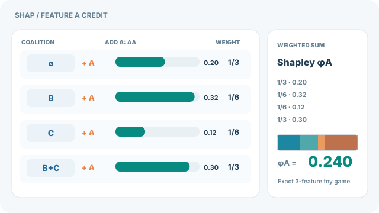

# SHAP

!!! info "Part of Feature attribution"
    This method page belongs to [Feature attribution](feature-attribution.md). It explains the method in detail; the overview compares it with the other methods.

SHAP (SHapley Additive exPlanations) explains a prediction by giving each feature a credit equal to its Shapley value from cooperative game theory. Lundberg and Lee (2017) proposed it as a unified framework: they show that several earlier explanation methods are special cases of the same additive form.

## Problem

Explanation methods disagree with each other, and it is hard to say which one is right. The problem is to find a single definition of feature importance that has a clear meaning and that the existing methods can be compared against.

## Core idea

Treat the features as players in a game whose payoff is the model's prediction when only a subset of features is known. A feature's Shapley value is its average marginal contribution across all subsets. SHAP uses these values as the explanation.

## Equation

For feature set $N$ and a value function $v(S)$, the expected model output when only the features in $S$ are known, the Shapley value of feature $i$ is

$$
\phi_i = \sum_{S \subseteq N \setminus \{i\}} \frac{|S|!\,(|N|-|S|-1)!}{|N|!}\,\bigl[v(S \cup \{i\}) - v(S)\bigr].
$$

The explanation for a prediction is $f(x) = \phi_0 + \sum_i \phi_i$, where $\phi_0$ is the expected output over the background data.

## Animated walkthrough

  

    
  

[Open the continuous SVG animation](../../assets/concept-animations/shap-coalition-marginals-motion.svg) · [View the GitHub-safe static figure](../../assets/concept-animations/shap-coalition-marginals-still.svg).

Each row fixes a coalition $S$ **without feature A** and shows the marginal gain $v(S\cup\{A\})-v(S)$ when A is added. The animation fills each bar, then grows the **weighted sum** at right. This is not a causal intervention or a temporal model-inference sequence: coalition order is only an aid to the Shapley accounting. On the MkDocs site, use **Play / Pause** (Tab, Enter or Space); on narrow screens, the diagram scrolls horizontally. The fallback is a complete, readable table even without animation.

The explicitly **synthetic three-feature value function** is $v(S)=0.10+0.20A+0.12B+0.08C+0.12AB-0.08AC+0.05BC+0.06ABC$, where each uppercase feature indicator equals one when that feature is present in $S$. The four A-marginal contributions for $S=\varnothing,\{B\},\{C\},\{B,C\}$ are $(0.20,0.32,0.12,0.30)$. Their exact Shapley weights are $(1/3,1/6,1/6,1/3)$, giving

$
\phi_A=\frac{0.20}{3}+\frac{0.32}{6}+\frac{0.12}{6}+\frac{0.30}{3}=0.240.
$

The displayed numbers are **exact for this constructed game**, not SHAP estimates from a measured model. Real attributions depend on the chosen background/value function, and coalition evaluation can be expensive; see [Lundberg and Lee (2017)](https://arxiv.org/abs/1705.07874).

*Original instructional artwork, CC BY-SA 4.0.*

## Results

Lundberg and Lee show that their class of additive feature attribution methods unifies six existing methods: LIME, DeepLIFT, layer-wise relevance propagation, Shapley regression values, Shapley sampling values and quantitative input influence. Each of these uses an explanation model of the same linear form. The paper's claims concern this unification and the properties the resulting measures have. They do not establish that SHAP values are correct explanations of every model.

## Limitations

- **Cost.** The exact sum has exponentially many terms, so practical versions approximate it, and the approximation must be checked.
- **Background choice.** Shapley values depend on the reference distribution used to fill in missing features.
- **Correlated features.** Evaluating unlikely combinations of features can credit a feature that the model does not use.
- **Causal reading.** A large value shows what the output depends on, not what causes the outcome.

## Connections

SHAP sits within [feature attribution](feature-attribution.md), next to [LIME](lime.md), [saliency maps](saliency-maps.md) and [integrated gradients](integrated-gradients.md). Its use of Shapley values comes from cooperative game theory, which is also the basis of many fair-allocation ideas in [ethics and fairness](../ethics/index.md). Unlike the gradient methods, SHAP does not need gradients, so it applies to tabular models and to models that are not differentiable.

## Applications

- Explaining predictions of credit, risk and clinical models to analysts who must check them.
- Ranking features across a dataset by their average absolute Shapley value, as a global summary.
- Auditing a model for dependence on a sensitive attribute, with the limits described above.

## Open questions

- How should the background distribution be chosen when features are strongly correlated?
- When do approximate Shapley values differ enough from exact ones to change the explanation?
- Do Shapley-based explanations help people make better decisions, not only feel more confident?

## References

### Seminal papers

- Lundberg, S. M. & Lee, S.-I. (2017). A Unified Approach to Interpreting Model Predictions. *Advances in Neural Information Processing Systems 30*. https://arxiv.org/abs/1705.07874 — Introduces SHAP and shows that six existing methods are special cases of one additive form.
- Štrumbelj, E. & Kononenko, I. (2014). Explaining prediction models and individual predictions with feature contributions. *Knowledge and Information Systems*, 41(3), 647–665. https://doi.org/10.1007/s10115-013-0679-x — Uses Shapley values to explain individual predictions of general models.
- Ribeiro, M. T., Singh, S. & Guestrin, C. (2016). "Why Should I Trust You?": Explaining the Predictions of Any Classifier. *Proceedings of KDD 2016*. https://arxiv.org/abs/1602.04938 — LIME, the local surrogate method that SHAP unifies with other additive methods.

### Surveys and textbooks

- Sundararajan, M., Taly, A. & Yan, Q. (2017). Axiomatic Attribution for Deep Networks. *Proceedings of ICML 2017*. https://arxiv.org/abs/1703.01365 — Integrated gradients, a neural-network attribution method that SHAP's framework also covers.
- Adebayo, J. et al. (2018). Sanity Checks for Saliency Maps. *Advances in Neural Information Processing Systems 31*. https://arxiv.org/abs/1810.03292 — Shows that some attribution maps fail basic tests, a caution that applies to any explanation method.

## Further learning

- Molnar, C. *Interpretable Machine Learning: A Guide for Making Black Box Models Explainable*, 3rd edition. [Free online book](https://christophm.github.io/interpretable-ml-book/), with a chapter on Shapley values and SHAP.
