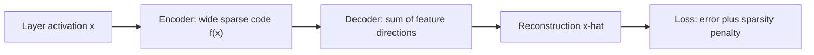

# Sparse autoencoders and feature dictionaries

A sparse autoencoder is a network trained to rebuild a model's internal activations from a wide code in which only a few entries are active for any input. Each entry, or feature, is meant to match one recognisable concept, so the learned set works as a dictionary for reading what the model represents.

## Overview

A layer of a neural network is hard to read directly. Its neurons usually respond to many unrelated things, the polysemanticity problem described in [Mechanistic interpretability and circuits](mechanistic-interpretability.md). One explanation is superposition: the network packs more concepts than it has neurons into nearly orthogonal directions. If so, the natural units are directions rather than neurons, and the task is to find them.

Sparse autoencoders (SAEs) try to find those directions without labels. Cunningham et al. (2023) reported features more interpretable than those from alternative methods. The idea descends from sparse coding of natural images, see [Sparse coding](../../brain-mind/computational-neuroscience/sparse-coding/index.md), and from dictionary learning (Mairal et al., 2009).

## Key concepts

- **Activation**: the vector a layer produces for one token. An SAE takes activations as input.
- **Overcomplete dictionary**: a set of feature directions larger than the input dimension, as superposition requires.
- **Sparsity**: how many features are active for one input (the L0 norm), often penalised through its L1 stand-in.
- **Trade-off**: a dictionary can reconstruct well by using many features, or stay sparse by discarding information. Training balances the two.
- **Dead latent**: a feature that never activates on the training data, wasting capacity.
- **Monosemanticity**: a feature that tracks one concept, judged by whether explanations of its strongest inputs are coherent.

## How it works

For an activation $x$, the encoder maps it to a wider code $f(x)$, and the decoder reconstructs it as a weighted sum of feature directions:

$$f(x) = \sigma(W_{\text{enc}}\,x + b_{\text{enc}}), \qquad \hat{x} = W_{\text{dec}}\,f(x) + b_{\text{dec}}$$

Training minimises reconstruction error plus a penalty on the code:

$$\mathcal{L} = \lVert x - \hat{x} \rVert_2^2 + \lambda\,\lVert f(x) \rVert_1$$

Each feature is then interpreted by collecting the inputs that activate it most strongly. Cunningham et al. (2023) scored features with automated methods rather than by hand. Because a model has many layers, a full study needs one SAE per layer and often one per sub-layer.

## Key methods

The variants differ in how they enforce sparsity. Each is compared inline here.

| Variant | How sparsity is enforced | What it addresses |
|---|---|---|
| ReLU with L1 penalty (Cunningham et al., 2023) | A penalty on the size of the code | The baseline. The penalty also shrinks feature magnitudes |
| Gated SAE (Rajamanoharan et al., 2024a) | One path decides which features fire, another estimates their size; the L1 penalty applies only to the first | Shrinkage, the systematic underestimate of activations |
| TopK or k-sparse (Makhzani & Frey, 2013; Gao et al., 2024) | Keep only the k largest activations per input | Sparsity is set directly; Gao et al. add changes that leave few dead latents |
| BatchTopK (Bussmann et al., 2024) | The top-k rule applies across a batch, so the count varies per input | A fixed k gives easy and hard inputs the same number of features |
| JumpReLU (Rajamanoharan et al., 2024b) | Each feature has its own learned threshold; the L0 count is trained with straight-through estimators | Reconstruction at a given sparsity; used for Gemma Scope |

Papers compare variants at a fixed sparsity level, since a sparser code usually reconstructs worse. Rajamanoharan et al. (2024b) report the best reconstruction at a given sparsity on Gemma 2 9B activations. Gao et al. (2024) trained a 16-million-latent autoencoder on GPT-4 activations and reported clean scaling trends.

## Connections

- The parent overview is [Interpretability](index.md). The features found here are the units on which the circuit analyses in [Mechanistic interpretability and circuits](mechanistic-interpretability.md) rest. SAEs are also a sparse, overcomplete kind of [autoencoder](../../theory/paradigms/unsupervised/autoencoders-and-representations/index.md).
- Probes need a labelled concept; an SAE proposes concepts without labels, which still need checking. See [Probing classifiers and representation analysis](probing.md).
- The neuroscience link is direct. Olshausen and Field (1996) explained V1 receptive fields by learning a sparse code for natural images; an SAE applies the same objective to a trained network's activations. See [NeuroAI](../../brain-mind/neuroai/index.md).

## Applications

- **Open research tools.** Gemma Scope released SAEs for all layers and sub-layers of Gemma 2 2B and 9B, because training a full suite is costly for researchers outside industry (Lieberum et al., 2024).
- **Steering.** Arad et al. (2025) found that filtering features by their effect on the output, not by the inputs that activate them, gave two- to three-fold better steering, making SAEs competitive with supervised methods. Steering is one route to the control covered in [Safety & Alignment](../safety-alignment/index.md).

## Open questions

### Are the features the real units?

Leask et al. (2025) use SAE stitching to show that a dictionary is incomplete, and meta-SAEs to show that its features are not atomic. A canonical set of units has not been established.

### Feature splitting and absorption

When concepts form a hierarchy, a sparse dictionary may split a parent concept into children. Chanin et al. (2024) found that the parent can then fail to fire where it should, its meaning absorbed by child features. Changing SAE size or sparsity did not remove this.

### Do they help downstream?

Kantamneni et al. (2025) tested SAE features as probes in data-scarce, imbalanced, noisy and shifted settings. SAEs sometimes beat baselines on one dataset, but ensembles with them did not reliably beat ensembles without, and simple baselines matched them on several tasks.

### Scale and evaluation

No one knows a model's true concepts, so scores rely on automated proxies. Whether features explain a frontier model's computation, rather than only reconstructing its activations, remains open.

## References

### Seminal papers

- Olshausen, B. A. & Field, D. J. (1996). Emergence of simple-cell receptive field properties by learning a sparse code for natural images. *Nature*. https://doi.org/10.1038/381607a0 — Shows that a sparse code for natural images yields V1-like oriented filters.
- Mairal, J., Bach, F., Ponce, J. & Sapiro, G. (2009). Online learning for matrix factorization and sparse coding. arXiv. https://arxiv.org/abs/0908.0050 — Gives an online algorithm for learning a dictionary from large data sets.
- Makhzani, A. & Frey, B. (2013). k-Sparse Autoencoders. arXiv. https://arxiv.org/abs/1312.5663 — Introduces the k-sparse autoencoder, which keeps only the k largest activities.
- Cunningham, H., et al. (2023). Sparse Autoencoders Find Highly Interpretable Features in Language Models. arXiv. https://arxiv.org/abs/2309.08600 — Applies sparse autoencoders to language model activations and finds more monosemantic features.
- Rajamanoharan, S., et al. (2024a). Improving Dictionary Learning with Gated Sparse Autoencoders. arXiv. https://arxiv.org/abs/2404.16014 — Introduces the gated variant, which removes the shrinkage caused by the L1 penalty.
- Rajamanoharan, S., et al. (2024b). Jumping Ahead: Improving Reconstruction Fidelity with JumpReLU Sparse Autoencoders. arXiv. https://arxiv.org/abs/2407.14435 — Introduces JumpReLU SAEs, which reconstruct Gemma 2 9B activations better than gated and TopK variants at a given sparsity.
- Gao, L., et al. (2024). Scaling and evaluating sparse autoencoders. arXiv. https://arxiv.org/abs/2406.04093 — Trains TopK SAEs at scale, including a 16-million-latent model on GPT-4 activations, with quality metrics.
- Bussmann, B., Leask, P. & Nanda, N. (2024). BatchTopK Sparse Autoencoders. arXiv. https://arxiv.org/abs/2412.06410 — Relaxes the TopK constraint to the batch, so the number of active features varies by input.
- Chanin, D., et al. (2024). A is for Absorption: Studying Feature Splitting and Absorption in Sparse Autoencoders. arXiv. https://arxiv.org/abs/2409.14507 — Shows that hierarchical features are absorbed into child features in SAEs trained for sparsity.
- Leask, P., et al. (2025). Sparse Autoencoders Do Not Find Canonical Units of Analysis. arXiv. https://arxiv.org/abs/2502.04878 — Uses SAE stitching and meta-SAEs to show that SAE features are incomplete and not atomic.
- Kantamneni, S., et al. (2025). Are Sparse Autoencoders Useful? A Case Study in Sparse Probing. arXiv. https://arxiv.org/abs/2502.16681 — Tests SAE features as probes in hard settings and finds they only occasionally beat simple baselines.
- Arad, D., Mueller, A. & Belinkov, Y. (2025). SAEs Are Good for Steering -- If You Select the Right Features. arXiv. https://arxiv.org/abs/2505.20063 — Separates input and output features and shows that filtering by output score improves steering.

### Surveys and textbooks

- Sharkey, L., et al. (2025). Open Problems in Mechanistic Interpretability. arXiv. https://arxiv.org/abs/2501.16496 — A collaborative review of unsolved problems in mechanistic interpretability, the setting in which SAE results are judged.

### Articles and documentation

- Lieberum, T., et al. (2024). Gemma Scope: Open Sparse Autoencoders Everywhere All At Once on Gemma 2. arXiv. https://arxiv.org/abs/2408.05147 — Releases JumpReLU SAEs for every layer of Gemma 2 2B and 9B, with weights and evaluation results.
