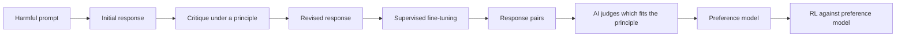

# Constitutional AI and RLAIF

Constitutional AI (CAI) trains a language model to be harmless by giving it a short written set of principles, the "constitution", and letting the model critique and revise its own outputs. Most of the human preference labels used in reinforcement learning from human feedback (RLHF) are replaced by labels produced by an AI model. Bai et al. (2022) introduced the method at Anthropic. The general idea of replacing human preference labels with AI labels, usually called reinforcement learning from AI feedback (RLAIF), was studied independently by Lee et al. (2024).

## Overview

RLHF trains a reward model on human comparisons of two responses and then optimises a policy against it (see [learning from human feedback](../../theory/paradigms/reinforcement-learning/learning-from-human-feedback/index.md)). Three problems follow from this setup:

- Human raters must read and judge large amounts of harmful text, which is slow and costly.
- Labels are inconsistent between raters, and the values behind them are implicit.
- The resulting behaviour is hard to inspect, because the values are spread across thousands of labels.

CAI addresses the second and third problems by writing the values down. The principles are short statements, such as preferring the response least likely to help with something dangerous. The model then applies them to its own outputs.

## Key concepts

- **Constitution**: a list of natural-language principles that the training procedure samples from.
- **Critique and revision**: the model writes a critique of one of its responses against a sampled principle, then rewrites the response to address the critique.
- **AI preference label**: a judgement, made by a language model, about which of two responses better satisfies a principle.
- **Preference model**: a reward model trained on AI preference labels.

## How it works

The method has two stages.

1. **Supervised stage (SL-CAI).** An initial model answers prompts designed to elicit harmful output. For each answer, the model generates a critique and a revision under a sampled principle. The revisions become training data for fine-tuning, so the model learns to produce the revised style of answer directly.
2. **Reinforcement stage (RL-CAI).** The fine-tuned model produces pairs of answers to each prompt. The model is asked which answer better fits a principle, and these AI labels train a preference model. Reinforcement learning then optimises the policy against that preference model, as in RLHF.

Bai et al. (2022) also keep a small set of human helpfulness labels, so that the resulting model remains useful as well as harmless.

## Key methods

The following methods share the preference-learning idea. Each is compared briefly here, and the detail sits on the linked pages.

- [RLHF](../../theory/paradigms/reinforcement-learning/learning-from-human-feedback/index.md) (Christiano et al., 2017; Ouyang et al., 2022): human comparisons train a reward model, which guides reinforcement learning.
- **RLAIF** (Lee et al., 2024): AI labels replace human labels in the same pipeline. The label source changes, the learning procedure does not.
- **Constitutional AI** (Bai et al., 2022): RLAIF combined with critique and revision guided by a written constitution.
- [DPO](../../theory/paradigms/reinforcement-learning/learning-from-human-feedback/dpo/index.md) (Rafailov et al., 2023): removes the explicit reward model and fits the policy directly to preference pairs. Constitutional or AI-generated pairs can be used with DPO as well.

## Results

Bai et al. (2022) report that models trained with the constitutional procedure were judged less harmful than RLHF baselines in the authors' own evaluations, with a trade-off in helpfulness that the authors discuss. Lee et al. (2024) compare AI-labelled and human-labelled preferences on summarisation and dialogue tasks and report that AI labels can produce policies that are preferred at a similar rate to those trained on human labels. Both results come from the developers' own evaluation protocols, so they are best read as evidence that the method works on the tasks studied, not as a general guarantee.

## Limitations and criticisms

- **Whose values?** The constitution is written by the developers. Critics argue that a short list of principles encodes particular cultural and political choices, and that the process for choosing them is opaque.
- **Labeller bias.** An AI labeller inherits the biases of its training data and may prefer responses in its own style. Self-preference of this kind can make the feedback look more consistent than it is.
- **Weak judges.** Critiques are only as good as the model that writes them. For tasks where the model is weaker than the policy, AI feedback may miss errors, which links this method to [scalable oversight](scalable-oversight.md).
- **Evasive refusals.** Training against harm can push models toward unhelpful refusals. The helpfulness trade-off is a recurring finding in this literature.
- **Specification gaps.** Principles are general, so the model must interpret them, and the interpretation may differ from what the developers meant. This is a version of the problem discussed in [reward hacking and specification gaming](reward-hacking.md).

## Connections

Constitutional AI is an engineering procedure, not a model of moral cognition, so the parallel with human ethics is loose. Its critique step resembles self-monitoring, and the constitution plays a role similar to the norms a person internalises, but neither comparison is tested. The philosophy of moral reasoning, including the debate between rules and judgement, is discussed in [Philosophy of AI](../philosophy/index.md) and [Ethics](../ethics/index.md). The method also sits within the wider [safety and alignment](index.md) toolkit, next to [model specifications](model-specs.md).

## Open questions

- Does AI feedback stay reliable as models become more capable than the labellers that judge them?
- Which principles should a constitution contain, and who should decide?
- How often do AI-written critiques catch real errors, as opposed to surface features of a response?
- Do gains from principle-based training transfer to new kinds of harm that the constitution did not list?

## References

### Seminal papers

- Bai, Y. et al. (2022). *Constitutional AI: Harmlessness from AI Feedback*. arXiv:2212.08073. https://arxiv.org/abs/2212.08073 — Introduces critique-and-revision followed by reinforcement learning from AI preference labels, guided by a written constitution.
- Lee, H. et al. (2024). *RLAIF vs. RLHF: Scaling Reinforcement Learning from Human Feedback with AI Feedback*. Proceedings of ICML 2024 (PMLR 235). https://arxiv.org/abs/2309.00267 — Compares AI-labelled and human-labelled preferences as training signals for summarisation and dialogue.
- Christiano, P. et al. (2017). *Deep Reinforcement Learning from Human Preferences*. arXiv:1706.03741. https://arxiv.org/abs/1706.03741 — Learns a reward model from human pairwise comparisons, the template that RLAIF and CAI modify.
- Ouyang, L. et al. (2022). *Training language models to follow instructions with human feedback*. arXiv:2203.02155. https://arxiv.org/abs/2203.02155 — Applies reward-model RLHF to make a language model follow user instructions.
- Rafailov, R. et al. (2023). *Direct Preference Optimization: Your Language Model is Secretly a Reward Model*. arXiv:2305.18290. https://arxiv.org/abs/2305.18290 — Fits a policy directly to preference pairs, with no explicit reward model.

### Surveys and textbooks

- Casper, S., Davies, X. & Shi, C. (2023). *Open Problems and Fundamental Limitations of Reinforcement Learning from Human Feedback*. arXiv:2307.15217. https://arxiv.org/abs/2307.15217 — Surveys the open technical and sociotechnical problems in RLHF, many of which carry over to AI-feedback methods.
