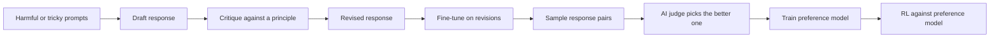

# Constitutional AI and RLAIF

Constitutional AI trains an assistant to judge and revise its own outputs against a written list of principles, so AI feedback can replace human labels for harmlessness. RLAIF (reinforcement learning from AI feedback) is the wider family of methods that train with a model's preference judgements instead of people's.

## Overview

Many assistants are first aligned with reinforcement learning from human feedback (RLHF; see [Learning from Human Feedback](../../theory/paradigms/reinforcement-learning/learning-from-human-feedback/index.md)), which needs many people to compare model outputs. Harmful content is also hard to label at scale, because raters have to read it.

Bai et al. (2022) proposed a different division of labour. The authors gave the model a list of principles, which they called a constitution, and let the model apply it. The only human oversight is the writing of those principles. The resulting assistant was harmless but non-evasive: when a request was harmful, it explained its objections instead of ignoring the request. Helpfulness training in the same work still used human labels, so the method is best understood as a change to the harmlessness part of alignment.

## Key concepts

- **Constitution**: a list of natural-language principles that serves as the standard for judging responses. The paper draws its principles from sources such as human-rights documents.
- **Critique and revision**: the model writes a critique of one of its own responses according to a principle, then rewrites the response to address it.
- **Preference model**: a network trained to score the preferred response in each pair higher. It supplies the reward in RLAIF.

## How it works

The method has two stages: supervised learning on self-revised responses, then reinforcement learning against AI-labelled preferences.

**Stage 1: learning from self-revision.** The researchers started from a model that was helpful but not yet harmless, and sampled its responses to prompts designed to elicit harmful content. For each response, the model critiqued it against a principle chosen from the constitution, then revised it. The process can be repeated with several principles. The original model is fine-tuned on the final revisions, so no person has labelled the harmful drafts.

**Stage 2: reinforcement learning from AI feedback.** The fine-tuned model samples two responses to each prompt. A feedback model, given a principle, chooses the response that better satisfies it. These AI-labelled comparisons train a preference model, which gives the probability that one response is preferred:

$$
P(y_1 \succ y_2 \mid x) = \sigma\big(r_\phi(x, y_1) - r_\phi(x, y_2)\big)
$$

Here $r_\phi$ is the learned reward and $\sigma$ is the logistic function. The assistant is then optimised, usually with PPO, to maximise the reward while staying close to the fine-tuned model:

$$
\max_\pi \; \mathbb{E}\big[r_\phi(x, y)\big] - \beta \, \mathrm{KL}\big(\pi \,\|\, \pi_{\text{ref}}\big)
$$

This is the RLHF pipeline with a different source of labels. In the paper's harmlessness training, the labels come from the model.

## Key methods

The variants share this basic structure and differ in where the preference signal comes from and how the model is optimised.

| Variant | Source of preference labels | Training procedure | Typical use |
|---|---|---|---|
| RLHF (Christiano et al., 2017; Ouyang et al., 2022) | Human raters comparing outputs | Reward model, then RL (usually PPO) | Baseline for helpfulness and harmlessness |
| Constitutional AI (Bai et al., 2022) | The model, judging against written principles | Supervised learning on self-revisions, then RLAIF | Harmlessness with few human labels |
| RLAIF (Lee et al., 2023) | An off-the-shelf language model | Reward model and RL, with AI labels in place of human labels | Cheaper preference data at scale |
| DPO (Rafailov et al., 2023) | Preference pairs, from people or from AI | Classification-style loss on the policy, with no separate reward model | A simpler and more stable pipeline |

Constitutional AI and RLAIF change the labels, while DPO changes the optimiser, so the two can be combined. The DPO objective is

$$
\mathcal{L}_{\text{DPO}} = -\mathbb{E}\left[\log \sigma\left(\beta \log \frac{\pi_\theta(y_w \mid x)}{\pi_{\text{ref}}(y_w \mid x)} - \beta \log \frac{\pi_\theta(y_l \mid x)}{\pi_{\text{ref}}(y_l \mid x)}\right)\right]
$$

where $y_w$ is the preferred response and $y_l$ the rejected one. Rafailov et al. (2023) report that this objective matches or exceeds PPO-based RLHF on the tasks they test.

## Connections

- The method is one way to produce the preference signal described in [Learning from Human Feedback](../../theory/paradigms/reinforcement-learning/learning-from-human-feedback/index.md). The RLHF baseline is in [InstructGPT](../../theory/models/llm/instructgpt-rlhf/index.md), and the wider context is in [Large Language Models](../../theory/models/llm/index.md).
- DPO and its variants are covered in [Training](../../engineering/training/index.md).
- The brain-and-mind link is analogical. People also learn norms from explicit rules and revise their own conduct after reflection, but nothing in the method requires the model to have the reflective states psychology studies. See [Psychology & AI](../../brain-mind/psychology/index.md).
- A published constitution lets outsiders read the target of training, which is one argument made for it ([Governance](../governance/index.md)). Whose values are written down is an ethical question ([Ethics & Fairness](../ethics/index.md)).
- Whether a model has internalised a principle, or only learned to cite it, is a question for [Interpretability](../interpretability/index.md).

## Applications

- **Harmlessness training.** Bai et al. (2022) trained an assistant that explains its objections to harmful requests.
- **Cheaper preference data.** Lee et al. (2023) found RLAIF comparable to RLHF on summarisation and dialogue.

## Open questions

- **Who writes the constitution.** The principles carry their authors' values. Kundu et al. (2023) found that one broad principle could partly produce harmless behaviour, while detailed constitutions gave finer control over specific harms. How broad the principles should be, and who chooses them, remain open.
- **Judge bias.** Zheng et al. (2023) describe position, verbosity and self-enhancement biases in language-model judges. A model that favours its own style can reinforce that style when it labels its own outputs.
- **Inherited flaws.** Sharma et al. (2023) found that responses matching a user's views were more likely to be preferred by people and by preference models. Replacing people with a model may pass such preferences on; the size of this effect is not settled.
- **Reward overoptimisation.** Gao et al. (2022) show that optimising too hard against a learned reward can hurt performance measured by a gold-standard reward, in line with Goodhart's law. The same pressure applies to a preference model trained on AI labels.
- **Limits of the wider approach.** Casper et al. (2023) survey the open problems and limits of RLHF and related methods, several of which plausibly apply to AI feedback as well.
- **Values or surface compliance.** A model that cites principles may behave differently in situations the principles did not anticipate. Whether principle-based training produces stable values, or only fluent compliance, is unresolved.

## References

### Seminal papers

- Bai, Y. et al. (2022). *Constitutional AI: Harmlessness from AI Feedback*. arXiv. https://arxiv.org/abs/2212.08073 — Introduces the constitution, self-critique and RL from AI feedback for harmlessness.
- Christiano, P. et al. (2017). *Deep Reinforcement Learning from Human Preferences*. NeurIPS. https://arxiv.org/abs/1706.03741 — Learns reward functions from human comparisons of agent behaviour, the root of RLHF.
- Ouyang, L. et al. (2022). *Training language models to follow instructions with human feedback*. arXiv. https://arxiv.org/abs/2203.02155 — InstructGPT: supervised fine-tuning, a reward model trained on rankings, then PPO.
- Rafailov, R. et al. (2023). *Direct Preference Optimization: Your Language Model is Secretly a Reward Model*. NeurIPS. https://arxiv.org/abs/2305.18290 — Fits a policy directly to preference pairs with a classification-style loss.
- Lee, H. et al. (2023). *RLAIF vs. RLHF: Scaling Reinforcement Learning from Human Feedback with AI Feedback*. arXiv. https://arxiv.org/abs/2309.00267 — Compares RL from AI-labelled and human-labelled preferences on summarisation and dialogue.

### Surveys and textbooks

- Casper, S. et al. (2023). *Open Problems and Fundamental Limitations of Reinforcement Learning from Human Feedback*. arXiv. https://arxiv.org/abs/2307.15217 — Surveys the open problems and fundamental limits of RLHF and related methods.
- Kaufmann, T. et al. (2023). *A Survey of Reinforcement Learning from Human Feedback*. arXiv. https://arxiv.org/abs/2312.14925 — Overview of RLHF across control, robotics and language models.

### Articles and documentation

- Kundu, S. et al. (2023). *Specific versus General Principles for Constitutional AI*. arXiv. https://arxiv.org/abs/2310.13798 — Tests whether one general principle can replace many specific constitutional principles.
- Sharma, M. et al. (2023). *Towards Understanding Sycophancy in Language Models*. arXiv. https://arxiv.org/abs/2310.13548 — Shows that preference data and preference models can favour sycophantic responses.
- Gao, L., Schulman, J. & Hilton, J. (2022). *Scaling Laws for Reward Model Overoptimization*. arXiv. https://arxiv.org/abs/2210.10760 — Measures how over-optimising a proxy reward model eventually hurts gold-standard performance.
- Zheng, L. et al. (2023). *Judging LLM-as-a-Judge with MT-Bench and Chatbot Arena*. arXiv. https://arxiv.org/abs/2306.05685 — Studies biases of language-model judges and their agreement with human preferences.
