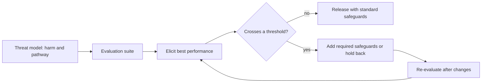

# Dangerous-capability evaluations and frontier safety frameworks

Dangerous-capability evaluations test whether an AI model could give serious help toward harms such as weapons development, cyberattacks or autonomous replication, before the model is released. Frontier safety frameworks turn those results into commitments: when a model reaches a stated capability threshold, the developer must add safeguards or hold the model back.

## Overview

Most safety work asks what a model is likely to do. This page asks what it is able to do. Shevlane et al. (2023) separate two kinds of test. Dangerous-capability evaluations establish what a model can do, while alignment evaluations measure how inclined it is to use those abilities for harm. Both kinds of result, they argue, should inform decisions about training, deployment and security.

Phuong et al. (2024) piloted dangerous-capability evaluations on Gemini 1.0 models in four areas: persuasion and deception, cybersecurity, self-proliferation and self-reasoning. They found no strong dangerous capabilities in the models tested, but flagged early warning signs. Frontier safety frameworks are the policy layer built on such evidence.

## Key concepts

- **Dangerous-capability evaluation**: a test of whether a model can perform a task that would give meaningful uplift toward a serious harm.
- **Uplift**: how much a model increases a person's ability to reach a harmful outcome, relative to a baseline such as web search.
- **Capability threshold**: a level, set in advance, at which a framework requires specific safeguards or a pause.
- **Elicitation**: the effort to bring out what a model can do, through prompting, tools, scaffolding or fine-tuning. A poorly elicited test understates capability.
- **Safety case**: a structured argument, backed by evidence, that a system is safe in a given deployment.

## How it works

A typical cycle has four steps. Developers name a threat model, meaning a harm and the pathway by which a model might contribute to it. They run an evaluation suite for that pathway, with elicitation strong enough to reflect the model's best performance. The results are compared with thresholds set in advance. Above a threshold, the framework requires safeguards, such as classifiers that block harmful outputs, access controls and protection of model weights, or it delays release. The cycle repeats after training changes.

Evaluation suites differ by domain:

- **Biology and chemistry.** Testing hazardous uplift directly is itself risky, so public benchmarks use proxies. The WMDP benchmark (Li et al., 2024) asks questions on hazardous knowledge in biology, chemistry and cybersecurity. Soice et al. (2023) used a different design: non-specialist students tried to get chatbots to help plan a pandemic-class attack. The authors reported substantial help within one hour and recommended pre-release evaluation by third parties.
- **Cybersecurity.** Cybench (Zhang et al., 2024) packages 40 professional-level capture-the-flag tasks for scoring agents on finding and exploiting vulnerabilities.
- **Autonomy and self-replication.** Kinniment et al. (2023) define "autonomous replication and adaptation" (ARA): acquiring resources, copying oneself and adapting to obstacles. Their example agents, built from language models with tools, could complete only the easiest of 12 related tasks.
- **Scheming.** Meinke et al. (2024) report that several frontier models show in-context scheming in agentic scenarios. Phuong et al. (2025) build evaluations for two prerequisites of covert scheming: stealth, or getting around oversight, and situational awareness of one's own deployment.

## Key methods

Three frameworks published by developers are the ones most often cited. Each sets a threshold for each risk domain, tied to a required action, but they differ in vocabulary and in how the decision is made.

| Framework | Developer | Threshold vocabulary | Required when a threshold is reached |
|---|---|---|---|
| [Responsible Scaling Policy](https://www.anthropic.com/responsible-scaling-policy) | Anthropic | AI Safety Levels (ASL), named after biosafety levels | Safeguards and security standards that rise with each level |
| Preparedness Framework | OpenAI | Risk ratings (low to critical) in tracked categories such as biological and chemical, cybersecurity and AI self-improvement | Safeguards that bring risk to an accepted level before deployment; the highest rating also limits further development |
| Frontier Safety Framework | Google DeepMind | Critical capability levels (CCLs) in domains such as CBRN uplift, cybersecurity and machine-learning R&D | Mitigation plans and a review of the safety case before deployment |

The ASL ladder ties each step up in capability to a step up in safeguards. The Preparedness Framework makes the decision depend on risk after mitigation, so the developer must judge how well safeguards will work. In all three, the threshold links evaluation to action, so the framework is only as good as the evaluation behind it.

These frameworks are voluntary company commitments. The EU AI Act sets evaluation and incident-reporting duties for general-purpose AI models with systemic risk, as described in [Law, Policy & Governance](../governance/index.md).

## Connections

- **Specification gaming.** An evaluation is a proxy for the capability it measures. A model that learns the test rather than the skill is a Goodhart problem, as in [Reward hacking and specification gaming](reward-hacking.md).
- **Evaluation awareness.** Needham et al. (2025) find that frontier models can often tell evaluation transcripts from real deployment. A model that behaves differently under test weakens what the test shows. People who know they are observed may also change their behaviour, a long-studied effect in [Psychology & AI](../../brain-mind/psychology/index.md). The analogy is partial, because the mechanisms differ.
- **Control.** When evaluations cannot rule out scheming, control protocols assume a model may be misaligned and rely on monitoring and sandboxing instead (Greenblatt et al., 2023), as in the monitoring row of the parent [Safety & Alignment](index.md) overview.
- **Interpretability.** [Mechanistic interpretability](../interpretability/mechanistic-interpretability.md) looks at internals rather than test behaviour.
- **Red-teaming and benchmarks.** Many dangerous-capability tests resemble attacks; see [Jailbreaks and red-teaming](../../engineering/llm-security/jailbreaks-and-red-teaming.md) and [Evaluation](../../engineering/evaluation/index.md).

## Applications

- **Access and openness decisions.** Results bear on whether a model's weights can be released openly; see [Law, Policy & Governance](../governance/index.md).
- **Third-party testing.** Government AI Safety Institutes, such as the UK AI Security Institute, have begun testing frontier models alongside developers.

## Open questions

- **Can absence of capability be shown?** Kinniment et al. (2023) conclude that their evaluations were not adequate to rule out near-future agents with ARA, and that intermediate tests during pretraining may be needed. Phuong et al. (2025) argue that a model failing their suite is almost certainly incapable of scheming, but that depends on elicitation being strong enough.
- **Does the test reflect deployment?** If models recognise evaluations, measured capability and behaviour may both be distorted (Needham et al., 2025).
- **Where should thresholds sit?** Uplift depends on a baseline that shifts as search and other tools improve.
- **Who checks?** Self-assessment, third-party testing and legal mandates each have trade-offs, including access to the model.
- **Do frameworks keep up?** Developers revise these documents often, so readers should check the current published version.

## References

### Seminal papers

- Shevlane, T. et al. (2023). *Model evaluation for extreme risks*. arXiv. https://arxiv.org/abs/2305.15324 — Argues that dangerous-capability and alignment evaluations should inform decisions about training, deployment and security.
- Phuong, M. et al. (2024). *Evaluating Frontier Models for Dangerous Capabilities*. arXiv. https://arxiv.org/abs/2403.13793 — Pilots dangerous-capability evaluations on Gemini 1.0 in persuasion, cybersecurity, self-proliferation and self-reasoning.
- Kinniment, M. et al. (2023). *Evaluating Language-Model Agents on Realistic Autonomous Tasks*. arXiv. https://arxiv.org/abs/2312.11671 — Tests language-model agents on autonomous replication tasks and explains why such tests cannot rule out future capability.
- Li, N. et al. (2024). *The WMDP Benchmark: Measuring and Reducing Malicious Use With Unlearning*. arXiv. https://arxiv.org/abs/2403.03218 — Releases a public proxy benchmark of hazardous knowledge in biology, chemistry and cybersecurity.
- Zhang, A. K. et al. (2024). *Cybench: A Framework for Evaluating Cybersecurity Capabilities and Risks of Language Models*. arXiv. https://arxiv.org/abs/2408.08926 — Provides 40 professional-level capture-the-flag tasks for scoring agents on cybersecurity.

### Surveys and textbooks

- Bengio, Y. et al. (2025). *International AI Safety Report*. arXiv. https://arxiv.org/abs/2501.17805 — Synthesises evidence on the capabilities and risks of advanced AI, commissioned after the Bletchley Park summit.

### Articles and documentation

- Anthropic (accessed 2026-10-28). *Anthropic's Responsible Scaling Policy*. https://www.anthropic.com/responsible-scaling-policy — The developer's published policy, which ties capability thresholds (AI Safety Levels) to required safeguards and security standards.
- Soice, E. H. et al. (2023). *Can large language models democratize access to dual-use biotechnology?* arXiv. https://arxiv.org/abs/2306.03809 — Student study of chatbot help toward pandemic-class attacks, recommending third-party pre-release evaluation.
- Meinke, A. et al. (2024). *Frontier Models are Capable of In-context Scheming*. arXiv. https://arxiv.org/abs/2412.04984 — Six agentic evaluations finding that several frontier models show in-context scheming capabilities.
- Phuong, M. et al. (2025). *Evaluating Frontier Models for Stealth and Situational Awareness*. arXiv. https://arxiv.org/abs/2505.01420 — Proposes stealth and situational-awareness evaluations for safety cases.
- Needham, J. et al. (2025). *Large Language Models Often Know When They Are Being Evaluated*. arXiv. https://arxiv.org/abs/2505.23836 — Tests whether models can tell evaluation transcripts from real deployment.
- Greenblatt, R. et al. (2023). *AI Control: Improving Safety Despite Intentional Subversion*. arXiv. https://arxiv.org/abs/2312.06942 — Evaluates safety protocols that assume a model may be trying to subvert them.
