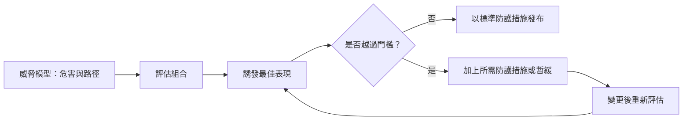

# 危險能力評估與前沿安全框架

危險能力評估會測試，AI 模型在發布前是否可能對武器開發、網路攻擊或自主複製等危害提供實質幫助。前沿安全框架則把這些結果轉化為承諾：當模型達到既定的能力門檻，開發者必須加上防護措施，或暫緩讓模型上線。

## 概述

多數安全工作關心的是模型可能會做什麼。本頁提出的問題較為狹窄：模型是否具備某些能力，使其遭到濫用或失控時會變得危險，而不論其意圖為何。Shevlane 等人（2023）區分了兩類測試。危險能力評估用來確認模型能做什麼，對齊評估則衡量模型有多大傾向將這些能力用於造成危害。他們主張，兩類結果都應該用來支持關於訓練、部署與安全的決策。

Phuong 等人（2024）在 Gemini 1.0 模型上，針對四個領域試行危險能力評估：說服與欺騙、網路安全、自我擴散與自我推理。他們在受測模型中沒有發現明顯的危險能力，但標出了早期預警訊號。前沿安全框架即是建立在這類證據之上的政策層，並在下方的〈主要方法〉一節中比較。

## 關鍵概念

- **危險能力評估（dangerous-capability evaluation）**：測試模型能否完成某項任務，而該任務會對嚴重危害提供實質的助長。
- **助長程度（uplift）**：模型使一個人達成有害結果的能力提升了多少，以某個基準為比較，例如只能使用網路搜尋的人。
- **能力門檻（capability threshold）**：事先設定的水準，達到時框架要求採取特定的防護措施或暫停。
- **誘發（elicitation）**：設法把模型能做的事情引出來，方法包括提示、工具、鷹架程式、微調等。誘發不足的測試會低估模型的能力。
- **安全論證（safety case）**：一套有結構的論證，並以證據支持，說明某系統在特定部署情境下是安全的。

## 運作方式

典型的循環有四個步驟。開發者先訂出威脅模型，也就是某種危害，以及模型可能促成該危害的路徑。接著針對該路徑執行一組評估，誘發的力度要足以反映模型的最佳表現。結果再與事先設定的門檻相比。一旦超過門檻，框架就要求採取防護措施，例如阻擋有害輸出的分類器、存取控制，以及對模型權重的保護；或者延後發布。每當訓練改變了模型，這個循環就會重新開始。

評估組合會依領域而有所不同：

- **生物與化學。** 直接測試有害的助長程度本身就有風險，因此公開的基準測試會使用代理題目。WMDP 基準（Li 等人，2024）收錄的是生物、化學與網路安全領域的危險知識問題。Soice 等人（2023）採用了不同的設計：由非專業的學生嘗試讓聊天機器人協助規劃足以引發大流行的攻擊。作者報告，聊天機器人在一小時內提供了大量幫助，並建議由第三方在發布前進行評估。
- **網路安全。** Cybench（Zhang 等人，2024）收錄了 40 項專業等級的奪旗（capture-the-flag）任務，用來為代理人在發現與利用漏洞方面的表現評分。
- **自主性與自我複製。** Kinniment 等人（2023）定義了「自主複製與適應」（ARA）：取得資源、複製自身，並適應各種阻礙。他們以語言模型搭配工具構成的範例代理人，只能完成 12 項相關任務中最簡單的幾項。
- **策劃（scheming）。** Meinke 等人（2024）報告，在代理情境中，數個前沿模型表現出情境內的策劃行為。Phuong 等人（2025）則建立了隱密策劃的兩項前提能力的評估：隱匿（即規避監督的能力）與情境察覺（即對自身部署情況的推理能力）。

## 主要方法

由開發者發布的三套框架是最常被引用的。每一套都為各個風險領域設定門檻，並把門檻與必須採取的行動綁在一起，但在用語與決策方式上有所不同。

| 框架 | 開發者 | 門檻用語 | 達到門檻時的要求 |
|---|---|---|---|
| [負責任擴展政策（Responsible Scaling Policy）](https://www.anthropic.com/responsible-scaling-policy) | Anthropic | AI 安全等級（ASL），仿照生物安全等級命名 | 隨等級提高而遞增的防護措施與安全標準 |
| 準備度框架（Preparedness Framework） | OpenAI | 在生物與化學、網路安全、AI 自我改進等追蹤類別中，依風險分為低至關鍵等級 | 發布前須以防護措施把風險降到可接受的程度；最高等級另外限制後續的開發 |
| 前沿安全框架（Frontier Safety Framework） | Google DeepMind | 在 CBRN 助長、網路安全與機器學習研發等領域設定關鍵能力等級（CCL） | 發布前須提出緩解計畫，並審查安全論證 |

ASL 的階梯把能力每提高一級，對應地提高防護措施的等級。準備度框架的評級制度則讓決策取決於緩解之後的剩餘風險，因此開發者必須判斷防護措施的成效如何。三者的共同點是，門檻把評估與行動連結起來，因此框架的可信度取決於背後評估的品質。

這些框架都是公司自願做出的承諾。歐盟 AI 法案為具有系統性風險的通用 AI 模型設定了評估與事件通報的義務，相關說明見[法律、政策與治理](../governance/index.md)。

## 連結

- **規格博弈。** 評估是其所衡量能力的代理指標。模型若學會了應試而非學會了技能，就是古德哈特問題，如同[獎勵駭客與規格博弈](reward-hacking.md)所述。
- **評估察覺。** Needham 等人（2025）發現，前沿模型往往能分辨評估用的對話紀錄與真實部署的情況。模型若在測試中表現與平常不同，就會削弱測試所呈現的證據。人在知道自己被觀察時也可能改變行為，這是[心理學與 AI](../../brain-mind/psychology/index.md)中長期研究的現象。這個類比只是部分相似，因為其機制並不相同。
- **控制。** 當評估無法排除策劃的可能時，控制協定會假設模型可能未對齊，轉而依賴監控與沙箱（Greenblatt 等人，2023），即上層[安全與對齊](index.md)總覽中監控那一列所述。
- **可解釋性。** [機制可解釋性](../interpretability/mechanistic-interpretability.md)檢視的是內部運作，而非測試中的行為。
- **紅隊測試與基準。** 許多危險能力測試很像攻擊；請見[越獄與紅隊測試](../../engineering/llm-security/jailbreaks-and-red-teaming.md)與[評估](../../engineering/evaluation/index.md)。

## 應用

- **對外的安全說明。** 模型卡與系統卡會摘要說明發布前執行的評估，以及採用的防護措施。
- **存取與開放決策。** 評估結果會影響模型權重能否公開釋出；相關爭論見[法律、政策與治理](../governance/index.md)。
- **第三方測試。** 政府的 AI 安全研究所（例如英國 AI 安全研究所）已開始與開發者一同測試前沿模型。

## 未解問題

- **能否證明沒有某項能力？** Kinniment 等人（2023）的結論是，他們的評估不足以排除近期的代理人具備 ARA 能力，並認為或許需要在預訓練期間進行中途測試。Phuong 等人（2025）主張，未通過其測試組合的模型幾乎不可能進行策劃，但這一說法取決於誘發是否足夠強。
- **測試是否反映部署情況？** 若模型能辨識評估，測得的能力與行為都可能失真（Needham 等人，2025）。
- **門檻應設在哪裡？** 助長程度取決於基準，而這個基準會隨搜尋與其他工具的進步而改變。
- **由誰來檢驗？** 自我評估、第三方測試與法律強制各有取捨，包括誰能接觸模型。
- **框架能否跟上？** 開發者經常修訂這些文件，讀者應查閱目前發布的版本。

## 參考文獻

### 開創性論文

- Shevlane, T. et al. (2023). *Model evaluation for extreme risks*. arXiv. https://arxiv.org/abs/2305.15324 — 主張危險能力評估與對齊評估應為訓練、部署與安全的決策提供依據。
- Phuong, M. et al. (2024). *Evaluating Frontier Models for Dangerous Capabilities*. arXiv. https://arxiv.org/abs/2403.13793 — 在 Gemini 1.0 上試行說服、網路安全、自我擴散與自我推理方面的危險能力評估。
- Kinniment, M. et al. (2023). *Evaluating Language-Model Agents on Realistic Autonomous Tasks*. arXiv. https://arxiv.org/abs/2312.11671 — 以自主複製任務測試語言模型代理人，並說明為何此類測試無法排除未來的能力。
- Li, N. et al. (2024). *The WMDP Benchmark: Measuring and Reducing Malicious Use With Unlearning*. arXiv. https://arxiv.org/abs/2403.03218 — 公開發布生物、化學與網路安全領域危險知識的代理基準。
- Zhang, A. K. et al. (2024). *Cybench: A Framework for Evaluating Cybersecurity Capabilities and Risks of Language Models*. arXiv. https://arxiv.org/abs/2408.08926 — 提供 40 項專業等級的奪旗任務，用來為代理人的網路安全能力評分。

### 綜述與教科書

- Bengio, Y. et al. (2025). *International AI Safety Report*. arXiv. https://arxiv.org/abs/2501.17805 — 綜整關於先進 AI 的能力、風險與安全的證據，由布萊切利園高峰會之後委託撰寫。

### 文章與文件

- Anthropic（存取日期 2026-10-28）。*Anthropic's Responsible Scaling Policy*。https://www.anthropic.com/responsible-scaling-policy — 該公司公布的政策，將能力門檻（AI 安全等級）與必要的防護措施及安全標準連結起來。
- Soice, E. H. et al. (2023). *Can large language models democratize access to dual-use biotechnology?* arXiv. https://arxiv.org/abs/2306.03809 — 學生研究聊天機器人是否能協助非專業人士規劃大流行等級的攻擊，並建議由第三方在發布前進行評估。
- Meinke, A. et al. (2024). *Frontier Models are Capable of In-context Scheming*. arXiv. https://arxiv.org/abs/2412.04984 — 六項代理評估，發現數個前沿模型表現出情境內策劃的能力。
- Phuong, M. et al. (2025). *Evaluating Frontier Models for Stealth and Situational Awareness*. arXiv. https://arxiv.org/abs/2505.01420 — 提出隱匿與情境察覺的評估，作為策劃的前提能力，供安全論證使用。
- Needham, J. et al. (2025). *Large Language Models Often Know When They Are Being Evaluated*. arXiv. https://arxiv.org/abs/2505.23836 — 測試模型能否分辨評估用的對話紀錄與真實部署，使用的基準取材自數十個資料集。
- Greenblatt, R. et al. (2023). *AI Control: Improving Safety Despite Intentional Subversion*. arXiv. https://arxiv.org/abs/2312.06942 — 評估那些假設模型可能試圖破壞它們的安全協定。
