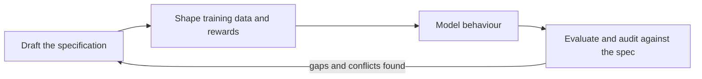

# Model Specifications and Behaviour Policies

A model specification is a written statement of how an AI system is meant to behave: which goals it serves, whose instructions take priority when they conflict, and what it should decline to do. Developers now publish some of these documents and use them as training targets, evaluation standards and public commitments. Whether a written spec shows what a model actually does is the open question.

## Overview

A model's behaviour has always been shaped by what its designers wrote down, through training data and reward signals. [Reward hacking](reward-hacking.md) shows how far a proxy can drift from the goal it stands for. [Constitutional AI](constitutional-ai.md) makes the intention explicit as a list of principles the model is trained to apply.

A model specification extends this into a public document covering a whole product line. It usually sets out the values the model should weigh, an instruction hierarchy that says whose requests prevail when sources disagree, and default behaviours with context-specific exceptions. A usage policy is different: it states what people may do with a system and is enforced through account terms, not through the model's reasoning.

## Key concepts

- **Model specification (model spec)**: a document stating intended behaviour. OpenAI's Model Spec is kept as Markdown source with archived HTML releases beginning in February 2025.
- **Instruction hierarchy**: a ranking of the text sources a model sees. Wallace et al. propose that developer instructions outrank user messages, which outrank content such as web pages or tool outputs.
- **Behavioural audit**: an investigation of whether a model has the behaviours or objectives its specification claims, or that it hides.

## How it works

A spec goes through a cycle: it is drafted, used to shape training, checked against behaviour, and revised when the checks find gaps or contradictions.

In one training method, Guan et al. (2024) teach a model the text of its safety specification and train it to recall and reason over that text before answering. They call this deliberative alignment and report that it was used for OpenAI's o-series models, without needing human-written reasoning or answers. The spec then forms part of the model's own deliberation rather than being applied only afterwards.

The instruction hierarchy is a narrower mechanism. Wallace et al. (2024) note that models often give a developer's system prompt the same weight as text from an untrusted user or web page, which lets attackers override the developer. They train models to ignore lower-privileged instructions that conflict with higher ones. In GPT-3.5 experiments this improved robustness, including to unseen attack types, at a small cost in standard capability. See also [Indirect Prompt Injection](../../engineering/llm-security/indirect-prompt-injection.md).

## Key methods

The approaches differ in who writes the principles and how the model is shown them.

| Approach | Who writes the principles | How the model uses them | Reported evidence |
|---|---|---|---|
| Deliberative alignment (Guan et al., 2024) | Developer, with a published spec | Recalls and reasons over the spec before answering | Fewer jailbreaks and less over-refusal, per the authors |
| Instruction hierarchy (Wallace et al., 2024) | Developer, through message roles | Ignores lower-privileged instructions that conflict with higher ones | Robustness to unseen attacks in GPT-3.5 experiments |
| Published constitution (Anthropic, n.d.) | Developer, released in full under CC0 | Ordered values and a few hard constraints, applied with judgement | A statement of intent rather than an outcome study |
| Collective Constitutional AI (Huang et al., 2024) | Public input, gathered through deliberation | Constitutional training on public principles | Lower bias across nine social dimensions than a developer-written baseline |

The first three are developer-written. The fourth tests who writes the principles, showing that they can be sourced from the public without abandoning the method.

## Connections

- The method most published constitutions descend from is [Constitutional AI and RLAIF](constitutional-ai.md). A spec adds a public statement of intent to that recipe.
- A written spec is a proxy for the behaviour it describes, so it can be gamed or misread like a reward function. See [Reward Hacking and Specification Gaming](reward-hacking.md).
- A model that complies in tests but acts differently elsewhere would defeat any spec. That is the concern of [Deceptive Alignment and Scheming](deceptive-alignment.md), and auditing for hidden objectives aims at the same gap.
- Dangerous-capability evaluations test whether refusal commitments hold in practice ([Dangerous-Capability Evaluations](dangerous-capability-evals.md)).
- Background: [Learning from Human Feedback](../../theory/paradigms/reinforcement-learning/learning-from-human-feedback/index.md).
- The brain-and-mind link is analogical: people hold general principles and bend them to context, much as the rules-versus-standards debate in law weighs many rules against a few values. See [Psychology & AI](../../brain-mind/psychology/index.md).
- Publishing a spec is an accountability tool; see [Law, Policy & Governance](../governance/index.md). Inspection of the model itself depends on whether its weights are open ([Open vs Closed Models](../open-vs-closed/index.md)).

## Applications

- **Product behaviour**: deployed assistants use an explicit hierarchy when an operator's configuration and a user's request disagree.
- **Evaluation**: a spec supplies the expected behaviour that tests are written against. Zhang et al. (2025) use the conflicts within specs to generate test scenarios.
- **Documentation**: specs extend the model-card tradition of disclosure from intended use to intended behaviour.

## Open questions

- **Does training follow the spec?** The OpenAI README describes the Model Spec as stating desired behaviour and does not claim it documents training. Anthropic's constitution says Claude's behaviour may diverge from it and that gaps will be disclosed, for example in system cards. Marks et al. (2025) trained a model with a hidden objective and tested eight auditing techniques; three of four blind teams uncovered it.
- **Are specs consistent?** Zhang et al. (2025) generated value-conflict scenarios and found large behavioural divergence among frontier models, which they argue exposes contradictions and ambiguities in the specs.[^1]
- **Who decides what models value?** Gabriel (2020) distinguishes aligning to instructions, intentions, preferences, interests and values. He argues for principles that people can endorse despite moral disagreement, rather than principles that are simply true. Huang et al. (2024) start from the view that developers should not be the sole deciders, and show public input can be used in practice. Anthropic's constitution credits many contributors, but its visible text describes no formal external feedback process. Sorensen et al. (2024) warn that standard alignment may reduce distributional pluralism.
- **Rules or judgement?** A detailed rulebook is predictable, auditable and harder to manipulate, but it fails in cases its authors did not foresee. Anthropic's constitution favours judgement, keeps a few hard constraints, and argues that narrow rules can reshape a model's broader self-image.
- **How far may developers restrict users?** Priority for developers protects products, but it also limits what users can learn about the system. Where that line sits is a policy question as much as a technical one.

[^1]: The paper reports over 70,000 scenarios with significant behavioural divergence among twelve frontier models from several providers.

## References

### Seminal papers

- Wallace, E. et al. (2024). *The Instruction Hierarchy: Training LLMs to Prioritize Privileged Instructions*. arXiv. https://arxiv.org/abs/2404.13208 — Defines a priority order among instruction sources and trains models to ignore lower-privileged conflicting instructions.
- Guan, M. Y. et al. (2024). *Deliberative Alignment: Reasoning Enables Safer Language Models*. arXiv. https://arxiv.org/abs/2412.16339 — Teaches models the text of safety specifications and trains them to reason over it before answering.
- Huang, S. et al. (2024). *Collective Constitutional AI: Aligning a Language Model with Public Input*. arXiv. https://arxiv.org/abs/2406.07814 — Sources a constitution from public deliberation and trains a model on it, compared with a developer-written baseline.
- Mitchell, M. et al. (2019). *Model Cards for Model Reporting*. arXiv. https://arxiv.org/abs/1810.03993 — Proposes standard documentation for intended use and evaluation results of trained models.

### Surveys and textbooks

- Gabriel, I. (2020). *Artificial Intelligence, Values and Alignment*. arXiv. https://arxiv.org/abs/2001.09768 — Philosophical analysis of what alignment should aim at, and how to choose principles under moral disagreement.
- Sorensen, T. et al. (2024). *A Roadmap to Pluralistic Alignment*. arXiv. https://arxiv.org/abs/2402.05070 — Defines three senses of pluralistic models and argues that standard alignment may reduce pluralism.

### Articles and documentation

- OpenAI (n.d.). *Model Spec* (README of the openai/model_spec repository). https://raw.githubusercontent.com/openai/model_spec/main/README.md — Describes the Model Spec as a statement of intended model behaviour, with its archived releases and public-domain licence.
- Anthropic (n.d.). *Claude's Constitution*. https://www.anthropic.com/constitution — Anthropic's published constitution, covering its priority ordering, its preference for judgement over rules and its acknowledged limits.
- Zhang, J. et al. (2025). *Stress-Testing Model Specs Reveals Character Differences among Language Models*. arXiv. https://arxiv.org/abs/2510.07686 — Generates value-conflict scenarios to find contradictions and ambiguities in published model specs.
- Marks, S. et al. (2025). *Auditing language models for hidden objectives*. arXiv. https://arxiv.org/abs/2503.10965 — Trains a model with a hidden objective and tests eight auditing techniques in blind and unblinded studies.
