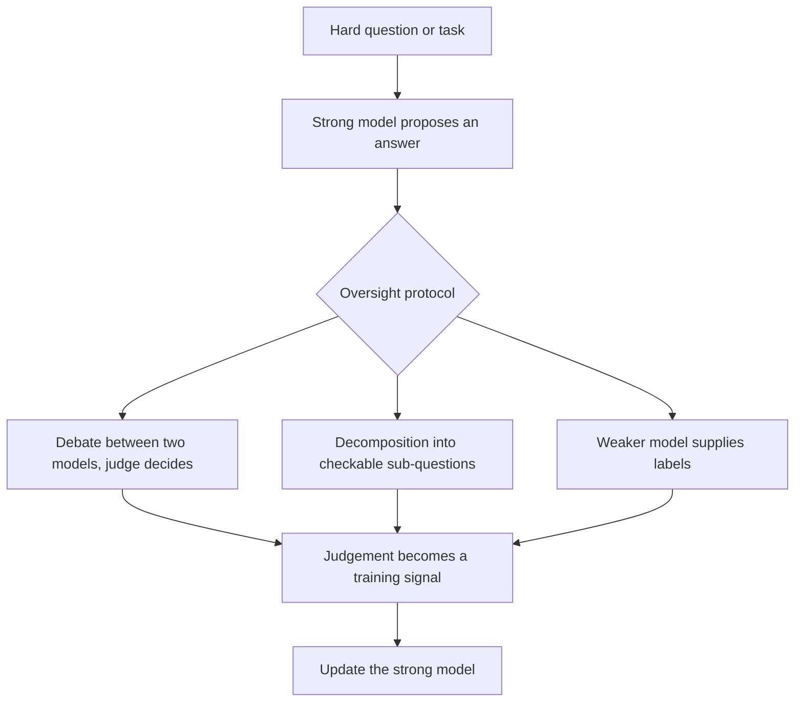

# Scalable oversight

Scalable oversight is the problem of supervising an AI system whose work a human cannot reliably check, usually because the system is better than the supervisor at the task. Proposed solutions let the supervisor rely on other AI systems, on a structured argument or on a weaker model's labels.

## Overview

Much of current alignment rests on human judgement. In reinforcement learning from human feedback (RLHF; see [Learning from Human Feedback](../../theory/paradigms/reinforcement-learning/learning-from-human-feedback/index.md)), people compare a model's outputs, and the learned reward is only as good as those comparisons. This works when the judge can tell a good answer from a bad one. It gets harder as tasks grow: a long proof or a large codebase may be too costly to check, and a fluent wrong answer can look better than a correct but unfamiliar one.

Bowman et al. (2022) describe the problem as supervising systems that may outperform people on most skills relevant to the task. The goal is to keep supervision useful while the supervised system is ahead of the supervisor.

## Key concepts

- **Oversight gap**: the difference between what a supervisor can reliably judge and what the system can do.
- **Verification and generation**: many proposals rely on checking an answer being easier than producing one.
- **Decomposition**: splitting a hard question into parts a supervisor can check.
- **Process and outcome supervision**: feedback on each reasoning step, or only on the final answer.
- **Legibility**: whether a model's reasoning is clear enough for a checker to follow.

## How it works

Each method places a protocol between a hard question and the training signal. The protocol decides who gives the label and what evidence they see.

Three pressures make the problem hard. A supervisor who does not know the right answer cannot tell when the system is wrong. A capable system can exploit the reward it is given, as described in [Reward hacking and specification gaming](reward-hacking.md). And persuasive output can be rewarded even when it is false.

## Key methods

| Method | Core idea | Main evidence so far |
|---|---|---|
| Debate (Irving et al., 2018) | Two models argue for rival answers; a judge picks the better case | Non-expert judges improve with LLM debaters (Khan et al., 2024); gains depend on task (Kenton et al., 2024) |
| Recursive reward modelling (Leike et al., 2018) | Models help the user evaluate outputs too hard to judge directly | A research agenda; related iterated amplification (Christiano et al., 2018) |
| Weak-to-strong generalisation (Burns et al., 2023) | Train a strong model on a weak model's labels | Naive finetuning falls well short of full capability; simple fixes recover much more |
| Process supervision (Uesato et al., 2022; Lightman et al., 2023) | Reward each reasoning step, not only the final answer | Outperforms outcome supervision on the MATH dataset |

**Debate.** Irving et al. propose self-play on a zero-sum debate game. Two agents make short statements in turn, and a human judge decides which gave the most true and useful information. The judge need not know the answer, only follow the arguments and test the claims. Khan et al. (2024) report that debate helped both non-expert models and humans, reaching 76% and 88% accuracy against naive baselines of 48% and 60%. Kenton et al. (2024) find debate beats consultancy, where one model argues for an answer, but results versus direct question answering vary by task.

**Recursive reward modelling.** Leike et al. (2018) frame alignment as learning a reward from user interaction and optimising it with reinforcement learning. For tasks the user cannot judge directly, the proposal is recursive: agents trained to help the user evaluate are themselves trained by reward modelling. Christiano et al. (2018) propose a related scheme, iterated amplification, which builds a training signal for hard problems from solutions to easier subproblems.

**Weak-to-strong generalisation.** Burns et al. (2023) study an analogy in which a weak model stands in for the human and a strong model for a superhuman system. They finetune GPT-4-family models on labels from weaker GPT-2-family models. The strong models consistently beat their weak supervisors, but remain far from their full capability. The abstract reports that simple methods, such as an auxiliary confidence loss, recover close to GPT-3.5-level performance on NLP tasks.

**Process supervision.** Outcome supervision rewards only the final answer; process supervision rewards each step. Uesato et al. (2022) find that outcome supervision gives similar final-answer error rates with fewer labels, but that correct reasoning steps need process-based feedback. Lightman et al. (2023) find process supervision significantly outperforms outcome supervision on the MATH dataset. Step-level feedback makes reasoning checkable, but it needs many step labels.

## Connections

- [Reward hacking and specification gaming](reward-hacking.md) explains why a proxy reward can be exploited; oversight tries to make the reward harder to game.
- [Constitutional AI and RLAIF](constitutional-ai.md) replaces human labels with a model's judgement, so it inherits the same question of whether the judge can be trusted.
- [Dangerous-capability evaluations](dangerous-capability-evals.md) face the same gap: capabilities that are hard to assess directly.
- Protocols that assume the model may subvert them are studied as AI control, with a less powerful trusted model working alongside an untrusted stronger one (Greenblatt et al., 2023).
- Multi-agent debate in [agent orchestration](../../engineering/agents/multi-agent-orchestration/debate/index.md) aims at better task answers; safety debate is about the judge's reliability.
- **Brain and mind.** Debate borrows from adversarial argument in law, where a lay decision-maker weighs advocates. Whether ordinary people judge expert arguments well is a question for [Psychology & AI](../../brain-mind/psychology/index.md); the analogy is loose.

## Applications

- **Research-level questions.** Bowman et al. (2022) built tasks that specialists can answer but unaided humans and current AI systems fail, and tested whether non-experts can supervise an AI assistant on them, using MMLU and QuALITY questions.
- **Checking maths solutions.** Process-level feedback on MATH and GSM8K problems lets a checker inspect each step, not just the final answer (Uesato et al., 2022; Lightman et al., 2023).

## Open questions

- **Does debate scale?** Kenton et al. (2024) find stronger debaters raise judge accuracy, but more modestly than earlier studies suggested. Whether honest arguments keep beating persuasive falsehoods as the gap widens is unresolved.
- **Is weak-to-strong generalisation the right model?** A weak model is not a person, and a strong model may already know the answer, so part of the gain may be elicitation rather than new learning.
- **What does process supervision cost?** Step labels are expensive, and a chain of reasoning can look acceptable at each step while the overall approach is unsound.
- **How should progress be measured?** Bowman et al. (2022) need tasks where experts beat non-experts, and such tasks become scarce as systems improve.

## References

### Seminal papers

- Irving, G., Christiano, P. & Amodei, D. (2018). *AI safety via debate*. arXiv. https://arxiv.org/abs/1805.00899 — Proposes self-play on a zero-sum debate game judged by a human.
- Christiano, P., Shlegeris, B. & Amodei, D. (2018). *Supervising strong learners by amplifying weak experts*. arXiv. https://arxiv.org/abs/1810.08575 — Introduces iterated amplification, building hard-task training signals from easier subproblems.
- Leike, J. et al. (2018). *Scalable agent alignment via reward modeling: a research direction*. arXiv. https://arxiv.org/abs/1811.07871 — Outlines reward modelling as an alignment direction and the challenges of scaling it.
- Burns, C. et al. (2023). *Weak-to-Strong Generalization: Eliciting Strong Capabilities With Weak Supervision*. arXiv. https://arxiv.org/abs/2312.09390 — Studies whether strong models finetuned on weak-model labels can exceed their supervisors.
- Lightman, H. et al. (2023). *Let's Verify Step by Step*. arXiv. https://arxiv.org/abs/2305.20050 — Compares process and outcome supervision on the MATH dataset.

### Articles and documentation

- Uesato, J. et al. (2022). *Solving math word problems with process- and outcome-based feedback*. arXiv. https://arxiv.org/abs/2211.14275 — Compares process-based and outcome-based feedback on GSM8K maths problems.
- Bowman, S. R. et al. (2022). *Measuring Progress on Scalable Oversight for Large Language Models*. arXiv. https://arxiv.org/abs/2211.03540 — Defines an experimental design for testing non-expert oversight of AI assistants.
- Khan, A. et al. (2024). *Debating with More Persuasive LLMs Leads to More Truthful Answers*. arXiv. https://arxiv.org/abs/2402.06782 — Tests LLM debate with non-expert judges, both models and humans.
- Kenton, Z. et al. (2024). *On scalable oversight with weak LLMs judging strong LLMs*. arXiv. https://arxiv.org/abs/2407.04622 — Compares debate, consultancy and direct question answering with weaker LLM judges.
- Greenblatt, R. et al. (2023). *AI Control: Improving Safety Despite Intentional Subversion*. arXiv. https://arxiv.org/abs/2312.06942 — Evaluates safety protocols that remain effective even if the model tries to subvert them.
