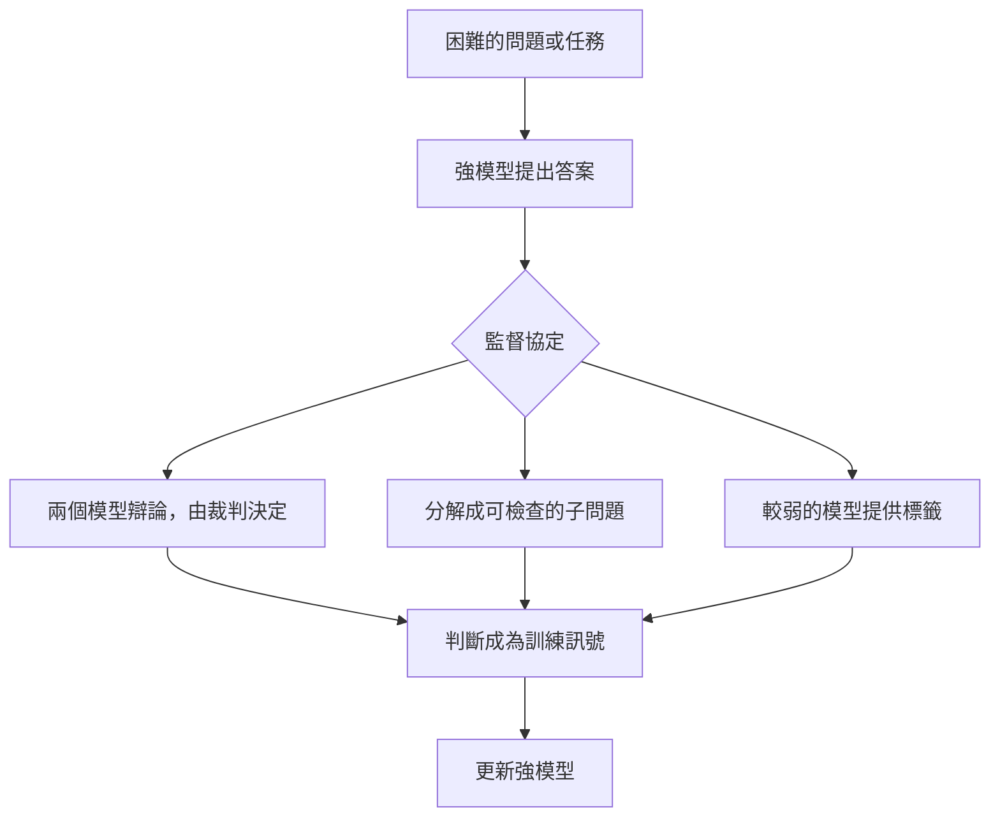

# 可擴展的監督

可擴展的監督是指：當 AI 系統的工作人類無法可靠地檢查時（通常是因為系統在該任務上比監督者更強），如何進行監督的問題。提出的解法讓監督者依賴其他 AI 系統、一套結構化的論證，或較弱模型提供的標籤。

## 概述

目前許多對齊工作仰賴人類判斷。在基於人類回饋的強化學習（RLHF；見[以人類回饋學習](../../theory/paradigms/reinforcement-learning/learning-from-human-feedback/index.md)）中，人們比較模型的輸出，而學到的獎勵只能和這些比較一樣好。當評審能分辨好答案與壞答案時，這種做法有效。隨著任務變大，它會越來越困難：一個很長的證明或一個龐大的程式碼庫，可能太耗成本而無法檢查；而流暢的錯誤答案，看起來可能比正確但不熟悉的答案更好。

Bowman et al. (2022) 將這個問題描述為：監督那些在多數與任務相關的技能上，可能勝過人類的系統。目標是在被監督的系統領先於監督者時，仍能讓監督發揮作用。

## 關鍵概念

- **監督缺口**：監督者能可靠判斷的內容，與系統實際能力之間的差距。
- **驗證與生成**：許多方案依賴於「檢查一個答案」比「產生一個答案」來得容易。
- **分解**：把困難的問題拆成監督者能檢查的部分。
- **過程監督與結果監督**：對每個推理步驟給予回饋，或只對最終答案給予回饋。
- **可讀性（legibility）**：模型的推理是否清楚到足以讓檢查者理解。

## 運作方式

每種方法都在困難問題與訓練訊號之間放置一個協定。協定決定由誰給出標籤，以及他們能看到哪些證據。

有三股壓力讓這個問題變得困難。不知道正確答案的監督者，無法判斷系統何時出錯。具有能力的系統可能會利用它所得到的獎勵，見[獎勵駭客與規格博弈](reward-hacking.md)。而具說服力的輸出，即使是錯的，也可能得到獎勵。

## 關鍵方法

| 方法 | 核心想法 | 目前的主要證據 |
|---|---|---|
| 辯論（Irving et al., 2018） | 兩個模型為對立的答案辯論；裁判選出較佳的論點 | 非專家裁判在 LLM 辯手的協助下表現提升（Khan et al., 2024）；效果取決於任務（Kenton et al., 2024） |
| 遞迴式獎勵建模（Leike et al., 2018） | 模型協助使用者評估那些無法直接判斷的輸出 | 一項研究議程；相關的是迭代式放大（Christiano et al., 2018） |
| 由弱到強的泛化（Burns et al., 2023） | 以弱模型的標籤訓練強模型 | 單純的微調遠不及強模型的完整能力；簡單的修正可以恢復更多 |
| 過程監督（Uesato et al., 2022；Lightman et al., 2023） | 獎勵每個推理步驟，而不只是最終答案 | 在 MATH 資料集上優於結果監督 |

**辯論。** Irving et al. 提出在零和辯論遊戲上進行自我對弈。兩個代理人輪流做簡短陳述，由人類裁判判斷哪一方提供了最真實、最有用的資訊。裁判不需要事先知道答案，只需要跟上論點並檢驗對方的主張。Khan et al. (2024) 報告，辯論同時協助了非專家模型與人類，準確率分別達到 76% 與 88%，而單純的基線分別為 48% 與 60%。Kenton et al. (2024) 發現，辯論優於由單一模型為某個答案辯護的諮詢式設計；但與直接問答相比，結果因任務而異。

**遞迴式獎勵建模。** Leike et al. (2018) 將對齊定義為：從與使用者的互動中學習獎勵函數，再以強化學習加以最佳化。對於使用者無法直接判斷的任務，提案是遞迴的：被訓練來協助使用者評估的代理人，本身也透過獎勵建模來訓練。Christiano et al. (2018) 提出相關方案「迭代式放大」，從較簡單子問題的解，建立困難問題的訓練訊號。

**由弱到強的泛化。** Burns et al. (2023) 研究一個類比：弱模型代表人類監督者，強模型代表超越人類的系統。他們以 GPT-2 家族較弱模型產生的標籤，微調 GPT-4 家族的模型。強模型的表現持續優於其弱監督者，但距離發揮完整能力仍相去甚遠。摘要指出，簡單的方法（例如輔助的信心損失）能在 NLP 任務上恢復接近 GPT-3.5 等級的表現。

**過程監督。** 結果監督只獎勵最終答案；過程監督則獎勵每一個步驟。Uesato et al. (2022) 發現，結果監督能以較少的標籤達到相近的最終答案錯誤率，但正確的推理步驟需要過程式回饋。Lightman et al. (2023) 發現，在 MATH 資料集上，過程監督顯著優於結果監督。步驟層級的回饋讓推理可以被檢查，但需要大量的步驟標籤。

## 相關連結

- [獎勵駭客與規格博弈](reward-hacking.md)說明了代理獎勵為何會被利用；可擴展的監督則試圖讓獎勵在系統變強時更難被鑽漏洞。
- [憲法式 AI 與 RLAIF](constitutional-ai.md)以模型的判斷取代人類標籤，因此承襲了同樣的問題：裁判是否值得信任。
- [危險能力評估](dangerous-capability-evals.md)面臨同樣的缺口：有些能力很難直接評估。
- 若一個協定假設模型可能破壞它，這類問題會以「AI 控制」的名義研究：由一個能力較弱但可信的模型，與一個能力較強但不可信的模型共同運作（Greenblatt et al., 2023）。
- [代理人編排](../../engineering/agents/multi-agent-orchestration/debate/index.md)中的多代理人辯論，目標是讓任務答案更好；安全性辯論則關心裁判的可靠度。
- **大腦與心智。** 辯論借用了法律中的對抗式論證，在那裡，外行的決策者會權衡各方倡議者的論點。一般人能否判斷專家論證的好壞，是[心理學與 AI](../../brain-mind/psychology/index.md)的問題；這個類比相當鬆散。

## 應用

- **研究級問題。** Bowman et al. (2022) 建立了一些任務：專家能夠回答，但沒有輔助的人類與目前的 AI 系統都會失敗。他們以 MMLU 與 QuALITY 的問題，測試非專家能否監督 AI 助理完成這些任務。
- **檢查數學解答。** 在 MATH 與 GSM8K 問題上的過程層級回饋，讓檢查者能檢視每個步驟，而不只是最終答案（Uesato et al., 2022；Lightman et al., 2023）。

## 開放問題

- **辯論能否擴展？** Kenton et al. (2024) 發現，較強的辯手能提高裁判的準確率，但幅度比早先的研究所顯示的更為有限。隨著能力差距擴大，誠實的論證能否持續勝過具說服力的錯誤主張，仍未解決。
- **由弱到強的泛化是否是正確的模型？** 弱模型不是人，而強模型可能本來就知道答案，因此部分增益可能來自引出既有知識，而非學到新能力。
- **過程監督的成本是什麼？** 步驟標籤很昂貴，而一段推理鏈可能每一步看起來都可接受，整體方法卻仍有缺陷。
- **應如何衡量進展？** Bowman et al. (2022) 需要專家勝過非專家的任務，而隨著系統進步，這類任務會變得稀少。

## 參考文獻

### 開創性論文

- Irving, G., Christiano, P. & Amodei, D. (2018). *AI safety via debate*. arXiv. https://arxiv.org/abs/1805.00899 — 提出在由人類裁判評判的零和辯論遊戲上進行自我對弈。
- Christiano, P., Shlegeris, B. & Amodei, D. (2018). *Supervising strong learners by amplifying weak experts*. arXiv. https://arxiv.org/abs/1810.08575 — 提出迭代式放大，從較簡單的子問題建立困難任務的訓練訊號。
- Leike, J. et al. (2018). *Scalable agent alignment via reward modeling: a research direction*. arXiv. https://arxiv.org/abs/1811.07871 — 將獎勵建模勾勒為對齊的研究方向，並說明擴展它所面臨的挑戰。
- Burns, C. et al. (2023). *Weak-to-Strong Generalization: Eliciting Strong Capabilities With Weak Supervision*. arXiv. https://arxiv.org/abs/2312.09390 — 研究以弱模型標籤微調的強模型，是否能超越其監督者。
- Lightman, H. et al. (2023). *Let's Verify Step by Step*. arXiv. https://arxiv.org/abs/2305.20050 — 在 MATH 資料集上比較過程監督與結果監督。

### 文章與文件

- Uesato, J. et al. (2022). *Solving math word problems with process- and outcome-based feedback*. arXiv. https://arxiv.org/abs/2211.14275 — 在 GSM8K 國小數學題上比較過程式與結果式回饋。
- Bowman, S. R. et al. (2022). *Measuring Progress on Scalable Oversight for Large Language Models*. arXiv. https://arxiv.org/abs/2211.03540 — 定義了測試非專家監督 AI 助理的實驗設計。
- Khan, A. et al. (2024). *Debating with More Persuasive LLMs Leads to More Truthful Answers*. arXiv. https://arxiv.org/abs/2402.06782 — 以非專家裁判（包括模型與人類）測試 LLM 辯論。
- Kenton, Z. et al. (2024). *On scalable oversight with weak LLMs judging strong LLMs*. arXiv. https://arxiv.org/abs/2407.04622 — 以較弱的 LLM 裁判比較辯論、諮詢與直接問答。
- Greenblatt, R. et al. (2023). *AI Control: Improving Safety Despite Intentional Subversion*. arXiv. https://arxiv.org/abs/2312.06942 — 評估即使模型試圖破壞仍能保持有效的安全協定。
