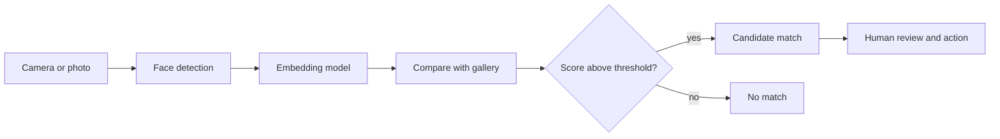

# Surveillance, Facial Recognition and Human Rights

Facial recognition lets software decide whether two face images show the same person, or which enrolled person a face most resembles. This page covers how accurate those systems are and for whom, how predictive policing and mass surveillance use similar data-driven tools, and how bans and laws have responded.

## Overview

Face recognition is one of the most widely deployed applications of computer vision. It unlocks phones, supports passport checks and helps investigators search images. Run on public spaces, it can identify people who have done nothing to attract attention, at a scale no human observer could match.

Three concerns recur. The first is that accuracy is not uniform: error rates depend on skin tone, gender and the conditions of capture, so a system that performs well on average can still fail particular groups. The second is that a match is often treated as evidence, so one error can lead to a stop, a search or an arrest. The third is that the infrastructure behind identification, namely cameras, databases and data sharing, is easily reused for purposes its designers did not intend.

Predictive policing raises a related problem. A model trained on records of police activity can learn where police have looked, which is not the same as where crime occurs. The fairness questions this raises are discussed in [Ethics & Fairness](../ethics/index.md).

International human rights law protects privacy and freedom of assembly, and these protections apply to facial recognition. Gabrielli (2025) analyses *Glukhin v Russia*, a European Court of Human Rights case about facial recognition used against a peaceful protester, and argues that mass surveillance at protests needs strict safeguards.

## Key concepts

- **Verification (1:1)**: checking whether two images show the same person, as when a phone unlocks for its owner.
- **Identification (1:N)**: searching a gallery of many enrolled faces for a match. Errors matter more here, because one probe is compared with every candidate in the gallery.
- **Threshold and error types**: a similarity score is compared with a threshold. Moving the threshold trades false matches (false positives) against missed matches (false negatives). [Fairness definitions](../ethics/fairness-definitions.md) explain why equal error rates and equal decision rates across groups can conflict.
- **Disaggregated evaluation**: reporting accuracy separately for each demographic subgroup instead of as a single average. The [Gender Shades](gender-shades/index.md) audit is the best-known example.
- **Feedback loop**: a system's output changes the data it later learns from. In predictive policing, recorded crime comes from the patrols the model sent.
- **Real-time and post hoc use**: identifying people live in public, as opposed to searching recorded footage later. Laws often treat the two differently.
- **Mass surveillance**: systematic, indiscriminate monitoring of a population, as opposed to targeted use against a named suspect.

## How it works

A typical face-identification pipeline has several stages, and errors can enter at each one.

1. **Detection** finds faces in an image. Lighting, angle and resolution set how much detail is available to later stages.
2. **Embedding** maps each face to a vector of numbers. A deep network trained on large face datasets learns the mapping, and the training loss shapes how well vectors of different people separate. [ArcFace](arcface/index.md) is a well-known loss of this kind.
3. **Matching** compares vectors by similarity and returns the best candidates above a threshold.
4. **Decision** is usually made by a person who reviews the candidate. Research on [automation bias](../human-ai-interaction/automation-bias.md) suggests reviewers tend to trust a system's ranking, so human checks are weaker than they look.

Accuracy depends on the training data as well as the algorithm. A model trained mostly on lighter-skinned faces tends to perform worse on darker-skinned faces, and a benchmark without demographic labels cannot show the gap at all.

## Key methods

Three landmark works make the field's main questions concrete. Each has its own page with the problem, method, results and limitations.

| Method | Question | Main result (per the paper) | Read more |
|---|---|---|---|
| Gender Shades (Buolamwini & Gebru, 2018) | How accurate are commercial gender classifiers across skin type and gender? | Error rates up to 34.7% for darker-skinned women, against at most 0.8% for lighter-skinned men [^1] | [Gender Shades](gender-shades/index.md) |
| ArcFace (Deng et al., 2019) | Which training loss makes face embeddings more discriminative? | An angular margin loss beats softmax on LFW, CFP-FP and AgeDB in the paper's ablation | [ArcFace](arcface/index.md) |
| Runaway feedback loops (Ensign et al., 2017) | Why can predictive policing drift away from the true crime rate? | In simulation, PredPol-style deployment does not track true rates; a correction to the incident data does | [Runaway feedback loops](runaway-feedback-loops/index.md) |

The three answer different questions: how a deployed system performs (Gender Shades), how a recognition model is trained (ArcFace), and how a whole policing system behaves (the feedback-loop paper).

## Connections

- **Brain and mind.** Human face perception is specialised: Kanwisher et al. (1997) found a region of the fusiform gyrus that responds more strongly to faces than to other objects. [Visual Perception](../../brain-mind/visual-perception/index.md) covers this selectivity. The "other-race effect", in which people recognise own-group faces more accurately, also appears in face recognition algorithms (Phillips et al., 2011), so training-data bias can reproduce a pattern long documented in people.
- **Computer vision.** The detection and embedding models are described in [Computer Vision](../../theory/models/computer-vision/index.md).
- **Ethics and fairness.** Disaggregated evaluation is a fairness problem. See [Ethics & Fairness](../ethics/index.md) and [Fairness definitions](../ethics/fairness-definitions.md).
- **Privacy.** Biometric data is a special category of personal data in European law, and facial images are a central case. See [Privacy and Data Protection](../privacy/index.md).

## Applications

- **Device and access control.** Phones and building entry systems compare one face with one enrolled template: verification, the simplest case.
- **Border control and travel.** Airports use face matching to compare travellers with their passport photographs.
- **Criminal investigation.** Police compare images from cameras and other sources with image databases. A wrong match has the most serious consequences here, which is why the rules are strictest in this area.
- **Predictive policing.** Software ranks neighbourhoods or people by expected crime to direct patrols. Lum and Isaac (2016) ask what happens when such systems are trained on biased data, and Hung and Yen (2023) examine a Chicago case in detail.

### Bans and moratoria

From 2019, several US cities restricted or banned municipal use of facial recognition, starting with San Francisco. Some states have since adopted time-limited pauses on police use. In a survey of German citizens, Kieslich and Lünich (2024) found that perceived discrimination increased demand for stricter rules, while trust in AI and in law enforcement reduced demand for a ban.

### EU AI Act prohibited practices

Article 5 of Regulation (EU) 2024/1689 lists practices that are banned outright. Its prohibitions have applied since 2 February 2025, and breaches can be fined up to 7% of global turnover, as summarised in [Law, Policy & Governance](../governance/index.md). The prohibitions most relevant to this page are:

- untargeted scraping of facial images from the internet or from CCTV footage to create or expand face-recognition databases;
- assessing a person's risk of committing a criminal offence based solely on profiling or personality traits, which is the central legal question for predictive policing;
- emotion recognition in workplaces and educational institutions, with narrow exceptions;
- biometric categorisation that infers race, political opinions, or sexual orientation;
- real-time remote biometric identification in publicly accessible spaces for law enforcement, which is generally prohibited, with narrow exceptions that require prior authorisation.

Veale and Borgesius (2021) analyse the Commission's draft, which predates the final text. They find unexpected legal consequences in some provisions and raise concerns about enforcement and national policy space. Check the final text for detail.

## Open questions

- Do accuracy figures from benchmarks predict field performance, where images are blurred, dark or taken at a distance?
- Can disparities be removed by better training data, or do they also depend on how systems are deployed?
- Should identification in public spaces be prohibited outright, or allowed under strict conditions? The EU chose a general prohibition with narrow exceptions, and other jurisdictions have chosen differently.
- How should a predictive-policing feedback loop be broken: by changing the model, the data or the way the system is deployed? Ensign et al. (2017) propose a correction to the incident data, and Hung and Yen (2023) propose governance measures.
- Public acceptance varies by country: Kostka et al. (2021) find the highest acceptance in China and the lowest in Germany, with convenience and security more prominent than surveillance in people's reasoning. Whether such attitudes should shape regulation is a question for democratic process.

## References

### Seminal papers

- Buolamwini, J. & Gebru, T. (2018). Gender Shades: Intersectional Accuracy Disparities in Commercial Gender Classification. *FAT\**. https://proceedings.mlr.press/v81/buolamwini18a.html — Audit of three commercial gender classifiers showing error rates that differ sharply by skin type and gender.
- Ensign, D. et al. (2017). Runaway Feedback Loops in Predictive Policing. arXiv. https://arxiv.org/abs/1706.09847 — Model and simulations of predictive policing feedback loops.
- Phillips, P. J. et al. (2011). An other-race effect for face recognition algorithms. *ACM Transactions on Applied Perception*. https://doi.org/10.1145/1870076.1870082 — Algorithms, like human observers, perform worse on other-race faces.
- Kanwisher, N., McDermott, J. & Chun, M. M. (1997). The Fusiform Face Area: A Module in Human Extrastriate Cortex Specialized for Face Perception. *The Journal of Neuroscience*. https://doi.org/10.1523/JNEUROSCI.17-11-04302.1997 — fMRI evidence for a cortical region that responds selectively to faces.

### Surveys and textbooks

- Alikhademi, K. et al. (2021). A review of predictive policing from the perspective of fairness. *Artificial Intelligence and Law*. https://doi.org/10.1007/s10506-021-09286-4 — Reviews predictive policing systems and the fairness problems they raise.

### Articles and documentation

- Lum, K. & Isaac, W. (2016). To Predict and Serve? *Significance*. https://doi.org/10.1111/j.1740-9713.2016.00960.x — Argues that predictive policing trained on biased data reproduces bias.
- Raji, I. D. & Buolamwini, J. (2019). Actionable Auditing. *AAAI/ACM Conference on AI, Ethics, and Society*. https://doi.org/10.1145/3306618.3314244 — Follow-up on how publicly reporting audit results affects AI products.
- Chapman, A. et al. (2022). A Data-driven analysis of the interplay between Criminological theory and predictive policing algorithms. *ACM FAccT*. https://doi.org/10.1145/3531146.3533071 — Data-driven study of criminological theory and predictive policing algorithms.
- Hung, T.-W. & Yen, C.-P. (2023). Predictive policing and algorithmic fairness. *Synthese*. https://doi.org/10.1007/s11229-023-04189-0 — Examines racial discrimination in a Chicago predictive policing system.
- Veale, M. & Zuiderveen Borgesius, F. (2021). Demystifying the Draft EU Artificial Intelligence Act. *Computer Law Review International*. https://doi.org/10.9785/cri-2021-220402 — Analyses the Commission's draft AI Act and its enforcement issues.
- Kieslich, K. & Lünich, M. (2024). Regulating AI-Based Remote Biometric Identification. Investigating the Public Demand for Bans, Audits, and Public Database Registrations. arXiv. https://arxiv.org/abs/2401.13605 — Survey of German citizens on regulating remote biometric identification.
- Gabrielli, G. (2025). The Use of Facial Recognition Technologies in the Context of Peaceful Protest. *European Journal of Risk Regulation*. https://doi.org/10.1017/err.2025.26 — Applies human rights standards to facial recognition at protests.
- Kostka, G., Steinacker, L. & Meckel, M. (2021). Between security and convenience: Facial recognition technology in the eyes of citizens in China, Germany, the United Kingdom, and the United States. *Public Understanding of Science*. https://doi.org/10.1177/09636625211001555 — Online surveys in four countries comparing public acceptance of facial recognition.

[^1]: Buolamwini & Gebru (2018), abstract and Table 4. The figures are for the Pilot Parliaments Benchmark, where all three classifiers have their highest error rates on darker-skinned women.
