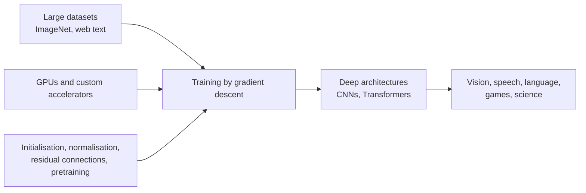

# The Deep Learning Revolution (2006–Present)

From about 2006 to the present, multi-layer neural networks trained on large datasets with fast hardware became the dominant methods across vision, speech, language and games. The period changed how AI research is organised as much as what it does: shared benchmarks, computing budgets and large companies moved to the centre of the field. It follows the [expert systems and AI winters](../expert-systems-and-winters/index.md) chapter.

## Overview

The revival began with a method for training deep networks. In 2006 Hinton, Osindero and Teh showed that a stack of [restricted Boltzmann machines](deep-belief-networks/index.md) could be trained one layer at a time and then fine-tuned, which made deep models trainable again. Hinton and Salakhutdinov (2006) pointed the same way with deep autoencoders, and the [method page](deep-belief-networks/index.md) gives the details.

Three ingredients then came together. The first was data: the [ImageNet](imagenet/index.md) database and its annual challenge from 2010 gave vision research a large labelled resource (Deng et al., 2009; Russakovsky et al., 2015). The second was compute, first graphics processors and later custom accelerators. The third was method: better initialisation (Glorot and Bengio, 2010), [dropout](../../../theory/deep-learning/dropout/index.md), [batch normalisation](../../../theory/deep-learning/normalisation/batch-normalisation/index.md) and [residual connections](../../../theory/models/cnn/backbones-and-scaling/resnet/index.md) made deep networks trainable in practice. In 2012 a deep convolutional network, [AlexNet](../../../theory/models/cnn/backbones-and-scaling/alexnet/index.md), won the ImageNet challenge by a wide margin and marked the start of the era in vision (Krizhevsky et al., 2012).

Deep networks soon became standard in speech recognition (Hinton et al., 2012a). Sequence-to-sequence learning and attention arrived in 2014 and opened the way to neural translation ([sequence to sequence](../../../theory/models/rnn/sequence-modes/sequence-to-sequence/index.md), [attention](../../../theory/models/transformer/bahdanau-attention/index.md); Sutskever et al., 2014; Bahdanau et al., 2014). Deep reinforcement learning reached [Atari games](../../../theory/paradigms/reinforcement-learning/deep-q-networks/index.md), and [AlphaGo](../../../theory/paradigms/reinforcement-learning/mcts-and-self-play/alphago/index.md) combined a deep network with tree search to master the game of Go (Silver et al., 2016).

The largest change came with the [Transformer](../../../theory/models/transformer/attention-is-all-you-need/index.md) (Vaswani et al., 2017). Models pretrained on large amounts of text and then adapted to tasks came to dominate language processing. [GPT-3](../../../theory/models/llm/gpt-3-few-shot/index.md) showed that a large model could perform new tasks from a few examples in its prompt (Brown et al., 2020). Scaling studies showed that loss falls predictably as models, data and compute grow ([Kaplan et al., 2020](../../../theory/models/llm/scaling-laws/kaplan-scaling-laws/index.md)). [Instruction tuning with human feedback](../../../theory/models/llm/instructgpt-rlhf/index.md) then made these models usable as assistants (Ouyang et al., 2022).

The institutional changes are as large as the technical ones:

- **Benchmarks became shared infrastructure.** The ImageNet challenge gave the field a common yardstick and a yearly cycle, with more than fifty institutions taking part (Russakovsky et al., 2015). Later benchmarks carry the risk of overfitting to reused test sets (Recht et al., 2019).
- **Compute became a gate.** Training compute for leading systems grew rapidly after the early 2010s (Sevilla et al., 2022). Hardware choices decide which ideas succeed (Hooker, 2020).
- **Foundation models concentrated frontier work.** Models trained on broad data at large scale need large budgets, so few groups can build them (Bommasani et al., 2021).

## Key concepts

- **Deep network**: a network with several layers of learned, non-linear transformations, trained end to end.
- **Pretraining and fine-tuning**: training a model on a broad objective first, then adapting it to a specific task.
- **Scaling law**: an empirical power-law relation in which loss falls as model size, data or compute grow (Kaplan et al., 2020).
- **Foundation model**: a model trained on broad data that can be adapted to many downstream tasks (Bommasani et al., 2021).

## How it works

A deep network is a composition of layers with learned weights. The weights are adjusted by gradient descent, with the error propagated backward through the layers, as described in the [backpropagation revival](../expert-systems-and-winters/backpropagation-revival/index.md) chapter. Deep networks were hard to train for three reasons, and each had a remedy in this period. Signals vanished or exploded across many layers, so initialisation and normalisation had to be chosen with care. Networks overfit, so regularisation such as dropout was needed. And they needed far more data and computation than earlier models. The remedies and the ingredients combined as in the diagram below.

Scaling laws summarise the last ingredient. Kaplan et al. (2020) report that the loss of language models follows a power law in model size, dataset size and training compute.

## Key methods

Four landmark methods, each with its own page:

- [Deep belief networks (Hinton et al., 2006)](deep-belief-networks/index.md): greedy layer-wise pretraining that made deep networks trainable again.
- [ImageNet and ILSVRC (Deng et al., 2009; Russakovsky et al., 2015)](imagenet/index.md): the labelled data and yearly benchmark that made deep vision measurable.
- [AlexNet (Krizhevsky et al., 2012)](../../../theory/models/cnn/backbones-and-scaling/alexnet/index.md): a deep convolutional network trained on graphics processors that won the 2012 challenge.
- [Attention Is All You Need (Vaswani et al., 2017)](../../../theory/models/transformer/attention-is-all-you-need/index.md): the Transformer, built from attention alone, and the architecture behind modern language models.

The first two are about training and data; the last two are architectures.

## Connections

The period links to the brain-and-mind side of the wiki. Hierarchical networks trained for object recognition predict neural responses in higher visual cortex (Yamins et al., 2014), as discussed in [performance-optimised networks](../../../brain-mind/neuroai/performance-optimised-networks/index.md) and [NeuroAI](../../../brain-mind/neuroai/index.md). Reinforcement learning in deep systems draws on temporal-difference ideas that can be compared with [dopamine reward prediction error](../../../brain-mind/neuroscience/dopamine-reward-prediction-error/index.md) in the brain.

The period inherits from earlier chapters: the [symbolic era](../symbolic-era/index.md) set the goals of machine intelligence, and the [backpropagation revival](../expert-systems-and-winters/backpropagation-revival/index.md) developed the neural line.

## Applications

- **Speech recognition.** Deep acoustic models became a standard part of speech systems (Hinton et al., 2012a).
- **Image recognition.** ImageNet-trained convolutional networks became default vision backbones.
- **Games.** Deep reinforcement learning and tree search reached top human level in Go (Silver et al., 2016).
- **Science.** Deep learning predicts protein structures with high accuracy (Jumper et al., 2021).
- **Language assistants.** Pretrained and instruction-tuned language models underlie chat assistants and coding tools (Ouyang et al., 2022).

## Open questions

- Is scale the only route to capability, or does insight still matter in ways compute cannot replace? Hooker (2020) asks how much of the progress reflects the hardware available.
- Who should set the benchmarks that guide the field? Recht et al. (2019) show how test sets wear out, and Bender et al. (2021) stress risks that benchmark scores do not capture.
- How should credit for the field's ideas be shared? Schmidhuber (2014) surveys earlier work, much of it from before 2000.
- Where does the compute trend lead? Sevilla et al. (2022) document rapid growth, and the supply of training data is itself a limit.

## References

### Seminal papers

- Hinton, G. E., Osindero, S. & Teh, Y.-W. (2006). A fast learning algorithm for deep belief nets. *Neural Computation*. https://doi.org/10.1162/neco.2006.18.7.1527 — Introduces greedy layer-wise training of deep belief networks, the start of the revival.
- Deng, J. et al. (2009). ImageNet: A large-scale hierarchical image database. *CVPR 2009*. https://doi.org/10.1109/CVPR.2009.5206848 — Introduces the ImageNet database on which the yearly challenge is built.
- Russakovsky, O. et al. (2015). ImageNet Large Scale Visual Recognition Challenge. *International Journal of Computer Vision*. https://doi.org/10.1007/s11263-015-0816-y — Describes the benchmark, the advances it enabled and lessons from its first years.
- Krizhevsky, A., Sutskever, I. & Hinton, G. E. (2012). ImageNet classification with deep convolutional neural networks. *NeurIPS*. https://proceedings.neurips.cc/paper/2012/hash/c399862d3b9d6b76c8436e924a68c45b-Abstract.html — The deep convolutional network that won the 2012 challenge and started the era in vision.
- Hinton, G. et al. (2012a). Deep neural networks for acoustic modeling in speech recognition: The shared views of four research groups. *IEEE Signal Processing Magazine*. https://doi.org/10.1109/MSP.2012.2205597 — Reports how deep networks were adopted for speech recognition acoustic models.
- Sutskever, I., Vinyals, O. & Le, Q. V. (2014). Sequence to sequence learning with neural networks. arXiv. https://arxiv.org/abs/1409.3215 — Maps sequences to sequences with an end-to-end encoder-decoder network.
- Bahdanau, D., Cho, K. & Bengio, Y. (2014). Neural machine translation by jointly learning to align and translate. arXiv. https://arxiv.org/abs/1409.0473 — Introduces learned soft alignment, or attention, for neural machine translation.
- Silver, D. et al. (2016). Mastering the game of Go with deep neural networks and tree search. *Nature*. https://doi.org/10.1038/nature16961 — Combines deep networks with Monte Carlo tree search to play Go at expert level.
- Vaswani, A. et al. (2017). Attention is all you need. arXiv. https://arxiv.org/abs/1706.03762 — Introduces the Transformer, an architecture built only from attention.
- Brown, T. B. et al. (2020). Language models are few-shot learners. arXiv. https://arxiv.org/abs/2005.14165 — Shows that a large language model performs new tasks from a few prompt examples.

### Surveys and textbooks

- LeCun, Y., Bengio, Y. & Hinton, G. (2015). Deep learning. *Nature*. https://doi.org/10.1038/nature14539 — Review by three founders of the field of how multi-layer networks learn representations.
- Schmidhuber, J. (2014). Deep learning in neural networks: An overview. arXiv. https://arxiv.org/abs/1404.7828 — Historical survey tracing the earlier work behind the revival.
- Bommasani, R. et al. (2021). On the opportunities and risks of foundation models. arXiv. https://arxiv.org/abs/2108.07258 — Report on models trained on broad data and adapted to many tasks.

### Articles and documentation

- Hinton, G. E. & Salakhutdinov, R. R. (2006). Reducing the dimensionality of data with neural networks. *Science*. https://doi.org/10.1126/science.1127647 — Shows that pretrained deep autoencoders learn better low-dimensional codes than principal components analysis.
- Glorot, X. & Bengio, Y. (2010). Understanding the difficulty of training deep feedforward neural networks. *AISTATS 2010*. https://proceedings.mlr.press/v9/glorot10a.html — Explains why deep networks train poorly and proposes a better initialisation.
- Yamins, D. L. K. et al. (2014). Performance-optimized hierarchical models predict neural responses in higher visual cortex. *PNAS*. https://doi.org/10.1073/pnas.1403112111 — Shows that hierarchical models optimised for object recognition predict neural responses in higher visual cortex.
- Kaplan, J. et al. (2020). Scaling laws for neural language models. arXiv. https://arxiv.org/abs/2001.08361 — Reports power-law scaling of language model loss with size, data and compute.
- Ouyang, L. et al. (2022). Training language models to follow instructions with human feedback. arXiv. https://arxiv.org/abs/2203.02155 — Aligns language models with user intent using human feedback.
- Jumper, J. et al. (2021). Highly accurate protein structure prediction with AlphaFold. *Nature*. https://doi.org/10.1038/s41586-021-03819-2 — Describes accurate protein structure prediction from sequence.
- Sevilla, J. et al. (2022). Compute trends across three eras of machine learning. arXiv. https://arxiv.org/abs/2202.05924 — Measures training compute across eras, from Moore's-law growth to the large-scale era.
- Hooker, S. (2020). The hardware lottery. arXiv. https://arxiv.org/abs/2009.06489 — Argues that research ideas succeed or fail partly according to their fit with hardware.
- Recht, B. et al. (2019). Do ImageNet classifiers generalize to ImageNet? arXiv. https://arxiv.org/abs/1902.10811 — Builds new test sets to check whether classifiers overfit reused benchmark data.
- Bender, E. M., Gebru, T., McMillan-Major, A. & Shmitchell, S. (2021). On the dangers of stochastic parrots. *FAccT 2021*. https://doi.org/10.1145/3442188.3445922 — Critiques the risks of very large language models, including environmental cost and bias.
