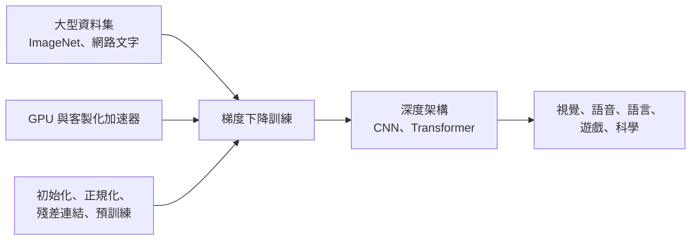

# 深度學習革命（2006 年至今）

從約 2006 年到現在，以大型資料集與快速硬體訓練的多層神經網路，成為視覺、語音、語言與遊戲領域的主流方法。這段時期改變的，既是 AI 研究的做法，也是它的組織方式：共享基準、運算預算與大型公司，都移到了領域的中心。它承接[專家系統與 AI 寒冬](../expert-systems-and-winters/index.md)一章。

## 概述

這場復興始於一套訓練深度網路的方法。2006 年，Hinton、Osindero 與 Teh 指出，可以把一疊[受限玻爾茲曼機](deep-belief-networks/index.md)一層一層地訓練，再加以微調，使深度模型重新可以被訓練。Hinton 與 Salakhutdinov（2006）以深度自編碼器指向同一方向，[方法頁面](deep-belief-networks/index.md)則有更多細節。

接著三項要素匯流在一起。第一是資料：[ImageNet](imagenet/index.md)資料庫及其自 2010 年起的年度挑戰賽，為視覺研究提供了大量標註資料（Deng 等人，2009；Russakovsky 等人，2015）。第二是運算：先是圖形處理器，後來則有客製化加速器。第三是方法：較好的初始化（Glorot 與 Bengio，2010）、[丟棄法](../../../theory/deep-learning/dropout/index.md)、[批次正規化](../../../theory/deep-learning/normalisation/batch-normalisation/index.md)與[殘差連結](../../../theory/models/cnn/backbones-and-scaling/resnet/index.md)，使深度網路在實務上可以訓練。2012 年，一個深度卷積網路[AlexNet](../../../theory/models/cnn/backbones-and-scaling/alexnet/index.md)以大幅領先之勢贏得 ImageNet 挑戰賽，標誌著視覺領域新時代的開始（Krizhevsky 等人，2012）。

深度網路很快成為語音辨識的標準做法（Hinton 等人，2012a）。序列到序列學習與注意力機制於 2014 年出現，為神經機器翻譯開路（[序列到序列](../../../theory/models/rnn/sequence-modes/sequence-to-sequence/index.md)、[注意力](../../../theory/models/transformer/bahdanau-attention/index.md)；Sutskever 等人，2014；Bahdanau 等人，2014）。深度強化學習進入了[Atari 遊戲](../../../theory/paradigms/reinforcement-learning/deep-q-networks/index.md)，而 [AlphaGo](../../../theory/paradigms/reinforcement-learning/mcts-and-self-play/alphago/index.md) 將深度網路與樹搜尋結合，掌握了圍棋（Silver 等人，2016）。

最大的變化來自 [Transformer](../../../theory/models/transformer/attention-is-all-you-need/index.md)（Vaswani 等人，2017）。先在大量文字上預訓練、再適應各種任務的模型，逐漸主導了語言處理。[GPT-3](../../../theory/models/llm/gpt-3-few-shot/index.md) 顯示，大型模型只要在提示中給出少數範例，就能執行新任務（Brown 等人，2020）。縮放研究顯示，隨著模型、資料與運算增加，損失會以可預測的方式下降（[Kaplan 等人，2020](../../../theory/models/llm/scaling-laws/kaplan-scaling-laws/index.md)）。之後，[以人類回饋進行指令微調](../../../theory/models/llm/instructgpt-rlhf/index.md)使這些模型可以作為助理使用（Ouyang 等人，2022）。

制度上的改變與技術上的改變一樣大：

- **基準成為共享基礎設施。** ImageNet 挑戰賽為領域提供了共同的衡量標準與每年一次的循環，有超過五十個機構參與（Russakovsky 等人，2015）。後來的基準也面臨對重複使用之測試集過度擬合的風險（Recht 等人，2019）。
- **運算成為門檻。** 領先系統的訓練運算量在 2010 年代初期之後快速成長（Sevilla 等人，2022）。硬體的選擇會決定哪些想法能夠成功（Hooker，2020）。
- **基礎模型使前沿工作集中。** 以大規模廣泛資料訓練的模型需要龐大的預算，因此只有少數團體能夠建造它們（Bommasani 等人，2021）。

## 關鍵概念

- **深度網路（deep network）**：具有數層學習得來的非線性轉換、端到端訓練的網路。
- **預訓練與微調（pretraining and fine-tuning）**：先以廣泛的目標訓練模型，再使其適應特定任務。
- **縮放定律（scaling law）**：一種經驗性的冪次關係，損失隨模型大小、資料或運算增加而下降（Kaplan 等人，2020）。
- **基礎模型（foundation model）**：以廣泛資料訓練、可適應多種下游任務的模型（Bommasani 等人，2021）。

## 運作方式

深度網路是由帶有學習權重的層所組成的。權重以梯度下降法調整，誤差則沿著各層向後傳播，這一點在[反向傳播的復興](../expert-systems-and-winters/backpropagation-revival/index.md)一章有所描述。深度網路難以訓練，原因有三，而這段時期各有對策。訊號在多層之間消失或爆炸，因此必須謹慎選擇初始化與正規化。網路容易過度擬合，因此需要丟棄法之類的正則化。而且它們需要遠多於以往的資料與運算。上述對策與各項要素的結合方式，見下圖。

縮放定律總結了最後一項要素。Kaplan 等人（2020）指出，語言模型的損失會依循一個冪次定律，與模型大小、資料集大小及訓練運算量相關。

## 關鍵方法

四個里程碑式的方法，各有自己的頁面：

- [深度信念網路（Hinton 等人，2006）](deep-belief-networks/index.md)：貪婪逐層預訓練，使深度網路重新可以訓練。
- [ImageNet 與 ILSVRC（Deng 等人，2009；Russakovsky 等人，2015）](imagenet/index.md)：標註資料與每年一次的基準，使深度視覺得以量化。
- [AlexNet（Krizhevsky 等人，2012）](../../../theory/models/cnn/backbones-and-scaling/alexnet/index.md)：在圖形處理器上訓練、贏得 2012 年挑戰賽的深度卷積網路。
- [Attention Is All You Need（Vaswani 等人，2017）](../../../theory/models/transformer/attention-is-all-you-need/index.md)：完全以注意力建構的 Transformer，也是現代語言模型的架構基礎。

前兩者關乎訓練與資料；後兩者則是架構。

## 關聯

這段時期與本維基的腦與心智部分有數處連結。為物件辨識而訓練的階層網路，能預測高階視覺皮質的神經反應（Yamins 等人，2014），相關討論見於[效能最佳化網路](../../../brain-mind/neuroai/performance-optimised-networks/index.md)與 [NeuroAI](../../../brain-mind/neuroai/index.md)。深度系統中的強化學習借用了時序差分的想法，可以與大腦中的[多巴胺獎勵預測誤差](../../../brain-mind/neuroscience/dopamine-reward-prediction-error/index.md)相互比較。

這段時期也承接前面的章節：[符號時代](../symbolic-era/index.md)確立了機器智慧的目標，而[反向傳播的復興](../expert-systems-and-winters/backpropagation-revival/index.md)則發展了神經網路這一路線。

## 應用

- **語音辨識。** 深度聲學模型成為語音系統的標準組成（Hinton 等人，2012a）。
- **影像辨識。** 在 ImageNet 上訓練的卷積網路，成為視覺系統的預設骨幹。
- **遊戲。** 深度強化學習與樹搜尋在圍棋上達到頂尖人類水準（Silver 等人，2016）。
- **科學。** 深度學習能高精度地預測蛋白質結構（Jumper 等人，2021）。
- **語言助理。** 預訓練與指令微調後的語言模型，構成聊天助理與程式工具的基礎（Ouyang 等人，2022）。

## 開放問題

- 規模是通往能力的唯一途徑嗎？還是洞見仍有運算無法取代的作用？Hooker（2020）追問，這段進展有多少反映了可用的硬體。
- 誰應該制定指引領域方向的基準？Recht 等人（2019）說明測試集如何逐漸耗損，而 Bender 等人（2021）則強調基準分數無法反映的風險。
- 領域中各項想法的功勞應如何分配？Schmidhuber（2014）回顧了早期工作，其中許多來自 2000 年以前。
- 運算趨勢將走向何方？Sevilla 等人（2022）記錄了快速的成長，而訓練資料的供應本身也是一項限制。

## 參考文獻

### 開創性論文

- Hinton, G. E., Osindero, S. & Teh, Y.-W. (2006). A fast learning algorithm for deep belief nets. *Neural Computation*. https://doi.org/10.1162/neco.2006.18.7.1527 — 引入深度信念網路的貪婪逐層訓練，是這場復興的起點。
- Deng, J. 等人（2009）。ImageNet: A large-scale hierarchical image database. *CVPR 2009*. https://doi.org/10.1109/CVPR.2009.5206848 — 介紹年度挑戰賽所依據的 ImageNet 資料庫。
- Russakovsky, O. 等人（2015）。ImageNet Large Scale Visual Recognition Challenge. *International Journal of Computer Vision*. https://doi.org/10.1007/s11263-015-0816-y — 描述此基準、它所促成的進展，以及頭幾年的經驗教訓。
- Krizhevsky, A., Sutskever, I. & Hinton, G. E. (2012). ImageNet classification with deep convolutional neural networks. *NeurIPS*. https://proceedings.neurips.cc/paper/2012/hash/c399862d3b9d6b76c8436e924a68c45b-Abstract.html — 贏得 2012 年挑戰賽、開啟視覺領域新時代的深度卷積網路。
- Hinton, G. 等人（2012a）。Deep neural networks for acoustic modeling in speech recognition: The shared views of four research groups. *IEEE Signal Processing Magazine*. https://doi.org/10.1109/MSP.2012.2205597 — 報告深度網路如何被採用於語音辨識的聲學模型。
- Sutskever, I., Vinyals, O. & Le, Q. V. (2014). Sequence to sequence learning with neural networks. arXiv. https://arxiv.org/abs/1409.3215 — 以端到端的編碼器–解碼器網路進行序列到序列的映射。
- Bahdanau, D., Cho, K. & Bengio, Y. (2014). Neural machine translation by jointly learning to align and translate. arXiv. https://arxiv.org/abs/1409.0473 — 為神經機器翻譯引入學習得來的軟對齊，即注意力機制。
- Silver, D. 等人（2016）。Mastering the game of Go with deep neural networks and tree search. *Nature*. https://doi.org/10.1038/nature16961 — 結合深度網路與蒙地卡羅樹搜尋，以專家水準下圍棋。
- Vaswani, A. 等人（2017）。Attention is all you need. arXiv. https://arxiv.org/abs/1706.03762 — 介紹完全由注意力構成的 Transformer 架構。
- Brown, T. B. 等人（2020）。Language models are few-shot learners. arXiv. https://arxiv.org/abs/2005.14165 — 顯示大型語言模型只要提示中有少數範例，就能執行新任務。

### 綜述與教科書

- LeCun, Y., Bengio, Y. & Hinton, G. (2015). Deep learning. *Nature*. https://doi.org/10.1038/nature14539 — 由該領域三位奠基者撰寫的回顧，探討多層網路如何學習表徵。
- Schmidhuber, J. (2014). Deep learning in neural networks: An overview. arXiv. https://arxiv.org/abs/1404.7828 — 追溯復興背後早期工作的歷史綜述。
- Bommasani, R. 等人（2021）。On the opportunities and risks of foundation models. arXiv. https://arxiv.org/abs/2108.07258 — 關於以廣泛資料訓練並適應多種任務之模型的報告。

### 文章與文件

- Hinton, G. E. & Salakhutdinov, R. R. (2006). Reducing the dimensionality of data with neural networks. *Science*. https://doi.org/10.1126/science.1127647 — 顯示預訓練過的深度自編碼器，學到的低維編碼比主成分分析更好。
- Glorot, X. & Bengio, Y. (2010). Understanding the difficulty of training deep feedforward neural networks. *AISTATS 2010*. https://proceedings.mlr.press/v9/glorot10a.html — 說明深度網路為何難以訓練，並提出較好的初始化方法。
- Yamins, D. L. K. 等人（2014）。Performance-optimized hierarchical models predict neural responses in higher visual cortex. *PNAS*. https://doi.org/10.1073/pnas.1403112111 — 顯示為物件辨識最佳化的階層模型，能預測高階視覺皮質的神經反應。
- Kaplan, J. 等人（2020）。Scaling laws for neural language models. arXiv. https://arxiv.org/abs/2001.08361 — 報告語言模型損失與規模、資料及運算量之間的冪次縮放關係。
- Ouyang, L. 等人（2022）。Training language models to follow instructions with human feedback. arXiv. https://arxiv.org/abs/2203.02155 — 以人類回饋使語言模型符合使用者意圖。
- Jumper, J. 等人（2021）。Highly accurate protein structure prediction with AlphaFold. *Nature*. https://doi.org/10.1038/s41586-021-03819-2 — 描述 AlphaFold 如何從序列準確預測蛋白質結構。
- Sevilla, J. 等人（2022）。Compute trends across three eras of machine learning. arXiv. https://arxiv.org/abs/2202.05924 — 衡量各時期的訓練運算趨勢，從摩爾定律式成長到大規模時代。
- Hooker, S. (2020). The hardware lottery. arXiv. https://arxiv.org/abs/2009.06489 — 主張研究想法的成敗，部分取決於它與現有硬體的契合程度。
- Recht, B. 等人（2019）。Do ImageNet classifiers generalize to ImageNet? arXiv. https://arxiv.org/abs/1902.10811 — 建立新的測試集，以檢驗分類器是否對重複使用的基準資料過度擬合。
- Bender, E. M., Gebru, T., McMillan-Major, A. & Shmitchell, S. (2021). On the dangers of stochastic parrots. *FAccT 2021*. https://doi.org/10.1145/3442188.3445922 — 批判超大型語言模型的風險，包括環境成本與偏見。
