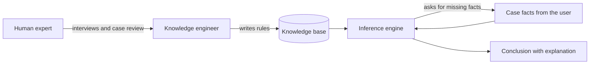

# Expert Systems and the AI Winters (1974–2006)

The period from the mid-1970s to the mid-2000s, when AI moved between commercial booms and funding collapses. Rule-based expert systems carried the field through the 1980s, while backpropagation and statistical methods for language grew more slowly until they could take over in the next period.

## Overview

The symbolic era ended in doubt. In 1973 the Lighthill report, a review of British AI research, was sharply critical of the field's claims, and funding for the subject in the UK was cut back. Historians have since reinterpreted the report as a case study in how research and its practical applications are related (Agar, 2020). Funding in the United States also tightened in these years. This downturn is usually called the first AI winter.

The field did not stop. Its next major phase rested on a narrower kind of system. An **expert system** stored the know-how of a human specialist as a body of if-then rules, separate from the general procedure that applied them. Its promise was modest but practical: a program that was reliable in one domain, such as medical diagnosis or equipment configuration, could be useful without solving general intelligence. Expert systems became the first AI technology sold widely to businesses. Their commercial success brought money back, and it encouraged large state programmes. In 1982 Japan launched the Fifth Generation Computer Systems project, which bet that logic programming on parallel hardware would produce a new generation of machines (Moto-Oka, 1983). The project did not meet its commercial goals, but it prompted responses in the United States and Europe.

The boom faded in the late 1980s. Expert systems were costly to build and to maintain, their rules were brittle outside their narrow domains, and the specialised machines built to run them lost ground to general-purpose workstations. Their market contracted, and funding fell again in what is usually called the second AI winter, which lasted into the early 1990s. While the boom was at its height, Cullen and Bryman (1988) questioned whether knowledge acquisition was the main constraint on expert systems.

Two other lines of work were developing in the background. In 1986 Rumelhart, Hinton and Williams showed that the error-correcting idea behind the perceptron could train networks with hidden layers, which answered the single-layer limit of 1969 (Rumelhart et al., 1986). In speech and language, researchers replaced hand-written grammars with probabilistic models estimated from data, a shift often called the statistical turn. Neither line dominated the field at once. By the mid-2000s both were ready for the deep learning era that the [history overview](../index.md) continues into.

## Key concepts

- **Expert system**: a program that stores a specialist's knowledge as rules and reasons over the facts of a particular case. It has a knowledge base of rules, an inference engine that applies them, and usually an explanation facility.
- **Knowledge acquisition bottleneck**: the difficulty of eliciting what experts know and turning it into usable rules. It is the main cost of building an expert system.
- **Certainty factor**: a number expressing how strongly a rule's conclusion is supported. Factors are combined as evidence accumulates. See [MYCIN](mycin/index.md).
- **Logic programming**: writing a program as logical statements that the system answers by proof or search. Prolog is the best-known language. Kowalski (1983) argued that logic should be the language basis of the Fifth Generation machines.
- **AI winter**: a period of reduced funding and interest after expectations for AI were not met.
- **Connectionism**: the view that intelligence emerges from networks of simple units whose connection weights are learned from experience. Hinton (1989) surveys the learning procedures in this tradition.
- **Statistical language processing**: an approach that models language with probabilities estimated from large collections of text, called corpora, instead of hand-written grammars.

## How it works

An expert system has a simple architecture. A knowledge engineer, working with a domain expert, writes the rules into a knowledge base. When a user supplies the facts of a case, an inference engine chains through the rules to reach conclusions and asks for any fact it still needs.

A rule in the style of the period reads, for example, "IF the stain is gram-negative AND the organism is rod-shaped, THEN the organism may be an enteric bacterium, with a certainty factor of 0.8." The example is illustrative.

The period repeats a familiar pattern. A demonstration or a commercial product attracts investment, expectations outrun what the methods can do outside the demonstration, and funding falls. The Lighthill critique and the collapse of the expert-system market both followed this path. The lesson drawn each time was the one from the 1960s: a result on a narrow problem does not show what happens when the problem is scaled up (see the [history overview](../index.md)).

## Key methods

Three landmark methods, each with its own page:

- [MYCIN and certainty factors (Shortliffe and Buchanan, 1975)](mycin/index.md): explicit if-then rules with a numerical certainty for each conclusion. Its reasoning can be inspected, but every rule is written by hand.
- [Backpropagation and the connectionist revival (Rumelhart, Hinton and Williams, 1986)](backpropagation-revival/index.md): trains hidden layers by propagating error backwards through the network. The features are learned rather than written, but the method needs far more data and computation than the period could supply.
- [Statistical language processing (Jelinek, 1976; Brown et al., 1990–1993)](statistical-nlp/index.md): replaces hand-written grammars with probabilities estimated from corpora. It improves with more data, at the cost of rules a linguist can read directly.

The Fifth Generation project and the Lighthill report are events rather than methods, so they are discussed in the Overview.

## Connections

The period bears on this wiki's brain-and-mind question, and the two main lines answered it differently. Symbolic systems assumed that thinking consists of manipulating explicit representations. Cognitive architectures such as [ACT-R](../../../brain-mind/cognitive-architectures/act-r/index.md) kept production rules as a model of human cognition. Connectionism took its cue from neurons. Backpropagation trains networks whose units are loosely modelled on them, and the [NeuroAI](../../../brain-mind/neuroai/index.md) pages follow that line. The learning signal that backpropagation uses has no clear counterpart in the brain, and this remains an open question.

A later link came in 1997, when Schultz, Dayan and Montague reported that dopamine neurons appear to signal errors in reward predictions, the quantity that temporal-difference learning computes (Schultz et al., 1997). See [dopamine and reward prediction error](../../../brain-mind/neuroscience/dopamine-reward-prediction-error/index.md).

## Applications

- **Medical decision support.** MYCIN, built to diagnose bacterial infections and suggest antibiotics, is the best-known example. See the [MYCIN page](mycin/index.md).
- **Equipment configuration.** Rule-based systems that configured computer orders at Digital Equipment Corporation were among the most cited commercial successes of the 1980s.
- **Speech recognition.** Statistical decoding framed speech recognition as a probability problem (Jelinek, 1976). See the [speech models](../../../theory/models/speech/index.md) page.
- **Machine translation.** Probabilistic translation models learned from parallel text were developed in the early 1990s (Brown et al., 1990, 1993).
- **Tagging and treebanks.** Hidden Markov models for part-of-speech tagging (Kupiec, 1992) and the Penn Treebank annotation of a large English corpus (Marcus et al., 1993) made the statistical approach practical.

## Open questions

- Were the two winters caused by overpromising, by technical limits, or by the politics of funding? Agar (2020) reexamines the Lighthill case, and the wider question remains debated.
- Would expert systems have scaled if knowledge were easier to acquire? The largest attempt at a general knowledge base, CYC (Lenat, 1995), describes a person-century of effort to build common-sense knowledge by hand, which shows how much work the approach demands.
- Did the statistical turn lose the explanations that rule systems could give? Clancey (1983) examined the explanations that a rule-based expert system can offer, and what they leave out.
- Can intelligent behaviour be built without the central symbolic representations that the earlier period assumed? Brooks (1991) argued that it can, a claim that changed robotics and remains contested.

## References

### Seminal papers

- Shortliffe, E. H. & Buchanan, B. G. (1975). A model of inexact reasoning in medicine. *Mathematical Biosciences*. https://doi.org/10.1016/0025-5564(75)90047-4 — Presents the certainty-factor model for combining uncertain evidence, developed for the MYCIN consultation system.
- Rumelhart, D. E., Hinton, G. E. & Williams, R. J. (1986). Learning representations by back-propagating errors. *Nature*. https://doi.org/10.1038/323533a0 — Shows how error can be propagated backwards to adjust hidden units, so that a network learns its own internal features.
- Jelinek, F. (1976). Continuous speech recognition by statistical methods. *Proceedings of the IEEE*. https://doi.org/10.1109/PROC.1976.10159 — Frames continuous speech recognition as statistical decoding with probabilistic models estimated from data.
- Brown, P. F. et al. (1990). A statistical approach to machine translation. *Computational Linguistics*. https://aclanthology.org/J90-2002/ — Applies statistical translation models, learned from parallel French and English text, to machine translation.
- Brown, P. F., Della Pietra, S. A., Della Pietra, V. J. & Mercer, R. L. (1993). The mathematics of statistical machine translation: Parameter estimation. *Computational Linguistics*. https://aclanthology.org/J93-2003/ — Sets out the IBM translation models and the estimation methods used to fit them to parallel text.
- Schultz, W., Dayan, P. & Montague, P. R. (1997). A neural substrate of prediction and reward. *Science*. https://doi.org/10.1126/science.275.5306.1593 — Reports that dopamine neurons respond in a way that resembles the prediction-error signal of temporal-difference learning.

### Surveys and textbooks

- Nilsson, N. J. (2009). *The Quest for Artificial Intelligence*. Cambridge University Press. https://doi.org/10.1017/CBO9780511819346 — A history of AI from its early ideas through the expert-system era, written by a researcher active in the field.
- Sejnowski, T. J. (2018). *The Deep Learning Revolution*. MIT Press. https://doi.org/10.7551/mitpress/11474.001.0001 — A history of neural networks and deep learning from a neuroscientist's viewpoint, covering the connectionist period.

### Articles and documentation

- Kupiec, J. (1992). Robust part-of-speech tagging using a hidden Markov model. *Computer Speech & Language*. https://doi.org/10.1016/0885-2308(92)90019-Z — Applies a hidden Markov model to part-of-speech tagging and studies how to make the tagger robust in practice.
- Moto-Oka, T. (1983). Overview and introduction to the Fifth Generation. In *The Fifth Generation Computer Project*. https://doi.org/10.1016/b978-0-08-028572-6.50005-5 — An early overview of Japan's Fifth Generation project by a principal figure in its planning.
- Kowalski, R. (1983). Logic as the Fifth Generation computer language. In *The Fifth Generation Computer Project*. https://doi.org/10.1016/b978-0-08-028572-6.50011-0 — Argues for logic programming as the language foundation of the Fifth Generation machines.
- Agar, J. (2020). What is science for? The Lighthill report on artificial intelligence reinterpreted. *The British Journal for the History of Science*. https://doi.org/10.1017/s0007087420000230 — Reinterprets the 1973 Lighthill report on UK AI research as a case study of how research relates to practical applications.
- Cullen, J. & Bryman, A. (1988). The knowledge acquisition bottleneck: Time for reassessment? *Expert Systems*. https://doi.org/10.1111/j.1468-0394.1988.tb00065.x — Questions the common view that knowledge acquisition is the main constraint on expert-system development.
- Clancey, W. J. (1983). The epistemology of a rule-based expert system: A framework for explanation. *Artificial Intelligence*. https://doi.org/10.1016/0004-3702(83)90008-5 — Examines the explanations a MYCIN-style rule system can give and what those explanations leave out.
- Lenat, D. B. (1995). CYC. *Communications of the ACM*. https://doi.org/10.1145/219717.219745 — Describes the long effort to build a large common-sense knowledge base by hand, and its lessons for knowledge engineering.
- Brooks, R. A. (1991). Intelligence without representation. *Artificial Intelligence*. https://doi.org/10.1016/0004-3702(91)90053-M — Argues for building behaviour-based robots without the central symbolic world models of the earlier period.
- Marcus, M., Santorini, B. & Marcinkiewicz, M. A. (1993). Building a large annotated corpus of English: The Penn Treebank. *Computational Linguistics*. https://aclanthology.org/J93-2004/ — Describes the Penn Treebank, a large hand-annotated English corpus that became a standard training and test resource.
