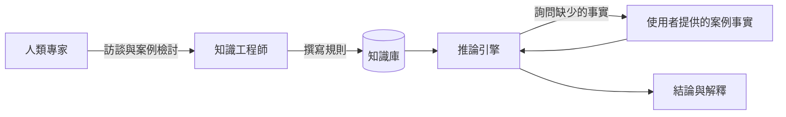

# 專家系統與 AI 寒冬（1974–2006）

從 1970 年代中期到 2000 年代中期，AI 在商業熱潮與經費崩跌之間起伏。規則式的專家系統支撐了 1980 年代的發展，而反向傳播與統計語言方法則在一旁緩慢成長，直到下一個時期才接手。

## 概述

符號時代在疑慮中結束。1973 年的萊特希爾報告檢視英國的 AI 研究，對該領域的主張提出嚴厲批評，英國的相關經費隨之縮減。此後的史家把這份報告重新詮釋，作為研究與實際應用之間關係的案例（Agar, 2020）。美國在同一時期也收緊了經費。這段低迷通常被稱為第一次 AI 寒冬。

該領域並未停止。它的下一個主要階段建立在一種範圍較窄的系統上。**專家系統**把人類專家的知識儲存為一組 if-then 規則，與套用這些規則的一般程序分開。它的承諾雖然有限，卻很實際：一個在單一領域（例如醫學診斷或設備組態）中可靠的程式，即使不解決通用智慧，也能派上用場。專家系統成為第一種被大量銷售給企業的 AI 技術。它的商業成功帶回了資金，也推動了大型的國家計畫。1982 年，日本啟動第五代電腦計畫，押注於以平行硬體執行邏輯程式，以產生新一代機器（Moto-Oka, 1983）。該計畫沒有達成商業目標，但在美國與歐洲引發了回應。

繁榮在 1980 年代後期消退。專家系統的建置與維護成本高昂，其規則在狹窄領域之外很脆弱，而為執行它們而設計的專用機器也輸給了通用工作站。市場萎縮，經費再度下滑，這就是通常所說的第二次 AI 寒冬，一直延續到 1990 年代初。在繁榮正盛之時，Cullen 與 Bryman（1988）已質疑知識獲取是否真的是專家系統的主要限制。

另外兩條路線在背景中發展。1986 年，Rumelhart、Hinton 與 Williams 表明，感知器背後的誤差修正概念可以訓練具有隱藏層的網路，從而回應了 1969 年對單層網路的限制（Rumelhart et al., 1986）。在語音與語言領域，研究者以從資料估計出的機率模型取代手寫文法，這一轉向常被稱為統計轉向。兩條路線都不是立刻主導該領域。到 2000 年代中期，兩者都已準備好迎接深度學習時代，而[歷史總覽](../index.md)正是要延續到那個時期。

## 核心概念

- **專家系統**：把專家知識儲存為規則，並針對特定案例的事實進行推理的程式。它包括知識庫（規則）、套用規則的推論引擎，通常還有解釋功能。
- **知識獲取瓶頸**：把專家所知道的內容引出來、轉換成可用規則的困難。它是建置專家系統的主要成本。
- **確定性因子**：表示規則結論被支持程度的數值，會隨證據累積而組合。見 [MYCIN](mycin/index.md)。
- **邏輯程式設計**：把程式寫成邏輯陳述，由系統以證明或搜尋來回答。最著名的語言是 Prolog。Kowalski（1983）主張，第五代機器應以邏輯作為語言基礎。
- **AI 寒冬**：AI 的期望未能達成之後，經費與興趣減少的時期。
- **連結主義**：認為智慧從許多簡單單元的網路中湧現、連結權重由經驗學得的觀點。Hinton（1989）回顧了這一傳統中的學習程序。
- **統計語言處理**：以大量文字（稱為語料庫）估計出的機率來建模語言的方法，取代手寫文法。

## 運作方式

專家系統的架構很簡單。知識工程師與領域專家合作，把規則寫進知識庫。當使用者提供案例的事實時，推論引擎沿著規則推導結論，並詢問它仍需要的任何事實。

該時期慣用的規則例如（說明用的虛構例子）：「IF 染色為革蘭氏陰性 AND 菌型為桿狀，THEN 該菌可能是腸道細菌，確定性因子 0.8。」

同樣的模式一再出現：一次示範或一項商業產品吸引投資，期望超過方法在示範之外的能力，經費隨之下降。萊特希爾的批判與專家系統市場的崩潰都循著這條路徑發生。每次得出的教訓都與 1960 年代相同：在狹窄問題上的成果，無法說明問題放大後會發生什麼（見[歷史總覽](../index.md)）。

## 關鍵方法

三個里程碑式的方法，各有專屬頁面：

- [MYCIN 與確定性因子（Shortliffe 與 Buchanan，1975）](mycin/index.md)：明確的 if-then 規則，每個結論附有數值確定性。推理可以檢視，但每條規則都要手寫。
- [反向傳播與連結主義的復興（Rumelhart、Hinton 與 Williams，1986）](backpropagation-revival/index.md)：把誤差往回傳遞，以訓練隱藏層。特徵是學來的而非寫好的，但此法需要比當時能提供的更多資料與運算。
- [統計語言處理（Jelinek，1976；Brown 等人，1990–1993）](statistical-nlp/index.md)：以從語料庫估計的機率取代手寫文法。資料越多效果越好，代價是語言學家無法直接閱讀的規則。

第五代計畫與萊特希爾報告屬於事件而非方法，因此在概述中討論。

## 連結

這個時期與本維基的心智與大腦問題有關，而兩條主要路線的回答不同。符號系統假設思考就是操作明確的表徵。[ACT-R](../../../brain-mind/cognitive-architectures/act-r/index.md) 這類認知架構則保留了產生式規則，作為人類認知的模型。連結主義則從神經元得到啟發：反向傳播訓練的網路，其單元粗略地模仿神經元，[NeuroAI](../../../brain-mind/neuroai/index.md) 頁面即循此脈絡。反向傳播所用的學習訊號在大腦中沒有明確的對應，這仍是一個開放問題。

1997 年又出現一個連結。Schultz、Dayan 與 Montague 報告，多巴胺神經元似乎會發出獎勵預測誤差的訊號，這正是時序差分學習所計算的量（Schultz et al., 1997）。見[多巴胺的獎勵預測誤差](../../../brain-mind/neuroscience/dopamine-reward-prediction-error/index.md)。

## 應用

- **醫學決策支援。** MYCIN 為診斷細菌感染並建議抗生素而建，是最著名的例子。見 [MYCIN 頁面](mycin/index.md)。
- **設備組態。** 數位設備公司（Digital Equipment Corporation）用來配置電腦訂單的規則式系統，是 1980 年代被引用最多的商業成功案例之一。
- **語音辨識。** 統計解碼把語音辨識框定為機率問題（Jelinek, 1976）。見[語音與音訊](../../../theory/models/speech/index.md)頁面。
- **機器翻譯。** 1990 年代初期，從平行文本學得的機率翻譯模型被發展出來（Brown 等人，1990、1993）。
- **詞性標註與樹庫。** 以隱馬可夫模型進行詞性標註（Kupiec, 1992），以及對大型英文語料做的賓州樹庫（Penn Treebank）標註（Marcus 等人，1993），使統計方法得以實用。

## 開放問題

- 兩次寒冬是因為過度承諾、技術限制，還是經費政治？Agar（2020）重新檢視了萊特希爾案例，更廣的問題仍有爭議。
- 如果知識更容易獲取，專家系統能否擴展？規模最大的通用知識庫嘗試 CYC（Lenat, 1995）描述了為常識知識人工建構投入一個人世紀努力的過程，說明這種做法需要多少工作。
- 統計轉向是否失去了規則系統原本能提供的解釋？Clancey（1983）檢視了規則式專家系統能給出的解釋，以及這些解釋遺漏了什麼。
- 智慧行為能否在不依賴前一時期所假設的中央符號表徵下建立？Brooks（1991）主張可以，這個主張改變了機器人學，至今仍有爭議。

## 參考文獻

### 開創性論文

- Shortliffe, E. H. & Buchanan, B. G. (1975). A model of inexact reasoning in medicine. *Mathematical Biosciences*. https://doi.org/10.1016/0025-5564(75)90047-4 — 提出結合不確定證據的確定性因子模型，為 MYCIN 諮詢系統而發展。
- Rumelhart, D. E., Hinton, G. E. & Williams, R. J. (1986). Learning representations by back-propagating errors. *Nature*. https://doi.org/10.1038/323533a0 — 說明如何把誤差往回傳播以調整隱藏單元，使網路學會自己的內部特徵。
- Jelinek, F. (1976). Continuous speech recognition by statistical methods. *Proceedings of the IEEE*. https://doi.org/10.1109/PROC.1976.10159 — 把連續語音辨識框定為以資料估計的機率模型所做的統計解碼。
- Brown, P. F. et al. (1990). A statistical approach to machine translation. *Computational Linguistics*. https://aclanthology.org/J90-2002/ — 把從法英平行文本學得的統計翻譯模型應用於機器翻譯。
- Brown, P. F., Della Pietra, S. A., Della Pietra, V. J. & Mercer, R. L. (1993). The mathematics of statistical machine translation: Parameter estimation. *Computational Linguistics*. https://aclanthology.org/J93-2003/ — 提出 IBM 翻譯模型，以及把它們擬合到平行文本的估計方法。
- Schultz, W., Dayan, P. & Montague, P. R. (1997). A neural substrate of prediction and reward. *Science*. https://doi.org/10.1126/science.275.5306.1593 — 報告多巴胺神經元的反應方式，類似於時序差分學習的預測誤差訊號。

### 綜述與教科書

- Nilsson, N. J. (2009). *The Quest for Artificial Intelligence*. Cambridge University Press. https://doi.org/10.1017/CBO9780511819346 — 一部 AI 史，把專家系統的發展放進整個領域的脈絡中。
- Sejnowski, T. J. (2018). *The Deep Learning Revolution*. MIT Press. https://doi.org/10.7551/mitpress/11474.001.0001 — 從神經科學家的角度，寫神經網路與深度學習的歷史，涵蓋連結主義時期。

### 文章與文件

- Kupiec, J. (1992). Robust part-of-speech tagging using a hidden Markov model. *Computer Speech & Language*. https://doi.org/10.1016/0885-2308(92)90019-Z — 把隱馬可夫模型應用於詞性標註，並研究如何使標註器在實務中更穩健。
- Moto-Oka, T. (1983). Overview and introduction to the Fifth Generation. In *The Fifth Generation Computer Project*. https://doi.org/10.1016/b978-0-08-028572-6.50005-5 — 由第五代計畫規劃的重要人物所寫，對該計畫的早期概觀。
- Kowalski, R. (1983). Logic as the Fifth Generation computer language. In *The Fifth Generation Computer Project*. https://doi.org/10.1016/b978-0-08-028572-6.50011-0 — 主張以邏輯程式設計作為第五代機器的語言基礎。
- Agar, J. (2020). What is science for? The Lighthill report on artificial intelligence reinterpreted. *The British Journal for the History of Science*. https://doi.org/10.1017/s0007087420000230 — 重新詮釋 1973 年關於英國 AI 研究的萊特希爾報告，把它當作研究與實際應用關係的案例。
- Cullen, J. & Bryman, A. (1988). The knowledge acquisition bottleneck: Time for reassessment? *Expert Systems*. https://doi.org/10.1111/j.1468-0394.1988.tb00065.x — 質疑「知識獲取是專家系統發展的主要限制」這一常見看法。
- Clancey, W. J. (1983). The epistemology of a rule-based expert system: A framework for explanation. *Artificial Intelligence*. https://doi.org/10.1016/0004-3702(83)90008-5 — 檢視 MYCIN 式規則系統能給出的解釋，以及這些解釋遺漏了什麼。
- Lenat, D. B. (1995). CYC. *Communications of the ACM*. https://doi.org/10.1145/219717.219745 — 描述以人工方式建立大型常識知識庫的長期努力，以及其對知識工程的啟示。
- Brooks, R. A. (1991). Intelligence without representation. *Artificial Intelligence*. https://doi.org/10.1016/0004-3702(91)90053-M — 主張在不依賴前一時期中央符號世界模型的情況下，建構以行為為基礎的機器人。
- Marcus, M., Santorini, B. & Marcinkiewicz, M. A. (1993). Building a large annotated corpus of English: The Penn Treebank. *Computational Linguistics*. https://aclanthology.org/J93-2004/ — 描述賓州樹庫，一個大型的人工標註英文語料庫，成為標準的訓練與測試資源。
