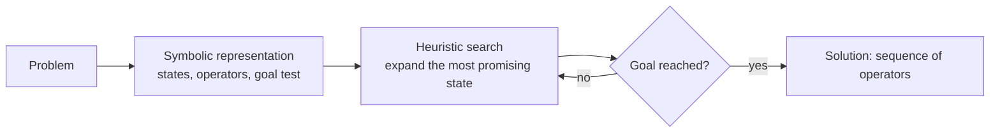

# Dartmouth and the Symbolic Era (1956–1974)

The period from the 1956 Dartmouth workshop to the early 1970s, when most AI research worked by manipulating explicit symbols with logic and heuristic search. It produced the first programs that proved theorems, played games and held simple conversations, along with the first trainable neural network. It ended with critiques, most famously of perceptrons, and with funding doubts that led into the first AI winter.

## Overview

In the summer of 1956 a small group met at Dartmouth College in New Hampshire for a workshop. Its organisers, John McCarthy, Marvin Minsky, Nathaniel Rochester and Claude Shannon, had proposed it a year earlier. The proposal conjectured that every aspect of learning and intelligence could be described precisely enough for a machine to simulate it, and it gave the new field its name, artificial intelligence. Historians still debate how much the workshop itself settled, but it is the usual starting point for AI as a named discipline (Nilsson, 2009).

For roughly the next two decades, researchers built programs that proved logic theorems, played checkers and chess, solved word problems, held text conversations and recognised simple shapes. Three threads run through this work:

- **Symbolic problem solving**: programs that represent a problem as symbolic states and search for a solution guided by heuristics. The Logic Theorist and the General Problem Solver are the landmarks.
- **Learning machines**: programs that improve with experience, from Samuel's checkers player to Rosenblatt's perceptron.
- **Language and perception**: systems for conversation and for working with images, from ELIZA to the SHRDLU blocks world and early vision programs.

The symbolic approach was the dominant one, and its successes encouraged bold forecasts. Several researchers predicted in the 1960s that machines would soon match human abilities across many tasks. The forecasts outran the methods. Programs that worked on toy problems did not scale to real ones, and sponsors grew sceptical (see the [history overview](../index.md) for the wider timeline).

The period closed with two critiques. In 1969 Minsky and Papert analysed the limits of single-layer perceptrons, and their analysis is often read as ending neural-network research for a decade. Historians have since argued that this reading owed as much to the rise of symbolic AI's institutions as to the mathematics (Olazaran, 1996). In 1973 the Lighthill report, a review of UK AI research, was sharply critical. It is often treated as the trigger of the first AI winter, a reading that later historians have examined critically (Agar, 2020).

## Key concepts

- **Physical symbol system**: a system that manipulates symbols by rules, where the symbols stand for things in the world. Newell and Simon argued that such a system is both necessary and sufficient for intelligent action (Newell and Simon, 1976).
- **Heuristic search**: exploring a space of possible states, ordering them by rules of thumb that estimate how promising they are. Modern versions are described in [A\* search](../../../theory/symbolic-ai/search/a-star/index.md).
- **Means–ends analysis**: comparing the current state with the goal, finding a difference between them, and choosing an operator that reduces it. It is the central method of the General Problem Solver.
- **Microworld**: a restricted domain, such as a table of coloured blocks, in which language and perception can be studied without the full complexity of the world.
- **Threshold unit**: a neuron-like element that weighs its inputs, sums them and outputs 1 if the sum passes a threshold. The perceptron is a network of such units with a learning rule.
- **Keyword script**: a set of trigger words and reply templates that produce plausible text without any model of meaning, as in ELIZA.

## How it works

Programs of this era follow three steps: represent the problem, search for a solution, and check the result against the goal.

The programmer writes the representation and the heuristics by hand. The Logic Theorist, for example, treats each theorem as an expression, uses rules of inference as operators, and ranks candidate expressions by how close they are to the target. The chain of operations that reaches the target is the proof. Newell, Shaw and Simon presented this kind of search as a model of human problem solving (Newell, Shaw and Simon, 1958), a claim that the [cognitive-science pages](../../../brain-mind/cognitive-science/heuristics-and-biases/index.md) discuss further.

The learning strand works differently. A perceptron is not given rules. It adjusts numerical weights whenever it misclassifies an example, so the knowledge lives in the weights rather than in symbols. ELIZA sits at the other extreme: it applies fixed text patterns without any internal representation of what the words mean.

## Key methods

Three landmark methods, each with its own page:

- [Logic Theorist and General Problem Solver (Newell, Shaw and Simon, 1956–1958)](logic-theorist/index.md): heuristic search over logical proofs, and means–ends analysis as a general problem-solving method.
- [Perceptron and the Minsky–Papert critique (Rosenblatt, 1958; Minsky and Papert, 1969)](perceptron/index.md): a trainable threshold network that learns from examples, and the analysis of its limits.
- [ELIZA (Weizenbaum, 1966)](eliza/index.md): a keyword-and-template conversation program, the period's best-known natural language system and a lesson in anthropomorphism.

## Connections

The period sits at the centre of this wiki's brain-and-mind question: how far a machine's computation resembles the brain's. McCulloch and Pitts had already modelled neurons as logic units in 1943 (McCulloch and Pitts, 1943). The perceptron was a direct attempt to turn that model into something that learns. The symbolic programmers looked instead to human reasoning, and their search programs were presented as theories of human thinking. Their ideas were later built into [cognitive architectures](../../../brain-mind/cognitive-architectures/index.md) such as [ACT-R](../../../brain-mind/cognitive-architectures/act-r/index.md).

The two strands did not stay apart. The search methods became the [symbolic AI](../../../theory/symbolic-ai/index.md) toolkit for search, planning and knowledge representation, and the perceptron is the ancestor of the multi-layer [deep learning](../../../theory/deep-learning/index.md) networks that replaced it. For the biological side of the neural line, see [NeuroAI](../../../brain-mind/neuroai/index.md).

## Applications

- **Game playing.** Samuel's checkers program searched ahead and scored positions with a learned evaluation function (Samuel, 1959). The chess-search work of the period used the same pattern, which the [alpha-beta pruning](../../../theory/symbolic-ai/search/alpha-beta/index.md) page describes in its later, more efficient form.
- **Automated reasoning.** Proof search of the kind the Logic Theorist introduced now runs inside SAT and SMT solvers, which verify hardware and software (see the [symbolic AI overview](../../../theory/symbolic-ai/index.md)).
- **Conversational interfaces.** Scripted chatbots that match keywords to canned replies follow the design of ELIZA. Modern [language models](../../../theory/models/llm/index.md) are far more capable but raise the same question ELIZA did.

## Open questions

- Was the 1969 critique a mathematical refutation of neural networks or a shift in research priorities? The historical debate is still open.
- Can the hand-written heuristics of this era be learned automatically, and does that keep the guarantees that made search trustworthy?
- What did the period's microworlds and demonstrations show about real-world performance? The lesson that demonstrations are not deployments still applies (see [evaluation](../../../engineering/evaluation/index.md)).
- How closely do symbolic search and human problem solving match? Modern work on [search with language models](../../../theory/symbolic-ai/search/tree-of-thoughts/index.md) revives the comparison.

## References

### Seminal papers

- Newell, A. & Simon, H. A. (1956). The logic theory machine: A complex information processing system. *IEEE Transactions on Information Theory*. https://doi.org/10.1109/TIT.1956.1056797 — Describes the Logic Theorist, an early program that searches for proofs of logic theorems using heuristics rather than exhaustive enumeration.
- Newell, A., Shaw, J. C. & Simon, H. A. (1958). Elements of a theory of human problem solving. *Psychological Review*. https://doi.org/10.1037/h0048495 — Proposes a general theory of human problem solving as heuristic search, drawing on the Logic Theorist and the means–ends method behind the General Problem Solver.
- Rosenblatt, F. (1958). The perceptron: A probabilistic model for information storage and organization in the brain. *Psychological Review*. https://doi.org/10.1037/h0042519 — Introduces the perceptron, a trainable network of threshold units that is proposed as a model of how the brain stores and organises information.
- Minsky, M. & Papert, S. (2017). *Perceptrons*. MIT Press. https://doi.org/10.7551/mitpress/11301.001.0001 — Reissue of the 1988 expanded edition of the 1969 analysis of what perceptrons can compute, the source of the critique discussed in this chapter.
- Minsky, M. (1961). Steps toward artificial intelligence. *Proceedings of the IRE*. https://doi.org/10.1109/JRPROC.1961.287775 — A survey of the problems of the new field, including search, pattern recognition, learning and planning, written just after the early programs appeared.
- Samuel, A. L. (1959). Some studies in machine learning using the game of checkers. *IBM Journal of Research and Development*. https://doi.org/10.1147/rd.33.0210 — Reports a checkers program that improved its evaluation of board positions through play, an early demonstration of machine learning.
- McCulloch, W. S. & Pitts, W. (1943). A logical calculus of the ideas immanent in nervous activity. *The Bulletin of Mathematical Biophysics*. https://doi.org/10.1007/BF02478259 — Models neurons as logic units with threshold behaviour, the formal starting point for both perceptrons and the neural side of the period.
- Newell, A. & Simon, H. A. (1976). Computer science as empirical inquiry: Symbols and search. *Communications of the ACM*. https://doi.org/10.1145/360018.360022 — Sets out the physical symbol system hypothesis and the claim that symbol manipulation underlies intelligence.

### Surveys and textbooks

- Nilsson, N. J. (2009). *The Quest for Artificial Intelligence*. Cambridge University Press. https://doi.org/10.1017/CBO9780511819346 — A history of AI from its early ideas onward, written by a researcher of the period, covering the 1956 workshop and the symbolic programs.

- Haenlein, M. & Kaplan, A. (2019). A brief history of artificial intelligence: On the past, present, and future of artificial intelligence. *California Management Review*. https://doi.org/10.1177/0008125619864925 — A short history of AI and its main perspectives, written as the introduction to a special issue on the field.

### Articles and documentation

- Olazaran, M. (1996). A sociological study of the official history of the perceptrons controversy. *Social Studies of Science*. https://doi.org/10.1177/030631296026003005 — Argues that the standard account of the 1969 perceptron critique was shaped by the rise of symbolic AI's institutions, not only by the proofs.
- Agar, J. (2020). What is science for? The Lighthill report on artificial intelligence reinterpreted. *The British Journal for the History of Science*. https://doi.org/10.1017/s0007087420000230 — Reinterprets the 1973 Lighthill report on UK AI research and examines how its influence on the field is judged.
- Winograd, T. (1972). Understanding natural language. *Cognitive Psychology*. https://doi.org/10.1016/0010-0285(72)90002-3 — Describes a language-understanding system for a blocks microworld, showing how syntax, semantics and reasoning can be combined in a restricted domain.
- Weizenbaum, J. (1966). ELIZA: A computer program for the study of natural language communication between man and machine. *Communications of the ACM*. https://doi.org/10.1145/365153.365168 — Describes ELIZA's keyword and template rules and discusses the psychological issues they raise.
