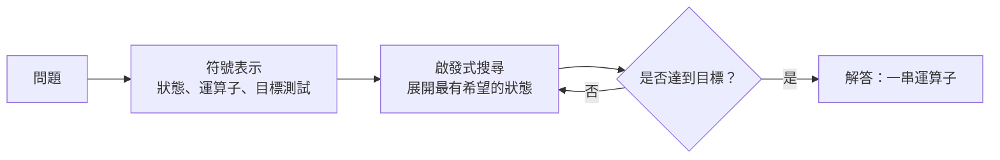

# 達特茅斯會議與符號時代（1956–1974）

從 1956 年的達特茅斯會議到 1970 年代初期，這段時期的 AI 研究大多靠操作明確的符號、以邏輯與啟發式搜尋來解題。它產生了第一批能證明定理、下棋並進行簡單對話的程式，也產生了第一個可訓練的神經網路。它的結束伴隨著批判，最有名的是對感知器的批判，還有隨之而來的資金疑慮，並通向第一次 AI 寒冬。

## 概述

1956 年夏天，一小群人在新罕布夏州的達特茅斯學院舉辦了一場研討會。主辦者 John McCarthy、Marvin Minsky、Nathaniel Rochester 與 Claude Shannon 在一年前提出了這項計畫。該提案猜想，學習與智慧的每個面向都可以被描述得足夠精確，使機器能夠加以模擬；它也為這個新領域取了名字，即「人工智慧」。歷史學家仍在討論這場研討會本身究竟定下了什麼，但它通常被視為 AI 作為一門有名稱學科的起點（Nilsson, 2009）。

接下來約二十年間，研究者寫出的程式能證明邏輯定理、下西洋跳棋與西洋棋、解文字題、進行文字對話，並辨認簡單的形狀。這段時期的工作有三條主線：

- **符號式問題求解**：把問題表示為符號狀態，並在啟發式引導下搜尋解答的程式。Logic Theorist 與通用問題求解器（General Problem Solver）是其中的里程碑。
- **學習機器**：能隨經驗改進的程式，從 Samuel 的西洋跳棋程式到 Rosenblatt 的感知器。
- **語言與感知**：用於對話與影像處理的系統，從 ELIZA 到 SHRDLU 積木世界，以及早期的視覺程式。

符號方法是當時的主流，它的成功也帶來大膽的預測。1960 年代有好幾位研究者預言，機器很快就能在許多任務上匹敵人類。預測跑在方法前面：只能處理玩具問題的程式無法擴展到真實問題，贊助者也開始存疑（更廣的時間脈絡見[歷史總覽](../index.md)）。

這段時期以兩項批判作結。1969 年，Minsky 與 Papert 分析了單層感知器的限制，他們的分析常被解讀為讓神經網路研究停擺了約十年。之後的歷史學家認為，這種解讀與其說來自數學本身，不如說也反映了符號 AI 的制度力量（Olazaran, 1996）。1973 年，針對英國 AI 研究的 Lighthill 報告措辭嚴厲，常被視為第一次 AI 寒冬的導火線；後來的歷史學者對這種解讀有所檢討（Agar, 2020）。

## 關鍵概念

- **物理符號系統（physical symbol system）**：依規則操作符號的系統，符號代表世界中的事物。Newell 與 Simon 主張，這樣的系統對於智慧行為而言既必要又充分（Newell and Simon, 1976）。
- **啟發式搜尋（heuristic search）**：在可能狀態的空間中探索，並依據估計前景的經驗法則排序。現代版本見 [A\* 搜尋](../../../theory/paradigms/symbolic-ai/search/a-star/index.md)。
- **手段－目的分析（means–ends analysis）**：比較目前狀態與目標，找出兩者之間的差異，並選擇能縮小該差異的運算子。它是通用問題求解器的核心方法。
- **微世界（microworld）**：一個受限的領域，例如一張擺著彩色積木的桌面。在其中，語言與感知可以在不必面對完整世界複雜度的情況下進行研究。
- **閾值單元（threshold unit）**：一種類神經元的元件，會對輸入加權並求和，若和超過閾值就輸出 1。感知器就是由這類單元加上學習規則所組成的網路。
- **關鍵字腳本（keyword script）**：一組觸發詞與回覆模板，能在沒有任何語意模型的情況下產生看似合理的文字，如 ELIZA。

## 運作方式

這個時期的程式大致遵循三個步驟：表示問題、搜尋解答，並把結果與目標比對。

表示法與啟發式由程式設計者手工撰寫。例如，Logic Theorist 把每個定理當作一個運算式，以推論規則作為運算子，並依候選運算式與目標的接近程度排序。通往目標的那串運算就是證明。Newell、Shaw 與 Simon 把這類搜尋當作人類解題的模型來提出（Newell, Shaw and Simon, 1958），[認知科學頁面](../../../brain-mind/cognitive-science/heuristics-and-biases/index.md)對這項主張有進一步討論。

學習這條主線的運作方式不同。感知器不會得到規則，而是在誤分類某個範例時調整數值權重，因此知識存在於權重之中，而非符號裡。ELIZA 則位於另一端：它套用固定的文字模式，對文字的意義沒有任何內部表示。

## 關鍵方法

本章有三個里程碑式的方法，各有獨立頁面：

- [Logic Theorist 與通用問題求解器（Newell、Shaw 與 Simon，1956–1958）](logic-theorist/index.md)：以啟發式搜尋尋找邏輯證明，並以手段－目的分析作為通用的問題求解方法。
- [感知器與 Minsky–Papert 批判（Rosenblatt，1958；Minsky 與 Papert，1969）](perceptron/index.md)：能從範例中學習的可訓練閾值網路，以及對其限制的分析。
- [ELIZA（Weizenbaum，1966）](eliza/index.md)：一個以關鍵字與模板進行對話的程式，是這個時期最知名的自然語言系統，也是一則關於擬人化的教訓。

## 關聯

這段時期位於本維基強調的腦與心智問題的核心：機器的運算在多大程度上類似大腦。McCulloch 與 Pitts 早在 1943 年就把神經元建模為邏輯單元（McCulloch and Pitts, 1943）。感知器則是直接嘗試把那個模型變成會學習的東西。符號派的程式設計者轉而借鏡人類推理，他們的搜尋程式被當作人類思考的理論來提出。這些想法後來被納入 [認知架構](../../../brain-mind/cognitive-architectures/index.md)，例如 [ACT-R](../../../brain-mind/cognitive-architectures/act-r/index.md)。

兩條主線並未就此分開。搜尋方法成為[符號 AI](../../../theory/paradigms/symbolic-ai/index.md) 在搜尋、規劃與知識表示方面的工具箱；感知器則是後來取代它的多層[深度學習](../../../theory/deep-learning/index.md)網路的祖先。至於神經線的生物面向，見 [NeuroAI](../../../brain-mind/neuroai/index.md)。

## 應用

- **遊戲博弈。** Samuel 的西洋跳棋程式會向前搜尋，並以學到的評估函數為局面評分（Samuel, 1959）。這個時期的西洋棋搜尋也使用同樣的模式，[α-β 剪枝](../../../theory/paradigms/symbolic-ai/search/alpha-beta/index.md)頁面介紹了它後來較有效率的形式。
- **自動推理。** Logic Theorist 引入的證明搜尋，如今運作於 SAT 與 SMT 求解器之中，用來驗證硬體與軟體（見[符號 AI 概述](../../../theory/paradigms/symbolic-ai/index.md)）。
- **對話介面。** 以關鍵字對應固定回覆的腳本式聊天機器人，沿用了 ELIZA 的設計。現代的[大型語言模型](../../../theory/models/llm/index.md)能力強得多，但提出的仍是 ELIZA 當年提出的問題。

## 開放問題

- 1969 年的批判究竟是對神經網路的數學反駁，還是研究優先順序的轉移？歷史上的爭論至今仍未定論。
- 這個時期手工寫成的啟發式能否自動學習，而這樣做是否會保留讓搜尋可靠的保證？
- 這個時期的微世界與示範，能說明真實世界中的表現嗎？「示範不等於部署」的教訓至今仍然適用（見[評估](../../../engineering/evaluation/index.md)）。
- 符號搜尋與人類解題究竟有多相近？近來[以語言模型進行搜尋](../../../theory/paradigms/symbolic-ai/search/tree-of-thoughts/index.md)的研究，又讓這個比較重新受到關注。

## 參考文獻

### 開創性論文

- Newell, A. & Simon, H. A. (1956). The logic theory machine: A complex information processing system. *IEEE Transactions on Information Theory*. https://doi.org/10.1109/TIT.1956.1056797 — 描述 Logic Theorist，一個以啟發式搜尋邏輯定理證明的早期程式，而非窮舉所有可能。
- Newell, A., Shaw, J. C. & Simon, H. A. (1958). Elements of a theory of human problem solving. *Psychological Review*. https://doi.org/10.1037/h0048495 — 提出以啟發式搜尋為核心的人類問題求解通用理論，立足於 Logic Theorist 與通用問題求解器背後的手段－目的方法。
- Rosenblatt, F. (1958). The perceptron: A probabilistic model for information storage and organization in the brain. *Psychological Review*. https://doi.org/10.1037/h0042519 — 提出感知器，一種可訓練的閾值單元網路，並被視為大腦如何儲存與組織資訊的模型。
- Minsky, M. (1961). Steps toward artificial intelligence. *Proceedings of the IRE*. https://doi.org/10.1109/JRPROC.1961.287775 — 對新領域各項問題的綜述，包括搜尋、模式辨識、學習與規劃，發表於早期程式出現之後不久。
- Samuel, A. L. (1959). Some studies in machine learning using the game of checkers. *IBM Journal of Research and Development*. https://doi.org/10.1147/rd.33.0210 — 報告一個透過對弈改進局面評估的西洋跳棋程式，是機器學習的早期示範。
- McCulloch, W. S. & Pitts, W. (1943). A logical calculus of the ideas immanent in nervous activity. *The Bulletin of Mathematical Biophysics*. https://doi.org/10.1007/BF02478259 — 把神經元建模為具閾值行為的邏輯單元，是感知器與這個時期神經線的形式起點。
- Newell, A. & Simon, H. A. (1976). Computer science as empirical inquiry: Symbols and search. *Communications of the ACM*. https://doi.org/10.1145/360018.360022 — 提出物理符號系統假說，主張符號操作是智慧的基礎。
- Minsky, M. & Papert, S. (2017). *Perceptrons*. MIT Press. https://doi.org/10.7551/mitpress/11301.001.0001 — 1969 年對感知器能計算什麼所做分析的 1988 年擴充版再版，本章所討論的批判即源於此書。

### 綜述與教科書

- Nilsson, N. J. (2009). *The Quest for Artificial Intelligence*. Cambridge University Press. https://doi.org/10.1017/CBO9780511819346 — 由該時期的一位研究者撰寫的 AI 史，涵蓋 1956 年的研討會與早期符號程式。
- Haenlein, M. & Kaplan, A. (2019). A brief history of artificial intelligence: On the past, present, and future of artificial intelligence. *California Management Review*. https://doi.org/10.1177/0008125619864925 — 簡短的 AI 史與其主要觀點，寫作時為一期特刊的導論。

### 文章與文件

- Olazaran, M. (1996). A sociological study of the official history of the perceptrons controversy. *Social Studies of Science*. https://doi.org/10.1177/030631296026003005 — 主張 1969 年感知器批判被視為神經網路研究終結的標準敘事，受到符號 AI 制度興起的影響。
- Agar, J. (2020). What is science for? The Lighthill report on artificial intelligence reinterpreted. *The British Journal for the History of Science*. https://doi.org/10.1017/s0007087420000230 — 重新詮釋 1973 年針對英國 AI 研究的 Lighthill 報告，並檢視其對該領域影響的評價方式。
- Winograd, T. (1972). Understanding natural language. *Cognitive Psychology*. https://doi.org/10.1016/0010-0285(72)90002-3 — 描述一個針對積木微世界的語言理解系統，展示如何在受限領域中結合句法、語意與推理。
- Weizenbaum, J. (1966). ELIZA: A computer program for the study of natural language communication between man and machine. *Communications of the ACM*. https://doi.org/10.1145/365153.365168 — 描述 ELIZA 的關鍵字與模板規則，並討論其引發的心理層面問題。
