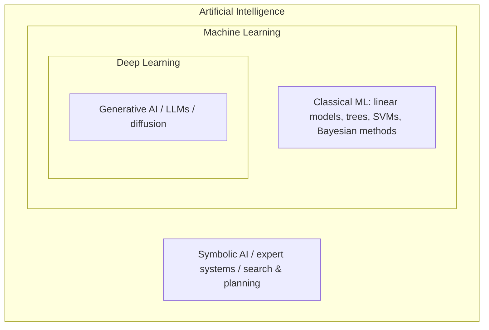

# Getting Started

This section gives you the big picture:

- [Learning Paths](learning-paths.md): reading orders for different backgrounds (beginners, engineers, researchers, neuroscience/psychology people, domain professionals).
- [Open-Source Resource Survey](open-source-survey.md): the most complete open AI textbooks, courses, knowledge bases and awesome lists, with license comparison.
- [History of AI](history.md): from the 1943 artificial neuron to today's language models and agents.

## What is artificial intelligence?

There is no single definition. Russell & Norvig (*AIMA*) organise the classic views into four:

| | Human-like | Rational |
|---|---|---|
| **Thinking** | Cognitive modelling: machines that think like people (the cognitive-science route) | Laws of thought: machines that reason correctly |
| **Acting** | Turing test: behaviour indistinguishable from a human | Rational agent: acts to maximise expected achievement of its goals |

Most modern AI research takes the rational-agent view, but cognitive science and neuroscience have always been major sources of inspiration — see [Brain & Mind](../brain-mind/index.md).

## AI, machine learning, deep learning

- **Artificial intelligence**: every method for getting machines to do tasks that require intelligence.
- **Machine learning**: learning patterns from data instead of hand-writing rules.
- **Deep learning**: machine learning with multi-layer neural networks that learn representations.
- **Generative AI**: models that produce new text, images, audio, code and more; mostly built on deep learning.

## Levels of capability

| Level | Meaning | Examples |
|---|---|---|
| Narrow AI | Human-level or better on one task | AlphaGo, image classification, speech recognition |
| Foundation models | One model adapted to many tasks by prompting or fine-tuning | GPT, Claude, Gemini, Llama families |
| Artificial general intelligence (AGI) | Matches or exceeds humans on nearly all cognitive tasks | No agreed definition; not achieved |
| Superintelligence (ASI) | Far exceeds humans across the board | Hypothetical |
