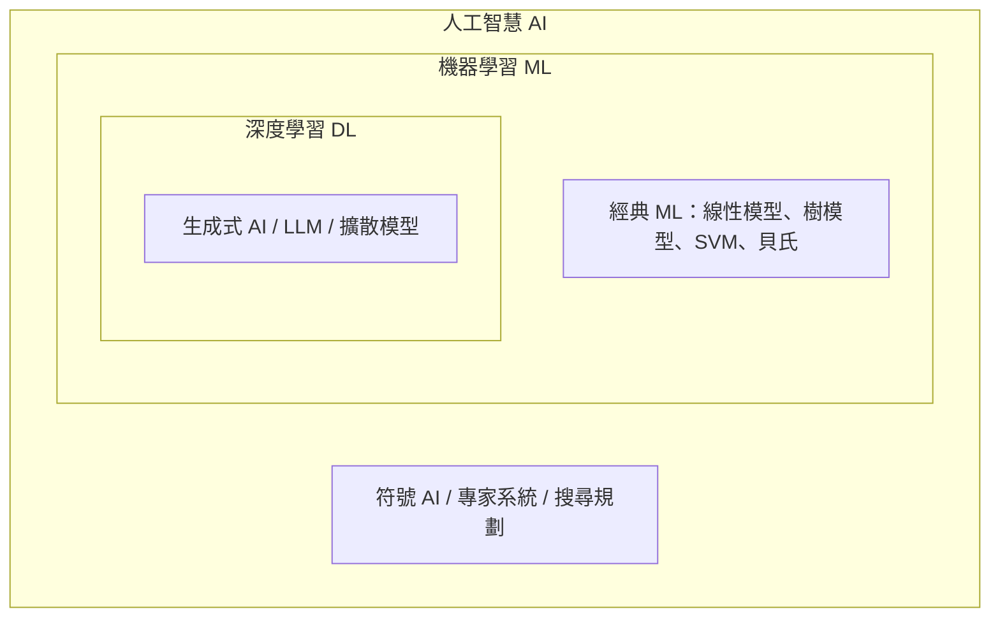

# 開始

這一區幫你建立全局觀：

- [學習路線](learning-paths/index.md)：依背景（零基礎、工程師、研究者、腦科學／心理學背景、各產業從業者）設計的閱讀順序。
- [開源資源調查](open-source-survey/index.md)：目前最完整的開源 AI 教材、知識庫、awesome 清單，與授權比較。
- [AI 發展史](history/index.md)：從 1943 年的人工神經元到今天的大型語言模型與代理人。

## 什麼是人工智慧？

「人工智慧」沒有唯一定義。常見的四種觀點（Russell & Norvig, *AIMA*）：

| | 像人類 | 理性 |
|---|---|---|
| **思考** | 認知建模：讓機器像人一樣思考（認知科學路線） | 邏輯推理：讓機器正確地推論 |
| **行動** | 圖靈測試：行為與人類無法區分 | 理性代理人：在環境中採取能最大化期望目標的行動 |

現代 AI 研究多採「理性代理人」觀點，但認知科學與神經科學路線一直是重要的靈感來源，見 [腦與心智](../brain-mind/index.md)。

## AI、機器學習、深度學習的關係

- **人工智慧**：讓機器完成需要智慧的任務的所有方法。
- **機器學習**：從資料中學習規律，而不是由人寫死規則。
- **深度學習**：用多層神經網路學習表徵的機器學習。
- **生成式 AI**：能產生文字、影像、聲音、程式碼等新內容的模型，多建立在深度學習之上。

## 能力分層

| 層級 | 說明 | 例子 |
|---|---|---|
| 窄 AI（Narrow AI） | 單一任務超越人類或接近人類 | 圍棋 AlphaGo、影像分類、語音辨識 |
| 通用型模型（Foundation Models） | 一個模型透過提示或微調處理大量任務 | GPT、Claude、Gemini、Llama 系列 |
| 通用人工智慧（AGI） | 在幾乎所有認知任務上達到或超越人類 | 尚無共識的定義，也尚未實現 |
| 超級智慧（ASI） | 全面遠超人類 | 假設性概念 |
