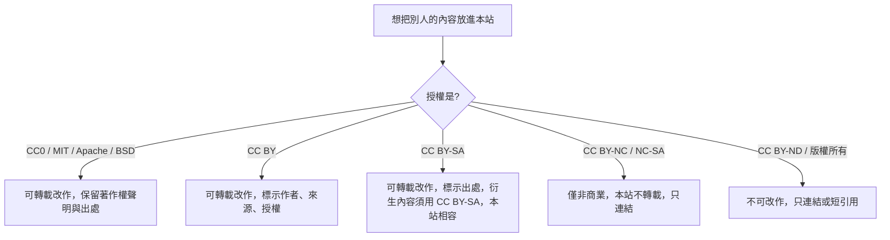

# 開源 AI 知識資源調查

> 整理日期：2026-10-27。授權資訊請以各專案 `LICENSE` 檔為準，專案可能隨時更改授權。

## 結論先講

目前**沒有任何單一開源專案**同時做到「涵蓋 AI 全領域 + 腦科學／認知科學／心理學 + 繁體中文 + 可瀏覽網站」。最接近的是幾類資源的組合：

| 需求 | 最佳開源資源 | 授權 | 能否直接轉載改作 |
|---|---|---|---|
| 深度學習教科書（中文） | [動手學深度學習 d2l-zh](https://github.com/d2l-ai/d2l-zh)（[線上版](https://zh.d2l.ai/)） | 文字 CC BY-SA 4.0、程式碼 MIT-0 | 可，需標示出處並以相同授權分享 |
| 入門課程（有繁中翻譯） | Microsoft [AI-For-Beginners](https://github.com/microsoft/AI-For-Beginners)、[ML-For-Beginners](https://github.com/microsoft/ML-For-Beginners)、[Generative-AI-for-Beginners](https://github.com/microsoft/generative-ai-for-beginners)、[AI-Agents-for-Beginners](https://github.com/microsoft/ai-agents-for-beginners) | MIT | 可，保留著作權聲明即可 |
| 計算神經科學／NeuroAI 課程 | [Neuromatch Academy](https://github.com/NeuromatchAcademy)（Computational Neuroscience、Deep Learning、NeuroAI、Climate 等課程） | 內容 CC BY 4.0、程式碼 BSD-3 | 可，需標示出處 |
| LLM 學習路線 | [mlabonne/llm-course](https://github.com/mlabonne/llm-course) | Apache-2.0 | 可 |
| 論文實作逐行註解 | [labmlai/annotated_deep_learning_paper_implementations](https://github.com/labmlai/annotated_deep_learning_paper_implementations) | MIT | 可 |
| 強化學習入門 | OpenAI [Spinning Up](https://github.com/openai/spinningup) | MIT | 可 |
| 提示工程 | [dair-ai/Prompt-Engineering-Guide](https://github.com/dair-ai/Prompt-Engineering-Guide)（含繁中） | MIT | 可 |
| 李宏毅機器學習筆記 | Datawhale [leedl-tutorial](https://github.com/datawhalechina/leedl-tutorial) 等 | 多為 CC BY-NC-SA 4.0 | **僅限非商業**，本站只連結不轉載 |
| 百科式條目 | [Wikipedia](https://zh.wikipedia.org/)（人工智慧、神經科學相關條目） | CC BY-SA 4.0 | 可，需標示出處並相同授權 |
| 機器學習名詞 | [Google 機器學習詞彙表](https://developers.google.com/machine-learning/glossary?hl=zh-tw) | CC BY 4.0（文字） | 可，需標示出處 |

**本站的做法**：以原創繁中文字為主體，系統性串起上述資源；文字採 CC BY-SA 4.0，因此未來可以合法吸收 d2l-zh、Wikipedia（CC BY-SA）與 Microsoft／Neuromatch（MIT、CC BY）的內容，只要標示出處。CC BY-NC 類資源只做連結。

## 分類詳表

### 1. 綜合教材與教科書

| 資源 | 說明 | 授權 |
|---|---|---|
| [Dive into Deep Learning](https://d2l.ai/) / [d2l-zh](https://zh.d2l.ai/) | 可執行的深度學習教科書，PyTorch/JAX/TF 版本，全球數百所大學採用 | CC BY-SA 4.0 / MIT-0 |
| [Microsoft AI-For-Beginners](https://github.com/microsoft/AI-For-Beginners) | 12 週 24 課，涵蓋符號 AI、神經網路、CV、NLP、倫理，含 zh-TW 翻譯 | MIT |
| [Microsoft ML-For-Beginners](https://github.com/microsoft/ML-For-Beginners) | 12 週經典機器學習（scikit-learn） | MIT |
| [Understanding Deep Learning](https://udlbook.github.io/udlbook/)（Simon Prince） | 2023 年出版，PDF 免費，圖解極佳 | PDF 免費閱讀，版權所有 |
| [Deep Learning Book](https://www.deeplearningbook.org/)（Goodfellow 等） | 經典教科書，可免費線上閱讀 | 版權所有，僅可閱讀 |
| [Probabilistic Machine Learning](https://probml.github.io/pml-book/)（Kevin Murphy） | 兩冊，機率觀點的機器學習百科 | 草稿 PDF 免費（CC BY-NC-ND） |
| [Mathematics for Machine Learning](https://mml-book.github.io/) | 線性代數、微積分、機率 | 免費 PDF，版權所有 |
| [Reinforcement Learning: An Introduction](http://incompleteideas.net/book/the-book-2nd.html)（Sutton & Barto） | 強化學習聖經 | 免費 PDF（CC BY-NC-ND） |
| [Artificial Intelligence: A Modern Approach](https://aima.cs.berkeley.edu/) | AI 教科書標準，[aima-python](https://github.com/aimacode/aima-python) 程式碼 MIT | 書籍版權所有 |

### 2. 大型語言模型與生成式 AI

| 資源 | 說明 | 授權 |
|---|---|---|
| [mlabonne/llm-course](https://github.com/mlabonne/llm-course) | LLM 基礎、科學家、工程師三條路線 | Apache-2.0 |
| [Hugging Face Learn](https://huggingface.co/learn)（NLP、Agents、Diffusion、Deep RL 課程） | 官方互動課程 | 多為 Apache-2.0 |
| [Hannibal046/Awesome-LLM](https://github.com/Hannibal046/Awesome-LLM) | LLM 論文、模型、工具清單 | CC0-1.0 |
| [karpathy/nn-zero-to-hero](https://github.com/karpathy/nn-zero-to-hero)、[nanoGPT](https://github.com/karpathy/nanoGPT) | 從零寫出 GPT | MIT |
| [rasbt/LLMs-from-scratch](https://github.com/rasbt/LLMs-from-scratch) | 書籍配套程式碼 | Apache-2.0（程式碼） |
| [dair-ai/Prompt-Engineering-Guide](https://github.com/dair-ai/Prompt-Engineering-Guide) | 提示工程、RAG、代理人 | MIT |
| [Datawhale so-large-lm、llm-cookbook 等](https://github.com/datawhalechina) | 簡中 LLM 教程 | 多為 CC BY-NC-SA 4.0 |

### 3. 腦科學、神經科學、認知科學

| 資源 | 說明 | 授權 |
|---|---|---|
| [Neuromatch Academy](https://neuromatch.io/) [course-content](https://github.com/NeuromatchAcademy/course-content) | 計算神經科學 3 週密集課，含影片與 Colab | CC BY 4.0 / BSD-3 |
| [Neuromatch NeuroAI 課程](https://github.com/neuromatch/NeuroAI_Course) | 大腦與 AI 交叉主題：泛化、微電路、表徵比較 | CC BY 4.0 / BSD-3 |
| [sakimarquis/awesome-computational-neuroscience](https://github.com/sakimarquis/awesome-computational-neuroscience) | 計算神經科學課程、書籍、工具清單 | 請見專案（awesome 清單通常 CC0） |
| [CYHSM/awesome-neuro-ai-papers](https://github.com/CYHSM/awesome-neuro-ai-papers) | 神經科學 × AI 論文清單 | 請見專案 |
| [Neuronal Dynamics](https://neuronaldynamics.epfl.ch/)（Gerstner 等） | 神經元模型、脈衝網路，線上全文 | 免費閱讀 |
| [Brian2](https://github.com/brian-team/brian2)、[NEST](https://github.com/nest/nest-simulator)、[snnTorch](https://github.com/jeshraghian/snntorch) | 神經模擬與 SNN 框架，附教學 | CeCILL / GPL / MIT |
| [Brain-Score](https://www.brain-score.org/) | 比較 AI 模型與大腦視覺／語言表徵的基準 | MIT |
| [Stanford Encyclopedia of Philosophy](https://plato.stanford.edu/) | 心靈哲學、認知科學、意識條目 | 免費閱讀，版權所有 |
| [Scholarpedia](http://www.scholarpedia.org/) | 同儕審查的計算神經科學百科 | 依條目而定 |

### 4. 強化學習、機器人

| 資源 | 說明 | 授權 |
|---|---|---|
| [OpenAI Spinning Up](https://spinningup.openai.com/) | Deep RL 理論與實作 | MIT |
| [Hugging Face Deep RL Course](https://huggingface.co/learn/deep-rl-course) | 實作導向 | Apache-2.0 |
| [aikorea/awesome-rl](https://github.com/aikorea/awesome-rl) | RL 資源清單 | 請見專案 |
| [Gymnasium](https://github.com/Farama-Foundation/Gymnasium) | 標準 RL 環境 | MIT |

### 5. 綜合 awesome 清單（適合當索引）

| 資源 | 說明 |
|---|---|
| [josephmisiti/awesome-machine-learning](https://github.com/josephmisiti/awesome-machine-learning) | 依語言分類的 ML 框架與工具 |
| [owainlewis/awesome-artificial-intelligence](https://github.com/owainlewis/awesome-artificial-intelligence) | AI 課程、書籍、論文 |
| [ChristosChristofidis/awesome-deep-learning](https://github.com/ChristosChristofidis/awesome-deep-learning) | 深度學習資源 |
| [dair-ai/ML-YouTube-Courses](https://github.com/dair-ai/ML-YouTube-Courses) | 頂尖大學公開課影片索引 |
| [labmlai annotated papers](https://nn.labml.ai/) | 論文逐行註解實作 |

!!! warning "awesome 清單的限制"
    awesome 清單是「連結目錄」，不是知識內容；很多清單已停止維護，連結失效比例高。適合當入口，不適合當教材。

### 6. 中文社群資源

| 資源 | 說明 | 授權 |
|---|---|---|
| [李宏毅 機器學習課程](https://speech.ee.ntu.edu.tw/~hylee/index.php)（台大） | 華語圈最受歡迎的 ML/生成式 AI 課，每年更新 | 影片於 YouTube 免費觀看 |
| [台大 林軒田 機器學習基石／技法](https://www.csie.ntu.edu.tw/~htlin/mooc/) | 理論扎實的經典課程 | 免費觀看 |
| [d2l-zh](https://zh.d2l.ai/) | 見上 | CC BY-SA 4.0 |
| [Datawhale](https://github.com/datawhalechina) | 大量簡中教程（南瓜書、LLM、RL、推薦系統） | 多為 CC BY-NC-SA 4.0 |
| [台灣人工智慧學校](https://aiacademy.tw/) | 實務課程（付費） | — |

## 授權相容性速查

## 為什麼還要自己建一個？

1. **繁中缺口**：大部分高品質中文資源是簡體中文，且授權多為非商業。
2. **跨領域缺口**：AI 教材很少系統性談神經科學、認知科學與心理學，而這些領域的教材也很少談最新 AI。
3. **應用缺口**：「AI 在各領域怎麼用」多半散落在產業報告與新聞，少有結構化整理。
4. **可持續擴充**：Git + Markdown + 自動部署，任何人都能用 Pull Request 補充內容。
