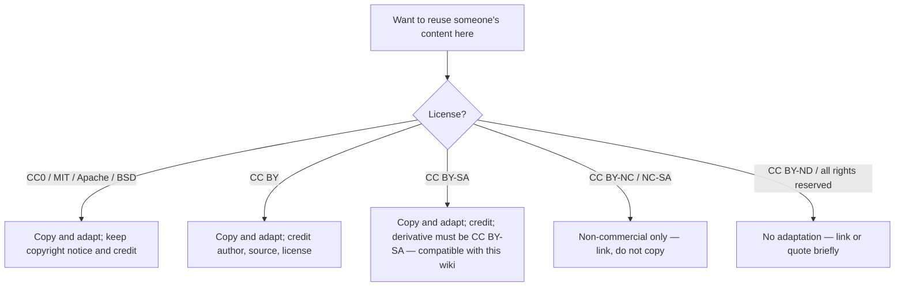

# Open-Source Resource Survey

> Compiled 2026-10-27. Always confirm a license in the project's own `LICENSE` file; projects can relicense at any time.

## Bottom line

**No single open project** covers "all of AI + brain science, cognitive science and psychology + applications by field + a browsable website". The closest you get is a combination of several high-quality resources:

| Need | Best open resource | License | Can it be copied and adapted? |
|---|---|---|---|
| Deep learning textbook | [Dive into Deep Learning](https://d2l.ai/) ([d2l-en](https://github.com/d2l-ai/d2l-en), [d2l-zh](https://github.com/d2l-ai/d2l-zh)) | Text CC BY-SA 4.0, code MIT-0 | Yes, with attribution and share-alike |
| Beginner curricula | Microsoft [AI-For-Beginners](https://github.com/microsoft/AI-For-Beginners), [ML-For-Beginners](https://github.com/microsoft/ML-For-Beginners), [Generative-AI-for-Beginners](https://github.com/microsoft/generative-ai-for-beginners), [AI-Agents-for-Beginners](https://github.com/microsoft/ai-agents-for-beginners) | MIT | Yes, keep the copyright notice |
| Computational neuroscience / NeuroAI | [Neuromatch Academy](https://github.com/NeuromatchAcademy) (Computational Neuroscience, Deep Learning, NeuroAI, Climate courses) | Content CC BY 4.0, code BSD-3 | Yes, with attribution |
| LLM roadmap | [mlabonne/llm-course](https://github.com/mlabonne/llm-course) | Apache-2.0 | Yes |
| Annotated paper implementations | [labmlai/annotated_deep_learning_paper_implementations](https://github.com/labmlai/annotated_deep_learning_paper_implementations) | MIT | Yes |
| Reinforcement learning | OpenAI [Spinning Up](https://github.com/openai/spinningup) | MIT | Yes |
| Prompt engineering | [dair-ai/Prompt-Engineering-Guide](https://github.com/dair-ai/Prompt-Engineering-Guide) | MIT | Yes |
| Encyclopaedic articles | [Wikipedia](https://en.wikipedia.org/) | CC BY-SA 4.0 | Yes, with attribution and share-alike |
| ML terminology | [Google Machine Learning Glossary](https://developers.google.com/machine-learning/glossary) | Text CC BY 4.0 | Yes, with attribution |
| Chinese-language tutorials | [Datawhale](https://github.com/datawhalechina) (e.g. leedl-tutorial, so-large-lm) | Mostly CC BY-NC-SA 4.0 | **Non-commercial only** — this wiki links, never copies |

**This wiki's approach:** original text as the backbone, systematically linking the resources above. Because our text is CC BY-SA 4.0, we can legally absorb material from d2l and Wikipedia (CC BY-SA) and from Microsoft and Neuromatch (MIT, CC BY) with attribution. Non-commercial resources are linked only.

## How complete are existing resources?

| Area | Maturity | Comment |
|---|---|---|
| ML / deep learning textbooks | ★★★★★ | Complete, course-quality, openly licensed (d2l, Microsoft) |
| LLMs and generative AI | ★★★★☆ | Plenty of material but fast-moving; much of it is link lists |
| Reinforcement learning | ★★★★☆ | Sutton & Barto, Spinning Up, Hugging Face course |
| Computational neuroscience & NeuroAI | ★★★☆☆ | Neuromatch is excellent but code-centric; everything else is paper lists |
| Cognitive science & psychology × AI | ★★☆☆☆ | Almost no open systematic material; scattered across SEP entries and papers |
| AI applications by domain | ★★☆☆☆ | Scattered across industry reports and news; little structured coverage |
| AI & society | ★★★☆☆ | Good reports (AI Index, safety textbooks) but not integrated with the technical material |

## Detailed tables

### 1. General textbooks and courses

| Resource | Description | License |
|---|---|---|
| [Dive into Deep Learning](https://d2l.ai/) | Executable deep-learning textbook (PyTorch/JAX/TF), used by hundreds of universities | CC BY-SA 4.0 / MIT-0 |
| [Microsoft AI-For-Beginners](https://github.com/microsoft/AI-For-Beginners) | 12 weeks, 24 lessons: symbolic AI, neural nets, CV, NLP, ethics; many translations | MIT |
| [Microsoft ML-For-Beginners](https://github.com/microsoft/ML-For-Beginners) | 12 weeks of classical ML with scikit-learn | MIT |
| [Understanding Deep Learning](https://udlbook.github.io/udlbook/) (Prince) | 2023 textbook with superb figures; free PDF | Free to read, all rights reserved |
| [Deep Learning](https://www.deeplearningbook.org/) (Goodfellow et al.) | Classic textbook, free online | All rights reserved |
| [Probabilistic Machine Learning](https://probml.github.io/pml-book/) (Murphy) | Two-volume probabilistic encyclopaedia | Draft PDFs free (CC BY-NC-ND) |
| [Mathematics for Machine Learning](https://mml-book.github.io/) | Linear algebra, calculus, probability | Free PDF |
| [Reinforcement Learning: An Introduction](http://incompleteideas.net/book/the-book-2nd.html) | The RL bible | Free PDF (CC BY-NC-ND) |
| [AIMA](https://aima.cs.berkeley.edu/) and [aima-python](https://github.com/aimacode/aima-python) | Standard AI textbook; code is MIT | Book all rights reserved |

### 2. Large language models and generative AI

| Resource | Description | License |
|---|---|---|
| [mlabonne/llm-course](https://github.com/mlabonne/llm-course) | LLM fundamentals, scientist and engineer tracks | Apache-2.0 |
| [Hugging Face Learn](https://huggingface.co/learn) | LLM, Agents, Diffusion, Deep RL, Audio courses | Mostly Apache-2.0 |
| [Hannibal046/Awesome-LLM](https://github.com/Hannibal046/Awesome-LLM) | Papers, models, tools | CC0-1.0 |
| [karpathy/nn-zero-to-hero](https://github.com/karpathy/nn-zero-to-hero), [nanoGPT](https://github.com/karpathy/nanoGPT) | Build GPT from scratch | MIT |
| [rasbt/LLMs-from-scratch](https://github.com/rasbt/LLMs-from-scratch) | Companion code to the book | Apache-2.0 (code) |
| [Prompt-Engineering-Guide](https://github.com/dair-ai/Prompt-Engineering-Guide) | Prompting, RAG, agents | MIT |

### 3. Brain, neuroscience, cognitive science

| Resource | Description | License |
|---|---|---|
| [Neuromatch course-content](https://github.com/NeuromatchAcademy/course-content) | Three-week intensive computational neuroscience course with videos and notebooks | CC BY 4.0 / BSD-3 |
| [Neuromatch NeuroAI course](https://github.com/neuromatch/NeuroAI_Course) | Generalisation, microcircuits, comparing representations | CC BY 4.0 / BSD-3 |
| [awesome-computational-neuroscience](https://github.com/sakimarquis/awesome-computational-neuroscience) | Courses, books, tools | See project |
| [awesome-neuro-ai-papers](https://github.com/CYHSM/awesome-neuro-ai-papers) | Neuroscience × AI papers | See project |
| [Neuronal Dynamics](https://neuronaldynamics.epfl.ch/) (Gerstner et al.) | Neuron models and spiking networks, full text online | Free to read |
| [Brian2](https://github.com/brian-team/brian2), [NEST](https://github.com/nest/nest-simulator), [snnTorch](https://github.com/jeshraghian/snntorch) | Simulators and SNN frameworks with tutorials | CeCILL / GPL / MIT |
| [Brain-Score](https://www.brain-score.org/) | Benchmarks comparing models to brain data | MIT |
| [Stanford Encyclopedia of Philosophy](https://plato.stanford.edu/) | Philosophy of mind, cognitive science, consciousness | Free to read, all rights reserved |
| [Scholarpedia](http://www.scholarpedia.org/) | Peer-reviewed computational neuroscience encyclopaedia | Varies by article |

### 4. Reinforcement learning and robotics

| Resource | Description | License |
|---|---|---|
| [Spinning Up](https://spinningup.openai.com/) | Deep RL theory and code | MIT |
| [Hugging Face Deep RL Course](https://huggingface.co/learn/deep-rl-course) | Hands-on | Apache-2.0 |
| [awesome-rl](https://github.com/aikorea/awesome-rl) | RL resources | See project |
| [Gymnasium](https://github.com/Farama-Foundation/Gymnasium) | Standard RL environments | MIT |

### 5. Awesome lists (good as indexes)

| Resource | Description |
|---|---|
| [awesome-machine-learning](https://github.com/josephmisiti/awesome-machine-learning) | ML frameworks and tools by language |
| [awesome-artificial-intelligence](https://github.com/owainlewis/awesome-artificial-intelligence) | AI courses, books, papers |
| [awesome-deep-learning](https://github.com/ChristosChristofidis/awesome-deep-learning) | Deep learning resources |
| [ML-YouTube-Courses](https://github.com/dair-ai/ML-YouTube-Courses) | Index of top university lecture videos |
| [labml.ai annotated papers](https://nn.labml.ai/) | Line-by-line annotated implementations |

!!! warning "Limits of awesome lists"
    Awesome lists are directories of links, not explanations. Many are unmaintained and accumulate dead links. Use them as entry points, not as teaching material.

### 6. Chinese-language resources

| Resource | Description | License |
|---|---|---|
| [Hung-yi Lee's ML courses](https://speech.ee.ntu.edu.tw/~hylee/index.php) (NTU) | The most popular Mandarin ML / generative AI lectures, updated yearly | Free on YouTube |
| [Hsuan-Tien Lin's ML Foundations/Techniques](https://www.csie.ntu.edu.tw/~htlin/mooc/) (NTU) | Theory-solid classic course | Free to watch |
| [d2l-zh](https://zh.d2l.ai/) | Chinese edition of d2l | CC BY-SA 4.0 |
| [Datawhale](https://github.com/datawhalechina) | Many simplified-Chinese tutorials | Mostly CC BY-NC-SA 4.0 |

## License compatibility cheat sheet

## Why build another one?

1. **Integration gap**: AI textbooks rarely cover neuroscience, cognitive science and psychology systematically, and those fields' textbooks rarely cover current AI.
2. **Application gap**: "how AI is used in field X" is scattered across reports and news.
3. **Language gap**: high-quality Traditional Chinese material is scarce; this wiki is bilingual.
4. **Sustainability**: Git + Markdown + automatic deployment means anyone can contribute with a pull request.

## References

- Paszke, A. et al. (2019). *PyTorch: An Imperative Style, High-Performance Deep Learning Library*. arXiv:1912.01703. https://arxiv.org/abs/1912.01703 — Describes PyTorch's design, the framework most open-source resources in this survey build on.
- Abadi, M. et al. (2016). *TensorFlow: Large-Scale Machine Learning on Heterogeneous Distributed Systems*. arXiv:1603.04467. https://arxiv.org/abs/1603.04467 — Describes the TensorFlow dataflow system and its support for heterogeneous and distributed execution.
- Pedregosa, F. et al. (2011). Scikit-learn: Machine Learning in Python. *Journal of Machine Learning Research* 12. https://jmlr.org/papers/v12/pedregosa11a.html — Describes scikit-learn, a widely used open-source toolkit for classical machine learning.
- Wolf, T. et al. (2020). Transformers: State-of-the-Art Natural Language Processing. *Proceedings of EMNLP 2020: System Demonstrations*. https://doi.org/10.18653/v1/2020.emnlp-demos.6 — Describes the Hugging Face Transformers library and its open model hub.
- Chen, T. et al. (2015). *MXNet: A Flexible and Efficient Machine Learning Library for Heterogeneous Distributed Systems*. arXiv:1512.01274. https://arxiv.org/abs/1512.01274 — Describes MXNet, an open-source library for distributed deep learning across heterogeneous hardware.
