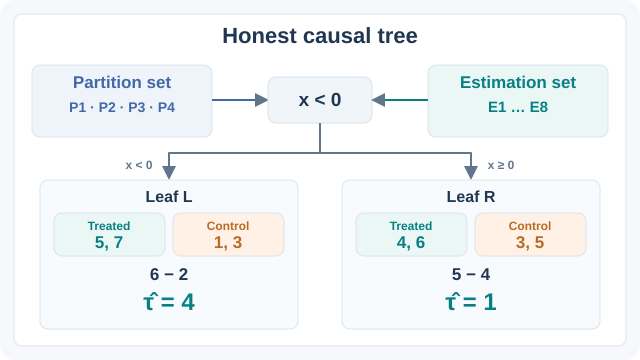

# Causal Forests

A causal forest estimates how a treatment effect varies across covariate-defined groups. It adapts random forests so that the trees split where effects differ, and, under regularity conditions, gives asymptotic confidence intervals at a point (Wager & Athey 2018). It is one of the landmark methods on the [causal inference overview](index.md).

## Problem

An average effect hides variation across people. The target is the conditional average treatment effect

$$\tau(x) = E\big[Y(1) - Y(0) \mid X = x\big],$$

where $Y(1)$ and $Y(0)$ are the potential outcomes under treatment and control. A standard random forest predicts $Y$, not the difference between two potential outcomes, and ordinary predictive intervals are not valid intervals for $\tau(x)$. Simpler approaches, such as fitting separate outcome models for treated and control units and subtracting them, can be unstable. Künzel et al. (2019) compare several such meta-learners.

## Core idea

Three ingredients, following Athey and Imbens (2016) and Wager and Athey (2018):

1. **Trees that split on effect differences.** Splits target treatment-effect heterogeneity, accounting for child sizes, uncertainty and minimum treated/control counts. They do not simply maximise the unweighted absolute difference between two noisy child estimates.
2. **Honest estimation.** Separate observations choose the partition and estimate leaf effects. A half/half split is one implementation, not the definition of honesty. Reusing outcomes for adaptive split selection and leaf estimation can introduce selection bias.
3. **Adaptive averaging.** Averaging over many randomised trees, as in bagging with random feature subsets (Breiman 2001), averages treatment-versus-control contrasts from leaves near $x$. In the basic honest causal tree, each leaf estimate is the treated mean minus the control mean. Thus the induced outcome coefficients are signed, not a single nonnegative average of all outcomes. Modern generalized causal forests instead solve a locally weighted, orthogonalized moment equation.

## Algorithm

1. Draw many subsamples of size $s$ without replacement.
2. Split each subsample into disjoint partition and estimation sets. Grow a tree on the partition set using random feature subsets and a heterogeneity-sensitive splitting criterion subject to leaf-size and treatment-balance constraints.
3. With the partition fixed, estimate leaf effects on the estimation set; each relevant leaf needs treated and control observations.
4. Average the leaf estimates over all trees to obtain $\hat\tau(x)$.
5. Estimate the sampling variance $\hat\sigma^2(x)$ and form the interval $\hat\tau(x) \pm z_{1-\alpha/2}\,\hat\sigma(x)$.

On narrow screens, focus the figure and use the left/right arrow keys or swipe horizontally to read it at its natural size. MkDocs provides Play/Pause and reduced motion. [Complete static preview](../../assets/concept-animations/honest-tree-leaf-contrast-still.svg) · [Standalone animation](../../assets/concept-animations/honest-tree-leaf-contrast-motion.svg).

*Original educational animation, CC BY-SA 4.0.* P1–P4 are partition observations; E1–E8 are disjoint estimation observations. A schematic split at zero is fixed before any estimation outcomes are used. The blue pulse represents partition selection; teal pulses represent routing estimation observations by their covariates, not refitting the split. In the left leaf, treated outcomes (5, 7) and controls (1, 3) give $6-2=4$; in the right leaf, treated outcomes (4, 6) and controls (3, 5) give $5-4=1$. The split and values are constructed, not results of a fitted tree or evidence of real effect heterogeneity. This is one basic honest tree, not the full forest or a generalized random forest moment equation.

### A leaf contrast is not an outcome mean

For estimation observations in leaf $L$, with $n_1$ treated and $n_0$ controls,

\[
\begin{aligned}
\hat\tau_L&=\frac1{n_1}\sum_{i\in L:D_i=1}Y_i\\
&\quad-\frac1{n_0}\sum_{i\in L:D_i=0}Y_i.
\end{aligned}
\]

For treated outcomes $(5,7)$ and controls $(1,3)$, the leaf contrast is $6-2=4$, not the pooled outcome mean $4$. Those numbers happen to coincide; adding $10$ to every outcome keeps the effect at $4$ but changes the pooled mean to $14$. This constructed example tests the distinction, not empirical accuracy.

### Leaf contrasts under unequal treatment counts

Honesty keeps partition selection separate from leaf estimation, but it does not require equal treated and control counts or remove confounding by itself.[^honest-partition] To see why leaf membership matters, extend the animation's toy estimation sample: add two treated outcomes of 6 to the left leaf and two control outcomes of 4 to the right leaf, keeping the split fixed. Each leaf now contains six observations. The within-leaf contrasts remain 4 and 1.

| Leaf | Treated count / mean | Control count / mean | Contrast |
| --- | --- | --- | --- |
| L | 4 / 6 | 2 / 2 | 4 |
| R | 2 / 5 | 4 / 4 | 1 |

Standardizing these two contrasts to a target distribution with equal leaf proportions gives $(4+1)/2=5/2$. Ignoring the split and pooling outcomes by treatment instead gives $(24+10)/6-(4+16)/6=7/3$. The two treatment groups place different proportions of their observations in each leaf, so the crude difference changes despite unchanged leaf contrasts. This illustrates stratified aggregation, not the prediction rule of a full causal forest or evidence from a fitted model. If either treatment group is absent from a leaf, its simple contrast is undefined rather than zero; actual implementations must address such support constraints.

[^honest-partition]: Athey & Imbens (2016), *Recursive partitioning for heterogeneous causal effects*. https://doi.org/10.1073/pnas.1510489113 — Honest partition/estimation separation and treatment-effect estimation in leaves.

## Results

Wager and Athey (2018) report that, under their conditions, the causal forest estimate has an asymptotically Gaussian and centred sampling distribution. This is what permits confidence intervals centred on the estimate at a point. Their simulations and empirical checks are in the paper and are not reproduced here.

## Limitations

- **Unconfoundedness and overlap.** Like [DML](double-machine-learning.md), a causal forest needs the covariates to block all confounding. Every type of individual must have a positive chance of receiving each treatment.
- **Efficiency cost.** Separating observations reduces the data available to either task within a tree, creating a bias–variance tradeoff. It does not imply that every honest forest has worse finite-sample error than every adaptive forest.
- **Asymptotic guarantees.** The interval validity depends on conditions on subsampling and tree growth. Coverage in small samples is not guaranteed by the theory.
- **Multiple comparisons.** Examining many subgroups invites false discoveries of heterogeneity, so subgroups should be specified in advance or corrected.
- **Description, not mechanism.** The method says where effects differ, not why they differ.

## Connections

Causal forests complement [double/debiased machine learning](double-machine-learning.md). DML targets chosen low-dimensional parameters using orthogonal scores, while a causal forest estimates the conditional-effect function $\tau(x)$. The forest itself is a random forest, whose general learning theory is in the [Machine Learning](../machine-learning/index.md) chapter.

## Applications

- **Personalised medicine.** Finding which patients benefit most from a treatment, using data from trials and registries.
- **Online experiments.** Finding which users respond to a product change, as in the online-experiment example of the [overview](index.md).
- **Policy targeting.** Choosing whom to treat when the budget is limited and the effect varies.

## Open questions

- How to estimate effects efficiently when there are many outcomes or dynamic treatments.
- How the interval guarantees behave with weak overlap and high-dimensional covariates.
- How far heterogeneity estimated in one population transfers to another.

## References

### Seminal papers

- Breiman, L. (2001). Random Forests. *Machine Learning*, 45(1), 5–32. doi:[10.1023/A:1010933404324](https://doi.org/10.1023/A:1010933404324) — Introduces random forests, the averaging over randomised trees on which causal forests are built.
- Athey, S. & Imbens, G. (2016). Recursive partitioning for heterogeneous causal effects. *Proceedings of the National Academy of Sciences*, 113(27), 7353–7360. doi:[10.1073/pnas.1510489113](https://doi.org/10.1073/pnas.1510489113) — Trees that split on differences in treatment effects, with honest estimation of leaf effects.
- Wager, S. & Athey, S. (2018). Estimation and Inference of Heterogeneous Treatment Effects using Random Forests. *Journal of the American Statistical Association*, 113(523), 1228–1242. doi:[10.1080/01621459.2017.1319839](https://doi.org/10.1080/01621459.2017.1319839) — The causal forest method, with an asymptotically Gaussian sampling distribution and confidence intervals at a point.
- Wager, S. & Athey, S. (2015). Estimation and Inference of Heterogeneous Treatment Effects using Random Forests. arXiv. https://arxiv.org/abs/1510.04342 — Preprint of the 2018 paper, with the same authors and method.

### Surveys and textbooks

- Athey, S., Tibshirani, J. & Wager, S. (2019). Generalized random forests. *The Annals of Statistics*, 47(2), 1148–1178. doi:[10.1214/18-AOS1709](https://doi.org/10.1214/18-AOS1709) — Extends the forest approach to any estimating equation, with the same honest splitting.
- Künzel, S. R., Sekhon, J. S., Bickel, P. J. & Yu, B. (2019). Metalearners for estimating heterogeneous treatment effects using machine learning. *Proceedings of the National Academy of Sciences*, 116(10), 4156–4165. doi:[10.1073/pnas.1804597116](https://doi.org/10.1073/pnas.1804597116) — Compares meta-learner approaches to estimating CATE with machine learning, the alternative that causal forests are often measured against.
