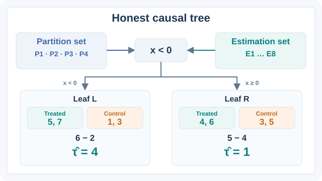

# 因果森林

因果森林估計處理效應如何隨共變量所定義的群體改變。它調整隨機森林，使分割關注效應異質性，並在正則條件下提供點態漸近信賴區間（Wager 與 Athey，2018）。其定位見[因果推論總覽](index.md)。

## 問題

平均效應可能掩蓋群體差異。目標是條件平均處理效應（CATE）：

\[
\tau(x)=E[Y(1)-Y(0)\mid X=x].
\]

$Y(1),Y(0)$ 是處理與控制下的潛在結果。一般隨機森林預測 $Y$，而非兩個潛在結果之差，其普通預測區間不是 $\tau(x)$ 的有效信賴區間。分別擬合處理組與控制組結果再相減，也可能不穩定；Künzel 等人（2019）比較多種這類 meta-learner。

## 核心想法

依 Athey 與 Imbens（2016）、Wager 與 Athey（2018），有三個要素：

1. **依效應差異分割。** 準則關注處理效應異質性，同時考慮子節點大小、不確定性與處理／控制樣本數限制；不是單純最大化兩個帶雜訊估計值的未加權絕對差。
2. **誠實估計。** 使用不同觀察值選擇分割與估計葉節點效應。對半切分是可用實作，不是 honesty 的定義。重複使用結果來選擇分割並估計效應，可能導致選擇偏差。
3. **適應性平均。** 隨機子樣本與特徵上的多棵樹，平均查詢點附近葉節點的處理／控制對比。基本誠實因果樹使用處理組平均減去控制組平均，因此結果的隱含係數有正有負，不是所有結果的單一非負加權平均。現代 generalized causal forest 則解局部加權的正交矩方程。

## 演算法

1. 不放回抽取多個大小為 $s$ 的子樣本。
2. 每個子樣本再分成互斥的分割集與估計集。使用分割集、隨機特徵子集與異質性敏感準則長樹，並限制葉節點大小與處理平衡。
3. 固定分割後，以估計集計算葉節點效應；相關葉節點需要處理及控制觀察值。
4. 平均所有樹的葉節點估計，得到 $\hat\tau(x)$。
5. 估計抽樣變異 $\hat\sigma^2(x)$，形成點態區間：

\[
\hat\tau(x)\pm z_{1-\alpha/2}\hat\sigma(x).
\]

窄螢幕可聚焦圖形後使用左右方向鍵或滑動，閱讀原始尺寸。MkDocs 提供播放／暫停與減少動態效果的支援。 [完整靜態預覽](../../assets/concept-animations/honest-tree-leaf-contrast-still.svg) · [獨立動畫](../../assets/concept-animations/honest-tree-leaf-contrast-motion.svg).

*原創教學動畫，CC BY-SA 4.0。* P1–P4 為分割觀察值，E1–E8 為互斥的估計觀察值。在使用估計集結果前，先固定零點的示意分割。藍色圓點代表選擇分割；青綠色圓點代表依共變量將估計觀察值送入葉節點，而非重新擬合分割。左葉的處理結果 (5, 7) 與控制結果 (1, 3) 給出 $6-2=4$；右葉的處理結果 (4, 6) 與控制結果 (3, 5) 給出 $5-4=1$。分割與數值均為人工構造，不是實際擬合結果或真實效應異質性的證據。此例為單棵基本誠實因果樹，而非完整森林或 generalized random forest 的矩方程。

### 葉節點對比不是結果平均

設估計集在葉節點 $L$ 中有 $n_1$ 個處理與 $n_0$ 個控制觀察值：

\[
\begin{aligned}
\hat\tau_L&=\frac1{n_1}\sum_{i\in L:D_i=1}Y_i\\
&\quad-\frac1{n_0}\sum_{i\in L:D_i=0}Y_i.
\end{aligned}
\]

若處理結果為 $(5,7)$、控制為 $(1,3)$，效應是 $6-2=4$；合併結果平均也恰好為 $4$，但兩者並非同一量。全部結果加 $10$ 後，效應仍為 $4$，合併平均卻變成 $14$。這是區分兩種運算的人工例子，不是實測準確率。

## 結果

Wager 與 Athey（2018）證明，在其假設下估計量具有漸近高斯、正確置中的抽樣分布，因此可建立以估計值為中心的點態漸近區間。論文的模擬及實證檢查不在此重製。

## 限制

- **無混淆與重疊性。** 本文設定需要共變量阻斷混淆，且各類個體有正機率接受兩種處理；參見 [DML](double-machine-learning.md)。
- **效率取捨。** 分離觀察值會減少單棵樹每項工作可用的資料，帶來偏差與變異取捨；不代表每個誠實森林的有限樣本誤差都較差。
- **漸近條件。** 區間依賴子抽樣及樹生長的正則條件，理論不保證小樣本涵蓋率。
- **多重比較。** 搜尋大量子群可能產生異質性的偽發現，應事先定義問題或做適當校正。
- **描述而非機制。** 方法估計效應在哪裡不同，不直接解釋差異的原因。

## 關聯

[雙重／去偏機器學習](double-machine-learning.md)以正交分數估計選定的低維參數；因果森林估計條件效應函數 $\tau(x)$，兩者互補。隨機森林的一般學習背景見[機器學習](../machine-learning/index.md)。

## 應用

- **個人化醫療。** 從試驗與登記資料研究哪些群體受益。
- **線上實驗。** 分析哪些使用者對產品變動有反應，見[總覽](index.md)。
- **政策配置。** 預算有限且效應異質時，研究處理資源的配置。

## 開放問題

- 多種結果或動態處理下如何有效估計。
- 薄弱重疊性及高維共變量下，區間保證如何表現。
- 異質效應如何從一個母體移轉到另一個母體。

## 參考文獻

### 開創性論文

- Breiman, L. (2001). Random Forests. *Machine Learning*, 45(1), 5–32. doi:[10.1023/A:1010933404324](https://doi.org/10.1023/A:1010933404324) — Introduces random forests, the averaging over randomised trees on which causal forests are built.
- Athey, S. & Imbens, G. (2016). Recursive partitioning for heterogeneous causal effects. *Proceedings of the National Academy of Sciences*, 113(27), 7353–7360. doi:[10.1073/pnas.1510489113](https://doi.org/10.1073/pnas.1510489113) — Trees that split on differences in treatment effects, with honest estimation of leaf effects.
- Wager, S. & Athey, S. (2018). Estimation and Inference of Heterogeneous Treatment Effects using Random Forests. *Journal of the American Statistical Association*, 113(523), 1228–1242. doi:[10.1080/01621459.2017.1319839](https://doi.org/10.1080/01621459.2017.1319839) — The causal forest method, with an asymptotically Gaussian sampling distribution and confidence intervals at a point.
- Wager, S. & Athey, S. (2015). Estimation and Inference of Heterogeneous Treatment Effects using Random Forests. arXiv. https://arxiv.org/abs/1510.04342 — Preprint of the 2018 paper, with the same authors and method.

### 綜述與教科書

- Athey, S., Tibshirani, J. & Wager, S. (2019). Generalized random forests. *The Annals of Statistics*, 47(2), 1148–1178. doi:[10.1214/18-AOS1709](https://doi.org/10.1214/18-AOS1709) — Extends the forest approach to any estimating equation, with the same honest splitting.
- Künzel, S. R., Sekhon, J. S., Bickel, P. J. & Yu, B. (2019). Metalearners for estimating heterogeneous treatment effects using machine learning. *Proceedings of the National Academy of Sciences*, 116(10), 4156–4165. doi:[10.1073/pnas.1804597116](https://doi.org/10.1073/pnas.1804597116) — Compares meta-learner approaches to estimating CATE with machine learning, the alternative that causal forests are often measured against.
