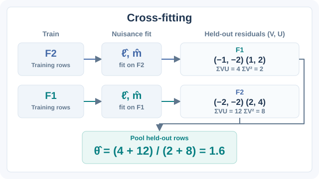

# Double/Debiased Machine Learning

Double/debiased machine learning (DML) estimates low-dimensional causal or structural parameters, such as an average treatment effect, when the rest of the model is fitted with flexible machine learning. It is the estimation step behind the [causal inference overview](index.md), where orthogonal scores and cross-fitting control leading nuisance-estimation bias under explicit assumptions.

## Problem

Consider the partially linear model (Chernozhukov et al. 2018):

\[
\begin{aligned}
Y&=D\theta_0+g_0(X)+U,\\
D&=m_0(X)+V,\\
E[U\mid D,X]&=0,\\E[V\mid X]&=0.
\end{aligned}
\]

where $Y$ is the outcome, $D$ the treatment, $X$ a possibly high-dimensional set of covariates, $\theta_0$ the effect of interest, and $U$ and $V$ noise terms. The functions $g_0$ and $m_0$ are *nuisance functions*. They are not the target, but they must be estimated to isolate $\theta_0$.

Identification also requires nonzero residual treatment variation, $E[V^2]>0$, and suitable moment conditions. For a causal interpretation, consistency and an appropriate identification assumption, such as conditional exchangeability for the treatment, are needed; regression alone does not establish them.

If a flexible learner is fitted to $Y$ on $(D, X)$ and the coefficient on $D$ is read off, the regularisation applied to $X$ can leak into the estimate of $\theta_0$. The resulting bias need not shrink fast enough for valid confidence intervals.

## Core idea

Robinson (1988) showed that $\theta_0$ can be recovered by regressing residualised outcomes on residualised treatments, which removes $X$ from both. Define the conditional expectations $\ell_0(X) = E[Y \mid X]$ and $m_0(X) = E[D \mid X]$. The orthogonal (Neyman) score is

\[
\begin{aligned}
\widetilde Y&=Y-\ell(X),\\\widetilde D&=D-m(X),\\
\psi(W;\theta,\eta)&=(\widetilde Y-\theta\widetilde D)\widetilde D.
\end{aligned}
\]

where $\eta = (\ell, m)$ collects the nuisance functions. Its expectation is zero at the true $\theta_0$ and the true nuisances. Because the score is orthogonal to the nuisances, first-order errors in the machine-learning estimates of $\ell$ and $m$ do not pass directly into $\hat\theta$. This insensitivity is what "orthogonal" refers to.

With the nuisances estimated, the score gives the familiar residual-on-residual estimator

\[
\hat\theta=\frac{\sum_i\hat V_i\hat U_i}{\sum_i\hat V_i^2},
\]

where $\hat U_i=Y_i-\hat\ell(X_i)$ and $\hat V_i=D_i-\hat m(X_i)$ use out-of-fold nuisance predictions.

## Algorithm

The method adds cross-fitting, a sample-splitting step that stops the nuisance models from overfitting the observations they are evaluated on:

1. Split the sample at random into $K$ folds (commonly $K = 5$ or $10$).
2. For each fold $k$, fit $\hat\ell$ and $\hat m$ on the other folds, then compute the residuals $\hat U_i = Y_i - \hat\ell(X_i)$ and $\hat V_i = D_i - \hat m(X_i)$ for the observations in fold $k$.
3. Pool all residuals and compute $\hat\theta = \sum_i \hat V_i \hat U_i \big/ \sum_i \hat V_i^2$.
4. For independent observations, use the empirical score variance and its Jacobian scaling:

\[
\begin{aligned}
\hat\psi_i&=\hat V_i\hat U_i-\hat\theta\hat V_i^2,\\
\hat J&=n^{-1}\sum_i\hat V_i^2,\\
\hat\sigma^2&=\frac{n^{-1}\sum_i\hat\psi_i^2}{\hat J^2},\\
\mathrm{CI}_{.95}&=\hat\theta\pm1.96\hat\sigma/\sqrt n.
\end{aligned}
\]

Clustered or dependent observations require an appropriate variance estimator and splitting scheme; the displayed interval is asymptotic, not an exact finite-sample guarantee.

On narrow screens, focus the figure and use the left/right arrow keys or swipe horizontally to read it at its natural size. MkDocs provides Play/Pause and reduced motion. [Complete static preview](../../assets/concept-animations/dml-crossfit-residual-pooling-still.svg) · [Standalone animation](../../assets/concept-animations/dml-crossfit-residual-pooling-motion.svg).

*Original educational animation, CC BY-SA 4.0.* First train both nuisance models on F2 and predict on F1; then reverse the roles. Each observation contributes its held-out residual pair (V, U) once. The toy pairs in F1 are (−1, −2), (1, 2); those in F2 are (−2, −2), (2, 4). Thus the pooled estimate is $(4+12)/(2+8)=1.6$, not the unweighted mean $(2+1.5)/2=1.75$ of the fold slopes. The dots indicate model/prediction flow, not measured execution time; the residuals are constructed, not outputs of an actual fitted model. Cross-fitting alone does not identify a causal effect.

### Why pooling is a different estimating equation

The animation implements DML2 (one pooled score equation), whereas DML1 solves the score equation within each fold and averages the resulting parameter estimates.[^dml-pooling] Write $a_k=\sum_{i\in I_k}\hat V_i\hat U_i$ and $b_k=\sum_{i\in I_k}\hat V_i^2$. When every $b_k>0$,

$
\hat\theta_{\mathrm{DML2}}=\sum_k\frac{b_k}{\sum_j b_j}\frac{a_k}{b_k},
$

$
\hat\theta_{\mathrm{DML1}}=\frac1K\sum_k\frac{a_k}{b_k}.
$

The DML2 weights are residual treatment sums of squares, not just fold sizes. In the animation the weights are $1/5$ and $4/5$. At the pooled estimate $8/5$, the two fold score sums $a_k-\hat\theta b_k$ are $4/5$ and $-4/5$: they cancel across folds. At the DML1 estimate $7/4$, their sum is $-3/2$, which does not solve the pooled equation. Both procedures use held-out predictions; the distinction is the aggregation step, not leakage. If a fold has zero residual treatment sum of squares, its own ratio is undefined even if the pooled denominator is positive. A positive sample denominator alone does not establish adequate population overlap or valid inference.

[^dml-pooling]: Chernozhukov et al. (2018), *Double/debiased machine learning for treatment and structural parameters*, section 3.1 (DML1 and DML2). https://doi.org/10.1111/ectj.12097

### Which effect does the PLR score estimate?

The constant-effect partially linear model is not the general ATE model. With binary treatment, conditional exchangeability and heterogeneous effects, its population residual-on-residual coefficient is

\[
\begin{aligned}w(X)&=e(X)(1-e(X)),\\\theta_{\rm PLR}&=\frac{E[w(X)\tau(X)]}{E[w(X)]}.\end{aligned}
\]

where $e(X)=P(D=1\mid X)$. This overlap-weighted effect need not equal $E[\tau(X)]$. DML also supplies a different orthogonal score for the ATE in an interactive regression model; choosing a score chooses the estimand.

## Results

The framework's central claim is asymptotic. The 2016 preprint's abstract says the de-biased estimator built from an orthogonal score typically converges at the fastest possible $1/\sqrt{n}$ rate and is approximately unbiased and normal, which supports confidence intervals. The guarantee holds under conditions on the nuisance estimators. The paper's simulations and empirical examples are the finite-sample evidence and are not reproduced here.

## Limitations

- **No unmeasured confounding.** The unconfoundedness-based example requires adequate observed controls; the estimator cannot verify this assumption. Other DML models can use different identification assumptions, such as valid instruments.
- **Nuisance accuracy.** For this partialling-out score, a sufficient remainder-rate condition is

    \[
    \begin{aligned}
    a_n&=\|\hat m-m_0\|_2,\\b_n&=\|\hat\ell-\ell_0\|_2,\\
    a_n(a_n+b_n)&=o_p(n^{-1/2}).
    \end{aligned}
    \]

    This includes a squared treatment-nuisance error, not just the product of the two errors; additional consistency and moment assumptions also apply.

- **Target scope.** DML covers low-dimensional parameters or vectors, not only one average effect. This page illustrates scalar PLR; a full conditional-effect function requires additional methods, such as [causal forests](causal-forests.md).
- **Model form.** The partially linear model is an assumption. The framework extends to other models, but each needs its own score.
- **Compute.** Cross-fitting fits the nuisance models $K$ times.

## Connections

DML combines the flexible nuisance models discussed in the [causal inference overview](index.md) with a target-specific orthogonal estimating equation. For effects that differ across individuals, see [causal forests](causal-forests.md). The general learning theory behind fitting flexible models is in the [Machine Learning](../machine-learning/index.md) chapter.

## Applications

- Estimating the effect of a policy, price or treatment when many observed controls are available. The 2024 survey by Chernozhukov et al. collects worked examples.
- Software: the DoubleML packages implement the framework for Python and R.

## Open questions

- How to keep the nuisance-rate conditions satisfied in very high dimensions and with complex dependence in the data.
- How to obtain reliable finite-sample inference in the existing instrumental-variable extensions and in more complex panel or dynamic-treatment settings.
- Inference when overlap is weak, that is, when treatment is almost fully determined by $X$.

## References

### Seminal papers

- Robinson, P. M. (1988). Root-N-Consistent Semiparametric Regression. *Econometrica*, 56(4), 931. doi:[10.2307/1912705](https://doi.org/10.2307/1912705) — Introduces the residual-on-residual estimator in the partially linear model, which the DML score generalises.
- Chernozhukov, V., Chetverikov, D., Demirer, M., Duflo, E., Hansen, C., Newey, W. & Robins, J. (2016). *Double/Debiased Machine Learning for Treatment and Causal Parameters*. arXiv. https://arxiv.org/abs/1608.00060 — Preprint of the framework: orthogonal scores and cross-fitting for flexible nuisance models.
- Chernozhukov, V., Chetverikov, D., Demirer, M., Duflo, E., Hansen, C., Newey, W. & Robins, J. (2018). Double/debiased machine learning for treatment and structural parameters. *The Econometrics Journal*, 21(1), C1–C68. doi:[10.1111/ectj.12097](https://doi.org/10.1111/ectj.12097) — The published version of the framework, with the general theory of the orthogonal estimator.
- Chernozhukov, V., Chetverikov, D., Demirer, M., Duflo, E., Hansen, C., Newey, W. & Robins, J. (2017). Double/Debiased/Neyman Machine Learning of Treatment Effects. *American Economic Review*, 107(5), 261–265. doi:[10.1257/aer.p20171038](https://doi.org/10.1257/aer.p20171038) — A short summary of the framework for applied economists.

### Surveys and textbooks

- Chernozhukov, V., Hansen, C., Kallus, N., Spindler, M. & Syrgkanis, V. (2024). *Applied Causal Inference Powered by ML and AI*. arXiv. https://arxiv.org/abs/2403.02467 — Book-length introduction to combining machine learning with causal inference, including DML.

### Articles and documentation

- DoubleML. *DoubleML documentation*. https://docs.doubleml.org/stable/index.html — Software documentation for the Python and R packages that implement the framework, with worked examples.
