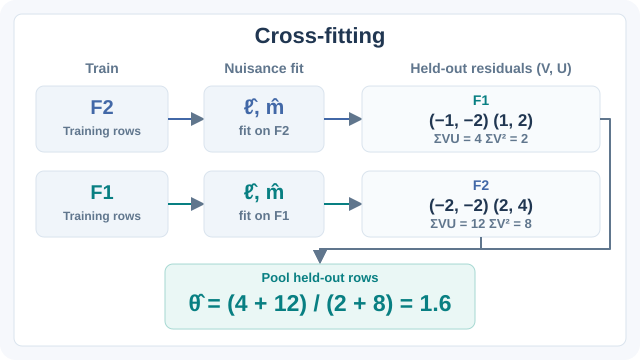

# 雙重／去偏機器學習

雙重／去偏機器學習（DML）以靈活的機器學習估計干擾函數，同時估計低維的因果或結構參數，例如平均治療效應。[因果推論總覽](index.md)介紹其定位：在明確假設下，正交分數與交叉擬合控制干擾估計誤差造成的主要偏差，而非保證任何模型都沒有偏差。

## 問題

考慮 Chernozhukov 等人（2018）的部分線性模型：

\[
\begin{aligned}
Y&=D\theta_0+g_0(X)+U,\\
D&=m_0(X)+V,\\
E[U\mid D,X]&=0,\\E[V\mid X]&=0.
\end{aligned}
\]

$Y$ 是結果，$D$ 是處理，$X$ 是可能高維的共變量，$\theta_0$ 是目標效應，$U,V$ 是誤差。$g_0,m_0$ 是干擾函數，不是主要目標，卻需要估計以分離處理效應。識別還需要非零殘差處理變異 $E[V^2]>0$ 與適當矩條件。因果解釋需要一致性及適用的識別假設，例如給定共變量後的處理可交換性；單靠迴歸無法建立這些條件。

直接用靈活模型將 $Y$ 對 $(D,X)$ 迴歸，再讀取 $D$ 的係數，可能讓正則化偏差進入 $\theta_0$ 的估計，而且偏差未必以足以支持信賴區間的速率消失。

## 核心想法

Robinson（1988）以結果殘差對處理殘差迴歸，消除兩者中的 $X$ 成分。定義 $\ell_0(X)=E[Y\mid X]$、$m_0(X)=E[D\mid X]$，Neyman 正交分數為：

\[
\begin{aligned}
\widetilde Y&=Y-\ell(X),\\\widetilde D&=D-m(X),\\
\psi(W;\theta,\eta)&=(\widetilde Y-\theta\widetilde D)\widetilde D.
\end{aligned}
\]

其中 $\eta=(\ell,m)$。在真實參數與干擾函數處，分數期望為零；對干擾函數的小幅擾動，其期望的一階變化也為零。這就是「正交」：干擾估計的一階誤差不直接傳入目標估計，而不是所有誤差都被消除。

使用樣本外的干擾預測，令 $\hat U_i=Y_i-\hat\ell(X_i)$、$\hat V_i=D_i-\hat m(X_i)$，可得：

\[
\hat\theta=\frac{\sum_i\hat V_i\hat U_i}{\sum_i\hat V_i^2}.
\]

## 演算法

交叉擬合避免用同一觀察值同時訓練干擾模型並評估其殘差。

1. 隨機分成 $K$ 折，常見選擇為 $5$ 或 $10$ 折。
2. 對每一折，以其他折訓練 $\hat\ell,\hat m$，再對保留折計算 $\hat U_i,\hat V_i$。
3. 合併所有樣本外殘差，計算上述殘差迴歸比值。
4. 對獨立觀察值，以經 Jacobian 縮放的分數變異建立漸近區間：

\[
\begin{aligned}
\hat\psi_i&=\hat V_i\hat U_i-\hat\theta\hat V_i^2,\\
\hat J&=n^{-1}\sum_i\hat V_i^2,\\
\hat\sigma^2&=\frac{n^{-1}\sum_i\hat\psi_i^2}{\hat J^2},\\
\mathrm{CI}_{.95}&=\hat\theta\pm1.96\hat\sigma/\sqrt n.
\end{aligned}
\]

群聚或相依資料需要相應的變異估計與切分方式；這不是有限樣本的精確涵蓋率保證。

窄螢幕可聚焦圖形後使用左右方向鍵或滑動，閱讀原始尺寸。MkDocs 提供播放／暫停與減少動態效果的支援。 [完整靜態預覽](../../assets/concept-animations/dml-crossfit-residual-pooling-still.svg) · [獨立動畫](../../assets/concept-animations/dml-crossfit-residual-pooling-motion.svg).

*原創教學動畫，CC BY-SA 4.0。* 先以 F2 訓練兩個干擾模型、對 F1 預測，再交換角色。每個觀察值的樣本外殘差配對 (V, U) 只計入一次。F1 的示意配對為 (−1, −2)、(1, 2)，F2 為 (−2, −2)、(2, 4)。因此合併估計為 $(4+12)/(2+8)=1.6$，不是兩折斜率的未加權平均 $(2+1.5)/2=1.75$。移動圓點代表模型與預測流程，不代表實測執行時間；殘差為人工構造，並非實際擬合結果。交叉擬合本身不能識別因果效應。

### 為什麼合併殘差是不同的估計方程？

動畫實作 DML2（解單一合併分數方程）；DML1 則分別解各折的分數方程，再平均其參數估計值。[^dml-pooling] 令 $a_k=\sum_{i\in I_k}\hat V_i\hat U_i$、$b_k=\sum_{i\in I_k}\hat V_i^2$。若每折皆有 $b_k>0$，則

$$
\hat\theta_{\mathrm{DML2}}=\sum_k\frac{b_k}{\sum_j b_j}\frac{a_k}{b_k},
$$

$$
\hat\theta_{\mathrm{DML1}}=\frac1K\sum_k\frac{a_k}{b_k}.
$$

DML2 的權重是各折處理殘差的平方和，不只是樣本數。動畫中的權重為 $1/5$ 與 $4/5$。當合併估計值為 $8/5$，各折分數總和 $a_k-\hat\theta b_k$ 分別為 $4/5$ 與 $-4/5$，兩者互相抵銷。若採用 DML1 的估計值 $7/4$，分數總和為 $-3/2$，並未解合併方程。兩者皆使用樣本外預測；差異在於聚合步驟，而非資料洩漏。若某折處理殘差的平方和為零，即使合併分母為正，該折的比值仍未定義。樣本分母為正本身不代表母體重疊性充分或推論有效。

[^dml-pooling]: Chernozhukov 等人（2018），*Double/debiased machine learning for treatment and structural parameters*，第 3.1 節（DML1 與 DML2）。https://doi.org/10.1111/ectj.12097

### PLR 分數估計哪一種效應？

固定效應的部分線性模型不是一般的 ATE 模型。若處理為二元、滿足條件可交換性，且效應隨 $X$ 改變，母體殘差迴歸係數為：

\[
\begin{aligned}w(X)&=e(X)(1-e(X)),\\\theta_{\rm PLR}&=\frac{E[w(X)\tau(X)]}{E[w(X)]}.\end{aligned}
\]

其中 $e(X)=P(D=1\mid X)$。這個重疊加權效應未必等於 $E[\tau(X)]$。DML 也提供互動迴歸模型下針對 ATE 的另一種正交分數；選擇分數也就是選擇估計目標。

## 結果

主要保證是漸近的：在干擾估計速率及其他正則條件成立時，估計量通常以 $1/\sqrt n$ 速率收斂，漸近無偏且常態，因此能建立漸近信賴區間。原論文包含模擬與實證例子，這裡不重製其有限樣本結果，也不把理論保證當成任意資料上的準確率。

## 限制

- **未測量混淆。** 本文採用無混淆識別的例子，必須有適當共變量；估計器不能驗證此假設。其他 DML 模型可依靠不同識別假設，例如有效工具變量。
- **干擾函數精度。** 對本文的 partialling-out 分數，一個充分的餘項速率條件為：

    \[
    \begin{aligned}
    a_n&=\|\hat m-m_0\|_2,\\b_n&=\|\hat\ell-\ell_0\|_2,\\
    a_n(a_n+b_n)&=o_p(n^{-1/2}).
    \end{aligned}
    \]

    條件包含處理干擾誤差的平方，不只是兩種誤差的乘積；另需一致性與矩條件。

- **目標範圍。** DML 可處理低維參數或向量，不限單一平均效應。本頁只示範純量 PLR；完整條件效應函數需要額外方法，例如[因果森林](causal-forests.md)。
- **模型形式。** 部分線性結構是一項假設；其他模型需要各自合適的分數。
- **計算。** $K$ 折交叉擬合需要擬合 $K$ 組干擾模型。

## 關聯

DML 將[因果推論總覽](index.md)中的靈活干擾模型，與針對目標的正交估計方程結合。條件效應異質性可參考[因果森林](causal-forests.md)，一般學習理論見[機器學習](../machine-learning/index.md)。

## 應用

- 在大量觀察控制變量下估計政策、價格或處理的效應。Chernozhukov 等人（2024）的書籍包含實例。
- DoubleML 的 Python 與 R 套件實作此框架。

## 開放問題

- 在高維度或複雜相依資料中如何滿足干擾估計速率條件。
- 既有工具變量延伸，以及更複雜的追蹤資料或動態處理設定，如何取得可靠的有限樣本推論。
- 處理幾乎由 $X$ 決定、重疊性薄弱時如何推論。

## 參考文獻

### 開創性論文

- Robinson, P. M. (1988). Root-N-Consistent Semiparametric Regression. *Econometrica*, 56(4), 931. doi:[10.2307/1912705](https://doi.org/10.2307/1912705) — Introduces the residual-on-residual estimator in the partially linear model, which the DML score generalises.
- Chernozhukov, V., Chetverikov, D., Demirer, M., Duflo, E., Hansen, C., Newey, W. & Robins, J. (2016). *Double/Debiased Machine Learning for Treatment and Causal Parameters*. arXiv. https://arxiv.org/abs/1608.00060 — Preprint of the framework: orthogonal scores and cross-fitting for flexible nuisance models.
- Chernozhukov, V., Chetverikov, D., Demirer, M., Duflo, E., Hansen, C., Newey, W. & Robins, J. (2018). Double/debiased machine learning for treatment and structural parameters. *The Econometrics Journal*, 21(1), C1–C68. doi:[10.1111/ectj.12097](https://doi.org/10.1111/ectj.12097) — The published version of the framework, with the general theory of the orthogonal estimator.
- Chernozhukov, V., Chetverikov, D., Demirer, M., Duflo, E., Hansen, C., Newey, W. & Robins, J. (2017). Double/Debiased/Neyman Machine Learning of Treatment Effects. *American Economic Review*, 107(5), 261–265. doi:[10.1257/aer.p20171038](https://doi.org/10.1257/aer.p20171038) — A short summary of the framework for applied economists.

### 綜述與教科書

- Chernozhukov, V., Hansen, C., Kallus, N., Spindler, M. & Syrgkanis, V. (2024). *Applied Causal Inference Powered by ML and AI*. arXiv. https://arxiv.org/abs/2403.02467 — Book-length introduction to combining machine learning with causal inference, including DML.

### 文章與文件

- DoubleML. *DoubleML documentation*. https://docs.doubleml.org/stable/index.html — Software documentation for the Python and R packages that implement the framework, with worked examples.
