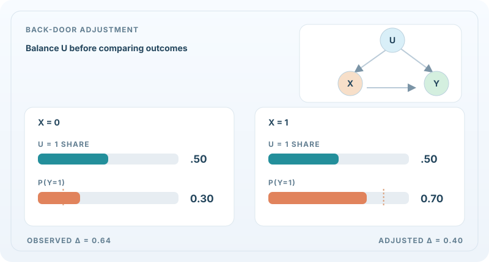
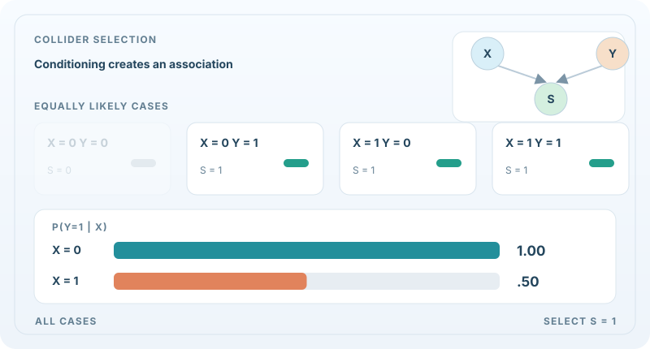

# Causal Inference

Causal inference asks what would happen if something were changed, not only what tends to go together. A model that finds that patients who take a drug recover more often has learned an association. Deciding whether the drug causes the recovery needs more than the data: it needs an assumption about how the data were produced, and a method that uses that assumption. The field is about stating those assumptions clearly and estimating the effects they allow.

## Overview

Prediction and causal reasoning answer different questions. A predictive model is judged on new data drawn from the same distribution. A causal model must also predict what happens under an *intervention*, such as giving a treatment, changing a price or lesioning a circuit, which changes the distribution the data came from. Two standard situations make this difference concrete. In an observational study, patients choose their treatment, so the groups differ before the treatment starts. In a randomised trial, chance decides, so the groups are comparable on average.

Causal inference studies when an effect can be estimated from observational data, and how to estimate it when it can. The main tools are graphical models of how variables influence each other, potential-outcome definitions of effects, and estimators that remain reliable when flexible machine-learning models are used for part of the calculation.

## Key concepts

- **Confounder**: a variable that affects both the treatment and the outcome. Failing to adjust for it makes an association look like an effect.
- **Causal diagram**: a directed graph whose arrows represent direct causal influence. Paths in the graph show which variables must be adjusted for to isolate an effect.
- **Intervention** (the *do* operator): setting a variable by an outside force, which removes the influence of its usual causes.
- **Average treatment effect (ATE)**: the average difference in outcome between treated and untreated units, over the population.
- **Conditional average treatment effect (CATE)**: the effect for a subgroup defined by covariates, which may vary from person to person.
- **Instrumental variable**: a variable that affects the outcome only through the treatment, and so can be used to estimate an effect when confounding cannot be fully measured.

## Causal paths in motion

### Back-door adjustment: the same confounder mix

**Interactive quantitative check:** Adjust the shared target-population share \(q=P^*(U=1)\). For this constructed constant-effect example, the standardised risks are \(0.1+0.4q\) and \(0.5+0.4q\), so their difference stays \(0.40\). Only \(q=0.50\) is the causal contrast for the original population; other settings target different hypothetical populations. Keyboard arrows change the slider; Reset restores the original example. The static SVG above remains visible in GitHub and without JavaScript.

In a **fully observed, correctly specified** causal graph $U\\to X$, $U\\to Y$, $X\\to Y$, standardising over $U$ blocks the back-door path.[^causal-motion-pearl] The animation uses an **invented binary population**, not fitted-model results: $P(U=1)=0.5$, $P(X=1\\mid U=0)=0.2$, $P(X=1\\mid U=1)=0.8$, and $P(Y=1\\mid X=x,U=u)=0.1+0.4x+0.4u$.

The observational contrast is $0.82-0.18=0.64$; after applying the **same marginal distribution of U** to both treatment levels, the causal contrast is $0.70-0.30=0.40$:

$
P(Y=1\\mid\\operatorname{do}(X=x))=\\sum_{u=0}^{1}P(Y=1\\mid X=x,U=u)P(U=u).
$

The moving turquoise bars show the confounder weights being standardised, and the coral bars show the resulting risks. The continuous morph is a **pedagogical interpolation**, not an optimisation path; the final adjustment is valid only under the assumed graph, positivity and absence of additional unblocked confounding.

### Collider selection: a spurious association

**Interactive selection experiment:** Let \(r=P(S=1\mid X=0,Y=0)\), with the other three binary pairs always retained. The conditional risks among selected samples become \(P(Y=1\mid X=0,S=1)=1/(1+r)\) and \(P(Y=1\mid X=1,S=1)=1/2\). Set \(r=1\) to recover independence or \(r=0\) to recover the deterministic collider example above. Intermediate values are **new, hypothetical probabilistic selection mechanisms**, not the original logical-OR rule. All numbers are constructed; Reset restores \(r=0\).

In a second **constructed** example, $X$ and $Y$ are independent fair binary variables, and $S=1$ exactly when $X=1$ **or** $Y=1$. Before conditioning, $P(Y=1\\mid X=0)=P(Y=1\\mid X=1)=0.5$. Conditioning on their common effect $S$ excludes the $X=0,Y=0$ pair. Therefore $P(Y=1\\mid X=0,S=1)=1$ while $P(Y=1\\mid X=1,S=1)=0.5$. The association arises from **selection**, not a causal arrow $X\\to Y$.[^causal-motion-pearl]

**Playback and experiments:** On the MkDocs site, use the accessible SVG Play/Pause button (Enter or Space when focused), or adjust the independent numeric labs using sliders and Reset. The static image is the GitHub/reduced-motion fallback; on narrow screens focus the figure region and scroll horizontally. No animation values are observational estimates.

[^causal-motion-pearl]: Pearl, J. (1995), *Causal diagrams for empirical research*, [Biometrika](https://doi.org/10.1093/biomet/82.4.669), develops graphical conditions for identifying effects and for reasoning about conditioning.

## How it works

**Identification.** Before estimating anything, one asks whether the target effect is determined by the observed distribution at all. Pearl (1995) shows how causal diagrams answer this question. The paper gives graphical criteria for choosing a set of variables to adjust for, so that the effect of an intervention can be computed from observational data. When no such set exists, the effect is not identified, and no amount of data from that graph can settle it.

**Estimation with machine learning.** Flexible learners can model the confounding relationships well, but using them naively biases the effect estimate. Chernozhukov et al. (2016) show how to fix this in the double/debiased machine learning framework. The abstract states that the regularisation bias "can be removed by solving auxiliary prediction problems via ML tools", so the estimate of the effect is built from predictions that are themselves fitted with machine learning.

**Heterogeneous effects.** Individual effects can differ across people, and the subgroups that benefit most are often what decision-makers need. Wager and Athey (2015) propose random forests that estimate treatment effects, called causal forests. The abstract reports that the estimates have an asymptotically Gaussian and centred sampling distribution, which allows asymptotic confidence intervals for the effect at a point.

**Causal representation learning.** Most causal methods assume that the variables in the graph are already given. Schölkopf et al. (2021) define causal representation learning as the discovery of high-level causal variables from low-level observations, such as pixels, and argue that this is a central open problem for AI.

## Key methods

Brief comparison. Each approach named above is a candidate for its own method page; those pages are not yet written, so the detail is given in this section for now.

- **Causal diagrams and adjustment (Pearl)**: an explicit graph, with identification criteria. Transparent about assumptions, but needs the graph to be known.
- **Double/debiased ML**: flexible nuisance models plus a debiased estimate of a low-dimensional effect. Designed for a single average effect.
- **Causal forests**: random forests for CATE with valid confidence intervals under the paper's conditions.
- **Causal representation learning**: learns the variables themselves, rather than taking them as given. Still largely a research programme.

## Connections

Causal inference and machine learning are connected in two directions. Causal ideas help decide which features a model should use if it has to work when the environment changes, and learning models can serve as the flexible parts of causal estimators. The shared language of distributions and information is in [Information Theory](../information-theory/index.md) and [Mathematics](../math/index.md).

The brain connection is about how science establishes causal roles. Neuroscience often tests whether a circuit is necessary for a behaviour by perturbing it and measuring the effect, which is the interventional view described here. Models of perception and learning are discussed in [NeuroAI](../../brain-mind/neuroai/index.md).

## Applications

- **Medicine.** Estimating treatment effects from trials and from registries where treatment was not randomised.
- **Economics and policy.** Evaluating programmes and interventions from observational data, where experiments are costly or unethical.
- **Online experiments.** Estimating the effect of a change in a product, and which users respond to it, from randomised tests.

## Open questions

- Unmeasured confounding cannot be detected from the data alone, so the conclusions depend on assumptions that may be wrong.
- Effects estimated in one population must be transferred to another, and the conditions for this are hard to check.
- Learning causal structure from data is hard when the number of variables grows, and many structures fit the same observations.
- Causal representation learning needs a clear definition of the variables it should recover, and its methods are not yet established at scale.

## References

### Seminal papers

- Pearl, J. (1995). Causal diagrams for empirical research. *Biometrika*, 82(4), 669–688. https://doi.org/10.1093/biomet/82.4.669 — Shows how causal diagrams answer identification questions, with graphical criteria for choosing variables to adjust for.
- Chernozhukov, V., Chetverikov, D., Demirer, M., Duflo, E., Hansen, C., Newey, W. & Robins, J. (2016). *Double/Debiased Machine Learning for Treatment and Causal Parameters*. arXiv. https://arxiv.org/abs/1608.00060 — Gives the double/debiased machine learning framework for estimating treatment effects with flexible nuisance models.
- Wager, S. & Athey, S. (2015). *Estimation and Inference of Heterogeneous Treatment Effects using Random Forests*. arXiv. https://arxiv.org/abs/1510.04342 — Causal forests, with a sampling distribution that is asymptotically Gaussian.
- Schölkopf, B., Locatello, F., Bauer, S., Ke, N. R., Kalchbrenner, N., Goyal, A. & Bengio, Y. (2021). *Towards Causal Representation Learning*. arXiv. https://arxiv.org/abs/2102.11107 — Defines causal representation learning as discovering high-level causal variables from low-level observations.

### Surveys and textbooks

- Peters, J., Janzing, D. & Schölkopf, B. (2017). *Elements of Causal Inference: Foundations and Learning Algorithms*. MIT Press. https://library.oapen.org/handle/20.500.12657/26040 — Textbook on structural causal models and causal discovery, with an open-access copy listed by the OAPEN library.
- Hernán, M. A. & Robins, J. M. (2020). *Causal Inference: What If*. Chapman & Hall/CRC. https://miguelhernan.org/whatifbook — Introductory text on causal inference for observational data, free to download from the authors' page.
