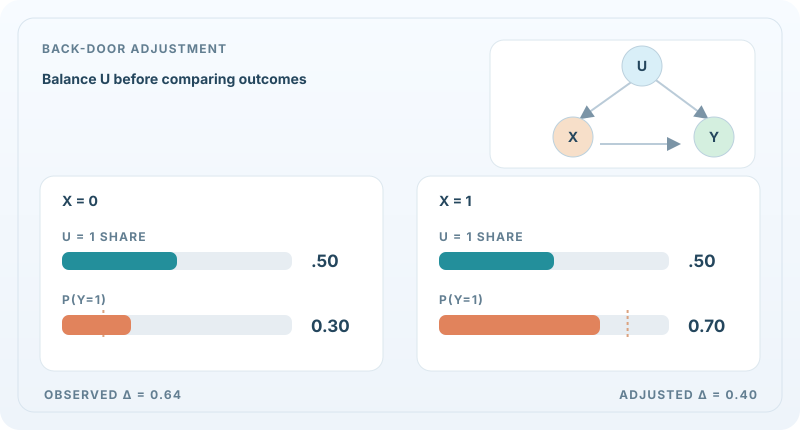
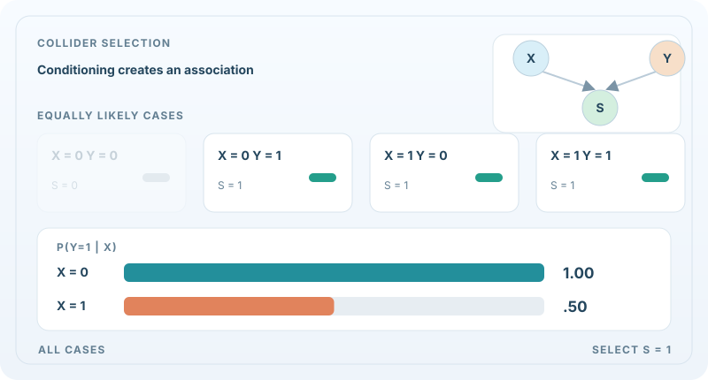

# 因果推論（Causal Inference）

因果推論問的是：如果改變某件事，會發生什麼，而不只是哪些事情常常一起出現。一個模型若發現服藥的病人康復的比例較高，它學到的是關聯。要判斷藥物是否導致康復，光靠資料並不夠，還需要關於資料如何產生的假設，以及利用這個假設的方法。這個領域的重點，是把這些假設講清楚，並在假設允許的範圍內估計效應。

## 概述

預測與因果推理回答的是不同的問題。預測模型是在同一分布抽出的新資料上被評估的。因果模型則還必須預測在*介入*下會發生什麼，例如給予治療、改變價格，或損毀一個迴路，這些都會改變資料原本來自的分布。兩種標準情境能具體說明這個差異。在觀察性研究中，病人自己選擇治療，因此兩組在治療開始前就已經不同。在隨機試驗中，由機會決定，因此兩組在平均上是可比的。

因果推論研究：什麼時候可以從觀察性資料估計某個效應，以及在可以估計時該怎麼做。主要工具包括描述變數如何互相影響的圖形模型、以潛在結果定義效應的方式，以及在部分計算中使用靈活的機器學習模型時仍然可靠的估計量。

## 關鍵概念

- **混淆因子（confounder）**：同時影響治療與結果的變數。若不調整它，關聯看起來就會像效應。
- **因果圖（causal diagram）**：以有向圖表示直接因果影響，圖中的路徑顯示必須調整哪些變數才能分離出效應。
- **介入（do 運算子）**：由外部力量設定某個變數，從而排除它原本的成因所造成的影響。
- **平均治療效應（ATE）**：在整個母體中，接受治療與未接受治療單位之間結果的平均差異。
- **條件平均治療效應（CATE）**：由共變量定義的子群體的效應，可能因人而異。
- **工具變數（instrumental variable）**：只透過治療影響結果的變數。當混淆無法完全測量時，可以用它來估計效應。

## 因果路徑動態示意

### 後門調整：將混淆因子的分布標準化

**互動數值驗算：** 調整共同目標母體的 $q=P^*(U=1)$。此人工設定的固定處理效果模型，標準化風險分別為 $0.1+0.4q$ 與 $0.5+0.4q$，因此風險差維持 $0.40$。**只有 $q=0.50$ 對應原始母體的因果對比**；其他滑桿設定代表不同的假想目標母體。可使用方向鍵調整滑桿、按「重設示例」復原。GitHub 與停用 JavaScript 時仍能閱讀上方靜態 SVG。

假設已完整觀測混淆因子，且因果圖為 $U\\to X$、$U\\to Y$、$X\\to Y$，對 $U$ 進行標準化可以阻斷後門路徑。[^causal-motion-pearl] 動畫使用**人工構造的二元母體**，並非模型實測資料：$P(U=1)=0.5$、$P(X=1\\mid U=0)=0.2$、$P(X=1\\mid U=1)=0.8$，以及 $P(Y=1\\mid X=x,U=u)=0.1+0.4x+0.4u$。

未調整的觀察差為 $0.82-0.18=0.64$；將兩種處理狀態的 $U$ **統一加權至同一個邊際分布**後，因果風險差是 $0.70-0.30=0.40$：

$
P(Y=1\\mid\\operatorname{do}(X=x))=\\sum_{u=0}^{1}P(Y=1\\mid X=x,U=u)P(U=u).
$

青綠色長條代表標準化中的混淆因子權重，珊瑚色長條代表相應結果風險。圖中連續變化僅是**教學插值**，並非最佳化或實際介入的時間軌跡；因果識別仍取決於圖形假設、正值性，以及沒有其他未被阻斷的混淆路徑。

### 碰撞點選擇偏誤：條件化反而引入關聯

**互動選取實驗：** 設 $r=P(S=1\mid X=0,Y=0)$，其餘三種組合一律入選。在已選取樣本中，$P(Y=1\mid X=0,S=1)=1/(1+r)$，而 $P(Y=1\mid X=1,S=1)=1/2$。$r=1$ 時恢復獨立，$r=0$ 時對應上方確定性的碰撞點範例。中間數值是**額外構造的機率式選取機制**，不是原先的 OR 規則；所有數值皆非實測。按「重設示例」恢復 $r=0$。

另一個**人工構造範例**令 $X$ 與 $Y$ 為相互獨立、機率各半的二元變數，並定義 $S=1$ 當且僅當 $X=1$ **或** $Y=1$。未進行選取時，$P(Y=1\\mid X=0)=P(Y=1\\mid X=1)=0.5$。若只保留 $S=1$ 的樣本，$(X,Y)=(0,0)$ 會被排除，因此 $P(Y=1\\mid X=0,S=1)=1$，但 $P(Y=1\\mid X=1,S=1)=0.5$。這項關聯來自對共同結果（碰撞點）進行**條件化**，不表示存在 $X\\to Y$ 的因果效果。[^causal-motion-pearl]

**動畫與實驗操作：** MkDocs 網站可使用 SVG 的 Play／Pause 按鈕（Enter 或空白鍵），也可以用互動滑桿、方向鍵與「重設示例」操作兩組數值實驗。GitHub 或偏好減少動態效果時會顯示靜態回退圖；窄螢幕可聚焦圖框並水平捲動。所有數值皆為示意，非實測資料。

[^causal-motion-pearl]: Pearl, J.（1995），*Causal diagrams for empirical research*，[Biometrika](https://doi.org/10.1093/biomet/82.4.669)，提出以因果圖判斷識別條件及條件化影響的方法。

## 運作方式

**可識別性。** 在估計之前，先問目標效應是否根本由觀察到的分布所決定。Pearl（1995）展示了因果圖如何回答這個問題。論文給出圖形化準則，用來選擇應調整的變數集合，使介入的效應能從觀察性資料計算出來。若不存在這樣的集合，該效應就是不可識別的，在該圖形下再多的資料也無法解決。

**以機器學習估計。** 靈活的學習器能很好地建模混淆關係，但若直接使用，會使效應估計產生偏差。Chernozhukov 等人（2016）在雙重／去偏機器學習框架中說明如何修正。摘要指出，正則化偏差「可以透過以機器學習工具求解輔助預測問題而移除」，因此效應的估計是由同樣以機器學習擬合的預測所建構。

**異質效應。** 個體效應可能因人而異，而最能受益的子群體往往正是決策者所需要的資訊。Wager 與 Athey（2015）提出用隨機森林估計治療效應的方法，稱為因果森林。摘要報告，這些估計量的抽樣分布是漸近高斯且以真值為中心的，因此可以在某一點上建立效應的漸近信賴區間。

**因果表徵學習。** 多數因果方法假設圖中的變數已經給定。Schölkopf 等人（2021）把因果表徵學習定義為：從低階觀察（例如像素）中發現高階的因果變數，並主張這是 AI 的核心開放問題。

## 關鍵方法

簡要比較。上面提到的每種方法都可以有自己的方法頁面；這些頁面尚未撰寫，因此目前在本節提供細節。

- **因果圖與調整（Pearl）**：明確的圖形，附帶可識別性準則。假設透明，但需要已知的圖。
- **雙重／去偏機器學習**：靈活的干擾模型加上對低維效應的去偏估計。設計用於單一平均效應。
- **因果森林**：用於 CATE 的隨機森林，在論文條件下具有有效的信賴區間。
- **因果表徵學習**：學習變數本身，而非把變數視為給定。仍然主要是研究中的方向。

## 關聯

因果推論與機器學習在兩個方向上相連。因果觀點有助於決定，當環境改變時模型應使用哪些特徵；而學習模型也可以作為因果估計量中靈活的部分。分布與資訊的共同語言見[資訊理論](../information-theory/index.md)與[數學基礎](../math/index.md)。

與大腦的連結在於科學如何確立因果角色。神經科學常透過擾動某個迴路並測量效應，來檢驗它對某種行為是否必要，這正是本文所描述的介入觀點。知覺與學習的模型則在 [NeuroAI](../../brain-mind/neuroai/index.md) 中討論。

## 應用

- **醫學。** 從試驗與未隨機分配治療的登記資料中估計治療效應。
- **經濟與政策。** 在實驗昂貴或不符倫理時，從觀察性資料評估計畫與介入措施。
- **線上實驗。** 從隨機測試中估計產品改變的效應，以及哪些使用者會對其有所反應。

## 開放問題

- 未測量的混淆無法僅從資料中偵測，因此結論依賴可能不正確的假設。
- 在一個母體中估計的效應，必須轉移到另一個母體，而其條件難以檢驗。
- 當變數數量增加時，從資料學習因果結構很困難，而且許多結構都能符合同樣的觀察。
- 因果表徵學習需要對其應恢復的變數有清楚的定義，其方法在大規模上尚未確立。

## 參考文獻

### 開創性論文

- Pearl, J. (1995). Causal diagrams for empirical research. *Biometrika*, 82(4), 669–688. https://doi.org/10.1093/biomet/82.4.669 — 展示因果圖如何回答可識別性問題，並提供選擇調整變數的圖形準則。
- Chernozhukov, V., Chetverikov, D., Demirer, M., Duflo, E., Hansen, C., Newey, W. & Robins, J. (2016). *Double/Debiased Machine Learning for Treatment and Causal Parameters*. arXiv. https://arxiv.org/abs/1608.00060 — 提出以靈活干擾模型估計治療效應的雙重／去偏機器學習框架。
- Wager, S. & Athey, S. (2015). *Estimation and Inference of Heterogeneous Treatment Effects using Random Forests*. arXiv. https://arxiv.org/abs/1510.04342 — 因果森林，其抽樣分布為漸近高斯。
- Schölkopf, B., Locatello, F., Bauer, S., Ke, N. R., Kalchbrenner, N., Goyal, A. & Bengio, Y. (2021). *Towards Causal Representation Learning*. arXiv. https://arxiv.org/abs/2102.11107 — 把因果表徵學習定義為從低階觀察中發現高階的因果變數。

### 綜述與教科書

- Peters, J., Janzing, D. & Schölkopf, B. (2017). *Elements of Causal Inference: Foundations and Learning Algorithms*. MIT Press. https://library.oapen.org/handle/20.500.12657/26040 — 關於結構因果模型與因果發現的教科書，OAPEN 圖書館列出了開放取用的版本。
- Hernán, M. A. & Robins, J. M. (2020). *Causal Inference: What If*. Chapman & Hall/CRC. https://miguelhernan.org/whatifbook — 針對觀察性資料之因果推論的入門教科書，作者網頁提供免費下載。
