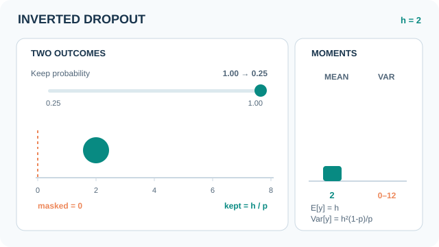

# Dropout

Dropout randomly removes units from a network during each training step. The remaining units must learn features that work without any particular partner, which reduces overfitting. At test time the full network is used, with weights or activations scaled so that their expected value matches training.

## Overview

The [chapter](index.md) covers stochastic regularisation. This page covers the original dropout method, its scaling rule, the reported results and its limits.

## Problem

Large networks with many parameters can memorise a training set. A penalty on the weights helps, but units in a layer can co-adapt, each depending on specific others. Srivastava and colleagues describe this as units that fit the training data without generalising, and they target co-adaptation directly [(Srivastava et al., 2014)](https://jmlr.org/papers/v15/srivastava14a.html).

## Core idea

On each training step, every unit in a layer is kept with a fixed probability $p$ and set to zero otherwise, independently of the other units. The gradient flows only through the kept units. Because each step trains a different thinned network that shares weights with all the others, training behaves like an ensemble of many networks. The paper's own explanation is that dropout "prevents co-adaptation by making the presence of other hidden units unreliable". A unit must therefore be useful across many random combinations of its neighbours.

The paper suggests $p = 0.5$ for hidden units. Input units usually keep a larger share, and the appendix gives $0.8$ as typical for real-valued inputs.

## Equation

For an activation vector $\mathbf{h}$ in a layer, training uses a mask $\mathbf{r}$ with independent entries $r_i \sim \mathrm{Bernoulli}(p)$:

$$
\tilde{h}_i = r_i \, h_i .
$$

At test time no unit is dropped. The paper scales the outgoing weights by $p$, so that $\mathbf{W}_{\text{test}} = p\,\mathbf{W}$. The paper also notes an equivalent alternative: scale each retained activation up by $1/p$ during training and leave the test-time weights unchanged. Most current frameworks use this second form, often called inverted dropout, because it keeps the test-time code identical to the untrained network.

Training procedure, for each mini-batch:

1. Sample a fresh mask $\mathbf{r}$ for every layer where dropout is applied.
2. Compute the forward pass with the masked activations.
3. Back-propagate through the kept units only, and update the weights as usual.

### Visual walkthrough: sampled masks and expectation

*Original teaching animation, CC BY-SA 4.0.* The synthetic input is $h=(1,2,3,4)$ and $p=0.5$. Inverted dropout computes $y_i=r_i h_i/p$, with $r_i\sim\mathrm{Bernoulli}(p)$. For the displayed mask $(1,0,1,0)$, the output is $(2,0,6,0)$; new masks change individual outputs. **For every unit**, $\mathbb{E}[y_i]=h_i$ follows analytically from the Bernoulli mean, but an individual masked sample need not preserve the sum or a downstream network prediction. These masks are intentionally constructed teaching draws, **not model measurements or a Monte Carlo estimate**. The website player supports Play/Pause and reduced-motion fallback; [view the GitHub-compatible static preview](../../../assets/concept-animations/dropout-inverted-sampling-still.svg).

### Visual walkthrough: variance under inverted scaling

*Original teaching animation, CC BY-SA 4.0.* With the **synthetic scalar** $h=2$, inverted dropout yields $y=0$ with probability $1-p$ and $y=h/p$ with probability $p$. Therefore the conditional mean is $\mathbb{E}[y]=h=2$, but the variance is

$
\operatorname{Var}(y)=\frac{h^2(1-p)}{p}.
$

The illustration varies the keep probability from $1$ to $0.25$ and back: the nonzero outcome moves from $2$ to $8$, the probability of zero grows from $0$ to $0.75$, and the variance rises from $0$ to $12$. Circle sizes represent relative probability mass schematically, rather than exact sampled counts. This **does not mean** the output of a nonlinear downstream network has the same expectation. No model was trained or measured. The website player offers Play/Pause and a reduced-motion fallback; [view the GitHub-compatible static preview](../../../assets/concept-animations/dropout-variance-tradeoff-still.svg).

### Visual walkthrough: independent masks versus contiguous DropBlock

*Original instructional animation, CC BY-SA 4.0.* Both artificial $6\times6$ feature maps hide **exactly nine of 36 cells**. Left: four hand-chosen scattered unit masks. Right: four hand-chosen contiguous $3\times3$ masks. Because neighboring convolutional activations are correlated, a spatial block can suppress an entire local evidence region whereas independently removed units often leave neighboring evidence available. This illustrates the **structure of the masks**, not the original DropBlock sampling algorithm, its calibrated retention distribution, or an empirical accuracy comparison. The masks are schematic, not model observations. Ghiasi et al. describe block-based regularisation in the linked reference below. The existing MkDocs player offers Play/Pause and reduced-motion fallback; [GitHub-readable still](../../../assets/concept-animations/dropblock-spatial-masking-still.svg).

## Results

The paper reports error rates for the same architecture with and without dropout. The comparisons below are the within-paper ones, taken from its tables for convolutional networks:

| Dataset | Without dropout | With dropout | Setting in the paper |
|---|---|---|---|
| CIFAR-10 | 15.60% | 12.61% | Convolutional network, dropout in all layers |
| CIFAR-100 | 43.48% | 37.20% | Convolutional network, dropout in all layers |
| SVHN | 3.95% | 2.55% | Convolutional network, dropout in all layers |

The paper also reports gains on MNIST, speech recognition (TIMIT) and document classification (Reuters-RCV1), and an ImageNet result with dropout in a network trained on ILSVRC-2010 and ILSVRC-2012. Those results are fully specified in the paper's tables and are not restated here. The gains are reported against baselines trained under the paper's own setup, so the table should be read as evidence for the method in that setting rather than a universal benchmark.

## Limitations

- **Training cost.** The paper states that a dropout network "typically takes 2-3 times longer to train than a standard neural network of the same architecture".
- **Convolutional layers.** Neighbouring activations in a feature map are strongly correlated, so dropping single units leaves much of the information in place. Ghiasi, Lin and Le propose DropBlock, which drops contiguous regions of a feature map, and report that it works better than dropout in convolutional networks [(Ghiasi et al., 2018)](https://arxiv.org/abs/1810.12890).
- **Interaction with batch normalisation.** Dropout shifts the variance of a unit between training and testing, while batch normalisation keeps the statistics accumulated during training. Li and colleagues call this mismatch "variance shift" and show that placing dropout before batch normalisation can make predictions less accurate [(Li et al., 2019)](https://arxiv.org/abs/1801.05134).
- **Benefit depends on overfitting.** When a model is not overfitting, or when a large dataset already regularises it, the extra noise can slow learning without improving generalisation.

## Connections

The Bayesian reading of dropout is in the [chapter](index.md). Gal and Ghahramani interpret dropout training in deep networks as approximate Bayesian inference and show how the same tool can model uncertainty in dropout networks [(Gal and Ghahramani, 2016)](https://arxiv.org/abs/1506.02142). Dropout is related to two other stochastic regularisers: [Mixup](mixup.md) changes the training data, and [Stochastic depth](stochastic-depth.md) drops whole residual blocks [(Huang et al., 2016)](https://arxiv.org/abs/1603.09382). The interaction with normalisation is covered in the [normalisation chapter](../normalisation/index.md).

## Applications

The paper applies dropout to fully connected networks, convolutional networks, a speech recognition model and a document classifier, which shows that the method is not tied to one architecture. It is most useful when a model is large relative to its training set.

## Open questions

- Is dropout still needed for large models trained on very large datasets?
- How should the rate be set for different layers and architectures?
- How should dropout be combined with batch normalisation so that the variance seen at test time matches training?

## References

### Seminal papers

- Srivastava, Hinton, Krizhevsky, Sutskever and Salakhutdinov, *Dropout: A Simple Way to Prevent Neural Networks from Overfitting*, Journal of Machine Learning Research, 15, 1929–1958 (2014). https://jmlr.org/papers/v15/srivastava14a.html — The original dropout method, its scaling rule and its experiments on vision, speech and text.
- Gal and Ghahramani, *Dropout as a Bayesian Approximation: Representing Model Uncertainty in Deep Learning* (2016). https://arxiv.org/abs/1506.02142 — Interprets dropout training as approximate Bayesian inference and uses dropout to model uncertainty.
- Huang, Sun, Liu, Sedra and Weinberger, *Deep Networks with Stochastic Depth* (2016). https://arxiv.org/abs/1603.09382 — Randomly drops whole residual blocks during training, reducing training time and test error.
- Zhang, Cisse, Dauphin and Lopez-Paz, *mixup: Beyond Empirical Risk Minimization* (2017). https://arxiv.org/abs/1710.09412 — Trains on convex combinations of pairs of examples and their labels.

### Articles and documentation

- Ghiasi, Lin and Le, *DropBlock: A regularization method for convolutional networks* (2018). https://arxiv.org/abs/1810.12890 — Structured dropout that removes contiguous regions of a feature map, compared against dropout in convolutional networks.
- Li, Chen, Hu and Yang, *Understanding the Disharmony between Dropout and Batch Normalization by Variance Shift* (2019). https://arxiv.org/abs/1801.05134 — Explains why dropout before batch normalisation can hurt predictions, through a variance shift between training and testing.
