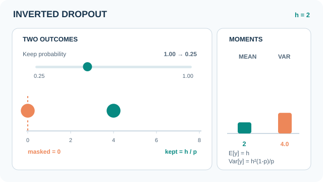

# 丟棄法

丟棄法在每個訓練步驟中隨機移除網路中的單元。剩下的單元必須學會在沒有特定夥伴的情況下也能運作的特徵，這能減少過擬合。測試時使用完整網路，並把權重或激活值縮放，使其期望值與訓練時一致。

## 概觀

[本章](index.zh-TW.md)涵蓋隨機正則化。本頁說明原始的丟棄法、其縮放規則、報告的結果與限制。

## 問題

具有大量參數的大型網路可能會記住訓練集。對權重加上懲罰有幫助，但同一層中的單元可能彼此共適應，每個單元都依賴特定的其他單元。Srivastava 等人把這種情況描述為：單元能擬合訓練資料，卻無法泛化，他們的方法直接針對共適應問題 [(Srivastava et al., 2014)](https://jmlr.org/papers/v15/srivastava14a.html)。

## 核心想法

每個訓練步驟中，某一層的每個單元都以固定機率 $p$ 被保留，否則獨立地設為零。梯度只流經被保留的單元。由於每一步都在訓練一個與其他所有步驟共享權重的不同稀疏網路，訓練的行為就像許多網路的集成。論文自己的解釋是：丟棄法「讓其他隱藏單元的存在變得不可靠，從而防止共適應」。因此，每個單元都必須在與鄰居的許多隨機組合中都有用。

論文建議隱藏單元使用 $p = 0.5$。輸入單元通常會保留較大的比例，附錄給出實值輸入的典型值為 $0.8$。

## 方程式

對某一層的激活向量 $\mathbf{h}$，訓練時使用獨立的遮罩 $\mathbf{r}$，其元素滿足 $r_i \sim \mathrm{Bernoulli}(p)$：

$$
\tilde{h}_i = r_i \, h_i .
$$

測試時不丟棄任何單元。論文將輸出權重乘以 $p$，使 $\mathbf{W}_{\text{test}} = p\,\mathbf{W}$。論文也指出一種等價做法：訓練時把每個被保留的激活值放大 $1/p$，測試時的權重則保持不變。許多深度學習函式庫採用的是這第二種形式，常稱為反向丟棄法（inverted dropout），因為它讓測試時的程式碼與未訓練的網路完全相同。

每個小批次的訓練流程如下：

1. 為每個套用丟棄法的層抽取新的遮罩 $\mathbf{r}$。
2. 以遮罩後的激活值計算前向傳播。
3. 只沿被保留的單元反向傳播，並照常更新權重。

### 視覺化：遮罩取樣與期望值

*原創教學動畫，CC BY-SA 4.0。* 使用人工輸入 $h=(1,2,3,4)$ 與 $p=0.5$，反向丟棄法計算 $y_i=r_i h_i/p$，其中 $r_i\sim\mathrm{Bernoulli}(p)$。當遮罩為 $(1,0,1,0)$ 時，輸出為 $(2,0,6,0)$；重新取樣會改變各單元的輸出。對**每個單元**，$\mathbb{E}[y_i]=h_i$ 來自伯努利分布的期望值，不代表任一次取樣都保持總和不變，更不代表下游非線性網路的輸出期望相同。圖中遮罩是刻意設計的教學樣本，**不是模型實測或蒙地卡羅估計**。網站播放器提供播放／暫停和減少動態效果的回退；[查看 GitHub 可顯示的靜態預覽](../../../assets/concept-animations/dropout-inverted-sampling-still.svg)。

### 視覺化：反向縮放的變異數代價

*原創教學動畫，CC BY-SA 4.0。* 使用**人工設定的純量** $h=2$。反向丟棄法的輸出 $y$ 以機率 $1-p$ 為 $0$，以機率 $p$ 為 $h/p$。因此條件期望值為 $\mathbb{E}[y]=h=2$，但變異數為

\[
\operatorname{Var}(y)=\frac{h^2(1-p)}{p}.
\]

動畫讓保留機率從 $1$ 降至 $0.25$ 再回升：非零輸出從 $2$ 移至 $8$，歸零機率由 $0$ 增至 $0.75$，變異數由 $0$ 增至 $12$。圓點大小僅示意相對機率質量，並非實際抽樣次數。此處**不代表**經過下游非線性網路後，預測值的期望仍相同，也沒有訓練模型或進行效能量測。網站播放器提供播放／暫停及減少動態效果回退；[查看 GitHub 可顯示的靜態預覽](../../../assets/concept-animations/dropout-variance-tradeoff-still.svg)。

### 視覺化：獨立單元遮罩與連續區塊遮罩

*原創教學動畫，CC BY-SA 4.0。* 兩張人工設計的 $6\times6$ 特徵圖都**遮蔽 36 個位置中的 9 個**。左側依序顯示四種分散單元遮罩，右側顯示四種連續的 $3\times3$ 區塊遮罩。由於相鄰卷積特徵常具有相關性，連續區塊可能一次遮蔽整個局部證據區域；個別遮蔽則仍可能留下周圍資訊。此圖只比較**遮罩的空間結構**，並未重現原始 DropBlock 的抽樣演算法、保留率校正或實驗準確率。所有遮罩皆為人工示意，非模型實測。方法來源為下方 Ghiasi 等人的論文。手機窄畫面請在圖內水平捲動，以比較左右兩種遮罩。MkDocs 既有播放器提供播放／暫停及減少動態效果回退；[GitHub 可顯示的靜態預覽](../../../assets/concept-animations/dropblock-spatial-masking-still.svg)。

## 結果

論文報告了相同架構在有與沒有丟棄法時的錯誤率。下表是論文中卷積網路的同架構比較：

| 資料集 | 無丟棄法 | 有丟棄法 | 論文中的設定 |
|---|---|---|---|
| CIFAR-10 | 15.60% | 12.61% | 卷積網路，所有層都使用丟棄法 |
| CIFAR-100 | 43.48% | 37.20% | 卷積網路，所有層都使用丟棄法 |
| SVHN | 3.95% | 2.55% | 卷積網路，所有層都使用丟棄法 |

論文還報告了 MNIST、語音辨識（TIMIT）與文件分類（Reuters-RCV1）的結果，以及在 ILSVRC-2010 與 ILSVRC-2012 上訓練的網路中使用丟棄法的 ImageNet 結果。這些結果在論文的表格中有完整說明，此處不再重述。這些改進是相對於論文自身設定下訓練的基準而言的，因此應把此表視為該設定下對此方法的證據，而非通用的基準。

## 限制

- **訓練成本。** 論文指出，丟棄法網路「通常訓練時間是相同架構標準神經網路的 2 至 3 倍」。
- **卷積層。** 特徵圖中相鄰的激活值高度相關，因此只丟棄單一單元仍會保留大部分資訊。Ghiasi、Lin 與 Le 提出 DropBlock，會丟棄特徵圖中連續的區域，並報告其在卷積網路中優於丟棄法 [(Ghiasi et al., 2018)](https://arxiv.org/abs/1810.12890)。
- **與批次正規化的交互作用。** 丟棄法會使單元的變異數在訓練與測試之間發生偏移，而批次正規化則保留訓練時累積的統計量。Li 等人把這種不一致稱為「變異數偏移（variance shift）」，並指出若把丟棄法置於批次正規化之前，預測可能變得較不準確 [(Li et al., 2019)](https://arxiv.org/abs/1801.05134)。
- **效益取決於是否過擬合。** 當模型沒有過擬合，或大型資料集本身已提供足夠的正則化時，額外的雜訊可能拖慢學習，卻不會改善泛化。

## 關聯

丟棄法的貝氏解釋見[本章](index.zh-TW.md)。Gal 與 Ghahramani 將深度網路中的丟棄法訓練解釋為近似貝氏推論，並說明同一工具如何用於丟棄法網路的不確定性建模 [(Gal and Ghahramani, 2016)](https://arxiv.org/abs/1506.02142)。丟棄法與另外兩種隨機正則化方法相關：[混合增強](mixup.zh-TW.md)改變的是訓練資料，[隨機深度](stochastic-depth.zh-TW.md)則整個丟棄殘差區塊 [(Huang et al., 2016)](https://arxiv.org/abs/1603.09382)。它與正規化的交互作用見[正規化章節](../normalisation/index.zh-TW.md)。

## 應用

論文將丟棄法應用於全連接網路、卷積網路、語音辨識模型與文件分類器，顯示此方法並不侷限於單一架構。當模型相對於訓練集而言很大時，它最有用。

## 開放問題

- 對於在極大資料集上訓練的大型模型，是否仍需要丟棄法？
- 不同層與不同架構應如何設定丟棄率？
- 丟棄法應如何與批次正規化並用，才能使測試時所見的變異數與訓練時一致？

## 參考文獻

### 奠基性論文

- Srivastava、Hinton、Krizhevsky、Sutskever 與 Salakhutdinov，*Dropout: A Simple Way to Prevent Neural Networks from Overfitting*，Journal of Machine Learning Research，15，1929–1958（2014）。https://jmlr.org/papers/v15/srivastava14a.html — 原始的丟棄法、其縮放規則與在視覺、語音和文字上的實驗。
- Gal 與 Ghahramani，*Dropout as a Bayesian Approximation: Representing Model Uncertainty in Deep Learning*（2016）。https://arxiv.org/abs/1506.02142 — 將丟棄法訓練解釋為近似貝氏推論，並用丟棄法建模不確定性。
- Huang、Sun、Liu、Sedra 與 Weinberger，*Deep Networks with Stochastic Depth*（2016）。https://arxiv.org/abs/1603.09382 — 訓練時隨機丟棄整個殘差區塊，減少訓練時間與測試錯誤。
- Zhang、Cisse、Dauphin 與 Lopez-Paz，*mixup: Beyond Empirical Risk Minimization*（2017）。https://arxiv.org/abs/1710.09412 — 在成對樣本及其標籤的凸組合上訓練。

### 文章與文件

- Ghiasi、Lin 與 Le，*DropBlock: A regularization method for convolutional networks*（2018）。https://arxiv.org/abs/1810.12890 — 結構化丟棄法，丟棄特徵圖中的連續區域，並與卷積網路中的丟棄法比較。
- Li、Chen、Hu 與 Yang，*Understanding the Disharmony between Dropout and Batch Normalization by Variance Shift*（2019）。https://arxiv.org/abs/1801.05134 — 說明為何丟棄法置於批次正規化之前可能損害預測，原因是訓練與測試之間的變異數偏移。
