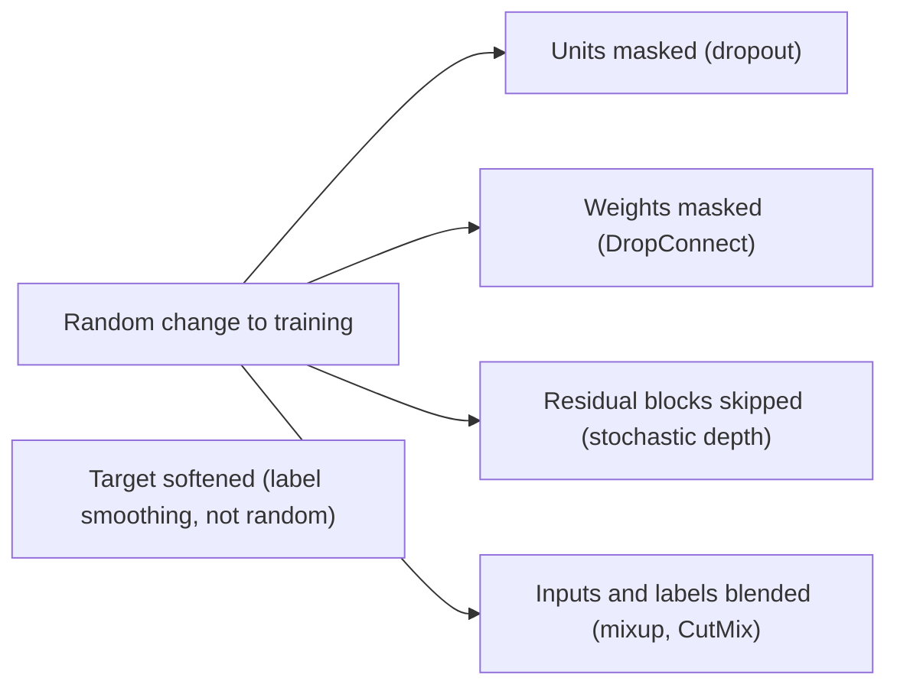

# Dropout and Stochastic Regularisation

Dropout and related methods reduce overfitting by adding randomness to training, so that a network cannot depend on any single unit, layer, weight or training example. The same randomness has two further readings: it approximates averaging over an ensemble of networks, and when it is kept switched on at test time it gives a rough measure of model uncertainty.

## Overview

A network with far more parameters than training examples can memorise its training set and still perform poorly on new data. This gap is the [generalisation](../../paradigms/supervised/generalization-theory/index.md) problem. Regularisation is the family of techniques that narrows it. Some act on the weights, such as penalties on their size (see [regularisation and weight decay](../../optimization/regularisation-and-weight-decay.md)). Stochastic regularisers take a different route: they perturb the training process at random, so that the network must find solutions that survive the perturbation.

Dropout, introduced by Hinton and colleagues in 2012, is the best-known example. During training, each hidden unit is removed with a fixed probability on every presentation of an example. The idea has since spread in several directions. DropConnect drops individual weights rather than units. Stochastic depth drops whole residual blocks. Mixup and CutMix randomly blend or paste training examples. Label smoothing is not random, but it belongs to the same family because it changes the training signal to discourage overconfidence.

These methods differ in what they randomise: units, weights, layers, inputs or targets. They share one goal, which is to stop the network from relying on a fragile pattern in its training data.

## Key concepts

- **Co-adaptation.** A situation in which a unit is useful only in the presence of specific other units. Dropout was motivated as a way to prevent it.
- **Mask.** The random pattern of kept and removed units used on one training step.
- **Inverted dropout.** The usual implementation, which scales the kept activations up during training so that nothing needs to change at test time.
- **Ensemble.** A set of models whose predictions are averaged. A dropout network shares its weights among a very large family of thinner sub-networks.
- **Soft target.** A training label that is a distribution over classes rather than a single class. Label smoothing and mixup both produce soft targets.

## How it works

### Dropout in one layer

For a layer with activations \(h_i\), draw a mask \(m_i\) for each unit, with \(m_i\) equal to 1 with probability \(1-p\) and 0 otherwise, where \(p\) is the drop rate. During training the layer uses

\[
\tilde h_i = \frac{m_i\,h_i}{1-p}.
\]

The division keeps the expected activation equal to \(h_i\). At test time the masks are removed and the full layer is used. Early descriptions achieved the same expected output by scaling the weights at test time instead. Dropout is usually applied to fully connected layers. In convolutional networks it is used less often, because neighbouring activations carry similar information, so dropping single values leaves the signal in the neighbours.

DropConnect is a close variant. It sets individual weights to zero instead of activations, so each connection is dropped independently.

### The ensemble view

Each mask defines a thinner sub-network. With \(n\) units there are \(2^n\) possible masks, so training samples many sub-networks, and the single full network used at test time approximates their average. Hara, Saitoh and Shouno (2017) analyse dropout learning in this way and argue that combining the dropped units with the learned network can be regarded as ensemble learning. The equivalence is exact in simple cases, such as a single linear unit, and only approximate in deep nonlinear networks. Veit, Wilber and Belongie (2016) apply a similar reading to residual networks, which they describe as collections of paths of different lengths that behave like an ensemble.

### The regulariser view

For generalised linear models, dropout is not only noise. Wager, Wang and Liang (2013) show that its effect is first-order equivalent to an L2 penalty applied after the features are rescaled by an estimate of their inverse Fisher information. In this reading, dropout is an adaptive penalty that treats rarely active features differently from common ones.

### The Bayesian view

Gal and Ghahramani (2015) argue that dropout training in a deep network approximates Bayesian inference in a deep Gaussian process. If dropout stays active at prediction time and many stochastic passes are averaged, the spread of the predictions gives an estimate of model uncertainty. This is [Monte Carlo dropout](../../machine-learning/uncertainty-and-calibration/mc-dropout/index.md), covered on its own page under uncertainty quantification. Kingma, Salimans and Welling (2015) extend the link: Gaussian dropout is a form of variational inference, and the dropout rate can be learned. The Bayesian reading is useful, but it is an approximation, and its quality depends on choices such as the prior and the rate that are not settled.

Dropout in recurrent networks needs special care. A later paper by Gal and Ghahramani on recurrent networks shows that applying dropout naively to recurrent layers can fail, and proposes a variational form that uses the same mask at every time step of a sequence.

## Key methods

Each method below has its own page, and the comparison here is brief.

| Method | Introduced | What it perturbs | Page |
|---|---|---|---|
| Stochastic depth | Huang et al. (2016) | Whole residual blocks, skipped at random for each mini-batch | [Stochastic depth](stochastic-depth/index.md) |
| Mixup and CutMix | Zhang et al. (2017); Yun et al. (2019) | Pairs of training inputs and their labels, blended together | [Mixup and CutMix](mixup/index.md) |
| Label smoothing | Szegedy et al. (2015) | Targets, softened towards the uniform distribution (deterministic) | [Label smoothing](label-smoothing/index.md) |
| Monte Carlo dropout | Gal and Ghahramani (2015) | Dropout kept on at prediction time, for uncertainty | [Monte Carlo dropout](../../machine-learning/uncertainty-and-calibration/mc-dropout/index.md) |

Years in this table follow the arXiv record of each paper.

## Connections

- **Normalisation.** Batch normalisation adds a regularising effect through its mini-batch statistics. The original paper suggested that it can reduce the need for dropout. See [normalisation layers](../normalisation/index.md).
- **Architectures.** Dropout is used in [Transformers](../../models/transformer/index.md), where Vaswani et al. (2017) apply it to the output of each sub-layer. Stochastic depth is designed for [residual networks](../../models/cnn/backbones-and-scaling/resnet/index.md).
- **Uncertainty and active learning.** Uncertainty estimates from dropout feed into [deep active learning](../../paradigms/active/deep-active-learning/index.md), and more broadly into the [probabilistic methods](../../paradigms/probabilistic/index.md) overview.
- **Brain and mind.** Neurons are noisy, and synaptic transmission is probabilistic: a synapse releases transmitter on only some of its presynaptic events, and release probability varies widely between synapses (Branco and Staras, 2009). Neural tissue is therefore not free of the kind of randomness used in dropout. Whether the brain uses such noise to avoid overfitting, or has any analogous regulariser, is not known. See [computational neuroscience](../../../brain-mind/computational-neuroscience/index.md) and [NeuroAI](../../../brain-mind/neuroai/index.md).

## Applications

- **Training large networks.** Dropout and weight decay are common defaults for fully connected layers and for the sub-layers of Transformer models.
- **Very deep residual networks.** Stochastic depth was used to train networks deeper than 1000 layers, and it reduced training time on the benchmarks in its paper.
- **Image classification.** Mixup and CutMix improved state-of-the-art classifiers on CIFAR and ImageNet, according to their papers.
- **Uncertainty estimation.** Monte Carlo dropout has been used for uncertainty in regression and classification, and in deep reinforcement learning.

## Open questions

- **Which explanation is right?** The ensemble, adaptive-penalty and Bayesian views each fit some results. Whether one of them is the main cause of dropout's benefit, or whether they describe a single effect in different terms, is not settled.
- **Do dropout uncertainties mean anything?** Whether the spread of Monte Carlo dropout predictions is well calibrated, and under which priors and rates, is still under study.
- **Where to randomise.** Dropout works well in some layers and poorly in others, such as recurrent layers without the variational form. Rules for placement and rate remain largely empirical.
- **Role at scale.** As models and datasets grow, the value of explicit regularisers may change, and their interaction with normalisation and with very large training sets is not fully mapped.
- **Biology.** Whether any biological noise is used as a regulariser, rather than being a by-product of unreliable transmission, is unknown.

## References

### Seminal papers

- Hinton, G. E. et al. (2012). *Improving neural networks by preventing co-adaptation of feature detectors*. arXiv. https://arxiv.org/abs/1207.0580 — The preprint that introduced randomly omitting hidden units during training to reduce overfitting and co-adaptation.
- Wager, S., Wang, S. & Liang, P. (2013). *Dropout Training as Adaptive Regularization*. arXiv. https://arxiv.org/abs/1307.1493 — Shows that dropout acts as an adaptive L2-type regulariser for generalised linear models.
- Gal, Y. & Ghahramani, Z. (2015). *Dropout as a Bayesian Approximation: Representing Model Uncertainty in Deep Learning*. arXiv. https://arxiv.org/abs/1506.02142 — Casts dropout training as approximate Bayesian inference and uses test-time dropout to estimate uncertainty.
- Huang, G. et al. (2016). *Deep Networks with Stochastic Depth*. arXiv. https://arxiv.org/abs/1603.09382 — Randomly drops residual blocks during training, with the full network used at test time, to train very deep networks.
- Szegedy, C. et al. (2015). *Rethinking the Inception Architecture for Computer Vision*. arXiv. https://arxiv.org/abs/1512.00567 — Redesigns an image classifier for efficiency and regularisation, and introduces label smoothing for its classifier.
- Zhang, H. et al. (2017). *mixup: Beyond Empirical Risk Minimization*. arXiv. https://arxiv.org/abs/1710.09412 — Trains on convex combinations of pairs of examples and their labels, improving generalisation and robustness.
- Yun, S. et al. (2019). *CutMix: Regularization Strategy to Train Strong Classifiers with Localizable Features*. arXiv. https://arxiv.org/abs/1905.04899 — Pastes patches between training images and mixes the labels by patch area, as an alternative to erasing image regions.

### Surveys and textbooks

- Shorten, C. & Khoshgoftaar, T. M. (2019). *A survey on Image Data Augmentation for Deep Learning*. Journal of Big Data. https://doi.org/10.1186/s40537-019-0197-0 — Surveys augmentation methods for image data, the setting in which mixup and CutMix are used.
- Branco, T. & Staras, K. (2009). *The probability of neurotransmitter release: variability and feedback control at single synapses*. Nature Reviews Neuroscience. https://doi.org/10.1038/nrn2634 — Reviews how the probability of neurotransmitter release varies between single synapses and how it is regulated.

### Articles and documentation

- Hara, K., Saitoh, D. & Shouno, H. (2017). *Analysis of dropout learning regarded as ensemble learning*. arXiv. https://arxiv.org/abs/1706.06859 — Argues that combining the dropped units with the learned network is a form of ensemble learning, and analyses dropout on that basis.
- Veit, A., Wilber, M. & Belongie, S. (2016). *Residual Networks Behave Like Ensembles of Relatively Shallow Networks*. arXiv. https://arxiv.org/abs/1605.06431 — Describes residual networks as collections of paths of different lengths that behave like an ensemble.
- Kendall, A. & Gal, Y. (2017). *What Uncertainties Do We Need in Bayesian Deep Learning for Computer Vision?* arXiv. https://arxiv.org/abs/1703.04977 — Separates aleatoric from epistemic uncertainty in vision models built with Bayesian deep learning tools.
- Gal, Y. & Ghahramani, Z. (2015). *A Theoretically Grounded Application of Dropout in Recurrent Neural Networks*. arXiv. https://arxiv.org/abs/1512.05287 — Applies a variational form of dropout to LSTM and GRU models, which naive dropout on recurrent layers cannot handle well.
- Vaswani, A. et al. (2017). *Attention Is All You Need*. arXiv. https://arxiv.org/abs/1706.03762 — Introduces the Transformer, whose sub-layers are regularised with dropout.
- Kingma, D. P., Salimans, T. & Welling, M. (2015). *Variational Dropout and the Local Reparameterization Trick*. arXiv. https://arxiv.org/abs/1506.02557 — Shows that Gaussian dropout is a variational Bayesian method and proposes learning the dropout rates.

