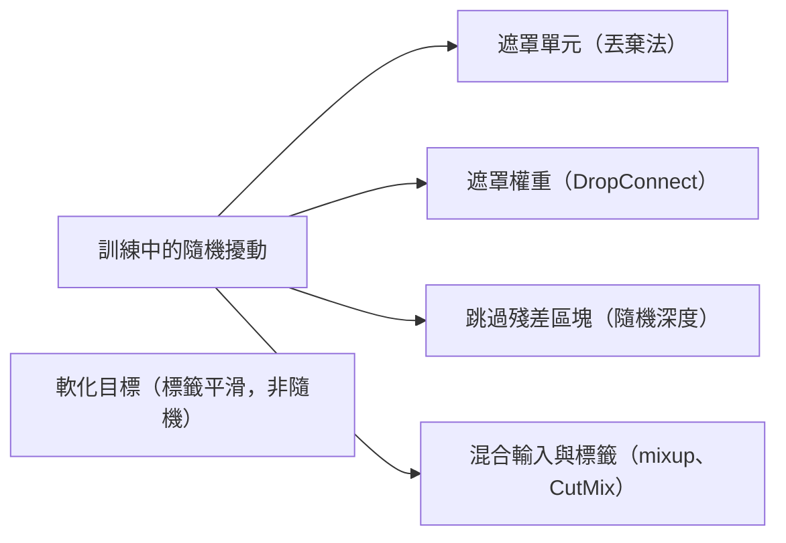

# 丟棄法與隨機正則化

丟棄法及相關方法透過在訓練中加入隨機性來減少過擬合，使網路無法依賴任何單一的單元、層、權重或訓練樣本。同樣的隨機性還有兩種延伸解讀：它近似於對一組網路取平均（集成），而且當推論時仍保持開啟時，它能粗略地衡量模型的不確定性。

## 概述

一個參數遠多於訓練樣本數的網路，可能會記住訓練集，卻在新資料上表現不佳。這個落差就是[泛化](../../paradigms/supervised/generalization-theory/index.md)問題。正則化是用來縮小這個落差的一整類技術。有些作用在權重上，例如對權重大小施加懲罰（見[正則化與權重衰減](../../optimization/regularisation-and-weight-decay.md)）。隨機正則化則走另一條路：它在訓練過程中隨機施加擾動，迫使網路找到能在擾動下仍然有效的解。

丟棄法由 Hinton 及其同事於 2012 年提出，是最著名的例子。訓練時，每個隱藏單元在每次看到樣本時，都會以固定機率被移除。此後這個想法朝幾個方向延伸。DropConnect 丟棄的是個別權重而非單元。隨機深度丟棄的是整個殘差區塊。Mixup 與 CutMix 則隨機混合或貼上訓練樣本。標籤平滑本身不是隨機的，但它屬於同一族，因為它改變訓練訊號，以抑制模型過度自信。

這些方法隨機化的對象不同：單元、權重、層、輸入或標籤。它們有共同的目標，就是阻止網路依賴訓練資料中脆弱的特定模式。

## 關鍵概念

- **共同適應。** 某個單元只有在其他特定單元存在時才有用的情況。丟棄法的動機之一就是防止這種現象。
- **遮罩。** 某一個訓練步驟中，決定哪些單元保留、哪些移除的隨機模式。
- **反向丟棄法。** 常見的實作方式，在訓練時把保留下來的激活值放大，使推論時不必做任何改變。
- **集成。** 將多個模型的預測取平均。一個丟棄法網路會在大量較細的子網路之間共享權重。
- **軟標籤。** 以類別分布表示的訓練標籤，而非單一類別。標籤平滑與 mixup 都會產生軟標籤。

## 運作方式

### 單一層中的丟棄法

對於激活值為 \(h_i\) 的一層，為每個單元抽取遮罩 \(m_i\)：\(m_i\) 以機率 \(1-p\) 等於 1，否則為 0，其中 \(p\) 為丟棄率。訓練時，該層使用

\[
\tilde h_i = \frac{m_i\,h_i}{1-p}.
\]

除以 \(1-p\) 能使激活值的期望值維持為 \(h_i\)。推論時移除遮罩，直接使用完整的層。早期的描述則在測試時改為縮放權重，兩者得到的期望輸出相同。丟棄法通常用在全連接層。在卷積網路中較少使用，因為相鄰的激活值攜帶相似的資訊，所以丟棄單一數值時，訊號仍會保留在鄰近的數值中。

DropConnect 是一個接近的變體，它把個別權重設為零，而非丟棄激活值，因此每條連接各自獨立地被丟棄。

### 集成觀點

每個遮罩定義出一個較細的子網路。若有 \(n\) 個單元，就有 \(2^n\) 種可能的遮罩，因此訓練實際上取樣了大量的子網路，而推論時使用的單一完整網路則近似於它們的平均。Hara、Saitoh 與 Shouno（2017）以此角度分析丟棄法學習，並主張把被丟棄的單元與已學習的網路結合起來，可以視為集成學習。在簡單情形下（例如單一線性單元），這種等價是精確的；在深層非線性網路中則只是近似。Veit、Wilber 與 Belongie（2016）對殘差網路也提出類似的解讀，把它們描述為由不同長度的路徑組成的集合，而這些路徑的行為像是一個集成。

### 正則化觀點

對於廣義線性模型，丟棄法不只是雜訊。Wager、Wang 與 Liang（2013）指出，它的效果在一階上等同於一個 L2 懲罰，而該懲罰是在特徵經過其逆對角 Fisher 資訊矩陣估計值縮放後才施加的。依此解讀，丟棄法是一種自適應懲罰，會對不常活躍的特徵與常見特徵給予不同的處理。

### 貝氏觀點

Gal 與 Ghahramani（2015）主張，深度網路中的丟棄法訓練近似於深度高斯過程上的貝氏推論。若在預測時仍保持丟棄法開啟，並對多次隨機前向傳播取平均，預測結果的離散程度就能估計模型的不確定性。這就是[蒙地卡羅丟棄法](../../machine-learning/uncertainty-and-calibration/mc-dropout/index.md)，在不確定性量化主題下另有專頁。Kingma、Salimans 與 Welling（2015）進一步延伸這個連結：高斯丟棄法是一種變分推論，而且丟棄率可以學習。貝氏觀點很有用，但它只是一種近似，其品質取決於先驗與丟棄率等尚未定案的選擇。

在循環網路中使用丟棄法需要特別小心。Gal 與 Ghahramani（2015）指出，若把丟棄法直接套用在循環層上，可能會失敗，並提出一種變分形式，讓同一個序列的每個時間步都使用相同的遮罩。

## 主要方法

下列每種方法都有自己的專頁，此處的比較從簡。

| 方法 | 提出者與年份 | 擾動的對象 | 專頁 |
|---|---|---|---|
| 隨機深度 | Huang 等人（2016） | 整個殘差區塊，每個 mini-batch 隨機跳過 | [隨機深度](stochastic-depth/index.md) |
| Mixup 與 CutMix | Zhang 等人（2017）；Yun 等人（2019） | 成對的訓練輸入及其標籤，混合在一起 | [Mixup 與 CutMix](mixup/index.md) |
| 標籤平滑 | Szegedy 等人（2015） | 標籤，向均勻分布軟化（具確定性） | [標籤平滑](label-smoothing/index.md) |
| 蒙地卡羅丟棄法 | Gal 與 Ghahramani（2015） | 預測時仍開啟的丟棄法，用於估計不確定性 | [蒙地卡羅丟棄法](../../machine-learning/uncertainty-and-calibration/mc-dropout/index.md) |

此表中的年份依各論文在 arXiv 上的紀錄。

## 關聯

- **正規化。** 批次正規化透過小批次統計量帶來正則化效果。原論文認為它可以減少對丟棄法的需要。見[正規化層](../normalisation/index.md)。
- **架構。** 丟棄法用於 [Transformer](../../models/transformer/index.md)，Vaswani 等人（2017）把它套用在每個子層的輸出上。隨機深度則是為[殘差網路](../../models/cnn/backbones-and-scaling/resnet/index.md)而設計。
- **不確定性與主動學習。** 丟棄法產生的不確定性估計可用於[深度主動學習](../../paradigms/active/deep-active-learning/index.md)，更廣泛地也與[機率方法](../../probabilistic/index.md)概述相關。
- **大腦與心智。** 神經元是有雜訊的，突觸傳遞也是機率性的：一個突觸只會在部分突觸前事件上釋放神經傳導物質，而且不同突觸之間的釋放機率差異很大（Branco 與 Staras，2009）。因此，神經組織並非不存在丟棄法所使用的那種隨機性。大腦是否利用這種雜訊來避免過擬合，或是否有類似的正則化機制，目前尚不清楚。見[計算神經科學](../../../brain-mind/computational-neuroscience/index.md)與 [NeuroAI](../../../brain-mind/neuroai/index.md)。

## 應用

- **訓練大型網路。** 丟棄法與權重衰減是全連接層以及 Transformer 模型子層的常見預設。
- **非常深的殘差網路。** 隨機深度被用來訓練超過 1000 層的網路，並在其論文的基準測試中縮短了訓練時間。
- **影像分類。** 根據各自的論文，Mixup 與 CutMix 在 CIFAR 與 ImageNet 上改善了最先進的分類器。
- **不確定性估計。** 蒙地卡羅丟棄法已用於迴歸與分類的不確定性估計，也用於深度強化學習。

## 未解問題

- **哪種解釋才正確？** 集成觀點、自適應懲罰觀點與貝氏觀點各自能解釋部分結果。它們究竟是丟棄法效果的主因，還是同一種效果的不同描述，目前尚無定論。
- **丟棄法的不確定性有意義嗎？** 蒙地卡羅丟棄法預測的離散程度是否校準良好，以及在哪些先驗與丟棄率下如此，仍在研究中。
- **應該在哪裡隨機化？** 丟棄法在某些層上效果很好，在另一些層上則效果不佳，例如沒有變分形式的循環層。關於放置位置與丟棄率的規則，大多仍屬經驗性質。
- **規模化後的角色。** 隨著模型與資料集變大，明確正則化器的價值可能改變，它們與正規化及超大訓練集之間的互動也尚未完全釐清。
- **生物學。** 生物中的雜訊是否被用作正則化器，而非只是傳輸不可靠的副產物，尚不清楚。

## 參考文獻

### 開創性論文

- Hinton, G. E. et al. (2012). *Improving neural networks by preventing co-adaptation of feature detectors*. arXiv. https://arxiv.org/abs/1207.0580 — 引入訓練時隨機省略隱藏單元的預印本，目的是減少過擬合與共同適應。
- Wager, S., Wang, S. & Liang, P. (2013). *Dropout Training as Adaptive Regularization*. arXiv. https://arxiv.org/abs/1307.1493 — 顯示丟棄法對廣義線性模型而言是一種自適應的 L2 型正則化器。
- Gal, Y. & Ghahramani, Z. (2015). *Dropout as a Bayesian Approximation: Representing Model Uncertainty in Deep Learning*. arXiv. https://arxiv.org/abs/1506.02142 — 把丟棄法訓練視為近似的貝氏推論，並以測試時的丟棄法估計預測不確定性。
- Huang, G. et al. (2016). *Deep Networks with Stochastic Depth*. arXiv. https://arxiv.org/abs/1603.09382 — 訓練時隨機丟棄殘差區塊，推論時使用完整網路，用以訓練非常深的網路。
- Szegedy, C. et al. (2015). *Rethinking the Inception Architecture for Computer Vision*. arXiv. https://arxiv.org/abs/1512.00567 — 為效率與正則化重新設計影像分類器，並為其分類器引入標籤平滑。
- Zhang, H. et al. (2017). *mixup: Beyond Empirical Risk Minimization*. arXiv. https://arxiv.org/abs/1710.09412 — 在成對樣本及其標籤的凸組合上訓練，改善泛化與穩健性。
- Yun, S. et al. (2019). *CutMix: Regularization Strategy to Train Strong Classifiers with Localizable Features*. arXiv. https://arxiv.org/abs/1905.04899 — 在訓練影像之間貼上區塊，並依區塊面積混合標籤，作為抹除影像區域的替代方法。

### 綜述與教科書

- Shorten, C. & Khoshgoftaar, T. M. (2019). *A survey on Image Data Augmentation for Deep Learning*. Journal of Big Data. https://doi.org/10.1186/s40537-019-0197-0 — 綜述影像資料的增強方法，也就是 mixup 與 CutMix 所使用的情境。
- Branco, T. & Staras, K. (2009). *The probability of neurotransmitter release: variability and feedback control at single synapses*. Nature Reviews Neuroscience. https://doi.org/10.1038/nrn2634 — 綜述神經傳導物質釋放機率如何在單一突觸之間變化，以及它如何被調控。

### 文章與文件

- Hara, K., Saitoh, D. & Shouno, H. (2017). *Analysis of dropout learning regarded as ensemble learning*. arXiv. https://arxiv.org/abs/1706.06859 — 主張把被丟棄的單元與已學習的網路結合，是一種集成學習，並據此分析丟棄法。
- Veit, A., Wilber, M. & Belongie, S. (2016). *Residual Networks Behave Like Ensembles of Relatively Shallow Networks*. arXiv. https://arxiv.org/abs/1605.06431 — 把殘差網路描述為由不同長度路徑組成的集合，其行為像一個集成。
- Gal, Y. & Ghahramani, Z. (2015). *A Theoretically Grounded Application of Dropout in Recurrent Neural Networks*. arXiv. https://arxiv.org/abs/1512.05287 — 把變分形式的丟棄法應用於 LSTM 與 GRU，這是直接套用在循環層上的丟棄法無法妥善處理的情況。
- Vaswani, A. et al. (2017). *Attention Is All You Need*. arXiv. https://arxiv.org/abs/1706.03762 — 提出 Transformer，其子層以丟棄法進行正則化。
- Kendall, A. & Gal, Y. (2017). *What Uncertainties Do We Need in Bayesian Deep Learning for Computer Vision?* arXiv. https://arxiv.org/abs/1703.04977 — 在以貝氏深度學習工具建立的視覺模型中，區分偶然不確定性與認知不確定性。
- Kingma, D. P., Salimans, T. & Welling, M. (2015). *Variational Dropout and the Local Reparameterization Trick*. arXiv. https://arxiv.org/abs/1506.02557 — 顯示高斯丟棄法是一種變分貝氏方法，並提出學習丟棄率。
