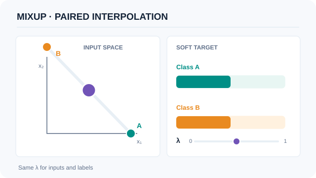
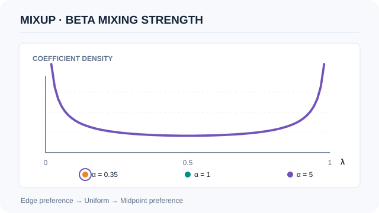

# Mixup

Mixup trains a network on convex combinations of paired inputs and their targets. It encourages smooth interpolation between training examples by changing the training distribution, while leaving the network architecture unchanged.[^mixup]

## Problem and core idea

The [stochastic regularisation chapter](index.md) compares methods that modify data, activations or network paths. Empirical risk minimisation (ERM) evaluates a model on observed training examples; mixup adds constraints at synthetic points between them. This is a form of **vicinal risk minimisation**, which trains on a distribution constructed around the observed data.[^mixup]

For paired examples $(x_i,y_i)$ and $(x_j,y_j)$, choose $\alpha>0$ and draw $\lambda\sim\mathrm{Beta}(\alpha,\alpha)$. Use the **same coefficient** for inputs and targets:

$$
\tilde{x}=\lambda x_i+(1-\lambda)x_j,\qquad
\tilde{y}=\lambda y_i+(1-\lambda)y_j.
$$

In single-label classification, $y_i$ and $y_j$ are one-hot class vectors. Their mixture is a probability vector, not an interpolated integer class ID. The synthetic target expresses a training constraint; it is not a measurement of the true class probabilities of a naturally occurring example.

Mixup favours approximately linear predictions between examples. It does not impose the exact identity $f(\tilde{x})=\lambda f(x_i)+(1-\lambda)f(x_j)$ on every trained model.[^mixup]

*Original instructional animation (CC BY-SA 4.0).* The purple point interpolates between invented inputs $x_A=(1,0)$ and $x_B=(0,1)$ using $\lambda$. The two soft-label weights are $\lambda$ and $1-\lambda$. These are **analytic teaching inputs and targets, not model predictions or actual blended photographs**. MkDocs supports Play/Pause via button, Enter or Space; GitHub shows a static fallback, which is also the default when reduced motion is preferred.

## Soft targets and the loss

Let $p=f_\theta(\tilde{x})$ be the class probabilities predicted **at the mixed input**. Ordinary unweighted cross-entropy is linear in its target:

$$
\operatorname{CE}(p,\tilde{y})
=-\sum_{c=1}^{C}\tilde{y}_c\log p_c
=\lambda\operatorname{CE}(p,y_i)
+(1-\lambda)\operatorname{CE}(p,y_j).
$$

This algebra explains two equivalent implementations: supply a soft target to a compatible loss, or combine two hard-target losses. Both losses on the right use the **same** prediction $p$. Averaging losses on the two original, unmixed inputs would optimise a different objective.

The identity assumes the stated cross-entropy and consistent reductions. If coefficients vary per example, combine the per-example losses before averaging the batch. For class-weighted reductions, additional smoothing or another loss function, check the actual definition rather than assuming identical behaviour.

### Worked classification example

This is an original numerical example, not a paper result. Use three classes and $\lambda=0.25$:

| Quantity | Value |
|---|---|
| First input and target | $x_i=(1,0)$, $y_i=(1,0,0)$ |
| Second input and target | $x_j=(0,1)$, $y_j=(0,1,0)$ |
| Mixed input | $\tilde{x}=(0.25,0.75)$ |
| Mixed target | $\tilde{y}=(0.25,0.75,0)$ |
| Prediction at the mixed input | $p=(0.2,0.7,0.1)$ |

Using natural logarithms, the loss is $-0.25\log(0.2)-0.75\log(0.7)\approx0.66987$. Taking the target's argmax would discard the first class's 25% contribution. Mixing integer class IDs would not represent these target weights at all.

## What the Beta parameter changes

The symmetric Beta distribution has mean $1/2$ for every positive $\alpha$. Its shape, rather than its mean, changes the strength of mixing:

| Choice | Typical coefficients and effect |
|---|---|
| $\alpha\to0^+$ | Mass concentrates near 0 and 1; samples approach either original example, recovering ERM in the limit. |
| $\alpha=1$ | Uniform coefficients over $[0,1]$, not a fixed 50:50 mixture. |
| Large $\alpha$ | Coefficients concentrate near $1/2$, favouring stronger midpoint mixtures. |

The paper uses different settings across experiments and reports underfitting for large $\alpha$ in its ImageNet study. A larger value is not a universal improvement.[^settings] Exactly $\alpha=0$ is outside the Beta distribution's parameter domain; an implementation offering “mixup off” at zero needs an explicit bypass.

*Original instructional animation (CC BY-SA 4.0).* The three labelled states plot **analytic probability densities** for $\mathrm{Beta}(0.35,0.35)$, $\mathrm{Beta}(1,1)$ and $\mathrm{Beta}(5,5)$ over $\lambda\in[0.02,0.98]$. Intermediate frames **visually morph these exact curves; they are not exact distributions for intermediate alpha values, random draws, or training measurements**. Their common mean is 0.5 while their variance decreases. MkDocs supports Play/Pause and reduced-motion fallback; GitHub shows the still preview.

## Training and evaluation procedure

1. Select a training minibatch and a random permutation of it to form pairs. The paper describes this single-loader approach as an alternative to drawing two separate minibatches.[^mixup]
2. Sample coefficients and record whether they are shared across a batch or drawn per example. Preserve the correspondence between each pair's input and target weights.
3. Form mixed inputs and soft targets, or retain the two original targets for the equivalent weighted loss.
4. Make a forward pass on the mixed inputs, compute the loss and update parameters normally.
5. For ordinary validation and test accuracy, evaluate the original examples against their original labels. Keep training/validation splits separate; do not use held-out examples as mixing partners.

The final step is evaluation guidance for the ordinary classification task. A separate interpolation experiment can be informative, but it measures a different input distribution. Likewise, mixed-target training loss is not directly comparable with hard-target training loss as a measure of ordinary classification performance.

## Results and scope

In Table 1 of the original paper, a ResNet-50 trained for 200 epochs on ImageNet-2012 has validation top-1 error of 23.6% under ERM and 22.1% with mixup at $\alpha=0.2$: a decrease of **1.5 percentage points**. This comparison uses that experiment's architecture, preprocessing and optimisation schedule; it is not a guaranteed gain from adding mixup to any model.[^results]

The paper also studies CIFAR classification, speech, tabular data, corrupted labels, adversarial examples and GAN training. These empirical results do not provide a certified adversarial robustness guarantee. For a new task, compare against a matched baseline and report both predictive performance and the training configuration.[^results]

## Connections and limitations

- **Label smoothing** changes the target toward a chosen prior while retaining the input. Mixup changes both the input and the target using another example; the two regularisers therefore impose different constraints.[^smoothing]
- [Dropout](dropout-method.md) removes units during training, while [stochastic depth](stochastic-depth.md) bypasses network layers or residual paths. These differ from mixing data and can interact with mixup rather than being automatic substitutes.[^dropout][^depth]
- **CutMix** copies image patches and weights labels by patch area, whereas ordinary mixup blends the inputs throughout. It provides a different assumption about spatial structure.[^cutmix]

A convex combination can lie outside the natural data distribution. Integer token IDs, categorical codes, bounding boxes and segmentation masks need task-specific treatment; the classification recipe does not establish that arbitrary arithmetic on them is meaningful. Likewise, a soft training target alone does not establish calibrated probabilities on real examples.

## Open questions

Which pairs and representations provide useful interpolations for a particular task? How should mixing interact with other augmentation, class imbalance and distribution shift? These require validation on the intended data rather than choosing a coefficient solely from another benchmark.

[^mixup]: Zhang et al. (2017, revised 2018), section 2: vicinal risk, paired convex combinations, ERM limit and minibatch pairing.
[^settings]: Zhang et al., sections 3.1–3.2: ImageNet coefficient settings and underfitting, and uniform mixing at $\alpha=1$ in the CIFAR experiments.
[^results]: Zhang et al., Table 1 and sections 3.1–3.7: ImageNet validation errors and the scope of the other evaluations.
[^smoothing]: Szegedy et al., section 7: a target distribution mixed with a fixed prior for label smoothing.
[^dropout]: Srivastava et al. (2014), *Dropout*: random removal of units during training.
[^depth]: Huang et al. (2016), *Deep Networks with Stochastic Depth*: random layer bypass during training.
[^cutmix]: Yun et al. (2019), *CutMix*: patch replacement with label weights proportional to patch area.

## References

### Seminal papers

- Zhang, H., Cisse, M., Dauphin, Y. N. & Lopez-Paz, D. (2017; revised 2018). *mixup: Beyond Empirical Risk Minimization*. https://arxiv.org/abs/1710.09412 — Introduces paired input and target interpolation, with experiments and ablations.
- Szegedy, C. et al. (2015). *Rethinking the Inception Architecture for Computer Vision*. https://arxiv.org/abs/1512.00567 — Describes label smoothing toward a fixed prior in section seven.
- Srivastava, N., Hinton, G., Krizhevsky, A., Sutskever, I. & Salakhutdinov, R. (2014). *Dropout: A Simple Way to Prevent Neural Networks from Overfitting*. JMLR 15(56):1929–1958. https://jmlr.org/papers/v15/srivastava14a.html — Explains unit dropout and its effect on overfitting during training.
- Huang, G., Sun, Y., Liu, Z., Sedra, D. & Weinberger, K. (2016). *Deep Networks with Stochastic Depth*. https://arxiv.org/abs/1603.09382 — Studies random layer bypass as a way to train deep networks.
- Yun, S. et al. (2019). *CutMix: Regularization Strategy to Train Strong Classifiers with Localizable Features*. https://arxiv.org/abs/1905.04899 — Introduces patch-based mixing with target weights determined by patch area.
