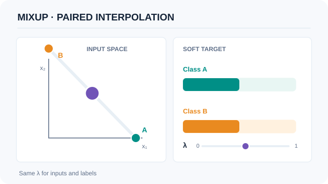
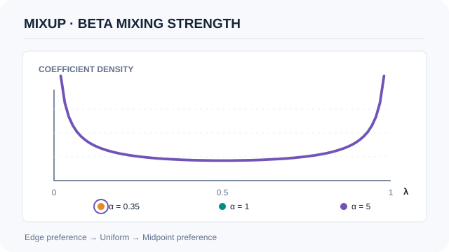

# 混合增強（Mixup）

混合增強在成對輸入及其目標的凸組合上訓練網路。它透過改變訓練分布，鼓勵模型在訓練樣本之間平滑內插，而不改變網路架構。[^mixup]

## 問題與核心想法

[隨機正則化章節](index.md)比較修改資料、激活值或網路路徑的方法。經驗風險最小化（ERM）在觀測到的訓練樣本上評估模型；混合增強則在樣本之間的合成點加入約束。這是一種**鄰域風險最小化**：在觀測資料周圍建構分布，並用該分布訓練。[^mixup]

對成對樣本 $(x_i,y_i)$ 與 $(x_j,y_j)$，選擇 $\alpha>0$ 並抽取 $\lambda\sim\mathrm{Beta}(\alpha,\alpha)$。輸入與目標必須使用**相同係數**：

$$
\tilde{x}=\lambda x_i+(1-\lambda)x_j,\qquad
\tilde{y}=\lambda y_i+(1-\lambda)y_j.
$$

在單標籤分類中，$y_i$ 與 $y_j$ 是獨熱類別向量。混合後是機率向量，而非內插後的整數類別編號。合成目標表達的是訓練約束，並非對自然樣本真實類別機率的測量。

混合增強偏好樣本之間近似線性的預測，並不強制所有訓練後的模型都精確滿足 $f(\tilde{x})=\lambda f(x_i)+(1-\lambda)f(x_j)$。[^mixup]

*原創教學動畫（CC BY-SA 4.0）。* 紫色點依 $\lambda$ 在人工輸入 $x_A=(1,0)$ 與 $x_B=(0,1)$ 之間移動，右側類別 A、B 的軟目標權重分別為 $\lambda$、$1-\lambda$。這些是解析式示意值，**不是模型預測或實際影像混合結果**。MkDocs 網站提供播放／暫停及 Enter／Space 鍵盤操作；GitHub 顯示靜態回退，偏好減少動態效果時預設不播放。

## 軟目標與損失

令 $p=f_\theta(\tilde{x})$ 表示**在混合輸入上**預測的類別機率。一般未加權交叉熵對目標呈線性：

$$
\operatorname{CE}(p,\tilde{y})
=-\sum_{c=1}^{C}\tilde{y}_c\log p_c
=\lambda\operatorname{CE}(p,y_i)
+(1-\lambda)\operatorname{CE}(p,y_j).
$$

此代數關係說明兩種等價實作：向支援軟目標的損失函式提供軟目標，或組合兩個硬目標損失。右側兩個損失都使用**相同**預測 $p$。若改為平均兩個原始未混合輸入上的損失，最佳化的就是不同目標。

此恆等式假設使用上述交叉熵與一致的彙總方式。若係數隨樣本而變，應先組合各樣本的損失，再對批次取平均。若使用類別加權的彙總、額外平滑或其他損失函式，應檢查實際定義，不要直接假定行為相同。

### 分類算例

以下為自行設計的數值例子，不是論文結果。使用三個類別，且 $\lambda=0.25$：

| 數量 | 數值 |
|---|---|
| 第一個輸入與目標 | $x_i=(1,0)$、$y_i=(1,0,0)$ |
| 第二個輸入與目標 | $x_j=(0,1)$、$y_j=(0,1,0)$ |
| 混合輸入 | $\tilde{x}=(0.25,0.75)$ |
| 混合目標 | $\tilde{y}=(0.25,0.75,0)$ |
| 混合輸入上的預測 | $p=(0.2,0.7,0.1)$ |

使用自然對數，損失為 $-0.25\log(0.2)-0.75\log(0.7)\approx0.66987$。對目標取 argmax 會丟失第一類的 25% 貢獻；混合整數類別編號則完全無法表達這些目標權重。

## Beta 參數改變什麼

對任何正的 $\alpha$，對稱 Beta 分布的平均值都是 $1/2$。改變混合強度的是其形狀，而非平均值：

| 選擇 | 典型係數與效果 |
|---|---|
| $\alpha\to0^+$ | 機率質量集中在 0 與 1 附近；樣本接近其中一個原始樣本，在極限下回到 ERM。 |
| $\alpha=1$ | 係數在 $[0,1]$ 上均勻分布，並非固定各占一半。 |
| 較大的 $\alpha$ | 係數集中在 $1/2$ 附近，偏向混合較強的中點樣本。 |

論文在不同實驗中採用不同設定，並在 ImageNet 研究中報告較大的 $\alpha$ 會導致欠擬合。較大數值並非普遍較好。[^settings] 恰好 $\alpha=0$ 不在 Beta 分布的參數定義域內；若實作以零表示「停用混合增強」，就需要明確略過抽樣。

*原創教學動畫（CC BY-SA 4.0）。* 三個標示時點的曲線分別是 $\mathrm{Beta}(0.35,0.35)$、$\mathrm{Beta}(1,1)$、$\mathrm{Beta}(5,5)$ 的**理論機率密度**，繪製範圍為 $\lambda\in[0.02,0.98]$。過渡影格僅將曲線作視覺內插，**並非其他 $\alpha$ 值的精確密度，也不是實際抽樣或訓練結果**。這三個分布的平均數均為 0.5，但變異數依序下降。MkDocs 支援播放／暫停與減少動態效果回退；GitHub 顯示靜態預覽。

## 訓練與評估程序

1. 選取一個訓練小批次，並以其隨機排列形成配對。論文將此單一資料載入器作法，描述為另取兩個小批次的替代方案。[^mixup]
2. 抽取係數，並記錄係數是全批次共用，或逐樣本抽取。保留每組輸入與目標權重的對應。
3. 形成混合輸入與軟目標，或保留兩個原始目標以計算等價加權損失。
4. 對混合輸入執行前向傳播，計算損失並正常更新參數。
5. 對一般驗證與測試準確度，以原始樣本及其原始標籤評估。保持訓練與驗證資料分離，不要使用保留資料作為混合夥伴。

最後一步是針對一般分類任務的評估建議。另做內插實驗也有幫助，但測量的是不同輸入分布。同樣地，混合目標訓練損失不能直接與硬目標訓練損失比較，來衡量一般分類效能。

## 結果與範圍

原論文表 1 中，在 ImageNet-2012 訓練 200 個 epoch 的 ResNet-50，ERM 驗證集 top-1 錯誤率為 23.6%，使用 $\alpha=0.2$ 的混合增強則為 22.1%，下降 **1.5 個百分點**。此比較使用該實驗的架構、前處理與最佳化排程，並不保證任意模型加入混合增強後都有同樣增益。[^results]

論文也研究 CIFAR 分類、語音、表格資料、損毀標籤、對抗樣本與 GAN 訓練。這些實證結果不提供經認證的對抗穩健性保證。對新任務，應比較條件相符的基準，並同時報告預測效能與訓練設定。[^results]

## 關聯與限制

- **標籤平滑**在保留輸入的同時，將目標往指定先驗分布移動。混合增強則利用另一個樣本，同時改變輸入與目標，因此兩種正則化施加不同約束。[^smoothing]
- [丟棄法](dropout-method.md)在訓練時移除單元，[隨機深度](stochastic-depth.md)則略過網路層或殘差路徑。它們與混合資料不同，可能與混合增強產生交互作用，並非自動可互相替代。[^dropout][^depth]
- **CutMix**複製影像區塊，並依區塊面積設定標籤權重；一般混合增強則對整個輸入進行混合。兩者對空間結構採取不同假設。[^cutmix]

凸組合可能落在自然資料分布之外。整數 token 編號、類別代碼、邊界框與分割遮罩需要依任務處理；分類配方並不能證明任意對它們進行算術操作都有意義。同樣地，單靠軟訓練目標，不能證明模型在真實樣本上的機率已經校準。

## 開放問題

對特定任務，哪些配對與表示能提供有用的內插？混合應如何搭配其他增強、類別不平衡與分布偏移？這些問題需要在目標資料上驗證，而非僅從另一個基準選取係數。

[^mixup]: Zhang 等人（2017，2018 年修訂），第 2 節：鄰域風險、配對凸組合、ERM 極限與小批次配對。
[^settings]: Zhang 等人，第 3.1–3.2 節：ImageNet 係數設定與欠擬合，以及 CIFAR 實驗中 $\alpha=1$ 的均勻混合。
[^results]: Zhang 等人，表 1 與第 3.1–3.7 節：ImageNet 驗證錯誤率及其他評估的範圍。
[^smoothing]: Szegedy 等人，第 7 節：標籤平滑將目標分布與固定先驗混合。
[^dropout]: Srivastava 等人（2014），《Dropout》：訓練時隨機移除單元。
[^depth]: Huang 等人（2016），《Deep Networks with Stochastic Depth》：訓練時隨機略過網路層。
[^cutmix]: Yun 等人（2019），《CutMix》：替換影像區塊，並以區塊面積比例設定標籤權重。

## 參考文獻

### 奠基性論文

- Zhang, H., Cisse, M., Dauphin, Y. N. & Lopez-Paz, D. (2017; revised 2018). *mixup: Beyond Empirical Risk Minimization*. https://arxiv.org/abs/1710.09412 — 提出輸入與目標的配對內插，並提供實驗及消融研究。
- Szegedy, C. et al. (2015). *Rethinking the Inception Architecture for Computer Vision*. https://arxiv.org/abs/1512.00567 — 第七節說明將標籤平滑至固定先驗分布的方法。
- Srivastava, N., Hinton, G., Krizhevsky, A., Sutskever, I. & Salakhutdinov, R. (2014). *Dropout: A Simple Way to Prevent Neural Networks from Overfitting*. JMLR 15(56):1929–1958. https://jmlr.org/papers/v15/srivastava14a.html — 說明單元丟棄法及其對訓練過擬合的影響。
- Huang, G., Sun, Y., Liu, Z., Sedra, D. & Weinberger, K. (2016). *Deep Networks with Stochastic Depth*. https://arxiv.org/abs/1603.09382 — 研究以隨機略過網路層來訓練深層網路的方法。
- Yun, S. et al. (2019). *CutMix: Regularization Strategy to Train Strong Classifiers with Localizable Features*. https://arxiv.org/abs/1905.04899 — 提出依區塊面積決定目標權重的區塊混合。
