# Stochastic depth

Stochastic depth regularises a residual network by randomly disabling residual branches during training. The shortcut still carries the signal, so each forward pass can use a different effective depth while evaluation uses the full-depth network.[^huang]

## Overview

The [chapter](index.md) covers randomised regularisers. Standard [Dropout](dropout-method.md) masks individual activations, while stochastic depth shares one mask across the entire residual branch for a sample or a mini-batch.[^dropout][^huang][^torchvision]

## Problem

A [residual network](../../models/cnn/index.md) adds a learned transformation to a shortcut signal at each block. Stacking many blocks increases the number of transformations computed during training. Stochastic depth uses the shortcut to keep the signal moving when it omits a transformation, then uses the complete stack of transformations for evaluation.[^resnet][^huang]

## Core idea

In the original method, each residual block samples one Bernoulli mask shared by the entire mini-batch. Block $l$ uses its residual branch with survival probability $p_l$. Otherwise it uses the shortcut alone. A shape-changing block still needs its shortcut transformation to produce the correct output shape, for example by pooling and padding or by using a learned projection.[^huang]

The active branches form a sampled subnetwork, and subnetworks share weights. A schedule with higher survival probabilities in early blocks keeps those transformations available more often.[^huang]

## Equation

### Original training and evaluation

Let $\mathbf{x}$ be the input to block $l$, $s_l$ its shortcut and $f_l$ its residual branch. The input to any activation after the sum is

$$
\begin{aligned}
\mathbf{z}_{\mathrm{train}} &= s_l(\mathbf{x}) + b_l f_l(\mathbf{x}), \qquad b_l \sim \mathrm{Bernoulli}(p_l),\\
\mathbf{z}_{\mathrm{eval}} &= s_l(\mathbf{x}) + p_l f_l(\mathbf{x}).
\end{aligned}
$$

Huang et al. apply ReLU after the sum. For a fixed block input, replacing $b_l$ by $p_l$ matches the expected sum before that activation. Later blocks see inputs that depend on earlier masks, so this local equality does not imply that the final network prediction equals the average over all sampled subnetworks.[^huang]

*Original teaching animation, CC BY-SA 4.0.* The first three stages illustrate mini-batch masks and identity shortcuts. The fourth shows the original evaluation rule, with each branch weighted by its survival probability. The website player supports play/pause and reduced motion. [View the GitHub-compatible static preview](../../../assets/concept-animations/stochastic-depth-paths-still.svg).

### Survival schedule and expected depth

The paper uses a linear decay from $p_0=1$ at the input to a chosen survival probability $p_L$ at the last of $L$ residual blocks.[^huang]

$$
p_l = 1 - \frac{l}{L}(1-p_L),
\qquad
\mathbb{E}\!\left[\sum_{l=1}^L b_l\right]
= \sum_{l=1}^L p_l
= L-\frac{L+1}{2}(1-p_L).
$$

For $L=4$ and $p_L=0.5$, the survival probabilities are $(0.875,\,0.75,\,0.625,\,0.5)$, so 2.75 of the four residual branches are active on average during training. This counts residual branches and excludes work on the shortcuts.

### Inverted scaling in torchvision

The torchvision operator takes a **drop probability** $q_l=1-p_l$. For $p_l>0$ it scales the retained training output by $1/p_l$, so the residual term is $b_l f_l(\mathbf{x})/p_l$ during training and $f_l(\mathbf{x})$ during evaluation. At a fixed input, the mean training residual term is then $f_l(\mathbf{x})$. For example, with $p_l=0.5$ and a branch output of $4$, the training residual term is $0$ or $8$ with equal probability, and the evaluation term is $4$.[^torchvision]

In torchvision, **batch** mode shares a mask across the mini-batch and **row** mode draws one mask per sample, broadcasting it across the other dimensions. The operator masks a tensor it receives. A call such as `stochastic_depth(f(x), q, mode, training)` computes `f(x)` before the mask is applied, so even batch mode in that call leaves the branch's forward compute in place.[^torchvision]

## Results

Huang et al. reported CIFAR-10 test error of 5.25% with stochastic depth and 6.41% with constant depth for their 110-layer ResNet using standard augmentation. In a separate 1,202-layer comparison, the errors were 4.91% and 6.67%, respectively. For the 110-layer CIFAR-10 run, Table 2 reports training times of 15 h 7 min with stochastic depth and 20 h 42 min with constant depth.[^huang]

On ImageNet with ResNet-152, the reported validation errors at 90 epochs were 23.38% with stochastic depth and 23.06% with constant depth. The same study reached 21.98% with stochastic depth after 120 epochs in almost the same time as the 90-epoch baseline. The 120-epoch constant-depth run reached 21.78%.[^huang]

## Limitations

- The expected number of active branches measures effective depth. Actual savings depend on which computations the implementation skips and how much they cost. Shortcut computation and all branches at evaluation still contribute to runtime.[^huang][^torchvision]
- The survival schedule determines how often each branch receives a training signal through its residual output. The original CIFAR-10 schedule comparison used a specific ResNet, and ConvNeXt reports different drop rates for different model variants.[^huang][^convnext]

## Connections

Stochastic depth and [Dropout](dropout-method.md) both use random masks. Stochastic depth changes the sequence of residual transformations a signal passes through, which is useful for interpreting the effective depth of [convolutional networks](../../models/cnn/index.md) with shortcuts.[^huang][^dropout]

## Applications

ConvNeXt uses stochastic depth in its ImageNet training recipe alongside data augmentation and label smoothing. The paper's appendix lists the drop rates used for different ConvNeXt variants.[^convnext]

## Open questions

- How should a survival schedule account for differences in compute cost between blocks?
- When does sharing a mask across a batch give a better accuracy and training-time trade-off than masking individual samples?

[^huang]: Huang et al., [*Deep Networks with Stochastic Depth*](https://arxiv.org/html/1603.09382), §§3–5, especially Equations 2, 4 and 5, Tables 1 and 2, and the 1,202-layer and ImageNet experiments.
[^resnet]: He et al., [*Deep Residual Learning for Image Recognition*](https://arxiv.org/abs/1512.03385), §3.2.
[^dropout]: Srivastava et al., [*Dropout: A Simple Way to Prevent Neural Networks from Overfitting*](https://jmlr.org/papers/v15/srivastava14a.html), abstract and §2.
[^torchvision]: Torchvision, [operator documentation](https://docs.pytorch.org/vision/stable/generated/torchvision.ops.stochastic_depth.html) and [implementation](https://docs.pytorch.org/vision/stable/_modules/torchvision/ops/stochastic_depth.html).
[^convnext]: Liu et al., [*A ConvNet for the 2020s*](https://arxiv.org/html/2201.03545), §3.1 and Appendix A.1.

## References

### Seminal papers

- Huang, G., Sun, Y., Liu, Z., Sedra, D. & Weinberger, K. Q. (2016). *Deep Networks with Stochastic Depth*. ECCV. https://arxiv.org/abs/1603.09382 — Defines the mini-batch masking procedure and reports its residual network experiments.
- He, K., Zhang, X., Ren, S. & Sun, J. (2016). *Deep Residual Learning for Image Recognition*. CVPR. https://arxiv.org/abs/1512.03385 — Introduces residual blocks with identity and projection shortcuts.
- Srivastava, N., Hinton, G., Krizhevsky, A., Sutskever, I. & Salakhutdinov, R. (2014). *Dropout: A Simple Way to Prevent Neural Networks from Overfitting*. JMLR. https://jmlr.org/papers/v15/srivastava14a.html — Explains stochastic masking of units and its approximate inference convention.
- Liu, Z., Mao, H., Wu, C.-Y., Feichtenhofer, C., Darrell, T. & Xie, S. (2022). *A ConvNet for the 2020s*. CVPR. https://arxiv.org/abs/2201.03545 — Describes ConvNeXt and lists the stochastic depth rates used in its training recipes.

### Articles and documentation

- Torchvision. *stochastic_depth*. https://docs.pytorch.org/vision/stable/generated/torchvision.ops.stochastic_depth.html — Defines the drop probability and the batch and row masking modes.
