# 隨機深度

隨機深度在訓練殘差網路時，於每個小批次中隨機跳過整個殘差區塊。測試時使用完整網路。此方法的正則化效果來自讓網路在訓練時表現得像許多較淺網路的集成，而且因為被跳過的區塊在該步驟不需計算，訓練時間也會縮短。

## 概觀

[本章](index.zh-TW.md)涵蓋隨機正則化。本頁說明隨機深度，它把丟棄法的想法套用到整層，而不是單一單元。

## 問題

非常深的殘差網路可能難以訓練，也可能過擬合。訓練深度的成本也很高。問題在於：訓練時隨機移除若干層，能否在降低成本的同時，保留深層網路的效能。

## 核心想法

每個殘差區塊 $l$ 以機率 $p_l$ 被保留。當某區塊被丟棄時，其輸入會直接經由恆等連接通過。存活機率可以隨深度遞減，因此較早的區塊比較晚的區塊更常被保留。測試時使用所有區塊，並把每個殘差分支乘以其存活機率。

## 方程式

對於具有分支函數 $f_l$ 的殘差區塊，訓練時的更新為

$$\mathbf{h}_{l} = \mathbf{h}_{l-1} + b_l \, f_l(\mathbf{h}_{l-1}), \qquad b_l \sim \mathrm{Bernoulli}(p_l)$$

測試時，分支會乘以其期望值 $p_l$。論文的存活機率排程在其方法章節中說明，本頁不重述。

*原創四階段教學動畫，CC BY-SA 4.0。* 前三階段展示不同的**整個殘差分支 Bernoulli 遮罩**，並非逐一丟棄激活值。分支被跳過時，輸入仍沿恆等捷徑傳遞，且該分支無須執行殘差運算。第四階段呈現**原始隨機深度論文的評估慣例**：啟用所有分支，並將每個殘差貢獻乘以存活機率 $p_l$。部分現代實作改為訓練時使用反向存活機率縮放，評估時不縮放；兩種慣例不應混用。遮罩與路徑上的流動光點均為**教學示意，非訓練實測**。網站播放器支援播放／暫停及減少動態效果；[GitHub 可顯示的靜態預覽](../../../assets/concept-animations/stochastic-depth-paths-still.svg)。

## 結果

摘要報告，訓練時間大幅減少，並給出在 CIFAR-10 上 4.91% 的測試誤差。比較見論文。

## 限制

- 效益取決於殘差結構。此方法無法直接套用到沒有跳接的網路。
- 存活機率的選擇是一項設計決定，結果也依賴於此。
- 正則化效果部分來自深度本身，因此對於在極大資料集上訓練的模型，增益可能會縮小。

## 關聯

隨機深度把[丟棄法](dropout-method.zh-TW.md)的邏輯套用到殘差區塊，並常用於具有殘差連接的[卷積網路](../../models/cnn/index.zh-TW.md)。這些區塊內部的正規化見[正規化](../normalisation/index.zh-TW.md)。

## 應用

訓練深層殘差影像分類器與偵測器，以及以長時間排程訓練的模型骨幹。

## 開放問題

- 能否為新架構自動選擇存活機率排程？
- 隨機深度與 Transformer 中的前置與後置正規化位置如何互動？

## 參考文獻

### 奠基性論文

- Huang、Sun、Liu、Sedra 與 Weinberger，*Deep Networks with Stochastic Depth*（2016）。https://arxiv.org/abs/1603.09382 — 提出隨機深度，即訓練時隨機跳過殘差區塊。
- He、Zhang、Ren 與 Sun，*Deep Residual Learning for Image Recognition*，IEEE Conference on Computer Vision and Pattern Recognition（2016）。https://doi.org/10.1109/CVPR.2016.90 — 隨機深度所正則化的殘差網路。
- Srivastava、Hinton、Krizhevsky、Sutskever 與 Salakhutdinov，*Dropout: A Simple Way to Prevent Neural Networks from Overfitting*，Journal of Machine Learning Research（2014）。https://jmlr.org/papers/v15/srivastava14a.html — 隨機深度推廣到層級的單元級方法。
- Zhang、Cisse、Dauphin 與 Lopez-Paz，*mixup: Beyond Empirical Risk Minimization*（2017）。https://arxiv.org/abs/1710.09412 — 常與之併用的資料層級正則化器。
- Ioffe 與 Szegedy，*Batch Normalization: Accelerating Deep Network Training by Reducing Internal Covariate Shift*（2015）。https://arxiv.org/abs/1502.03167 — 許多此類網路殘差區塊中所使用的正規化。
