# 隨機深度

隨機深度在訓練時隨機停用殘差分支，為殘差網路提供正則化。捷徑仍會傳遞訊號，因此每次前向傳播可經過不同的有效深度，評估時則使用完整深度的網路。[^huang]

## 概觀

[本章](index.zh-TW.md)涵蓋隨機正則化方法。標準[丟棄法](dropout-method.zh-TW.md)逐一遮蔽激活值，隨機深度則讓整個殘差分支共用一個遮罩值，取樣單位可以是單筆樣本或整個小批次。[^dropout][^huang][^torchvision]

## 問題

[殘差網路](../../models/cnn/index.zh-TW.md)的每個區塊都將學得的轉換加到捷徑訊號上。堆疊越多區塊，訓練時就需要計算越多轉換。隨機深度省略某個轉換時，由捷徑繼續傳遞訊號，評估時則使用完整的一系列轉換。[^resnet][^huang]

## 核心想法

在原始方法中，每個殘差區塊會抽取一個供整個小批次共用的伯努利遮罩值。第 $l$ 個區塊以存活機率 $p_l$ 使用殘差分支，其餘情況只走捷徑。若區塊會改變張量形狀，捷徑仍需進行轉換以符合輸出形狀，例如採用池化加補零，或使用學得的投影。[^huang]

啟用的分支組成一次抽樣得到的子網路，各子網路共用權重。前段區塊的存活機率較高時，這些區塊的轉換就會更常參與訓練。[^huang]

## 方程式

### 原始訓練與評估規則

設 $\mathbf{x}$ 為第 $l$ 個區塊的輸入，$s_l$ 為捷徑，$f_l$ 為殘差分支。若相加後還有激活函數，其輸入為

$$
\begin{aligned}
\mathbf{z}_{\mathrm{train}} &= s_l(\mathbf{x}) + b_l f_l(\mathbf{x}), \qquad b_l \sim \mathrm{Bernoulli}(p_l),\\
\mathbf{z}_{\mathrm{eval}} &= s_l(\mathbf{x}) + p_l f_l(\mathbf{x}).
\end{aligned}
$$

Huang 等人在相加後套用 ReLU。固定區塊輸入時，以 $p_l$ 代入 $b_l$ 可得到激活函數之前的期望加總。後續區塊的輸入會受到前面遮罩的影響，因此這個局部等式無法推出整個網路的預測等於所有抽樣子網路的平均預測。[^huang]

*原創教學動畫，CC BY-SA 4.0。* 前三階段示範小批次遮罩與恆等捷徑。第四階段呈現原論文的評估規則，每個殘差分支依其存活機率加權。網站播放器支援播放／暫停及減少動態效果。[查看 GitHub 可顯示的靜態預覽](../../../assets/concept-animations/stochastic-depth-paths-still.svg)。

### 存活機率排程與期望深度

論文採用線性遞減排程，從輸入位置的 $p_0=1$ 降到 $L$ 個殘差區塊中最後一個區塊所指定的存活機率 $p_L$。[^huang]

$$
p_l = 1 - \frac{l}{L}(1-p_L),
\qquad
\mathbb{E}\!\left[\sum_{l=1}^L b_l\right]
= \sum_{l=1}^L p_l
= L-\frac{L+1}{2}(1-p_L).
$$

若 $L=4$ 且 $p_L=0.5$，存活機率為 $(0.875,\,0.75,\,0.625,\,0.5)$，所以訓練時四個殘差分支平均有 2.75 個啟用。這個數量只計算殘差分支，捷徑的運算另計。

### torchvision 的反向縮放

torchvision 運算子接收的是**丟棄機率** $q_l=1-p_l$。當 $p_l>0$ 時，訓練會將保留的輸出乘上 $1/p_l$，因此訓練的殘差項為 $b_l f_l(\mathbf{x})/p_l$，評估的殘差項為 $f_l(\mathbf{x})$。固定輸入時，訓練殘差項的期望也是 $f_l(\mathbf{x})$。例如 $p_l=0.5$ 且分支輸出為 $4$ 時，訓練殘差項等機率為 $0$ 或 $8$，評估殘差項為 $4$。[^torchvision]

torchvision 的 **batch** 模式讓整個小批次共用一個遮罩值，**row** 模式則為每筆樣本抽取一個遮罩值，再沿其他維度廣播。運算子對收到的張量套用遮罩。呼叫 `stochastic_depth(f(x), q, mode, training)` 時，`f(x)` 會先算好，所以即使用 batch 模式，這種呼叫方式仍會執行分支的前向運算。[^torchvision]

## 結果

Huang 等人在採用標準資料增強的 CIFAR-10 實驗中，以 110 層 ResNet 得到 5.25% 的隨機深度測試錯誤率，固定深度的對照組為 6.41%。另一組 1,202 層的比較中，兩者分別為 4.91% 與 6.67%。就 110 層的 CIFAR-10 實驗而言，論文表 2 記錄的訓練時間分別為 15 小時 7 分鐘與 20 小時 42 分鐘。[^huang]

在 ImageNet 上訓練 ResNet-152 達 90 個週期時，隨機深度和固定深度的驗證錯誤率分別為 23.38% 與 23.06%。同一研究將隨機深度訓練延長至 120 個週期，耗時接近 90 個週期的固定深度對照組，驗證錯誤率為 21.98%。固定深度訓練 120 個週期則達到 21.78%。[^huang]

## 限制

- 啟用分支的期望數量衡量的是有效深度。實際節省的時間取決於實作會跳過哪些運算，以及這些運算的成本。捷徑及評估時的所有分支仍有執行成本。[^huang][^torchvision]
- 存活機率排程決定各分支多久透過殘差輸出接收一次訓練訊號。原論文在特定 ResNet 上比較 CIFAR-10 的排程，ConvNeXt 則為不同模型變體採用不同的丟棄率。[^huang][^convnext]

## 關聯

隨機深度與[丟棄法](dropout-method.zh-TW.md)都使用隨機遮罩。隨機深度會改變訊號通過的一系列殘差轉換，因此可用來理解具備捷徑的[卷積網路](../../models/cnn/index.zh-TW.md)的有效深度。[^huang][^dropout]

## 應用

ConvNeXt 在 ImageNet 的訓練流程中結合隨機深度、資料增強和標籤平滑。論文附錄列出了不同 ConvNeXt 變體所使用的丟棄率。[^convnext]

## 開放問題

- 存活機率排程應如何考量各區塊的運算成本差異？
- 在哪些情況下，整批共用遮罩相較於逐筆遮蔽，能在準確率與訓練時間之間取得較好的平衡？

[^huang]: Huang 等人，[*Deep Networks with Stochastic Depth*](https://arxiv.org/html/1603.09382)，第 3 至 5 節，尤其是公式 2、4、5、表 1 和表 2，以及 1,202 層與 ImageNet 的實驗。
[^resnet]: He 等人，[*Deep Residual Learning for Image Recognition*](https://arxiv.org/abs/1512.03385)，第 3.2 節。
[^dropout]: Srivastava 等人，[*Dropout: A Simple Way to Prevent Neural Networks from Overfitting*](https://jmlr.org/papers/v15/srivastava14a.html)，摘要與第 2 節。
[^torchvision]: Torchvision 的[運算子文件](https://docs.pytorch.org/vision/stable/generated/torchvision.ops.stochastic_depth.html)與[實作原始碼](https://docs.pytorch.org/vision/stable/_modules/torchvision/ops/stochastic_depth.html)。
[^convnext]: Liu 等人，[*A ConvNet for the 2020s*](https://arxiv.org/html/2201.03545)，第 3.1 節與附錄 A.1。

## 參考文獻

### 奠基性論文

- Huang、Sun、Liu、Sedra 與 Weinberger（2016）。*Deep Networks with Stochastic Depth*。ECCV。https://arxiv.org/abs/1603.09382 — 定義小批次遮罩方法，並報告其在殘差網路上的實驗。
- He、Zhang、Ren 與 Sun（2016）。*Deep Residual Learning for Image Recognition*。CVPR。https://arxiv.org/abs/1512.03385 — 介紹使用恆等捷徑與投影捷徑的殘差區塊。
- Srivastava、Hinton、Krizhevsky、Sutskever 與 Salakhutdinov（2014）。*Dropout: A Simple Way to Prevent Neural Networks from Overfitting*。JMLR。https://jmlr.org/papers/v15/srivastava14a.html — 說明如何隨機遮蔽單元，以及推論所用的近似方式。
- Liu、Mao、Wu、Feichtenhofer、Darrell 與 Xie（2022）。*A ConvNet for the 2020s*。CVPR。https://arxiv.org/abs/2201.03545 — 描述 ConvNeXt，並列出其訓練所用的隨機深度丟棄率。

### 文章與文件

- Torchvision。*stochastic_depth*。https://docs.pytorch.org/vision/stable/generated/torchvision.ops.stochastic_depth.html — 定義丟棄機率，以及整批與逐筆樣本的遮罩模式。
