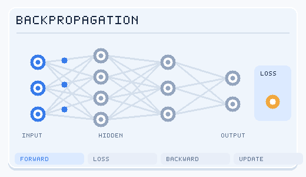

---
related:
- brain-mind/neuroai
- brain-mind/neuroscience
- theory/models/transformer
- theory/paradigms/self-supervised
aliases:
  - 深度學習
  - 深度神經網路
  - Deep neural networks
---

# Deep Learning

## Intuition

Deep learning composes **many layers of differentiable functions** to learn useful **representations** directly from raw data (pixels, text, waveforms). Early layers learn edges or phonemes; deeper layers learn objects and meanings. This hierarchy bears a striking resemblance to the primate visual stream (V1 → V2 → V4 → IT); see [NeuroAI](../../brain-mind/neuroai/index.md).

## The artificial neuron

\[
y = \sigma\Big(\sum_i w_i x_i + b\Big)
\]

| Biological neuron | Artificial neuron |
|---|---|
| Dendrites receive input | Inputs \(x_i\) |
| Synaptic strength | Weights \(w_i\) |
| Soma integrates | Weighted sum |
| Fires an action potential above threshold | Nonlinear activation \(\sigma\) |
| Codes with spike rates and timing | Outputs a real number (spiking versions: [SNNs](../../brain-mind/snn-neuromorphic/index.md)) |

!!! warning "Limits of the analogy"
    Real dendrites perform nonlinear computation themselves; simulating a single cortical pyramidal neuron's input–output behaviour can require a 5–8-layer deep network (Beniaguev et al., 2021). The artificial neuron is an extreme abstraction.

### Activation functions

| Function | Formula | Notes |
|---|---|---|
| Sigmoid | \(1/(1+e^{-x})\) | Early default; saturates → vanishing gradients |
| Tanh | \(\tanh x\) | Zero-centred |
| ReLU | \(\max(0,x)\) | Simple and effective; CNN default |
| GELU / SiLU | \(x\Phi(x)\) / \(x\sigma(x)\) | Common in Transformers |
| SwiGLU | Gated variant | Common in modern LLMs |

## Training: backpropagation and gradient descent

1. **Forward pass**: compute predictions layer by layer.
2. **Loss**: compare with targets (cross-entropy, mean squared error).
3. **Backward pass**: apply the chain rule from output to input to get every parameter's gradient.
4. **Update**: an optimiser (SGD, AdamW) moves parameters against the gradient.

*Animated training loop (original schematic, CC BY-SA 4.0).* The four stages are **forward**, **loss**, **backward**, and **update**. Blue pulses represent forward activations; red pulses indicate gradient information moving backward; teal marks indicate parameter updates. These are instructional signals, not measured values, and the network topology is intentionally simplified.

!!! question "Does the brain do backpropagation?"
    Exact backprop needs symmetric feedback weights and separate forward/backward phases — biologically implausible. Candidate alternatives: feedback alignment, predictive-coding networks, equilibrium propagation, dendritic error computation, burst-dependent plasticity, and the forward-forward algorithm. See [NeuroAI](../../brain-mind/neuroai/index.md).

## Architectures

| Architecture | Inductive bias | Typical use | See |
|---|---|---|---|
| Multi-layer perceptron | None in particular | Tabular data, inside Transformers | — |
| Convolutional network (CNN) | Locality, translation equivariance | Images, audio | [Computer Vision](../models/computer-vision/index.md) |
| Recurrent network (RNN/LSTM/GRU) | Sequential order, recurrent state | Sequences, time series | [NLP](../models/nlp/index.md) |
| Transformer | Global attention, permutation equivariance (+ positions) | Almost every modality | [Transformers](../models/transformer/index.md) |
| State-space models (S4, Mamba) | Linear recurrence, efficient long sequences | Long sequences, audio, genomics | [Transformers](../models/transformer/index.md) |
| Graph neural network | Graph structure, permutation invariance | Molecules, social networks | [GNNs](../models/gnn/index.md) |
| Autoencoder / VAE | Bottleneck compression | Representation learning, generation | [Generative Models](../paradigms/unsupervised/density-and-generative-models/generative-models/index.md) |
| Diffusion model | Iterative denoising | Images, video, molecules | [Generative Models](../paradigms/unsupervised/density-and-generative-models/generative-models/index.md) |

## Tricks that make deep networks trainable

- **Initialisation**: Xavier/Glorot, He
- **Normalisation**: BatchNorm, LayerNorm, RMSNorm
- **Residual connections** (ResNet): gradients flow through hundreds of layers
- **Dropout**, weight decay, data augmentation
- **Optimisation**: AdamW, warmup + cosine decay, gradient clipping
- **Mixed precision**: BF16/FP16/FP8
- **Distributed training**: data, tensor and pipeline parallelism; ZeRO/FSDP

## Representation learning and self-supervision

Deep learning's real power is **learning representations**. The biggest shift of recent years is [self-supervised learning](../paradigms/self-supervised/index.md): creating training signals from unlabelled data — masked prediction (BERT, MAE), next-token prediction (GPT), contrastive learning (SimCLR, CLIP), joint-embedding prediction (JEPA).

This echoes **predictive processing** theories of the brain, in which the cortex continuously predicts its input and learns from prediction errors (see [Cognitive Science](../../brain-mind/cognitive-science/index.md)).

## Scaling laws

Kaplan et al. (2020) and Hoffmann et al. (2022, "Chinchilla") found that language-model loss falls as a **power law** in parameters, data and compute. Chinchilla suggested that for a fixed compute budget, parameters and training tokens should grow together (roughly 20 tokens per parameter). In practice, models are often trained far beyond that ratio to make inference cheaper.

Since 2024, **test-time compute scaling** — letting models think longer before answering (long chains of thought, search, sampling and voting) — has become a second reliable axis of improvement for reasoning.

## Open theoretical questions

- Why do over-parameterised networks generalise? (implicit regularisation, flat minima, neural tangent kernel)
- **Grokking**: sudden generalisation long after the training loss has converged
- **Emergent abilities**: genuine phase transitions or artefacts of discontinuous metrics? (Schaeffer et al., 2023)
- **Representational convergence**: do different models and modalities converge on similar representations of the world? (Huh et al., 2024, "Platonic representation hypothesis")

## Key methods

Each method has its own page. The overview and comparison here are brief.

### AlexNet (Krizhevsky, Sutskever & Hinton, 2012)

- **Overview:** A large deep convolutional network trained on GPUs, using non-saturating neurons and a new regularisation method.
- **Comparison:** The image-recognition network that the residual network below extends to much greater depth.
- **Full write-up:** [AlexNet](../models/cnn/backbones-and-scaling/alexnet/index.md)

### Residual networks (He et al., 2015)

- **Overview:** Each block learns a residual function of its input and adds the input back through a shortcut, so passing the signal through unchanged is easy.
- **Comparison:** The shortcut idea reappears in Transformer blocks; see the Transformer page for the attention variants.
- **Full write-up:** [ResNet, in the CNN section](../models/cnn/backbones-and-scaling/resnet/index.md)

## Resources

- [Dive into Deep Learning](https://d2l.ai/) (CC BY-SA 4.0; strongly recommended)
- [Understanding Deep Learning](https://udlbook.github.io/udlbook/) (free PDF)
- Andrej Karpathy, *Neural Networks: Zero to Hero*
- Stanford CS231n (vision), CS224n (NLP)
- fast.ai, *Practical Deep Learning for Coders*

## References

### Seminal papers

- Krizhevsky, A., Sutskever, I. & Hinton, G. E. (2012). *ImageNet Classification with Deep Convolutional Neural Networks*. NeurIPS. https://papers.nips.cc/paper/2012/hash/c399862d3b9d6b76c8436e924a68c45b-Abstract.html — The AlexNet paper, whose ImageNet result started the modern deep-learning era.
- He, K., et al. (2015). *Deep Residual Learning for Image Recognition*. arXiv. https://arxiv.org/abs/1512.03385 — Residual connections that make very deep networks trainable.
- Kingma, D. P. & Ba, J. (2014). *Adam: A Method for Stochastic Optimization*. arXiv. https://arxiv.org/abs/1412.6980 — The Adam optimiser, still a default choice for training many neural networks.
- Zhang, C., et al. (2017). *Understanding deep learning requires rethinking generalization*. ICLR. https://arxiv.org/abs/1611.03530 — Shows that networks can fit random labels, challenging classical explanations of how deep models generalise.

### Surveys and textbooks

- Goodfellow, I., Bengio, Y. & Courville, A. (2016). *Deep Learning*. MIT Press. https://www.deeplearningbook.org/ — The standard textbook on the mathematics and practice of deep learning, free online.
- Zhang, A., Lipton, Z. C., Li, M. & Smola, A. J. *Dive into Deep Learning*. https://d2l.ai/ — An interactive online textbook with runnable code, useful for hands-on practice.
