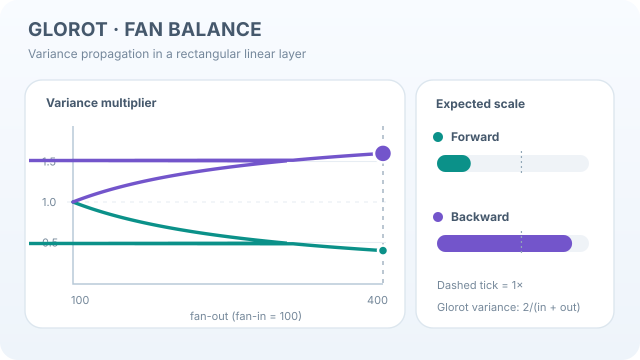

# Glorot (Xavier) initialisation

Glorot initialisation scales random weights using both the number of inputs and the number of outputs of a layer. It balances approximate forward and backward signal propagation at initialisation; it does not guarantee that both variances stay constant in every layer.[^glorot]

## Problem and scope

The [initialisation chapter](index.md) compares the main schemes. This page explains the Glorot rule and its assumptions.

Weights that are too small can shrink signals and gradients through a deep network; weights that are too large can amplify signals or push nonlinearities into saturation. Glorot and Bengio studied these effects in feedforward networks. Their analysis motivates a scale for activations that are approximately linear near zero, notably tanh. The paper also identifies the non-zero mean of the logistic sigmoid as a source of saturation: the rule is not a general cure for sigmoid networks.[^glorot]

## Why fan-in and fan-out appear

For a dense layer, let $z=Wx$, where $W$ has shape $n_{\text{out}}\times n_{\text{in}}$. **Fan-in** $n_{\text{in}}$ counts inputs to each output; **fan-out** $n_{\text{out}}$ counts outputs receiving each input.

Assume independent, zero-mean weights with variance $\sigma_w^2$, independent of the inputs. With equally scaled, centred inputs of variance $q$, summing the input contributions gives

$$
\operatorname{Var}(z_j)\approx n_{\text{in}}\sigma_w^2 q.
$$

For the backward relation $\delta_x=W^\top\delta_z$, the analogous independence and equal-variance approximation gives

$$
\operatorname{Var}(\delta_{x,i})\approx n_{\text{out}}\sigma_w^2
\operatorname{Var}(\delta_{z,j}).
$$

Here $\delta$ denotes a loss gradient with respect to the named variable. Extending these relations through an activation assumes a derivative near one; correlations and nonlinear saturation can invalidate them. In particular, independence between weights and backward gradients is an approximation, not an identity for a trained network.[^glorot]

Forward preservation would require $\sigma_w^2=1/n_{\text{in}}$; backward preservation would require $\sigma_w^2=1/n_{\text{out}}$. When the widths differ, one shared weight variance cannot satisfy both. The Glorot compromise is

$$
\sigma_w^2=\frac{2}{n_{\text{in}}+n_{\text{out}}}
=\frac{1}{(n_{\text{in}}+n_{\text{out}})/2}.
$$

This is the reciprocal of the average fan, **not** the arithmetic mean of the two target variances $1/n_{\text{in}}$ and $1/n_{\text{out}}$. Both preservation conditions coincide for a square layer.[^glorot]

## Uniform and normal forms

The original paper proposes a uniform distribution. For a symmetric uniform variable on $[-a,a]$, the variance is $a^2/3$, so

$$
W_{ji}\sim\mathcal{U}(-a,a),\qquad
a=\sqrt{\frac{6}{n_{\text{in}}+n_{\text{out}}}}.
$$

The commonly implemented normal form matches that variance:

$$
W_{ji}\sim\mathcal{N}(0,\sigma_w^2),\qquad
\sigma_w=\sqrt{\frac{2}{n_{\text{in}}+n_{\text{out}}}}.
$$

The normal distribution's scale parameter here is a **standard deviation**, not a variance. Equal variance does not make the two distributions identical: the uniform form is bounded, whereas the normal form is not.[^implementation]

Some libraries expose a gain $g$: multiply $a$ or $\sigma_w$ by $g$, which multiplies the variance by $g^2$. The formulas above use $g=1$. PyTorch's Xavier functions default to that gain; its separately called gain helper recommends $5/3$ for tanh. Supplying that value explicitly changes the scale, rather than reproducing the unit-gain formula.[^implementation]

## Worked example: a rectangular layer

These are original calculations under the linear approximation, not measured network results. Define forward and backward variance multipliers as $m_f=n_{\text{in}}\sigma_w^2$ and $m_b=n_{\text{out}}\sigma_w^2$.

| Fan-in | Fan-out | Glorot variance | $m_f$ | $m_b$ |
|---|---|---|---|---|
| 100 | 100 | 0.01 | 1 | 1 |
| 100 | 400 | 0.004 | 0.4 | 1.6 |
| 400 | 100 | 0.004 | 1.6 | 0.4 |

For the 100-to-400 layer, $a=\sqrt{0.012}\approx0.10954$ and $\sigma_w=\sqrt{0.004}\approx0.06325$. Averaging the two preservation targets instead would yield $(0.01+0.0025)/2=0.00625$, a different rule.

The rectangular examples show why “preserves variance in both directions” needs qualification. Even a correctly implemented Glorot layer can shrink forward variance and enlarge backward variance.

### Visualising the forward/backward trade-off

  

*Original continuous teaching animation, CC BY-SA 4.0.* With fan-in fixed at 100 and fan-out sweeping from 100 to 400, the Glorot variance is $2/(100+n_{\\text{out}})$. The forward variance multiplier $200/(100+n_{\\text{out}})$ decreases from **1 to 0.4**, while the backward multiplier $2n_{\\text{out}}/(100+n_{\\text{out}})$ increases from **1 to 1.6**. The dashed bar marker indicates a multiplier of one. This is an **analytical illustration**, not measurements from a trained model: the forward and backward approximations require the independence and near-linear assumptions described above.[^glorot]

On the wiki site, use **Play/Pause** (Enter or Space when focused); a reduced-motion preference initially selects the still image. The 640-pixel graphic can be scrolled horizontally with the keyboard on small screens. [Open the continuous SVG](../../../assets/concept-animations/glorot-fan-tradeoff-motion.svg) · [View the static fallback](../../../assets/concept-animations/glorot-fan-tradeoff-still.svg).

## Practical use and checks

1. Identify the actual linear operation and its input/output dimensions. Do not infer fan values from an unrelated flattened parameter count.
2. Choose a scale for the surrounding nonlinearity and architecture. Record any gain rather than treating every “Xavier” call as the same configuration.
3. Draw each weight independently from the selected distribution. For a basic dense-layer experiment, zero biases are a separate conventional choice, not a consequence of the weight-variance equation.
4. On representative inputs, inspect activation and gradient scales across layers before a long training run. Record the random seed and check more than one draw; finite samples will not have exactly the target variance.

PyTorch's documented dense-weight convention is $[n_{\text{out}},n_{\text{in}}]$, used as $xW^\top$. Transposing a two-dimensional matrix swaps the fans but leaves their sum unchanged, so unit-gain Xavier's scale is unchanged. This symmetry does **not** extend to schemes that choose only fan-in or fan-out.[^implementation]

## Results and limitations

The original study reports faster convergence and improved results for its normalised tanh initialisation. For five-hidden-layer networks in Table 1, CIFAR-10 test error changes from 55.9% for tanh to 52.92% for normalised tanh, a reduction of 2.98 percentage points. These are the paper's historical experimental settings, not a modern CIFAR-10 accuracy claim or an isolated guarantee for other architectures.[^results]

- **Nonlinearities matter.** Logistic sigmoid has value $1/2$ and derivative $1/4$ at zero, unlike the centred, unit-slope approximation. For ReLU, [He initialisation](he-initialisation.md) accounts for rectification and gives the familiar forward scale $2/n_{\text{in}}$. Its derivation tracks second moments; ReLU outputs are not zero-mean.[^he]
- **Depth and correlations matter.** Matching a scalar variance does not control every direction of a layer's Jacobian, the matrix of local derivatives. Saxe et al. study special initial conditions in deep linear networks, while Schoenholz et al. analyse signal and correlation propagation in random nonlinear networks.[^propagation]
- **Architecture matters.** Residual additions, gates and [normalisation](../normalisation/index.md) alter signal propagation. Batch Normalization is a separate intervention during computation, not a proof that initial scale never matters.[^normalisation]

## Connections and open questions

The gradients in the derivation are computed by [automatic differentiation](../../math/automatic-differentiation/index.md). [He initialisation](he-initialisation.md) changes the scale for rectifiers, while [muP](mup.md) addresses a different question: how parametrisation and hyperparameters should change with width.

For a new architecture, the useful question is which signals the scale should stabilise. Attention, gating and residual paths can require more than a single fan-based variance rule.

[^glorot]: Glorot and Bengio (2010), sections 3–4, especially equations 10–16: saturation, forward/backward variance constraints and the compromise distribution.
[^implementation]: PyTorch 2.15, *torch.nn.init*: Xavier uniform/normal formulas, gain helper and dense-weight layout note. This is a versioned implementation reference, not a claim about every framework default.
[^results]: Glorot and Bengio (2010), section 5 and Table 1: five-hidden-layer comparisons and normalised tanh results.
[^he]: He et al. (2015), section 2.2: rectifier-aware initialisation and forward/backward signal scaling.
[^propagation]: Saxe et al. (2013), *Exact solutions*, and Schoenholz et al. (2016), *Deep Information Propagation*: complementary analyses of learning dynamics and signal propagation.
[^normalisation]: Ioffe and Szegedy (2015), *Batch Normalization*: normalisation during training and reduced sensitivity to initialisation.

## References

### Seminal papers

- Glorot, X. & Bengio, Y. (2010). *Understanding the difficulty of training deep feedforward neural networks*. AISTATS, PMLR 9:249–256. https://proceedings.mlr.press/v9/glorot10a.html — Original variance constraints, uniform initialiser and experiments on saturation and convergence.
- He, K., Zhang, X., Ren, S. & Sun, J. (2015). *Delving Deep into Rectifiers: Surpassing Human-Level Performance on ImageNet Classification*. https://arxiv.org/abs/1502.01852 — Derives initialisation scales that explicitly account for rectifier nonlinearities.
- Schoenholz, S. S., Gilmer, J., Ganguli, S. & Sohl-Dickstein, J. (2016). *Deep Information Propagation*. https://arxiv.org/abs/1611.01232 — Studies variance, correlations and trainable depth through mean-field analysis.
- Saxe, A. M., McClelland, J. L. & Ganguli, S. (2013). *Exact solutions to the nonlinear dynamics of learning in deep linear neural networks*. https://arxiv.org/abs/1312.6120 — Analyses learning dynamics and special initial conditions in deep linear networks.
- Ioffe, S. & Szegedy, C. (2015). *Batch Normalization: Accelerating Deep Network Training by Reducing Internal Covariate Shift*. https://arxiv.org/abs/1502.03167 — Introduces normalisation within the network and studies its training effects.

### Articles and documentation

- PyTorch contributors. *torch.nn.init*, PyTorch 2.15 documentation. https://docs.pytorch.org/docs/2.15/nn.init.html — Documents Xavier sampling, gain factors and weight-layout conventions for implementation.
