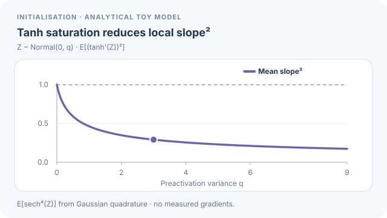
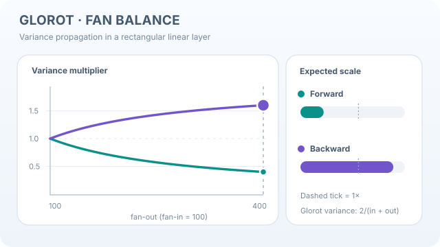
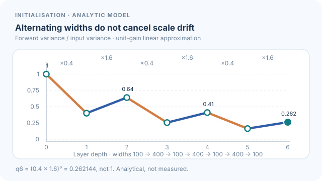
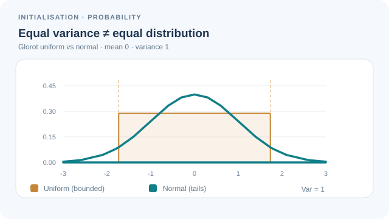

# Glorot（Xavier）初始化

Glorot 初始化依據一層的輸入數與輸出數，設定隨機權重的尺度。它在初始化時折衷平衡近似的前向與反向訊號傳播，並不保證每一層的兩種變異數都保持不變。[^glorot]

## 問題與範圍

[初始化章節](index.md)比較主要方案，本頁說明 Glorot 規則及其假設。

權重太小可能使訊號與梯度在深層網路中逐漸縮小；權重太大則可能放大訊號，或使非線性函數進入飽和區。Glorot 與 Bengio 在前饋網路中研究這些效應。其分析為零附近近似線性的激活函數，尤其是 tanh，提供尺度選擇的依據。論文也指出，邏輯 sigmoid 的非零平均值會導致飽和：這套規則並非 sigmoid 網路的通用解方。[^glorot]

## 為何需要扇入與扇出

對全連接層，令 $z=Wx$，其中 $W$ 的形狀為 $n_{\text{out}}\times n_{\text{in}}$。**扇入** $n_{\text{in}}$ 是每個輸出接收的輸入數；**扇出** $n_{\text{out}}$ 是每個輸入連接的輸出數。

假設各權重相互獨立、平均值為零、變異數為 $\sigma_w^2$，且與輸入獨立。若各輸入已置中、尺度相同且變異數為 $q$，將輸入貢獻加總可得：

$$
\operatorname{Var}(z_j)\approx n_{\text{in}}\sigma_w^2 q.
$$

對反向關係 $\delta_x=W^\top\delta_z$，採用類似的獨立性與等變異數近似可得：

$$
\operatorname{Var}(\delta_{x,i})\approx n_{\text{out}}\sigma_w^2
\operatorname{Var}(\delta_{z,j}).
$$

$\delta$ 表示損失對該變數的梯度。將這些關係延伸至激活函數時，還假設導數接近一；相關性與非線性飽和可能使近似失效。尤其是權重與反向梯度之間的獨立性只是一種近似，並非已訓練網路中的恆等關係。[^glorot]

維持前向變異數需要 $\sigma_w^2=1/n_{\text{in}}$；維持反向變異數需要 $\sigma_w^2=1/n_{\text{out}}$。當兩側寬度不同，單一權重變異數無法同時滿足兩者。Glorot 的折衷為：

$$
\sigma_w^2=\frac{2}{n_{\text{in}}+n_{\text{out}}}
=\frac{1}{(n_{\text{in}}+n_{\text{out}})/2}.
$$

這是平均扇數的倒數，**不是**兩個目標變異數 $1/n_{\text{in}}$ 與 $1/n_{\text{out}}$ 的算術平均。對方形層，兩個變異數保持條件才會一致。[^glorot]

## 均勻與常態形式

原論文提出均勻分布。對稱均勻變數在 $[-a,a]$ 上的變異數為 $a^2/3$，因此：

$$
\begin{gathered}
W_{ji}\sim\mathcal{U}(-a,a),\\
a=\sqrt{\frac{6}{n_{\text{in}}+n_{\text{out}}}}.
\end{gathered}
$$

常見實作中的常態形式採用相同變異數：

$$
\begin{gathered}
W_{ji}\sim\mathcal{N}(0,\sigma_w^2),\\
\sigma_w=\sqrt{\frac{2}{n_{\text{in}}+n_{\text{out}}}}.
\end{gathered}
$$

此處常態分布的尺度參數是**標準差**，不是變異數。相同變異數並不表示兩個分布相同：均勻形式有界，常態形式則無界。[^implementation]

部分函式庫提供增益 $g$：將 $a$ 或 $\sigma_w$ 乘以 $g$，變異數就會乘以 $g^2$。上式使用 $g=1$。PyTorch 的 Xavier 函式預設使用此增益；另行呼叫的增益輔助函式則為 tanh 建議 $5/3$。明確傳入該值會改變尺度，並不等於重現單位增益公式。[^implementation]

### Tanh 飽和：為什麼單位斜率近似會失效

  
  

*原創教學動畫，CC BY-SA 4.0。* 使用 Glorot 初始化平衡線性化的訊號變異數，**不代表**非線性函數始終維持接近一的局部斜率。對於人工設定的 $Z\sim\mathcal N(0,q)$，tanh 的**局部導數平方期望**為

$$
G(q)=\mathbb E\!\left[(\tanh'(Z))^2\right]
=\mathbb E\!\left[\operatorname{sech}^4(Z)\right].
$$

紫色曲線由確定性的**高斯數值積分**取得，並非訓練結果擬合或實測曲線。計算得到 $G(0)=1$、$G(1)\approx0.4644$、$G(9)\approx0.1742$。前激活分布變寬後，更多值落在 tanh 飽和區域，局部導數便下降。此單一因子**不等於**整層輸入輸出的 Jacobian，也不能直接視為實測梯度範數；權重尺度、層間相關性與深度均會影響結果。[^glorot][^propagation]

Wiki 網站沿用共用的播放／暫停、Enter／Space 鍵盤操作、Reduced Motion 靜態回退與手機圖內水平捲動。[完整 SVG 動畫](../../../assets/concept-animations/glorot-tanh-saturation-motion.svg) · [GitHub 靜態預覽](../../../assets/concept-animations/glorot-tanh-saturation-still.svg)。

## 算例：非方形層

以下是在線性近似下自行計算的例子，並非實測網路結果。定義前向與反向變異數倍率為 $m_f=n_{\text{in}}\sigma_w^2$ 與 $m_b=n_{\text{out}}\sigma_w^2$。

| 扇入 | 扇出 | Glorot 變異數 | $m_f$ | $m_b$ |
|---|---|---|---|---|
| 100 | 100 | 0.01 | 1 | 1 |
| 100 | 400 | 0.004 | 0.4 | 1.6 |
| 400 | 100 | 0.004 | 1.6 | 0.4 |

對 100 個輸入、400 個輸出的層，$a=\sqrt{0.012}\approx0.10954$，且 $\sigma_w=\sqrt{0.004}\approx0.06325$。若改取兩個保持目標的平均，會得到 $(0.01+0.0025)/2=0.00625$，那是不同的規則。

非方形算例說明為何「同時保持兩個方向的變異數」需要限定條件。即使正確實作 Glorot，一層仍可能縮小前向變異數並放大反向變異數。

### 動態示意：前向與反向變異數的折衷

  
  

*原創連續教學動畫，CC BY-SA 4.0。* 將扇入固定為 100，讓扇出從 100 變至 400，權重變異數為 $2/(100+n_{\text{out}})$。前向倍率 $200/(100+n_{\text{out}})$ 從 **1 降為 0.4**；反向倍率 $2n_{\text{out}}/(100+n_{\text{out}})$ 從 **1 升至 1.6**。長條上的虛線代表倍率一。這些是**解析式示意值，並非訓練模型的量測結果**；上述近似依賴先前說明的獨立性及近線性條件。[^glorot]

在 Wiki 網站可透過**播放／暫停**按鈕操作（聚焦後按 Enter 或 Space）；偏好減少動態效果時，初始顯示靜態圖。手機可使用鍵盤方向鍵水平捲動。[開啟完整 SVG 動畫](../../../assets/concept-animations/glorot-fan-tradeoff-motion.svg) · [查看靜態回退預覽](../../../assets/concept-animations/glorot-fan-tradeoff-still.svg)。

### 交替層寬：為何變異數仍會隨深度偏移

  
  

*原創教學動畫，CC BY-SA 4.0。* 設定層寬為 **100 → 400 → 100 → 400 → 100 → 400 → 100**，各層採用單位增益 Glorot 權重變異數 **2/(100 + 400)**，並假設激活函數可近似為斜率一的線性函數。前向變異數倍率在 **0.4** 與 **1.6** 之間交替，但每兩層的乘積是 **0.64**，而不是 1；經六層後，**相對初始變異數為 0.64³ = 0.262144**。移動標記代表**理論期望，並非單一激活值或模型實測結果**。推導依賴零均值獨立權重、置中且獨立的輸入特徵與近線性假設；非線性、相關性、殘差連接都會影響真實傳播。[^glorot]

Wiki 網站提供可用鍵盤啟動的播放／暫停；偏好減少動態效果時顯示靜態回退。[連續 SVG 動畫](../../../assets/concept-animations/glorot-alternating-width-motion.svg) · [GitHub 靜態回退](../../../assets/concept-animations/glorot-alternating-width-still.svg)。

### 相同變異數，不代表相同的尾部分布

  
  

*原創連續教學動畫，CC BY-SA 4.0。* 令 $\sigma^2=2/(n_{\mathrm{in}}+n_{\mathrm{out}})$ 為 Glorot 的目標權重變異數。將權重除以 $\sigma$ 後，**均勻形式**為 $U\sim\mathcal U(-\sqrt3,\sqrt3)$，**常態形式**為 $G\sim\mathcal N(0,1)$。兩者平均值均為零、變異數均為一；但均勻分布的支援範圍有界，常態分布則對更大的幅度仍給予非零機率。[^implementation] 動畫中間狀態是**示意用的密度混合** $p_t=(1-t)p_U+tp_G$，$0\leq t\leq1$。因為兩端分布的平均值與變異數相同，任何中間混合亦維持兩者不變；**此混合並非標準的 Glorot 抽樣規則**。圖中是解析密度，不是抽樣權重直方圖或訓練模型的實測結果。

網站提供播放／暫停（Enter／Space 鍵盤操作）、減少動態效果的靜態回退，手機可於圖內水平捲動。[連續 SVG 動畫](../../../assets/concept-animations/glorot-equal-variance-densities-motion.svg) · [GitHub 靜態回退](../../../assets/concept-animations/glorot-equal-variance-densities-still.svg)。

## 實務使用與檢查

1. 確認實際線性運算及其輸入、輸出維度，不要從無關的展平參數總數推斷扇數。
2. 依周圍的非線性函數與架構選擇尺度。記錄增益，不要把所有「Xavier」呼叫都視為相同設定。
3. 從選定分布中獨立抽取各權重。對基本的全連接層實驗，零偏置是另一項慣例，並非權重變異數方程式的推論。
4. 在長時間訓練前，以代表性輸入檢視各層激活值與梯度的尺度。記錄隨機種子並檢查多次抽樣；有限樣本的變異數不會恰好等於目標值。

PyTorch 文件中的全連接權重慣例為 $[n_{\text{out}},n_{\text{in}}]$，運算使用 $xW^\top$。轉置二維矩陣會交換兩個扇數，但不改變其總和，因此單位增益 Xavier 的尺度不變。這種對稱性**不適用**於只選扇入或扇出的方案。[^implementation]

## 結果與限制

原研究報告，正規化 tanh 初始化在其實驗中有較快的收斂與較好的結果。表 1 的五隱藏層網路中，CIFAR-10 測試錯誤率從 tanh 的 55.9% 變為正規化 tanh 的 52.92%，減少 2.98 個百分點。這是論文歷史實驗設定的結果，不是現代 CIFAR-10 準確率的宣稱，也不是對其他架構的獨立保證。[^results]

- **非線性函數會影響結果。** 邏輯 sigmoid 在零點的值為 $1/2$、導數為 $1/4$，不同於置中且斜率為一的近似。對 ReLU，[He 初始化](he-initialisation.md)納入整流效應，得到常見的前向尺度 $2/n_{\text{in}}$。其推導追蹤二階動差；ReLU 輸出並非零平均值。[^he]
- **深度與相關性會影響結果。** 配對單一純量變異數，無法控制一層 Jacobian（局部導數矩陣）的每個方向。Saxe 等人研究深度線性網路中的特定初始條件，Schoenholz 等人則分析隨機非線性網路的訊號與相關性傳播。[^propagation]
- **架構會影響結果。** 殘差相加、閘控與[正規化](../normalisation/index.md)都會改變訊號傳播。批次正規化是運算期間另一項介入，並不能證明初始尺度永遠不重要。[^normalisation]

## 關聯與開放問題

推導中的梯度由[自動微分](../../math/automatic-differentiation/index.md)計算。[He 初始化](he-initialisation.md)為整流函數改變尺度；[muP](mup.md)則處理另一個問題：參數化與超參數應如何隨寬度改變。

對新架構，值得問的是這個尺度應穩定哪些訊號。注意力、閘控與殘差路徑可能需要的不只是單一依扇數設定的變異數規則。

[^glorot]: Glorot 與 Bengio（2010），第 3–4 節，尤其方程式 10–16：飽和、前向與反向變異數限制及折衷分布。
[^implementation]: PyTorch 2.15，〈torch.nn.init〉：Xavier 均勻與常態公式、增益輔助函式及全連接權重佈局註記。這是有版本的實作參考，並非宣稱所有框架都採用同樣預設值。
[^results]: Glorot 與 Bengio（2010），第 5 節與表 1：五隱藏層比較及正規化 tanh 結果。
[^he]: He 等人（2015），第 2.2 節：考慮整流函數的初始化與前向、反向訊號尺度。
[^propagation]: Saxe 等人（2013）的《Exact solutions》與 Schoenholz 等人（2016）的《Deep Information Propagation》：互補的學習動態與訊號傳播分析。
[^normalisation]: Ioffe 與 Szegedy（2015），《Batch Normalization》：訓練時的正規化與對初始化敏感度的降低。

離散深度與通道示例停留在精確整數狀態後重設；連線只是視覺引導，不是分數層或分數通道。參數掃描是示意插值，不是訓練軌跡；反向掃描參數不代表訓練倒退。密度圖只顯示高斯尾部的有限視窗，不會將截斷視窗重新正規化。

## 參考文獻

### 奠基性論文

- Glorot, X. & Bengio, Y. (2010). *Understanding the difficulty of training deep feedforward neural networks*. AISTATS, PMLR 9:249–256. https://proceedings.mlr.press/v9/glorot10a.html — 原始變異數限制、均勻初始化方法，以及飽和與收斂實驗。
- He, K., Zhang, X., Ren, S. & Sun, J. (2015). *Delving Deep into Rectifiers: Surpassing Human-Level Performance on ImageNet Classification*. https://arxiv.org/abs/1502.01852 — 推導明確納入整流非線性函數的初始化尺度。
- Schoenholz, S. S., Gilmer, J., Ganguli, S. & Sohl-Dickstein, J. (2016). *Deep Information Propagation*. https://arxiv.org/abs/1611.01232 — 透過平均場分析研究變異數、相關性與可訓練深度。
- Saxe, A. M., McClelland, J. L. & Ganguli, S. (2013). *Exact solutions to the nonlinear dynamics of learning in deep linear neural networks*. https://arxiv.org/abs/1312.6120 — 分析深度線性網路的學習動態與特定初始條件。
- Ioffe, S. & Szegedy, C. (2015). *Batch Normalization: Accelerating Deep Network Training by Reducing Internal Covariate Shift*. https://arxiv.org/abs/1502.03167 — 提出網路內的正規化方法並研究其訓練效果。

### 文章與文件

- PyTorch contributors. *torch.nn.init*, PyTorch 2.15 documentation. https://docs.pytorch.org/docs/2.15/nn.init.html — 記載 Xavier 抽樣、增益因子與實作使用的權重佈局慣例。
