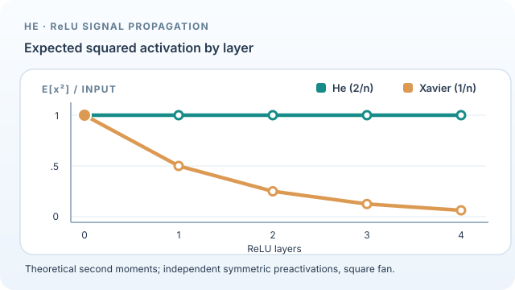
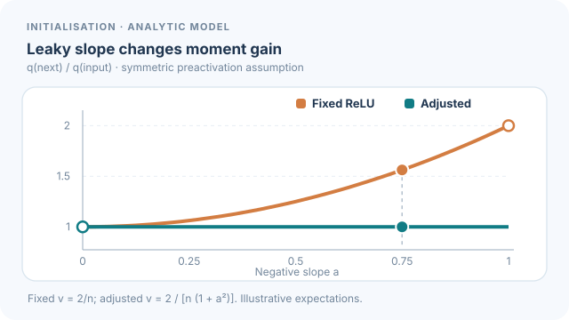
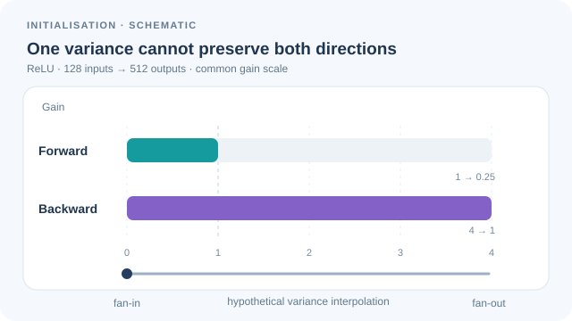
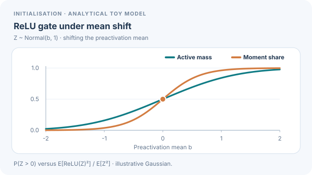

# He（Kaiming）初始化

He 初始化依照整流非線性函數調整隨機權重的尺度。對 ReLU 層，扇入規則採用 $2/n_{\mathrm{in}}$ 的權重變異數，使激活值的平方期望在初始化假設下保持穩定。[^he]

## 概觀

權重初始化章節說明訊號如何通過深層網路。He 初始化利用整流函數對激活值平方的影響，決定每一層的權重尺度。原論文也提出 PReLU，其負半軸斜率會在訓練中學得。[權重初始化](index.zh-TW.md)。[^he]

## 問題

若每一層都反覆乘上小於一或大於一的尺度因子，訊號就可能隨深度呈指數衰減或成長。Glorot 初始化以兩個層寬平衡前向與反向傳播，He 初始化則在計算中納入整流函數對應的增益。[Glorot 初始化](glorot-initialisation.zh-TW.md)。[^glorot][^he]

## 核心想法

將激活函數之前的值寫成 $z=\sum_{i=1}^{n_{\mathrm{in}}} w_i x_i$，並令偏置為零。假設權重彼此獨立、平均值為零、與輸入獨立，且有相同的變異數 $v$。另外假設輸入具有相同的二階矩 $m_2=\mathbb{E}[x_i^2]$。則 $\mathbb{E}[z]=0$，且 $\mathbb{E}[z^2]=n_{\mathrm{in}}v m_2$。若 $z$ 的分布以零為中心對稱，ReLU 會保留一半的二階矩。[^he]

$$
\mathbb{E}[\operatorname{ReLU}(z)^2]
=\frac12\mathbb{E}[z^2]
=\frac{n_{\mathrm{in}}v}{2}m_2.
$$

選擇 $v=2/n_{\mathrm{in}}$ 即可使倍率為一。二階矩與中心化變異數的關係為 $\operatorname{Var}(x)=\mathbb{E}[x^2]-\mathbb{E}[x]^2$。ReLU 輸出通常有正的平均值。例如 $z\sim\mathcal{N}(0,q)$ 時，直接積分可得 $\mathbb{E}[\operatorname{ReLU}(z)^2]=q/2$，而 $\operatorname{Var}(\operatorname{ReLU}(z))=q(1/2-1/(2\pi))$。[^he]

### ReLU 二階矩逐層傳播動畫

  

*原創教學動畫，CC BY-SA 4.0。* 對扇入與扇出皆為 $n$ 的**方形層**，假設權重獨立、均值為零，激活前分布對零點對稱，且輸入二階矩 $q_0=1$，初始化近似給出 $q_{\ell+1}=(nv/2)q_\ell$。He 扇入權重變異數 $v=2/n$ 導致 $q_\ell=1$；**單位增益** Xavier 的 $v=1/n$ 則得到 $q_\ell=2^{-\ell}$，經過四層 ReLU 為 **0.0625**。移動標記追蹤的是解析式的**平方期望而非置中變異數**，也不是模型實測、單顆神經元或隨機模擬；相關性、殘差路徑與有限寬度都可能造成偏離。[^he][^glorot]

Wiki 網站提供**播放／暫停**按鈕（聚焦後按 Enter／Space），偏好減少動態效果時顯示靜態圖，手機上可用鍵盤水平捲動。[完整 SVG 動畫](../../../assets/concept-animations/he-relu-second-moment-motion.svg) · [GitHub 靜態回退](../../../assets/concept-animations/he-relu-second-moment-still.svg)。

### Leaky ReLU 負斜率與 He 增益的對應

  

*原創教學動畫，CC BY-SA 4.0。* 設負半軸斜率為固定的 **a ∈ [0, 1]**，若激活前分布對零對稱，則 **E[leaky-ReLU(z)²] = (1+a²)E[z²]/2**。繼續採用**僅適用 ReLU 的**權重變異數 **v = 2/n**，平方激活期望的倍率就是 **1+a²**，隨斜率從零到一由 **1 增加至 2**；改成 **v = 2/[n(1+a²)]** 後，倍率維持 **1**。兩個同步游標展示的是**解析式倍率，而非模型訓練量測結果**。推導假設零均值獨立權重及對稱的激活前分布，且初始化時斜率固定；PReLU 的可學習斜率會使訓練中的狀況不同。[^he][^pytorch]

Wiki 網站提供鍵盤可操作的播放／暫停、偏好減少動態效果時的靜態回退，以及窄螢幕的水平鍵盤捲動。[連續 SVG 動畫](../../../assets/concept-animations/prelu-slope-gain-motion.svg) · [GitHub 靜態回退](../../../assets/concept-animations/prelu-slope-gain-still.svg)。

### 扇入與扇出：同一權重變異數無法兼顧兩個方向

  

*原創連續教學動畫，CC BY-SA 4.0。* 考慮**輸入寬度 128、輸出寬度 512 的 ReLU 層**。在權重獨立、零平均值、激活前分布對稱等假設下，前向二階矩倍率近似為 $m_f=n_{\mathrm{in}}v/2$；對反向**梯度平方的二階矩**，另外假設反向梯度獨立、整流導數有一半時間啟用，可得 $m_b=n_{\mathrm{out}}v/2$。[^he] 採用**扇入**變異數 $v=2/128$，則 $(m_f,m_b)=(1,4)$；採用**扇出**變異數 $v=2/512$，則為 $(0.25,1)$。連續動畫的中間狀態使用**純示意插值** $v(t)=2/[128+384t]$，$0\leq t\leq1$，連接上述兩種端點規則；**不代表推薦使用插值後的第三種初始化法**。圖中皆為解析式倍率，**不是實測激活值、梯度或訓練結果**；有限寬度與變數相依性都可能影響實際傳播。

Wiki 網站可使用播放／暫停（聚焦控制項後按 Enter 或 Space），偏好減少動態效果時顯示靜態回退；手機可於圖內水平捲動。[完整 SVG 動畫](../../../assets/concept-animations/he-fan-mode-tradeoff-motion.svg) · [GitHub 靜態回退](../../../assets/concept-animations/he-fan-mode-tradeoff-still.svg)。

### ReLU 前激活平均值偏移：通過比例不等於保留的二階矩

  

*原創教學動畫，CC BY-SA 4.0。* 常見的 ReLU 二階矩倍率 **1/2**，依賴前激活分布對零點對稱。另取一組**人工設定的高斯例子** $Z\sim\mathcal N(b,1)$，令 $\phi$ 與 $\Phi$ 分別為標準常態密度與累積分布，則

$
P(Z>0)=\Phi(b),\qquad
\frac{\mathbb E[\operatorname{ReLU}(Z)^2]}{\mathbb E[Z^2]}
=\frac{(1+b^2)\Phi(b)+b\phi(b)}{1+b^2}.
$

當 $b=0$，兩者均為 $0.5$；當 $b=-1$，約為 **0.1587、0.0377**；當 $b=1$，約為 **0.8413、0.9623**。**通過 ReLU 的機率不等於輸出所保留的平方訊號比例。** 因此，不能將基於對稱性得到的 $v=2/n_{\mathrm{in}}$ 二階矩論證原封不動套用到偏移後的前激活。圖中的值是解析式示意，**不是神經網路的實測激活分布，也不是推薦的 bias 初始化規則**。[^he][^propagation]

Wiki 網站沿用播放／暫停（控制項聚焦後按 Enter 或 Space），偏好減少動態效果時顯示靜態回退；手機可於圖內水平捲動。[完整 SVG 動畫](../../../assets/concept-animations/he-relu-mean-shift-motion.svg) · [GitHub 靜態預覽](../../../assets/concept-animations/he-relu-mean-shift-still.svg)。

## 方程式

### 常態與均勻分布形式

對於負半軸斜率為 $a$ 的整流函數，增益為 $g=\sqrt{2/(1+a^2)}$。前向規則使用下列分布，ReLU 對應於 $a=0$。使用 PReLU 時，採用斜率在初始化時的值。[^he][^pytorch]

$$
w_{ij}\sim\mathcal{N}\!\left(0,\frac{g^2}{n_{\mathrm{in}}}\right),
\qquad
w_{ij}\sim\mathcal{U}(-u,u),
\qquad
u=g\sqrt{\frac{3}{n_{\mathrm{in}}}}.
$$

兩種分布有相同的權重變異數，因為 $[-u,u]$ 上的均勻分布具有 $u^2/3$ 的變異數。常態分布的標準差為 $g/\sqrt{n_{\mathrm{in}}}$。

### 扇入、扇出與張量配置

扇入規則著眼於前向傳播。在梯度獨立的近似下，對應的反向規則採用 $g^2/n_{\mathrm{out}}$ 的權重變異數。對全連接層，兩種扇數分別為輸入與輸出特徵數。對核心大小為 $k_h\times k_w$ 的一般未分組卷積，則為 $n_{\mathrm{in}}=C_{\mathrm{in}}k_hk_w$ 與 $n_{\mathrm{out}}=C_{\mathrm{out}}k_hk_w$。[^he][^pytorch]

PyTorch 的 `kaiming_normal_` 與 `kaiming_uniform_` 可使用 `mode="fan_in"` 或 `mode="fan_out"`。其扇數計算假設全連接權重張量的形狀為 `[out_features, in_features]`，並用於 `x @ w.T`。若自訂矩陣以 `[in_features, out_features]` 儲存，且用於 `x @ w`，則初始化時應傳入 `w.T`。ReLU 使用 `nonlinearity="relu"`，leaky ReLU 則使用 `nonlinearity="leaky_relu"`，並以 `a` 傳入實際的負半軸斜率。[^pytorch]

### 卷積算例

一個未分組的 $3\times3$ 卷積若將 16 個輸入通道映射為 32 個輸出通道，權重形狀就是 $[32,16,3,3]$，扇入為 144，扇出為 288。採用 ReLU 與扇入縮放時，權重變異數為 $1/72$，常態標準差約為 $0.11785$，均勻分布的邊界約為 $0.20412$。

前向二階矩的倍率為 $144(1/72)/2=1$。若採用扇出縮放，變異數變為 $1/144$，前向倍率則變為 $1/2$，顯示所選扇數如何影響尺度。

## 結果

原論文圖 3 在 30 層 ReLU 網路上比較初始化方法。He 初始化使該模型收斂，Xavier 初始化的訓練則停滯。ImageNet 分類結果還取決於架構、激活函數與評估程序。最佳單一模型在多尺度、多視圖評估下，達到 5.71% 的 top-5 驗證錯誤率。六個模型的組合則達到 4.94% 的 top-5 測試錯誤率。[^he]

## 限制

- 推導描述的是初始化時的隨機權重。訓練會改變權重，以及權重和激活值、梯度之間的相依關係。平均場分析還研究其他量，包括不同輸入之間的相關性如何在網路中傳遞。[^propagation]
- 加入殘差分支會改變傳播計算。Fixup 研究依架構重新縮放殘差分支，讓深層網路能在沒有正規化層的情況下訓練。[正規化](../normalisation/index.zh-TW.md)。[^fixup]

## 關聯

Glorot 初始化在增益為一時使用 $2/(n_{\mathrm{in}}+n_{\mathrm{out}})$ 的權重變異數。當兩種扇數皆為 $n$，此值為 $1/n$，ReLU 的 He 變異數則為 $2/n$。卷積架構的通道數與核心形狀決定這些扇數。[Glorot 初始化](glorot-initialisation.zh-TW.md)、[卷積神經網路](../../models/cnn/index.zh-TW.md)。[^glorot][^pytorch]

## 應用

此規則為後接 ReLU 或 leaky ReLU 的全連接層與卷積層提供權重尺度。選擇增益與扇數模式，便能使實作對應到要建模的激活函數與傳播方向。[PyTorch 初始化文件](https://docs.pytorch.org/docs/2.15/nn.init.html)。[^pytorch]

## 開放問題

- 對於非整流的非線性函數與閘控層，應如何由訊號傳播決定增益？
- 每層的增益應如何與依深度調整的殘差縮放互相配合？

[^he]: He 等人，[*Delving Deep into Rectifiers*](https://arxiv.org/html/1502.01852)，第 2.2 節、公式 7 至 15、圖 3 與表 6 至 7。
[^glorot]: Glorot 與 Bengio，[*Understanding the Difficulty of Training Deep Feedforward Neural Networks*](https://proceedings.mlr.press/v9/glorot10a.html)，第 4.2 節。
[^pytorch]: PyTorch 2.15，[*torch.nn.init*](https://docs.pytorch.org/docs/2.15/nn.init.html)，增益表與 Kaiming 常態／均勻初始化文件。
[^propagation]: Schoenholz 等人，[*Deep Information Propagation*](https://arxiv.org/abs/1611.01232)，摘要與第 2 節。
[^fixup]: Zhang、Dauphin 與 Ma，[*Fixup Initialization*](https://arxiv.org/abs/1901.09321)，第 2 至 3 節。

## 參考文獻

### 奠基性論文

- He、Zhang、Ren 與 Sun（2015）。*Delving Deep into Rectifiers: Surpassing Human-Level Performance on ImageNet Classification*。https://arxiv.org/abs/1502.01852 — 推導考量整流函數的初始化方式、提出 PReLU，並報告 ImageNet 實驗。
- Glorot 與 Bengio（2010）。*Understanding the Difficulty of Training Deep Feedforward Neural Networks*。AISTATS。https://proceedings.mlr.press/v9/glorot10a.html — 推導能平衡前向與反向訊號尺度的初始化方法。
- Schoenholz、Gilmer、Ganguli 與 Sohl-Dickstein（2017）。*Deep Information Propagation*。ICLR。https://arxiv.org/abs/1611.01232 — 研究隨機初始化的深層網路中，變異數與相關性的傳遞。
- Zhang、Dauphin 與 Ma（2019）。*Fixup Initialization: Residual Learning Without Normalization*。ICLR。https://arxiv.org/abs/1901.09321 — 利用網路深度與更新尺度的分析，設計殘差分支的初始化。

### 文章與文件

- PyTorch 2.15。*torch.nn.init*。https://docs.pytorch.org/docs/2.15/nn.init.html — 規定 Kaiming 初始化的激活增益、扇數模式與張量配置假設。
