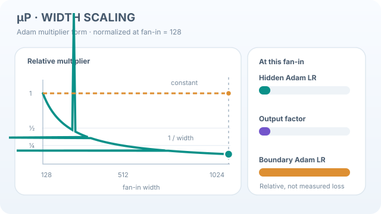

# Maximal update parametrisation (muP)

Maximal update parametrisation, usually written muP, is a scaling rule for the initialisation and learning rates of a network as its width grows. Yang et al. show that under this rule, the best hyperparameters found on a narrow model remain close to the best for a wider one. They call this zero-shot hyperparameter transfer.

## Overview

The [chapter](index.md) treats initialisation as a question of signal scale. muP asks how the scale of weights, updates and learning rates should depend on width, so that training dynamics stay comparable across model sizes.

## Problem

In the standard parametrisation, the best learning rate tends to change with width. Tuning a large model by search is then expensive, and a learning rate found on a small model may not transfer. The question is whether a parametrisation exists under which the best hyperparameters stay put as width grows.

## Core idea

Yang et al. identify such a parametrisation and verify the transfer on Transformer and ResNet models. In the paper's multiplier form, the learning rate and output multiplier of each layer are set according to its width, as listed below.

## Equation

The multiplier form for Adam, with $\text{fan\_in}$ the input width of a layer, is:

- hidden weights: Adam learning rate proportional to $1/\text{fan\_in}$;
- output layer: output multiplier $1/\text{fan\_in}$, with Adam learning rate 1;
- input layer: Adam learning rate 1.

## Width-dependent Adam multipliers

  

*Original continuous teaching animation, CC BY-SA 4.0.* This diagram normalises the selected multipliers to one at a reference hidden-layer fan-in $n_0=128$. For a representative width $n$ increasing to 1024, the **hidden-weight Adam learning-rate factor** and the **output multiplier** both scale as $n_0/n$, hence fall to **1/8**; the **input/output-layer Adam learning-rate factors** remain at one under the specific multiplier-form recipe described above.[^mup-motion] Each quantity denotes a different part of the parametrisation: the output multiplier is **not** the output-layer Adam learning rate. These are **schematic scaling factors**, not learning curves, measured gradients or proof of hyperparameter transfer.

The wiki site provides **Play/Pause** (Enter/Space when focused), an initial static image for reduced motion, and horizontal keyboard scrolling on narrow screens. [Open the continuous SVG](../../../assets/concept-animations/mup-width-multipliers-motion.svg) · [View the static fallback](../../../assets/concept-animations/mup-width-multipliers-still.svg).

[^mup-motion]: Yang et al. (2022), *Tensor Programs V*, the Adam multiplier form and zero-shot hyperparameter transfer; see the original paper in References.

## Results

The abstract reports that hyperparameters tuned on a small model can be used on a much larger one, and that this holds for Transformer and ResNet models. Two examples are given. Transferring from a 13M-parameter model gives pretraining hyperparameters that outperform the published BERT-large numbers, at a tuning cost equal to pretraining BERT-large once. Transferring from a 40M-parameter model outperforms the published 6.7B GPT-3 model, with a tuning cost of only 7% of its total pretraining cost [(Yang et al., 2022)](https://arxiv.org/abs/2203.03466).

## Limitations

- The multiplier entries given above are for Adam. Other optimisers need their own derivation, and this page does not cover them.
- The verification in the paper covers Transformer and ResNet models, so other architectures need their own check.

## Connections

For the fan-based initialisation rules, see [Glorot initialisation](glorot-initialisation.md) and [He initialisation](he-initialisation.md).

## Applications

Tuning very large networks, where a full hyperparameter search is costly.

## Open questions

- How far does transfer extend across depth, batch size and architecture?
- How does muP interact with normalisation layers and with optimisers other than Adam?

## References

### Seminal papers

- Yang et al., *Tensor Programs V: Tuning Large Neural Networks via Zero-Shot Hyperparameter Transfer* (2022). https://arxiv.org/abs/2203.03466 — Introduces muP and zero-shot hyperparameter transfer.
- Glorot and Bengio, *Understanding the difficulty of training deep feedforward neural networks*, Proceedings of the 13th International Conference on Artificial Intelligence and Statistics (2010). https://proceedings.mlr.press/v9/glorot10a.html — Analyses training difficulty in deep feedforward networks and proposes a fan-based initialisation.
- He, Zhang, Ren and Sun, *Delving Deep into Rectifiers: Surpassing Human-Level Performance on ImageNet Classification* (2015). https://arxiv.org/abs/1502.01852 — Introduces an initialisation designed for rectifier networks.
- Schoenholz, Gilmer, Ganguli and Sohl-Dickstein, *Deep Information Propagation* (2016). https://arxiv.org/abs/1611.01232 — Mean-field analysis of signal propagation through deep networks.
- Vaswani et al., *Attention Is All You Need* (2017). https://arxiv.org/abs/1706.03762 — Introduces the Transformer architecture in which muP is most often applied.
