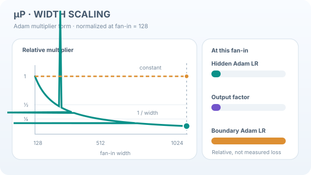

# 最大更新參數化（muP）

最大更新參數化，通常寫作 muP，是一種隨網路寬度增加而縮放初始化與學習率的規則。Yang 等人指出，在此規則下，在窄模型上找到的最佳超參數，對較寬的模型仍然接近最佳。他們稱之為零樣本超參數轉移。

## 概觀

[本章](index.zh-TW.md)把初始化視為訊號尺度的問題。muP 則問：權重、更新量與學習率的尺度應如何隨寬度變化，才能使不同模型大小之間的訓練動態保持可比較？

## 問題

在標準參數化下，最佳學習率通常會隨寬度而改變。以搜尋來調整大型模型成本高昂，而在小模型上找到的學習率可能無法轉移。問題在於，是否存在一種參數化方式，使最佳超參數隨寬度增加而保持不變。

## 核心想法

Yang 等人找到了這樣的參數化，並在 Transformer 與 ResNet 模型上驗證了轉移。在論文的乘數形式中，每一層的學習率與輸出乘數依該層寬度設定，見下方列出的各項。

## 方程式

Adam 的乘數形式如下，其中 $\text{fan\_in}$ 為該層的輸入寬度：

- 隱藏權重：Adam 學習率與 $1/\text{fan\_in}$ 成正比；
- 輸出層：輸出乘數為 $1/\text{fan\_in}$，Adam 學習率為 1；
- 輸入層：Adam 學習率為 1。

## Adam 乘數隨模型寬度的變化

  

*原創連續教學動畫，CC BY-SA 4.0。* 圖中以隱藏層參考扇入 $n_0=128$，將各乘數相對於此尺度正規化為一。當示意寬度 $n$ 增至 1024 時，**隱藏層權重的 Adam 學習率倍率**與**輸出乘數**皆依 $n_0/n$ 縮小至 **1/8**；在上節指定的 Adam 乘數形式中，**輸入層與輸出層的 Adam 學習率倍率**保持為一。[^mup-motion] 輸出乘數與輸出層的 Adam 學習率**不是同一個量**。這是**解析式縮放規則的示意**，不是訓練損失曲線、實測梯度，也不是超參數能轉移的實驗證據。

在 Wiki 網站可透過**播放／暫停**按鈕操作（聚焦後按 Enter 或 Space）；偏好減少動態效果時，初始顯示靜態圖。窄螢幕可水平捲動。[開啟完整 SVG 動畫](../../../assets/concept-animations/mup-width-multipliers-motion.svg) · [查看靜態回退預覽](../../../assets/concept-animations/mup-width-multipliers-still.svg)。

[^mup-motion]: Yang 等人（2022），《Tensor Programs V》中的 Adam 乘數參數化與零樣本超參數轉移；原始論文見參考文獻。

## 結果

摘要報告，在小模型上調好的超參數，可以用到大得多的模型上，並且此結果對 Transformer 與 ResNet 模型成立。摘要舉了兩個例子。由 1,300 萬參數的模型轉移預訓練超參數，所得結果優於已發表的 BERT-large 數字，調參成本等同於預訓練 BERT-large 一次。由 4,000 萬參數的模型轉移，所得結果優於已發表的 67 億參數 GPT-3 模型，調參成本僅為其總預訓練成本的 7% [(Yang et al., 2022)](https://arxiv.org/abs/2203.03466)。

## 限制

- 表格中的數值是針對 Adam 而定的。其他最佳化器需要各自的推導，本頁不涵蓋。
- 論文的驗證涵蓋 Transformer 與 ResNet 模型，其他架構需要各自檢驗。

## 關聯

關於以扇入為基礎的初始化規則，見 [Glorot 初始化](glorot-initialisation.zh-TW.md)與 [He 初始化](he-initialisation.zh-TW.md)。

## 應用

調整非常大的網路，此時完整的超參數搜尋成本高昂。

## 開放問題

- 轉移能跨越深度、批次大小與架構到多遠？
- muP 與正規化層，以及 Adam 以外的最佳化器，會如何互動？

## 參考文獻

### 奠基性論文

- Yang 等人，*Tensor Programs V: Tuning Large Neural Networks via Zero-Shot Hyperparameter Transfer*（2022）。https://arxiv.org/abs/2203.03466 — 提出 muP 與零樣本超參數轉移。
- Glorot 與 Bengio，*Understanding the difficulty of training deep feedforward neural networks*，Proceedings of the 13th International Conference on Artificial Intelligence and Statistics（2010）。https://proceedings.mlr.press/v9/glorot10a.html — 分析深度前饋網路的訓練困難，並提出以扇入與扇出為基礎的初始化。
- He、Zhang、Ren 與 Sun，*Delving Deep into Rectifiers: Surpassing Human-Level Performance on ImageNet Classification*（2015）。https://arxiv.org/abs/1502.01852 — 提出為整流網路設計的初始化。
- Schoenholz、Gilmer、Ganguli 與 Sohl-Dickstein，*Deep Information Propagation*（2016）。https://arxiv.org/abs/1611.01232 — 對深層網路中訊號傳播做平均場分析。
- Vaswani 等人，*Attention Is All You Need*（2017）。https://arxiv.org/abs/1706.03762 — 提出 muP 最常應用的 Transformer 架構。
