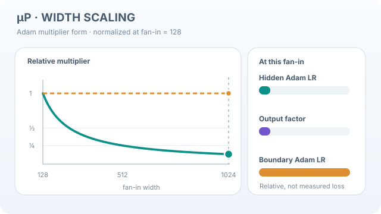
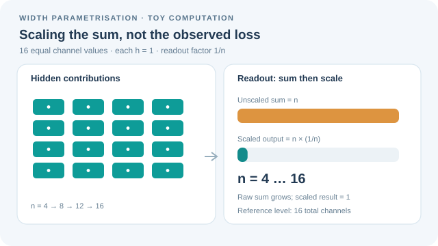
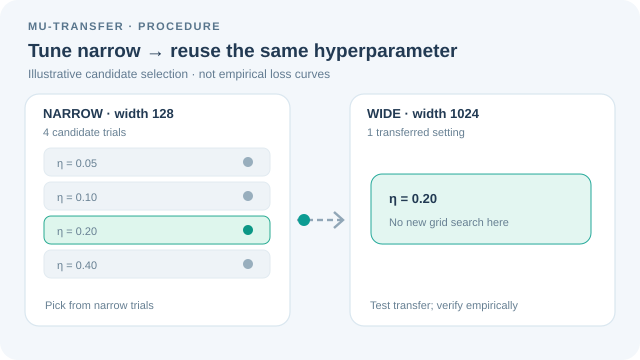
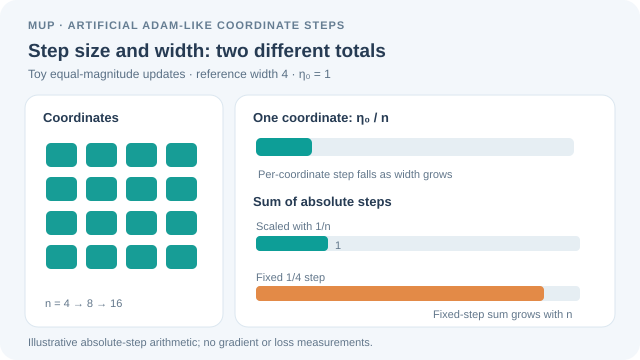
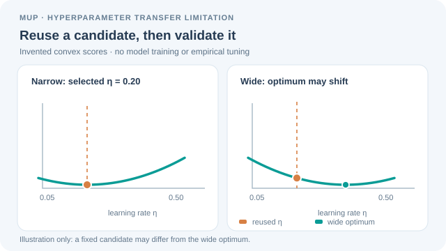
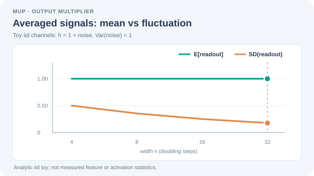
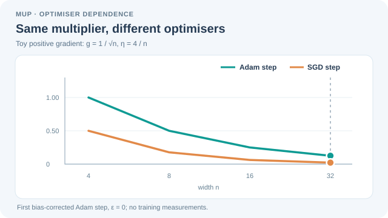

# 最大更新參數化（muP）

最大更新參數化，通常寫作 muP，是一種隨網路寬度增加而縮放初始化與學習率的規則。Yang 等人指出，在此規則下，在窄模型上找到的最佳超參數，對較寬的模型仍然接近最佳。他們稱之為零樣本超參數轉移。

## 概觀

[本章](index.zh-TW.md)把初始化視為訊號尺度的問題。muP 則問：權重、更新量與學習率的尺度應如何隨寬度變化，才能使不同模型大小之間的訓練動態保持可比較？

## 問題

在標準參數化下，最佳學習率通常會隨寬度而改變。以搜尋來調整大型模型成本高昂，而在小模型上找到的學習率可能無法轉移。問題在於，是否存在一種參數化方式，使最佳超參數隨寬度增加而保持不變。

## 核心想法

Yang 等人找到了這樣的參數化，並在 Transformer 與 ResNet 模型上驗證了轉移。在論文的乘數形式中，每一層的學習率與輸出乘數依該層寬度設定，見下方列出的各項。

## 方程式

Adam 的乘數形式如下，其中 $\text{fan\_in}$ 為該層的輸入寬度：

- 隱藏權重：Adam 學習率與 $1/\text{fan\_in}$ 成正比；
- 輸出層：輸出乘數為 $1/\text{fan\_in}$，Adam 學習率為 1；
- 輸入層：Adam 學習率為 1。

## Adam 乘數隨模型寬度的變化

  
  

*原創連續教學動畫，CC BY-SA 4.0。* 圖中以隱藏層參考扇入 $n_0=128$，將各乘數相對於此尺度正規化為一。當示意寬度 $n$ 增至 1024 時，**隱藏層權重的 Adam 學習率倍率**與**輸出乘數**皆依 $n_0/n$ 縮小至 **1/8**；在上節指定的 Adam 乘數形式中，**輸入層與輸出層的 Adam 學習率倍率**保持為一。[^mup-motion] 輸出乘數與輸出層的 Adam 學習率**不是同一個量**。這是**解析式縮放規則的示意**，不是訓練損失曲線、實測梯度，也不是超參數能轉移的實驗證據。

在 Wiki 網站可透過**播放／暫停**按鈕操作（聚焦後按 Enter 或 Space）；偏好減少動態效果時，初始顯示靜態圖。窄螢幕可水平捲動。[開啟完整 SVG 動畫](../../../assets/concept-animations/mup-width-multipliers-motion.svg) · [查看靜態回退預覽](../../../assets/concept-animations/mup-width-multipliers-still.svg)。

[^mup-motion]: Yang 等人（2022），《Tensor Programs V》中的 Adam 乘數參數化與零樣本超參數轉移；原始論文見參考文獻。

### 讀出層加總的人工示例：為什麼要縮放輸出

  
  

*原創分階段教學動畫，CC BY-SA 4.0。* 此處刻意將每個隱藏通道的貢獻設定為 $h_i=1$。因此，原始總和 $s_n=\sum_{i=1}^{n}h_i=n$ 隨 $n=4、8、12、16$ 增加；但人工讀出 $f_n=(1/n)s_n$ 仍等於 **1**。這是用來隔離說明輸出乘數 $1/n$ 的**代數示例**，不代表已推導全部 muP 層縮放規則，也不是訓練中的特徵、激活或損失實測結果。[^mup-motion]

Wiki 網站提供**播放／暫停**（聚焦後可按 Enter 或 Space）；偏好減少動態效果時先顯示靜態預覽，手機可於圖內水平捲動。[開啟動畫](../../../assets/concept-animations/mup-readout-aggregation-motion.svg) · [GitHub 靜態回退](../../../assets/concept-animations/mup-readout-aggregation-still.svg)。

### 零樣本超參數轉移：窄模型搜尋，寬模型直接沿用

  
  

*原創流程動畫，CC BY-SA 4.0。* 圖中的窄模型先比較四個**任意設定、僅供示意**的學習率 $\eta\in\{0.05,0.10,0.20,0.40\}$，再假設選出 $0.20$；接著在較寬的模型**不重新執行完整調參搜尋**，直接沿用同一設定。這不是實際訓練比較，也不能證明該學習率最優或一定能轉移；仍須在大型模型上實證評估。[^mup-motion]

Wiki 網站可透過**播放／暫停**（聚焦後按 Enter 或 Space）觀看搜尋到轉移的步驟；Reduced Motion 先顯示完整靜態圖。[開啟動畫](../../../assets/concept-animations/mup-transfer-protocol-motion.svg) · [GitHub 靜態回退](../../../assets/concept-animations/mup-transfer-protocol-still.svg)。

### 隱藏層權重更新量的人工範例：單一座標與總量不同

  
  

*原創連續／分階段數學動畫，CC BY-SA 4.0。* 這是**人工算術例子，不是實際 Adam 更新**。令 $n=4、8、16$ 個座標各自具有 $|\Delta w_i|=1/n$，則 $\sum_i|\Delta w_i|=1$；刻意不依寬度縮放的對照則固定 $|\Delta w_i|=1/4$，得到總和 $1、2、4$。此例只用來隔離說明隱藏層權重學習率的扇入倒數倍率，**不代表**真實 muP 模型的權重更新 $L_1$ 範數、函數／特徵更新或梯度實測會維持固定。[^mup-motion]

網站提供**播放／暫停**（聚焦後按 Enter 或 Space）、Reduced Motion 靜態回退及手機區域內水平捲動。[開啟 SVG 動畫](../../../assets/concept-animations/mup-update-budget-motion.svg) · [GitHub 靜態預覽](../../../assets/concept-animations/mup-update-budget-still.svg)。

### 超參數轉移有適用條件：仍須驗證寬模型

  
  

*原創連續教學動畫，CC BY-SA 4.0。* 左圖是最佳點位於 $\eta=0.20$ 的**虛構**窄模型目標函數；右圖的**虛構**寬模型目標，從最佳點同樣為 $0.20$ 逐漸變為 $0.35$。終點可用人工函數 $L_{\mathrm{wide}}(\eta)=(\eta-0.35)^2+0.15$ 表示，因此沿用 $0.20$ 的示意超額損失為 $(0.20-0.35)^2=0.0225$。**所有曲線、最佳點及損失皆非實際訓練結果**，也不能據此推論 muTransfer 的實測成功率。零樣本超參數轉移是特定參數化與設定下的實證結果，不保證跨任何任務、最佳化器或超參數必然成立；寬模型仍需驗證。[^mup-motion]

網站提供**播放／暫停**、鍵盤操作、減少動態偏好下的靜態圖與手機水平捲動。[開啟 SVG 動畫](../../../assets/concept-animations/mup-transfer-validation-motion.svg) · [GitHub 靜態預覽](../../../assets/concept-animations/mup-transfer-validation-still.svg)。

### 讀出層平均值不變，不代表隨機波動也不變

  
  

*原創 12 秒四種寬度解析動畫，CC BY-SA 4.0。* 前面的確定性算例假設所有通道 $h_i=1$。此處改用**另一組刻意簡化、各通道獨立**的人工假設：$h_i=1+\varepsilon_i$，且 $\varepsilon_i$ 互相獨立、$\mathbb E[\varepsilon_i]=0$、$\operatorname{Var}(\varepsilon_i)=1$。此時 $f_n=\frac{1}{n}\sum_i h_i$，**期望值 $\mathbb E[f_n]=1$**，但**標準差 $\operatorname{SD}(f_n)=1/\sqrt n$**。在 $n=4、8、16、32$ 時，標準差約為 $0.500、0.354、0.250、0.177$。游標用來區分固定的平均值與逐漸縮小的雜訊尺度。**這不表示真實 muP 模型的讀出雜訊必然趨近零**：學得的通道可能相關，訓練的尺度分析也不能只靠獨立性假設。[^mup-motion] 圖中沒有任何模型實測值。

網站端可**播放／暫停**（聚焦後按 Enter／Space），Reduced Motion 會先顯示靜態圖；手機可在圖面區域內水平捲動。[完整 SVG 動畫](../../../assets/concept-animations/mup-readout-noise-motion.svg) · [GitHub 回退預覽](../../../assets/concept-animations/mup-readout-noise-still.svg)。

### 最佳化器相依性：Adam 的倍率不能直接當作 SGD 規則

  
  

*原創 12 秒解析動畫，CC BY-SA 4.0。* 人工設定單一**正的梯度** $g_n=1/\sqrt n$，再刻意將同一個學習率 $\eta_n=4/n$ 套用至從零動量、零權重衰減開始的兩種**第一步**更新。對有偏差修正的 Adam，若特別設 $\epsilon=0$，則 $|\Delta w_{\mathrm{Adam}}|=\eta_n g_n/|g_n|=4/n$；一般 SGD 則為 $|\Delta w_{\mathrm{SGD}}|=\eta_n g_n=4/n^{3/2}$。游標分別追蹤 $n=4、8、16、32$ 的解析數值。**此處刻意把 Adam 的倍率直接用在 SGD，只為呈現兩者不等價，並非推薦的 SGD muP 參數化。**真實 muP 的縮放規則與最佳化器、架構及參數群組有關。[^mup-motion] 此處不是模型的梯度量測，也不能比較訓練優劣。

既有播放器提供**播放／暫停**及鍵盤操作；Reduced Motion 起始顯示靜態預覽。[完整 SVG 動畫](../../../assets/concept-animations/mup-adam-sgd-motion.svg) · [GitHub 回退預覽](../../../assets/concept-animations/mup-adam-sgd-still.svg)。

## 結果

摘要報告，在小模型上調好的超參數，可以用到大得多的模型上，並且此結果對 Transformer 與 ResNet 模型成立。摘要舉了兩個例子。由 1,300 萬參數的模型轉移預訓練超參數，所得結果優於已發表的 BERT-large 數字，調參成本等同於預訓練 BERT-large 一次。由 4,000 萬參數的模型轉移，所得結果優於已發表的 67 億參數 GPT-3 模型，調參成本僅為其總預訓練成本的 7% [(Yang et al., 2022)](https://arxiv.org/abs/2203.03466)。

## 限制

- 表格中的數值是針對 Adam 而定的。其他最佳化器需要各自的推導，本頁不涵蓋。
- 論文的驗證涵蓋 Transformer 與 ResNet 模型，其他架構需要各自檢驗。

## 關聯

關於以扇入為基礎的初始化規則，見 [Glorot 初始化](glorot-initialisation.zh-TW.md)與 [He 初始化](he-initialisation.zh-TW.md)。

## 應用

調整非常大的網路，此時完整的超參數搜尋成本高昂。

## 開放問題

- 轉移能跨越深度、批次大小與架構到多遠？
- muP 與正規化層，以及 Adam 以外的最佳化器，會如何互動？

離散深度與通道示例停留在精確整數狀態後重設；連線只是視覺引導，不是分數層或分數通道。參數掃描是示意插值，不是訓練軌跡；反向掃描參數不代表訓練倒退。密度圖只顯示高斯尾部的有限視窗，不會將截斷視窗重新正規化。

這些是所引 Adam 參數化中的寬度相對倍率，不是字面上學習率等於 1，也不是完整實作配方；共同的基準學習率仍須調整。示例固定架構族與非寬度維度，初始化、參數分組、偏置與注意力／輸出倍率都必須遵循相同參數化。轉移驗證的變形明確使用 L(eta) = (eta - mu)² + 0.15，mu 從 0.20 移到 0.35；所有移動標記都在同一曲線上計算。

## 參考文獻

### 奠基性論文

- Yang 等人，*Tensor Programs V: Tuning Large Neural Networks via Zero-Shot Hyperparameter Transfer*（2022）。https://arxiv.org/abs/2203.03466 — 提出 muP 與零樣本超參數轉移。
- Glorot 與 Bengio，*Understanding the difficulty of training deep feedforward neural networks*，Proceedings of the 13th International Conference on Artificial Intelligence and Statistics（2010）。https://proceedings.mlr.press/v9/glorot10a.html — 分析深度前饋網路的訓練困難，並提出以扇入與扇出為基礎的初始化。
- He、Zhang、Ren 與 Sun，*Delving Deep into Rectifiers: Surpassing Human-Level Performance on ImageNet Classification*（2015）。https://arxiv.org/abs/1502.01852 — 提出為整流網路設計的初始化。
- Schoenholz、Gilmer、Ganguli 與 Sohl-Dickstein，*Deep Information Propagation*（2016）。https://arxiv.org/abs/1611.01232 — 對深層網路中訊號傳播做平均場分析。
- Vaswani 等人，*Attention Is All You Need*（2017）。https://arxiv.org/abs/1706.03762 — 提出 muP 最常應用的 Transformer 架構。
