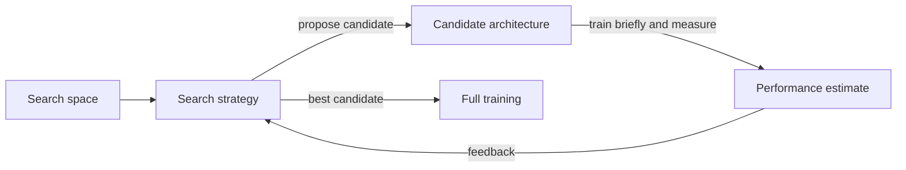

# Neural Architecture Search and AutoML

Neural architecture search (NAS) uses an automated procedure to find the structure of a neural network that a human designer would otherwise choose by hand. Automated machine learning (AutoML) extends the same idea to the rest of the workflow, including hyperparameter tuning and model selection.

## Overview

Choosing an architecture used to mean choosing layers, operations, connections and sizes by hand. The networks behind the early deep-learning results, such as [AlexNet](../../models/cnn/backbones-and-scaling/alexnet/index.md) and [ResNet](../../models/cnn/backbones-and-scaling/resnet/index.md), came from expert intuition and many rounds of trial and error. NAS treats this choice as a search problem. It defines a set of possible architectures, proposes candidates from that set, scores each candidate by training it, and uses the scores to decide what to try next.

The field took off in 2016 and 2017, when reinforcement-learning controllers produced convolutional and recurrent networks that matched the best hand-designed models on standard benchmarks. The first systems were very expensive, so much of the later work aims to make search cheaper, to measure the costs that matter on real hardware, and to compare methods fairly. AutoML is the broader goal of removing manual choices from the whole machine-learning pipeline. Architecture search is one part of it.

## Key concepts

- **Search space**: the set of architectures a search can produce. Most modern spaces repeat a small block, called a cell, many times, which keeps the space manageable.
- **Search strategy**: the rule that proposes candidates. Common choices are reinforcement learning, evolution, random sampling and gradient descent on a continuous relaxation.
- **Performance estimation**: how a candidate is scored. Full training is accurate but slow. Shortcuts include short training runs, smaller proxy networks, predicting learning curves and weight sharing.
- **Weight sharing**: candidates reuse the same parameters for the operations they have in common, so each one need not be trained from scratch.
- **Hardware-aware search**: an objective that includes measured speed, latency or energy on a target device, not only accuracy.
- **AutoML**: the umbrella term for automating model selection and [hyperparameter](../../optimization/index.md) tuning, such as the choice of learning rate, together with related steps.

Elsken et al. (2018) organise the field along exactly these three dimensions: search space, search strategy and performance estimation.

## How it works

Every NAS method runs the same loop:

1. Propose a candidate architecture from the search space.
2. Estimate its performance, usually as validation accuracy after a limited training budget.
3. Update the strategy so that promising candidates are proposed more often, or keep them as parents for further mutation.
4. Repeat until the budget is spent, then train the best candidate fully and test it on held-out data.

Writing the goal as an equation makes the nested structure clear. Let \(\mathcal{A}\) be the search space and \(w\) the network weights. The search seeks

\[
a^{*} = \arg\max_{a \in \mathcal{A}} \; \mathrm{Acc}_{\mathrm{val}}\big(w^{*}(a), a\big), \qquad w^{*}(a) = \arg\min_{w} \mathcal{L}_{\mathrm{train}}(w, a).
\]

The inner problem trains the weights of one candidate, and the outer problem chooses the candidate. [DARTS](darts/index.md) handles this nested structure with gradients. The other landmark methods treat validation accuracy as a black-box reward or fitness.

## Key methods

The landmark methods differ mainly in their search strategy and in how they keep the cost down. Each has its own page.

| Method | Search strategy | Main idea | Reported cost |
|---|---|---|---|
| [NAS with reinforcement learning](nas-rl/index.md) (2016) | Policy gradient on an RNN controller | Learn to generate architectures, with validation accuracy as the reward | 800 networks trained in parallel on 800 GPUs[^1] |
| [Regularized evolution](regularized-evolution/index.md) (2018) | Tournament selection with ages | Mutate a parent, then discard the oldest model rather than the worst | About 450 GPUs for about seven days in one controlled run[^2] |
| [DARTS](darts/index.md) (2018) | Gradient descent on a softmax relaxation | Learn architecture weights jointly with the network weights | 1.5 to 4 GPU days on CIFAR-10 search[^3] |
| [MnasNet](mnasnet/index.md) (2018) | Policy gradient with measured latency in the reward | Trade accuracy against latency on a phone | 4.5 days on 64 TPUv2 devices[^4] |

Weight sharing is the other main route to lower cost. ENAS (Pham et al., 2018) lets child networks share parameters inside an RL search, and reports a search about 1000 times cheaper than standard NAS.

The most successful product of this line of work in image classification is the [EfficientNet](../../models/cnn/backbones-and-scaling/efficientnet/index.md) family. Its baseline network came from a multi-objective architecture search, and compound scaling then grew that baseline into a family of models. Mingxing Tan, the first author of EfficientNet, is also the first author of MnasNet, which shows the same logic applied to phone latency.

## Connections

- **Architecture families.** Most search spaces are built from familiar blocks, such as residual and depthwise separable convolutions, in the [CNN backbone](../../models/cnn/backbones-and-scaling/index.md) pages. The search decides how the blocks are combined and sized.
- **Reinforcement learning and evolution.** NAS borrows its strategies from two older fields. Policy gradients come from [reinforcement learning](../../paradigms/reinforcement-learning/index.md), and population-based search comes from [evolutionary computation](../../evolutionary/index.md), where neuroevolution of network topologies predates NAS.
- **Meta-learning.** [Meta-learning](../../paradigms/meta-learning/index.md) learns how to adapt quickly to new tasks, while NAS learns the structure of the model. Both automate choices that were once made by people, but they are different problems.
- **Brain and mind.** Yamins et al. (2014) used computational techniques to find a hierarchical network that matches human performance on object categorisation. Without being fitted to neural data, the network predicted responses in V4 and inferior temporal cortex. See [performance-optimised networks](../../../brain-mind/neuroai/performance-optimised-networks/index.md) in NeuroAI. This is an example of letting a computational search choose a model that then fits brain data.
- **Evolution as an analogy.** NAS and Darwinian evolution share the logic of variation and selection. The analogy is loose. Brain wiring is shaped by development and by many factors that no search space captures, and NAS does not claim to model that process.

## Applications

- **Mobile and embedded vision.** Latency-aware search produces networks for phones. MnasNet was designed for that purpose, and EfficientNet is widely used as a family of efficient image classifiers.
- **Language modelling.** NAS has produced recurrent cells that beat the LSTM on the Penn Treebank benchmark. Zoph and Le (2016) reported a test perplexity of 62.4, and Pham et al. (2018) reported 55.8 with a much cheaper search.
- **Hyperparameter tuning.** Random search and early-stopping methods such as Hyperband are standard AutoML tools. Li and Talwalkar (2019) show that random search is a strong NAS baseline.
- **Shared benchmarks.** NAS-Bench-101 provides a public dataset of trained architectures, so that search algorithms can be compared without rerunning the full experiments (Ying et al., 2019).

## Open questions

- **Fair comparison.** Yang et al. (2019) argue that NAS methods are often tested under different search spaces and protocols, with too few ablation studies, so their gains are hard to attribute. They propose measuring each method's improvement over randomly sampled architectures.
- **Is the search worth its cost?** Random search with early stopping performed at least as well as ENAS on PTB and CIFAR-10 (Li and Talwalkar, 2019). This suggests that much of the gain may come from the search space rather than the strategy.
- **Proxy tasks.** Architectures are often found on small proxy settings and then scaled up for large datasets. Whether the ranking of candidates holds at full scale is not settled.
- **Bias from weight sharing.** Shared weights can rank candidates wrongly. The DARTS authors note a gap between the continuous relaxation used in search and the discrete architecture derived from it.
- **Hardware measurements.** Measured latency depends on the device, the compiler and the software. A network that is fast on one phone may not be fast on another.
- **Where the effort goes.** AutoML does not remove expert knowledge. It moves that knowledge into search-space design, benchmarks and objective functions.

[^1]: Zoph and Le (2016) describe 12,800 sampled architectures and 800 child networks training concurrently on 800 GPUs.
[^2]: Real et al. (2018) report that one controlled search of 20,000 small models ran on 450 K40 GPUs for about seven days.
[^3]: Liu et al. (2018) report 1.5 GPU days for the first-order search and 4 GPU days for the second-order search, compared with 2000 GPU days for NASNet.
[^4]: Tan et al. (2018) report that each architecture search took 4.5 days on 64 TPUv2 devices.

## References

### Seminal papers

- Zoph, B. & Le, Q. V. (2016). *Neural Architecture Search with Reinforcement Learning*. arXiv:1611.01578. https://arxiv.org/abs/1611.01578 — Introduces an RNN controller, trained with reinforcement learning, that generates CNN and recurrent cells.
- Real, E., et al. (2018). *Regularized Evolution for Image Classifier Architecture Search*. arXiv:1802.01548. https://arxiv.org/abs/1802.01548 — Aging evolution, compared with RL and random search under matched compute on CIFAR-10.
- Liu, H., Simonyan, K. & Yang, Y. (2018). *DARTS: Differentiable Architecture Search*. arXiv:1806.09055. https://arxiv.org/abs/1806.09055 — Relaxes the choice of operations to a softmax and learns it with gradient descent in a bilevel problem.
- Tan, M., et al. (2018). *MnasNet: Platform-Aware Neural Architecture Search for Mobile*. arXiv:1807.11626. https://arxiv.org/abs/1807.11626 — Puts measured phone latency into the search reward, producing mobile CNNs that trade accuracy against speed.
- Pham, H., et al. (2018). *Efficient Neural Architecture Search via Parameter Sharing*. arXiv:1802.03268. https://arxiv.org/abs/1802.03268 — Shares weights between child networks inside an RL controller, cutting search cost by about three orders of magnitude.
- Tan, M. & Le, Q. V. (2019). *EfficientNet: Rethinking Model Scaling for Convolutional Neural Networks*. arXiv:1905.11946. https://arxiv.org/abs/1905.11946 — Uses NAS to design a baseline network, then scales it with a compound coefficient.
- Li, L., et al. (2016). *Hyperband: A Novel Bandit-Based Approach to Hyperparameter Optimization*. arXiv:1603.06560. https://arxiv.org/abs/1603.06560 — Speeds up random search with adaptive resource allocation and early stopping, a standard AutoML tool.
- Yamins, D. L. K., et al. (2014). *Performance-optimized hierarchical models predict neural responses in higher visual cortex*. Proceedings of the National Academy of Sciences. https://doi.org/10.1073/pnas.1403112111 — Identifies a hierarchical network by computational means that predicts neural responses in V4 and IT.

### Surveys and textbooks

- Elsken, T., Metzen, J. H. & Hutter, F. (2018). *Neural Architecture Search: A Survey*. arXiv:1808.05377. https://arxiv.org/abs/1808.05377 — Organises the field by search space, search strategy and performance estimation strategy.

### Articles and documentation

- Li, L. & Talwalkar, A. (2019). *Random Search and Reproducibility for Neural Architecture Search*. arXiv:1902.07638. https://arxiv.org/abs/1902.07638 — Shows that random search with early stopping is a competitive NAS baseline on PTB and CIFAR-10.
- Yang, A., Esperança, P. M. & Carlucci, F. M. (2019). *NAS evaluation is frustratingly hard*. arXiv:1912.12522. https://arxiv.org/abs/1912.12522 — Benchmarks eight NAS methods on five datasets under a shared protocol and discusses why comparisons are difficult.
- Ying, C., et al. (2019). *NAS-Bench-101: Towards Reproducible Neural Architecture Search*. arXiv:1902.09635. https://arxiv.org/abs/1902.09635 — A public dataset of trained architectures for comparing search algorithms without large compute budgets.
