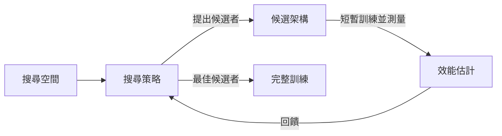

# 神經架構搜尋與 AutoML

神經架構搜尋（Neural architecture search，NAS）以自動化程序尋找神經網路的結構，這些結構原本需要人類設計者手動選擇。自動化機器學習（AutoML）則把相同的想法延伸到整個工作流程，包括超參數調校與模型選擇。

## 概述

過去，選擇架構意味著手動決定各層、運算、連接方式與大小。早期深度學習成果背後的網路，例如 [AlexNet](../../models/cnn/backbones-and-scaling/alexnet/index.md) 與 [ResNet](../../models/cnn/backbones-and-scaling/resnet/index.md)，都來自專家的直覺與多次的反覆嘗試。NAS 把這個選擇視為搜尋問題：先定義一組可能的架構，從中提出候選者，透過訓練為每個候選者評分，再依分數決定接下來要嘗試什麼。

這個領域在 2016 與 2017 年起飛，當時以強化學習為控制器的方法，所產生的卷積網路與循環網路，已能在標準基準上媲美最好的人工設計模型。早期的系統非常昂貴，因此後續許多工作的目標是降低搜尋成本、衡量在真實硬體上真正重要的成本，並公平地比較各種方法。AutoML 則是更廣的目標，要把整個機器學習流程中的人工選擇都自動化；架構搜尋只是其中一部分。

## 關鍵概念

- **搜尋空間**：搜尋可以產生的架構集合。多數現代的搜尋空間會重複一個小型區塊，稱為胞元（cell），使空間保持在可管理的範圍。
- **搜尋策略**：提出候選者的規則。常見選擇包括強化學習、演化、隨機取樣，以及在連續鬆弛上做梯度下降。
- **效能估計**：為候選者評分的方式。完整訓練準確但緩慢，捷徑包括短時間訓練、較小的代理網路、預測學習曲線，以及權重共享。
- **權重共享**：候選架構對共同運算重複使用同一組參數，因此每個候選者不必從頭訓練。
- **硬體感知搜尋**：目標函數中納入在目標裝置上實測的速度、延遲或能耗，而不只考慮準確率。
- **AutoML**：自動化模型選擇與[超參數](../../optimization/index.md)調校（例如學習率的設定）及相關步驟的總稱。

Elsken et al.（2018）正是沿著這三個面向組織這個領域：搜尋空間、搜尋策略與效能估計。

## 運作方式

每種 NAS 方法都執行相同的迴圈：

1. 從搜尋空間中提出一個候選架構。
2. 估計其效能，通常是在有限的訓練預算後的驗證準確率。
3. 更新策略，使有希望的候選者被更頻繁地提出，或把它們保留為進一步突變的親代。
4. 重複直到預算用完，然後完整訓練最佳候選者，並在保留的資料上測試。

把目標寫成方程式，可以看清這個巢狀結構。令 \(\mathcal{A}\) 為搜尋空間，\(w\) 為網路權重。搜尋要找的是

\[
a^{*} = \arg\max_{a \in \mathcal{A}} \; \mathrm{Acc}_{\mathrm{val}}\big(w^{*}(a), a\big), \qquad w^{*}(a) = \arg\min_{w} \mathcal{L}_{\mathrm{train}}(w, a).
\]

內層問題訓練單一候選者的權重，外層問題則選擇候選者。[DARTS](darts/index.md) 以梯度處理這種巢狀結構；其他代表性方法則把驗證準確率視為黑箱式的獎勵或適應度。

## 關鍵方法

各代表性方法的主要差異在於搜尋策略，以及如何控制成本。每個方法都有自己的專頁。

| 方法 | 搜尋策略 | 主要想法 | 回報的成本 |
|---|---|---|---|
| [以強化學習進行 NAS](nas-rl/index.md)（2016） | 以 RNN 控制器進行策略梯度 | 以驗證準確率為獎勵，學習生成架構 | 800 個網路在 800 個 GPU 上平行訓練[^1] |
| [正則化演化](regularized-evolution/index.md)（2018） | 附年齡的錦標賽選擇 | 突變親代，然後淘汰最舊的模型而非最差的模型 | 在一次受控實驗中，約 450 個 GPU 跑了約七天[^2] |
| [DARTS](darts/index.md)（2018） | 對 softmax 鬆弛做梯度下降 | 與網路權重一起學習架構權重 | CIFAR-10 搜尋需 1.5 至 4 GPU 天[^3] |
| [MnasNet](mnasnet/index.md)（2018） | 獎勵中納入實測延遲的策略梯度 | 在手機上權衡準確率與延遲 | 在 64 台 TPUv2 上 4.5 天[^4] |

權重共享是降低成本的另一條主要途徑。ENAS（Pham et al., 2018）讓子網路在強化學習搜尋中共享參數，並回報其搜尋成本約為標準 NAS 的 1/1000。

在影像分類中，最成功的這條研究路線成果是 [EfficientNet](../../models/cnn/backbones-and-scaling/efficientnet/index.md) 家族。其基準網路來自多目標架構搜尋，接著複合縮放把這個基準放大成一整個模型家族。EfficientNet 的第一作者 Mingxing Tan 也是 MnasNet 的第一作者，後者把同樣的邏輯應用到手機延遲上。

## 連結

- **架構家族。** 多數搜尋空間由熟悉的區塊組成，例如殘差與深度可分離卷積，這些在 [CNN 骨幹](../../models/cnn/backbones-and-scaling/index.md)的頁面中有介紹。搜尋決定的是這些區塊如何組合與調整大小。
- **強化學習與演化。** NAS 的策略借自兩個較早的領域。策略梯度來自[強化學習](../../paradigms/reinforcement-learning/index.md)，族群式搜尋則來自[演化計算](../../evolutionary/index.md)，其中網路拓撲的神經演化早於 NAS。
- **元學習。** [元學習](../../paradigms/meta-learning/index.md)學習如何快速適應新任務，而 NAS 學習的是模型的結構。兩者都自動化了過去由人決定的選擇，但它們是不同的問題。
- **大腦與心智。** Yamins et al.（2014）以計算方法找到一個階層式網路，能在物件分類上達到人類的表現。這個網路並未針對神經資料擬合，卻能預測 V4 與下顳葉皮質的反應。詳見 NeuroAI 中的[效能最佳化網路](../../../brain-mind/neuroai/performance-optimised-networks/index.md)。這是讓計算搜尋選出模型、再去擬合腦部資料的一個例子。
- **作為類比的演化。** NAS 與達爾文式演化都依循變異與選擇的邏輯。這個類比只是粗略的。大腦的連線是由發育以及許多搜尋空間無法涵蓋的因素所塑造，而 NAS 並不主張它在模擬那個過程。

## 應用

- **行動與嵌入式視覺。** 考慮延遲的搜尋可產生適用於手機的網路。MnasNet 正是為此設計，而 EfficientNet 家族則被廣泛用作高效率的影像分類器。
- **語言建模。** NAS 已產生在 Penn Treebank 基準上勝過 LSTM 的循環胞元。Zoph and Le（2016）回報的測試困惑度為 62.4，Pham et al.（2018）則以便宜得多的搜尋得到 55.8。
- **超參數調校。** 隨機搜尋以及 Hyperband 等提前停止方法，是標準的 AutoML 工具。Li and Talwalkar（2019）指出，隨機搜尋是強大的 NAS 基準。
- **共用基準。** NAS-Bench-101 提供一個公開的已訓練架構資料集，讓搜尋演算法無須重跑完整實驗即可互相比較（Ying et al., 2019）。

## 開放問題

- **公平比較。** Yang et al.（2019）指出，NAS 方法常在不同的搜尋空間與協定下測試，而且消融研究太少，使得其增益難以歸因。他們建議以各方法相對於隨機取樣架構的改進來衡量。
- **搜尋是否值得其成本？** 附提前停止的隨機搜尋，在 PTB 與 CIFAR-10 上至少與 ENAS 表現相當（Li and Talwalkar, 2019）。這暗示許多增益可能來自搜尋空間，而非搜尋策略。
- **代理任務。** 架構常在小型代理設定上找到，然後放大到大型資料集。候選者的排名在全尺寸下是否仍成立，尚無定論。
- **權重共享造成的偏誤。** 共享的權重可能會誤判候選者的排名。DARTS 的作者指出，搜尋時使用的連續鬆弛與由此導出的離散架構之間存在落差。
- **硬體測量。** 實測延遲取決於裝置、編譯器與軟體。在某支手機上很快的網路，在另一支上不一定快。
- **人力去了哪裡。** AutoML 並未消除專家知識，而是把它轉移到搜尋空間設計、基準與目標函數之中。

## 參考文獻

### 開創性論文

- Zoph, B. & Le, Q. V. (2016). *Neural Architecture Search with Reinforcement Learning*. arXiv:1611.01578. https://arxiv.org/abs/1611.01578 — 介紹以強化學習訓練的 RNN 控制器，用來生成 CNN 與循環胞元。
- Real, E., et al. (2018). *Regularized Evolution for Image Classifier Architecture Search*. arXiv:1802.01548. https://arxiv.org/abs/1802.01548 — 附年齡的演化，在 CIFAR-10 上以相同計算量與強化學習及隨機搜尋比較。
- Liu, H., Simonyan, K. & Yang, Y. (2018). *DARTS: Differentiable Architecture Search*. arXiv:1806.09055. https://arxiv.org/abs/1806.09055 — 把運算選擇鬆弛為 softmax，並以雙層問題中的梯度下降學習。
- Tan, M., et al. (2018). *MnasNet: Platform-Aware Neural Architecture Search for Mobile*. arXiv:1807.11626. https://arxiv.org/abs/1807.11626 — 把手機實測延遲納入搜尋獎勵，產生在準確率與速度之間權衡的行動 CNN。
- Pham, H., et al. (2018). *Efficient Neural Architecture Search via Parameter Sharing*. arXiv:1802.03268. https://arxiv.org/abs/1802.03268 — 在強化學習控制器中讓子網路共享權重，將搜尋成本降低約三個數量級。
- Tan, M. & Le, Q. V. (2019). *EfficientNet: Rethinking Model Scaling for Convolutional Neural Networks*. arXiv:1905.11946. https://arxiv.org/abs/1905.11946 — 以 NAS 設計基準網路，再用複合係數縮放成模型家族。
- Li, L., et al. (2016). *Hyperband: A Novel Bandit-Based Approach to Hyperparameter Optimization*. arXiv:1603.06560. https://arxiv.org/abs/1603.06560 — 以適應性資源分配與提前停止加速隨機搜尋，是標準的 AutoML 工具。
- Yamins, D. L. K., et al. (2014). *Performance-optimized hierarchical models predict neural responses in higher visual cortex*. Proceedings of the National Academy of Sciences. https://doi.org/10.1073/pnas.1403112111 — 以計算方法找出階層式網路，能預測 V4 與 IT 的神經反應。

### 綜述與教科書

- Elsken, T., Metzen, J. H. & Hutter, F. (2018). *Neural Architecture Search: A Survey*. arXiv:1808.05377. https://arxiv.org/abs/1808.05377 — 依搜尋空間、搜尋策略與效能估計策略組織 NAS 方法。

### 文章與文件

- Li, L. & Talwalkar, A. (2019). *Random Search and Reproducibility for Neural Architecture Search*. arXiv:1902.07638. https://arxiv.org/abs/1902.07638 — 顯示附提前停止的隨機搜尋，在 PTB 與 CIFAR-10 NAS 基準上是有競爭力的基準。
- Yang, A., Esperança, P. M. & Carlucci, F. M. (2019). *NAS evaluation is frustratingly hard*. arXiv:1912.12522. https://arxiv.org/abs/1912.12522 — 在五個資料集上以共同協定比較八種 NAS 方法，並主張與隨機架構比較。
- Ying, C., et al. (2019). *NAS-Bench-101: Towards Reproducible Neural Architecture Search*. arXiv:1902.09635. https://arxiv.org/abs/1902.09635 — 公開的已訓練架構資料集，讓人們無須大量計算即可比較搜尋演算法。

[^1]: Zoph and Le（2016）描述 12,800 個取樣架構，以及 800 個子網路在 800 個 GPU 上同時訓練。
[^2]: Real et al.（2018）回報，一次受控搜尋（20,000 個小模型）在 450 個 K40 GPU 上跑了約七天。
[^3]: Liu et al.（2018）回報，一階搜尋需 1.5 GPU 天，二階搜尋需 4 GPU 天；相較之下 NASNet 需 2000 GPU 天。
[^4]: Tan et al.（2018）回報，每次架構搜尋在 64 台 TPUv2 上花了 4.5 天。
