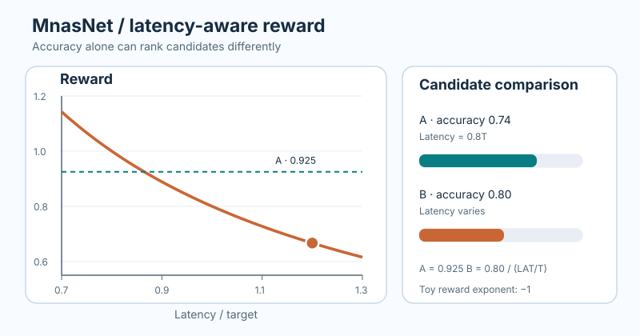

# MnasNet：平台感知的架構搜尋（Tan 等人，2019）

MnasNet 以一個獎勵函數搜尋行動端影像分類器，該獎勵結合了準確率與在實體手機上實測的延遲，而非 FLOPS 之類的代理指標。它的搜尋空間被分解為區塊，使網路不同部分的層可以彼此不同。本頁是[神經架構搜尋](index.md)的一部分。

## 概述

行動網路必須既小又快，同時又要準確，要以人工平衡這些取捨十分困難。較早的架構搜尋使用運算量（如乘加次數）之類的成本代理，但在手機上，它往往不能很好地預測速度。Tan、Chen、Pang、Vasudevan、Sandler、Howard 與 Le（2019）直接把目標手機上實測的推論延遲放入搜尋目標。他們也提出一個允許網路不同部分的層彼此不同的搜尋空間，以鼓勵層的多樣性。

## 關鍵概念

- **延遲**：目標手機上一次推論的實測時間，而非代理指標。
- **獎勵**：驅動控制器的分數，結合準確率與延遲懲罰。
- **分解的階層式搜尋空間**：把網路分成區塊，每個區塊各自選擇層。
- **目標延遲**：當候選超過此延遲預算時，獎勵會加以懲罰。

## 問題

當模型的延遲無法由其運算次數推得時，架構搜尋如何在真實裝置上找到準確率與延遲之間取捨良好的行動端分類器？

## 運作方式

強化學習控制器從搜尋空間中取樣一個候選架構。候選經過訓練，在驗證集上量測其準確率；並在手機上執行，量測其延遲。獎勵以加權乘積結合兩者，

\[
\mathrm{reward}(m) = \mathrm{ACC}(m) \times \left[\frac{\mathrm{LAT}(m)}{T}\right]^{w},
\]

其中 \(\mathrm{LAT}(m)\) 為實測延遲，\(T\) 為目標延遲，\(w\) 為控制延遲懲罰強度的指數。控制器的更新目標是提高期望獎勵。

原論文允許在目標延遲兩側使用不同指數：當 \(\mathrm{LAT}(m)\le T\) 時 \(w=\alpha\)，否則 \(w=\beta\)。論文的軟限制設定為 \(\alpha=\beta=-0.07\)；下方動畫刻意採用較強的人工懲罰值（Tan et al., 2019，第 3 節）。

## 動態範例：延遲可能反轉架構排名

窄螢幕可聚焦圖框後使用方向鍵或滑動，水平捲動檢視原尺寸圖。

*原創教學 SVG，CC BY-SA 4.0。* GitHub 顯示[靜態預覽](../../../assets/concept-animations/mnasnet-latency-tradeoff-still.svg)；MkDocs 可用鍵盤播放／暫停，減少動態效果模式保留靜態圖。

取**人工設定的獎勵指數** \(w=-1\)。架構 A 的示意準確率為 \(0.74\)，延遲比率 \(\mathrm{LAT}_A/T=0.8\)，因此 \(R_A=0.74/0.8=0.925\)。架構 B 的示意準確率較高，為 \(0.80\)，但將其*假設*延遲比率由 \(0.7\) 掃描至 \(1.3\)，\(R_B=0.80/(\mathrm{LAT}_B/T)\) 就會從約 \(1.143\) 降到 \(0.615\)。比率超過 \(0.80/0.925\approx0.865\) 時，B 的獎勵低於 A。

這是**連續參數掃描，並非控制器訓練軌跡、手機實測或原論文超參數的重現**。範例只用來說明：即使準確率比較高，裝置延遲仍可能改變架構選擇。

## 主要方法

本頁只涵蓋一種方法：以準確率乘以延遲比為獎勵的強化學習搜尋，延遲在手機上實測，搜尋空間為分解的區塊式結構。

1. 從分解的搜尋空間中取樣一個候選。
2. 訓練它，並量測其驗證準確率。
3. 在目標手機上量測其延遲。
4. 計算獎勵並更新控制器。

## 變體

- **延遲懲罰的強度**：指數 \(w\) 決定延遲懲罰的強弱，從寬鬆的取捨到接近硬性的限制。
- **其他目標裝置**會改變延遲的量測，因此也改變搜尋所得的模型。
- **遷移到其他任務**：論文中，為分類找到的架構也被用於物件偵測。

## 結果與限制

- 在 ImageNet 上，Tan 等人（2019）報告 Pixel 手機上的 top-1 準確率為 75.2%，延遲為 78 毫秒。他們形容其比 MobileNetV2 快 1.8 倍，準確率高 0.5%；比 NASNet 快 2.3 倍，準確率高 1.2%。
- 論文報告，在 COCO 物件偵測上，其 mAP 優於 MobileNets。
- 延遲只在一款手機上量測，因此最佳架構可能隨裝置而改變。
- 獎勵取決於目標延遲與指數的選擇，選擇不當可能偏好紙上速度快、實際上卻不快的架構。

## 應用

- **行動端影像分類**，此時裝置延遲是硬性需求。
- **邊緣部署**的視覺模型，部署於延遲特性已知的硬體上。
- **物件偵測的骨幹網路**，使用為分類找到的架構。

## 開放問題

- 為某一款手機調整的架構，在其他硬體或未來的硬體上表現如何？
- 能否足夠準確地預測延遲，以避免在裝置上量測每一個候選？

## 與其他頁面的連結

- 上層主題：[神經架構搜尋](index.md)
- 可微分的替代方案：[DARTS](darts.md)
- 它所建立於其上的強化學習搜尋：Zoph 與 Le（2017），見[上層頁面](index.md)

## 參考文獻

### 奠基性論文

- Tan, M., Chen, B., Pang, R., Vasudevan, V., Sandler, M., Howard, A. & Le, Q. V. (2019). MnasNet: Platform-Aware Neural Architecture Search for Mobile. In *CVPR 2019*. arXiv:1807.11626. https://arxiv.org/abs/1807.11626 — 把實測手機延遲放入架構搜尋的獎勵，並報告 ImageNet 上準確率與延遲的結果。
- Sandler, M., Howard, A., Zhu, M., Zhmoginov, A. & Chen, L.-C. (2018). MobileNetV2: Inverted Residuals and Linear Bottlenecks. In *CVPR 2018*. arXiv:1801.04381. https://arxiv.org/abs/1801.04381 — MnasNet 報告加速倍數時所比較的人工設計行動基準。
- Zoph, B., Vasudevan, V., Shlens, J. & Le, Q. V. (2018). Learning Transferable Architectures for Scalable Image Recognition. In *CVPR 2018*. arXiv:1707.07012. https://arxiv.org/abs/1707.07012 — NASNet 的搜尋空間與模型，是 MnasNet 比較中的第二個基準。
- Zoph, B. & Le, Q. V. (2017). Neural Architecture Search with Reinforcement Learning. In *ICLR 2017*. arXiv:1611.01578. https://arxiv.org/abs/1611.01578 — MnasNet 以延遲感知獎勵加以延伸的強化學習搜尋。

### 綜述與教科書

- Elsken, T., Metzen, J. H. & Hutter, F. (2019). Neural Architecture Search: A Survey. *Journal of Machine Learning Research* 20(55). https://jmlr.org/papers/v20/18-598.html — 把硬體感知搜尋歸入搜尋目標的綜述。
- Liu, H., Simonyan, K. & Yang, Y. (2019). DARTS: Differentiable Architecture Search. In *ICLR 2019*. arXiv:1806.09055. https://arxiv.org/abs/1806.09055 — 搜尋中不量測延遲的可微分替代方案。
- Real, E., Aggarwal, A., Huang, Y. & Le, Q. V. (2019). Regularized Evolution for Image Classifier Architecture Search. In *Proceedings of the AAAI Conference on Artificial Intelligence* 33, 4780–4789. https://doi.org/10.1609/aaai.v33i01.33014780 — 目標只有準確率的演化替代方案。
