# Batch normalisation

Batch normalisation normalises each channel of a layer using the mean and variance of the current mini-batch, then applies a learned scale and shift. It was introduced to speed up training of deep image classifiers and became a default component of convolutional networks.

## Overview

The [chapter](index.md) covers the family of normalisation layers. This page covers the method that started it. Batch normalisation computes statistics across the examples in a batch and across spatial positions for each channel, so the statistics depend on the batch.

## Problem

Deep networks train slowly and are sensitive to learning rate and initialisation, partly because each layer's inputs keep shifting as earlier layers change. The paper set out to make training faster and more stable without changing the model's capacity.

## Core idea

For each channel, compute the mean and variance over the batch and spatial axes, normalise each activation with them, and apply a learned scale $\gamma$ and shift $\beta$. At test time the layer uses running averages of the statistics collected during training, so that a single example can be processed alone.

## Equation

For a channel with activations $x_1, \ldots, x_m$ over a mini-batch,

$$\mu_B = \frac{1}{m}\sum_{i=1}^{m} x_i, \qquad \sigma_B^2 = \frac{1}{m}\sum_{i=1}^{m}(x_i - \mu_B)^2, \qquad y_i = \gamma\,\frac{x_i - \mu_B}{\sqrt{\sigma_B^2 + \epsilon}} + \beta$$

The original paper reported that the method reaches the same accuracy as the baseline in 14 times fewer training steps on an image classification model [(Ioffe and Szegedy, 2015)](https://arxiv.org/abs/1502.03167).

*Original four-stage teaching animation, CC BY-SA 4.0.* The first two frames show that each training mini-batch supplies its **own per-channel mean and variance**, so a shifted batch can still have centred, scaled activations. The third frame illustrates updating running statistics during training; the fourth uses those **frozen running estimates** for a single inference sample rather than recomputing statistics from that sample. The drawing suppresses spatial dimensions and the subsequent learned affine transform ($\gamma$, $\beta$) for clarity. Dot positions, batch statistics and running estimates are **schematic, not measured model activations**. The website player supports play/pause and reduced-motion mode; [view the GitHub-compatible static preview](../../../assets/concept-animations/batch-norm-train-infer-still.svg).

## Results

The paper's headline result is the training speed-up on a large image classification model. Exact accuracy and step counts are given in its results section.

## Limitations

- The statistics depend on the batch. Small batches give noisy estimates, which hurts performance.
- Training and inference behave differently, because inference uses running averages.
- Sequence models with variable-length inputs fit batch statistics poorly, which is one reason Transformers use layer normalisation.

[Group normalisation](group-normalisation.md) addresses the small-batch problem, and [RMSNorm](rms-normalisation.md) addresses the cost of mean and variance computation in language models.

## Connections

The explanation debate for batch normalisation is covered in the [chapter](index.md), where Santurkar and colleagues argue that it smooths the optimisation landscape [(Santurkar et al., 2018)](https://arxiv.org/abs/1805.11604). Gradients through the layer are computed as described in [Automatic differentiation](../../math/automatic-differentiation/index.md).

## Applications

Image classifiers, object detectors and segmentation networks trained with large batches, and the convolutional stacks used in many vision backbones.

## Open questions

- Is the benefit of batch normalisation mainly about the batch statistics or about the normalised scale?
- How should batch statistics be shared across devices when batches are split for large-scale training?

## References

### Seminal papers

- Ioffe and Szegedy, *Batch Normalization: Accelerating Deep Network Training by Reducing Internal Covariate Shift* (2015). https://arxiv.org/abs/1502.03167 — The original method and the reported training speed-up.
- Santurkar, Tsipras, Ilyas and Madry, *How Does Batch Normalization Help Optimization?* (2018). https://arxiv.org/abs/1805.11604 — Argues that the main effect is a smoother optimisation landscape.
- Ba, Kiros and Hinton, *Layer Normalization* (2016). https://arxiv.org/abs/1607.06450 — The sample-wise alternative that avoids batch dependence.
- Wu and He, *Group Normalization*, European Conference on Computer Vision (2018). https://arxiv.org/abs/1803.08494 — The small-batch alternative, with a numerical comparison to batch normalisation at batch size 2.
- Xiong, Yang, He, Zheng, Zheng, Xing, Zhang, Lan, Wang and Liu, *On Layer Normalization in the Transformer Architecture* (2020). https://arxiv.org/abs/2002.04745 — Analyses pre-norm and post-norm Transformer blocks at initialisation, relevant to where normalisation sits in residual blocks.
