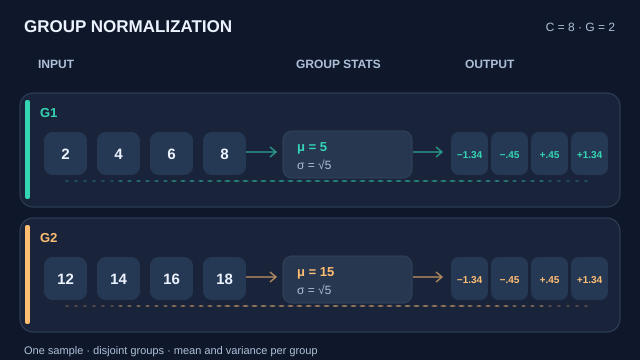

# Group normalisation

Group normalisation divides the channels of each sample into groups and normalises each group using its own statistics. Because it does not depend on the batch, it works at small batch sizes, where batch normalisation becomes unreliable.

## Overview

The [chapter](index.md) compares the normalisation axes. This page covers group normalisation, which sits between batch normalisation and instance normalisation. It normalises over spatial positions and over a group of channels, within one example.

## Problem

Batch normalisation estimates its statistics from the batch. When the batch is small, as in detection and segmentation models trained on high-resolution images, the estimates are noisy and the error rises. The method is designed to remove that dependence.

## Core idea

Split the $C$ channels of a sample into $G$ groups of $C/G$ channels each. For each group, compute the mean and variance over the channels in the group and over the spatial positions, normalise, and apply per-channel learned scale and shift. Nothing is computed across the batch, so the result for one example is the same whatever the other examples are.

## Equation

For an activation tensor $x$ with spatial positions $(h, w)$ and channel index $c$, the statistics are computed over the group $\mathcal{S}_i$ that contains channel $c$:

$$\mu_i = \frac{1}{|\mathcal{S}_i|}\sum_{k \in \mathcal{S}_i} x_k, \qquad \sigma_i^2 = \frac{1}{|\mathcal{S}_i|}\sum_{k \in \mathcal{S}_i}(x_k - \mu_i)^2$$

The set $\mathcal{S}_i$ contains the positions and channels of group $i$ within one sample. Setting $G = 1$ gives layer normalisation over channels and positions, and setting $G = C$ gives instance normalisation.

### Visual walkthrough: separate group statistics

  

*Original instructional motion and GitHub-readable still, CC BY-SA 4.0.* In this **constructed calculation**, eight scalar activations represent eight channels at one spatial location, divided into two disjoint groups. The first group $(2,4,6,8)$ has mean $5$; the second $(12,14,16,18)$ has mean $15$. Both have **population** variance $5$, so each gives $( -3,-1,1,3 )/\\sqrt{5}\\approx(-1.34,-0.45,0.45,1.34)$ before learnable $\\gamma$ and $\\beta$, with $\\epsilon=0$ only for this nonzero illustrative calculation. For a real feature map, group statistics also aggregate spatial positions; **no other batch examples are included**. The moving dots show conceptual data flow, not separate optimisation steps or measured activations. On the MkDocs site, use Play/Pause (Enter/Space with the button focused); reduced-motion settings show the still. The image region scrolls horizontally on narrow screens. [Open the full looping SVG](../../../assets/concept-animations/group-norm-statistics-motion.svg) or [view the GitHub-safe still](../../../assets/concept-animations/group-norm-statistics-still.svg). This is a visual interpretation of the method in Wu and He (2018), cited below.

## Results

The abstract reports that, on ResNet-50 trained on ImageNet, group normalisation has 10.6% lower error than batch normalisation at a batch size of 2. Comparisons at other batch sizes are in the paper [(Wu and He, 2018)](https://arxiv.org/abs/1803.08494).

## Limitations

- The number of groups is a hyperparameter, and the best choice can vary by task.
- Batch normalisation can still be better when batches are large, so the method is not a universal replacement.
- It does not remove the need for learned scale and shift terms, which must be initialised carefully.

## Connections

Instance normalisation, which Ulyanov and colleagues introduced for style transfer, is the extreme case with one group per channel [(Ulyanov et al., 2016)](https://arxiv.org/abs/1607.08022). The sample-wise alternative for sequences is [layer normalisation](../../models/mlp/layer-normalisation/index.md). The batch-based baseline is [batch normalisation](batch-normalisation.md).

## Applications

Object detection and segmentation models, video models and any setting where batches are small because inputs are large.

## Open questions

- How should the number of groups be chosen automatically for a new architecture?
- Does group normalisation give the same smoothing benefit that the batch-based analysis describes?

## References

### Seminal papers

- Wu and He, *Group Normalization*, European Conference on Computer Vision (2018). https://arxiv.org/abs/1803.08494 — The method, with comparisons across batch sizes.
- Ioffe and Szegedy, *Batch Normalization: Accelerating Deep Network Training by Reducing Internal Covariate Shift* (2015). https://arxiv.org/abs/1502.03167 — The batch-based method that group normalisation replaces at small batch sizes.
- Ba, Kiros and Hinton, *Layer Normalization* (2016). https://arxiv.org/abs/1607.06450 — The sample-wise normalisation that group normalisation generalises.
- Ulyanov, Vedaldi and Lempitsky, *Instance Normalization: The Missing Ingredient for Fast Stylization* (2016). https://arxiv.org/abs/1607.08022 — Normalises each channel of each sample, the one-group-per-channel case.
- Santurkar, Tsipras, Ilyas and Madry, *How Does Batch Normalization Help Optimization?* (2018). https://arxiv.org/abs/1805.11604 — Background on why normalisation helps optimisation, relevant to the alternatives.
