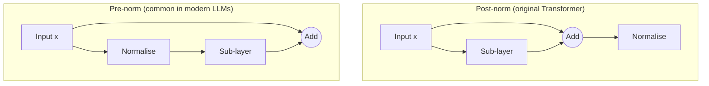

# Normalisation Layers

A normalisation layer rescales the activations inside a network to a controlled mean and spread, which makes deep networks faster and more reliable to train. The main variants differ in one choice: the set of activations over which the mean and variance are computed. That choice decides where each variant works well.

## Overview

Training a deep network means sending gradients through many layers. The inputs to each layer keep shifting as the layers before it change, the scale of activations can grow or shrink with depth, and small errors can compound across the stack. A normalisation layer tackles this directly. It computes the mean and variance of a group of activations, subtracts the mean, divides by the standard deviation, and then applies a learned scale and shift. The layer is cheap, has few parameters, and can be placed almost anywhere in a network.

Batch normalisation, proposed by Ioffe and Szegedy in 2015, was the first method to make this routine in image classifiers. Since then, layer normalisation, group normalisation and RMS normalisation have each been adopted in particular kinds of network. The [MLP](../../models/mlp/index.md) page covers [layer normalisation](../../models/mlp/layer-normalisation/index.md), which is the default in Transformers; it is linked here rather than repeated.

The question of where normalisation sits in a network matters as much as which statistics it uses. In Transformers, the placement relative to the residual connection, called pre-norm or post-norm, changes how stable training is. This is discussed below.

## Key concepts

- **Normalisation set.** The group of activations that share one mean and one variance. Batch, layer, instance, group and RMS normalisation differ only in how this set is chosen.
- **Learned gain and bias.** After normalising, the layer multiplies by a learned scale \(\gamma\) and adds a learned shift \(\beta\). Without them the layer would be forced to output zero-mean, unit-variance activations, which can reduce what the network can represent.
- **Batch statistics and running statistics.** During training, some methods compute statistics from the current mini-batch. At inference there may be no batch to use, so such methods keep running averages instead.
- **Internal covariate shift.** The term Ioffe and Szegedy used for the drift of each layer's input distribution during training. It motivated batch normalisation, but its causal role is now debated.
- **Pre-norm and post-norm.** Whether the normalisation is applied before a sub-layer (inside the residual branch) or after the residual addition.

## How it works

Take an activation tensor with four axes: batch \(N\), channel \(C\), height \(H\) and width \(W\), as in a convolutional network. Each variant normalises every element \(x_i\) with the same formula:

\[
\hat{x}_i = \frac{x_i - \mu_{S_i}}{\sqrt{\sigma^2_{S_i} + \epsilon}}, \qquad
y_i = \gamma\,\hat{x}_i + \beta,
\]

where \(\mu_{S_i}\) and \(\sigma^2_{S_i}\) are the mean and variance over the set \(S_i\) that contains \(i\), and \(\epsilon\) is a small constant for numerical stability. The sets are:

| Method | Statistics computed over | Learned parameters per | Typical use |
|---|---|---|---|
| [Batch normalisation](batch-normalisation/index.md) | The mini-batch and spatial positions, separately for each channel | Channel | CNNs trained with large batches |
| [Layer normalisation](../../models/mlp/layer-normalisation/index.md) | All features of one sample | Feature | Transformers, recurrent networks |
| Instance normalisation | Spatial positions of one channel in one sample | Channel | Style transfer and image generators |
| [Group normalisation](group-normalisation/index.md) | Spatial positions and a group of channels, for one sample | Channel | CNNs trained with small batches |
| [RMSNorm](rmsnorm/index.md) | All features of one sample, without subtracting the mean | Feature | Large language models |

The family is a set of choices along one axis. Batch normalisation depends on other examples in the batch, so its output for one input can change with the batch it arrives in. Layer, instance, group and RMS normalisation compute their statistics within a single sample, so their output for an input is fixed. The survey by Huang et al. (2020) breaks each method into three parts: how the activations are partitioned into normalisation sets, what operation is applied, and how the scale and shift are restored.

### Where normalisation sits in a block

The original Transformer applied the normalisation after the residual addition. This is called post-norm, written \(\mathrm{LN}(x + \mathrm{Sublayer}(x))\). Most current large models apply it before each sub-layer instead, so that the residual path carries the input unchanged. This is called pre-norm, written \(x + \mathrm{Sublayer}(\mathrm{LN}(x))\).

Xiong et al. (2020) analysed the two placements at initialisation. They showed that in post-norm Transformers the expected gradients near the output layer are large, so a warm-up phase with a small learning rate is needed. Pre-norm gradients are better behaved, and the authors trained pre-norm models without warm-up. Liu et al. (2020) located the instability in amplification: in a post-norm stack, each residual branch can strongly magnify small parameter changes. Nguyen and Salazar (2019) found that pre-norm allowed warm-up-free training with large learning rates on small translation datasets, but that it degraded results on a large English–German benchmark. The LLaMA models (Touvron et al., 2023) normalise the input of each sub-layer and use RMSNorm for it. The same pattern appears across many recent language models, so pre-norm with RMSNorm has become a common default.

## Key methods

Each method has its own page. This comparison is brief.

| Method | Year | Core idea | Page |
|---|---|---|---|
| Batch normalisation | 2015 | Normalises each channel over the mini-batch, with running statistics at inference | [Batch normalisation](batch-normalisation/index.md) |
| Group normalisation | 2018 | Normalises within groups of channels for each sample, so it does not depend on batch size | [Group normalisation](group-normalisation/index.md) |
| RMSNorm | 2019 | Scales by the root mean square of the features, without re-centring, which is cheaper | [RMSNorm](rmsnorm/index.md) |

Batch normalisation is strongest when batches are large. Group normalisation was designed for the small batches used in detection and segmentation. RMSNorm trades the re-centring step for lower cost, and is the common choice in large language models.

## Why it works, and the debate

Ioffe and Szegedy attributed the benefit of batch normalisation to reducing internal covariate shift. Santurkar et al. (2018) tested this and reported that the stability of layer inputs has little to do with the method's success. They argued instead that it smooths the optimisation landscape, so gradients are more predictive. Bjorck et al. (2018) found that the main effect is to allow larger learning rates without divergence, because it keeps activations centred and of unit scale. These explanations can be combined, and the disagreement is mostly about which effect is the cause and which is a consequence. The details are on the [batch normalisation](batch-normalisation/index.md) page.

## Connections

Normalisation is a point where engineering and biology meet. Divisive normalisation, in which a neuron's response is divided by the pooled activity of a neighbourhood of neurons, has been described in many sensory areas. Carandini and Heeger (2011) argued that it is a canonical computation used across the brain. This is a structural similarity rather than a direct mechanism, and it does not show that brains use batch statistics. The wiki's [computational neuroscience](../../../brain-mind/computational-neuroscience/index.md) page covers the wider modelling context. Homeostatic synaptic scaling, which keeps neural activity in range, is a related functional idea; see [memory and learning](../../../brain-mind/memory-learning/index.md).

Inside the wiki, normalisation interacts with [optimisation](../../optimization/index.md). Learning-rate warm-up is often used to compensate for post-norm instability, as discussed above and on the [gradual warm-up](../../optimization/gradual-warm-up.md) page. The main families that use each variant are the [CNN](../../models/cnn/index.md) family, the [Transformer](../../models/transformer/index.md) family and the [RNN](../../models/rnn/index.md) family.

## Applications

- **Image classification and detection.** Batch normalisation became a default in convolutional backbones. Ioffe and Szegedy reported that on a state-of-the-art image classifier it reached the same accuracy with 14 times fewer training steps.[^1]
- **Style transfer.** Ulyanov et al. (2016) showed that swapping batch normalisation for instance normalisation in a fast stylisation network gave a clear qualitative improvement.
- **Large language models.** Pre-norm placement with RMSNorm is used in the LLaMA family, and in many similar models.
- **Model compression.** Network slimming uses the scaling factors of batch normalisation to choose which channels to remove; see the [network slimming](../../model-compression/pruning/structured-pruning/network-slimming/index.md) page. Deployed models often fold batch normalisation into the preceding convolution before quantisation; see [quantisation-aware training](../../model-compression/quantisation/quantisation-aware-training/index.md).

## Open questions

- **Mechanism.** Which property of batch normalisation causes the speed-up: the stability of activations, the smoothness of the loss landscape, or the larger learning rates it permits? The studies above suggest these are linked, but the causal ordering is not settled.
- **Placement at scale.** Post-norm can reach better final performance in some settings, while pre-norm trains more reliably. Whether the gap reported by Nguyen and Salazar (2019) for high-resource translation holds across model sizes is not clear.
- **Choice of set.** No single normalisation set is best for every architecture, data type and batch size. Rules for choosing one in new settings are still largely empirical.
- **Biology.** Divisive normalisation in the cortex is established, but it is not known whether any biological mechanism computes statistics in the way batch normalisation does across examples.

[^1]: The figure of 14 times fewer training steps is reported in the abstract of Ioffe and Szegedy (2015), for the image classifier they tested.

## References

### Seminal papers

- Ioffe, S. & Szegedy, C. (2015). "Batch Normalization: Accelerating Deep Network Training by Reducing Internal Covariate Shift". arXiv:1502.03167 — Introduces batch normalisation, normalising each mini-batch and reporting faster training of image classifiers.
- Ba, J. L., Kiros, J. R. & Hinton, G. E. (2016). "Layer Normalization". arXiv:1607.06450 — Normalises over the features of each example, the alternative to batch statistics used in Transformers.
- Ulyanov, D., Vedaldi, A. & Lempitsky, V. (2016). "Instance Normalization: The Missing Ingredient for Fast Stylization". arXiv:1607.08022 — Shows that instance normalisation improves fast style transfer when used at training and test time.
- Wu, Y. & He, K. (2018). "Group Normalization". arXiv:1803.08494 — Introduces group normalisation, which does not depend on batch size, and compares it with batch normalisation.
- Zhang, B. & Sennrich, R. (2019). "Root Mean Square Layer Normalization". arXiv:1910.07467 — Proposes RMSNorm, which drops the re-centring step of layer normalisation.
- Xiong, R., et al. (2020). "On Layer Normalization in the Transformer Architecture". arXiv:2002.04745 — Analyses post-norm and pre-norm placement and why warm-up is needed for post-norm.

### Surveys and textbooks

- Huang, L., et al. (2020). "Normalization Techniques in Training DNNs: Methodology, Analysis and Application". arXiv:2009.12836 — A survey that gives a taxonomy of normalisation methods and reviews their analysis and applications.
- Carandini, M. & Heeger, D. J. (2011). "Normalization as a canonical neural computation". *Nature Reviews Neuroscience*. https://doi.org/10.1038/nrn3136 — A review arguing that divisive normalisation is a computation repeated across brain areas and senses.

### Articles and documentation

- Santurkar, S., et al. (2018). "How Does Batch Normalization Help Optimization?". arXiv:1805.11604 — Tests the internal covariate shift explanation and proposes that batch normalisation smooths the optimisation landscape.
- Bjorck, J., et al. (2018). "Understanding Batch Normalization". arXiv:1806.02375 — Empirical study concluding that batch normalisation mainly enables training with larger learning rates.
- Nguyen, T. Q. & Salazar, J. (2019). "Transformers without Tears: Improving the Normalization of Self-Attention". arXiv:1910.05895 — Compares pre-norm and post-norm Transformers on low- and high-resource translation.
- Liu, L., et al. (2020). "Understanding the Difficulty of Training Transformers". arXiv:2004.08249 — Explains Transformer training instability through the amplification effect of residual branches.
- Touvron, H., et al. (2023). "LLaMA: Open and Efficient Foundation Language Models". arXiv:2302.13971 — Describes a family of language models that normalise the input of each sub-layer with RMSNorm.
