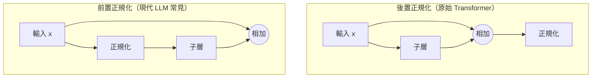

# 正規化層

正規化層會把網路內部的激活值重新縮放到受控的平均值與離散程度，使深度網路更快速、也更穩定地訓練。各種正規化層的主要差異只有一個選擇：計算平均值與變異數時，所用的是哪一組激活值。這個選擇決定了每種方法適用於哪些情境。

## 概述

訓練深度網路意味著讓梯度穿過許多層。隨著前面各層不斷更新，每一層的輸入也持續改變；激活值的尺度可能隨深度增長或縮小，而小誤差也可能在層層傳遞中逐步放大。正規化層直接針對這些問題。它計算一組激活值的平均值與變異數，減去平均值，再除以標準差，最後套用一組可學習的縮放與平移。這種層的計算成本低、參數少，而且幾乎可以放在網路的任何位置。

批次正規化由 Ioffe 與 Szegedy 於 2015 年提出，是第一個讓此做法在影像分類器中成為常規的方法。此後，層正規化、群組正規化與均方根正規化也各自被用在特定類型的網路中。[MLP](../../models/mlp/index.md) 頁面涵蓋了[層正規化](../../models/mlp/layer-normalisation/index.md)，它是 Transformer 的預設選擇；此處僅連結，不再重複。

正規化層在網路中的位置，與它使用哪些統計量同樣重要。在 Transformer 中，它相對於殘差連接的位置，稱為前置（pre-norm）或後置（post-norm），會改變訓練的穩定程度。下文會討論這一點。

## 關鍵概念

- **正規化集合。** 共享同一組平均值與變異數的激活值集合。批次、層、實例、群組與 RMS 正規化的差異，只在於這個集合如何選取。
- **可學習的增益與偏置。** 正規化之後，層會乘上可學習的縮放係數 \(\gamma\)，並加上可學習的平移量 \(\beta\)。若沒有它們，層就會被迫輸出平均值為零、變異數為一的激活值，這可能降低網路能表示的範圍。
- **批次統計量與滑動統計量。** 訓練時，部分方法會從目前的小批次計算統計量。推論時可能沒有批次可用，因此這些方法會改為保存滑動平均值。
- **內部共變量偏移。** Ioffe 與 Szegedy 用來描述訓練期間每一層輸入分布漂移的用語。它是批次正規化的提出動機，但其因果角色至今仍有爭議。
- **前置與後置正規化。** 正規化是套用在子層之前（位於殘差分支內），還是套用在殘差相加之後。

## 運作方式

考慮一個具有四個軸的激活張量：批次 \(N\)、通道 \(C\)、高度 \(H\) 與寬度 \(W\)，如卷積網路中的情形。每種變體都以同一公式正規化每個元素 \(x_i\)：

\[
\hat{x}_i = \frac{x_i - \mu_{S_i}}{\sqrt{\sigma^2_{S_i} + \epsilon}}, \qquad
y_i = \gamma\,\hat{x}_i + \beta,
\]

其中 \(\mu_{S_i}\) 與 \(\sigma^2_{S_i}\) 分別是包含 \(i\) 的集合 \(S_i\) 內的平均值與變異數，\(\epsilon\) 是為了數值穩定而加入的小常數。各種方法的集合如下：

| 方法 | 統計量的計算範圍 | 可學習參數的對象 | 典型用途 |
|---|---|---|---|
| [批次正規化](batch-normalisation/index.md) | 小批次與空間位置，對每個通道分別計算 | 通道 | 以大批次訓練的 CNN |
| [層正規化](../../models/mlp/layer-normalisation/index.md) | 單一樣本的所有特徵 | 特徵 | Transformer、循環網路 |
| 實例正規化 | 單一樣本中單一通道的空間位置 | 通道 | 風格轉換與影像生成器 |
| [群組正規化](group-normalisation/index.md) | 單一樣本中，一組通道的空間位置 | 通道 | 以小批次訓練的 CNN |
| [RMSNorm](rmsnorm/index.md) | 單一樣本的所有特徵，不減去平均值 | 特徵 | 大型語言模型 |

這個家族是沿著同一個軸所做的一組選擇。批次正規化依賴批次中的其他樣本，因此同一個輸入的輸出可能因所在的批次而改變。層、實例、群組與 RMS 正規化則在單一樣本內計算統計量，因此輸入的輸出是固定的。Huang 等人（2020）的綜述把每種方法拆成三個部分：如何把激活值劃分為正規化集合、套用什麼運算，以及如何還原縮放與平移。

### 正規化在區塊中的位置

原始的 Transformer 把正規化放在殘差相加之後，稱為後置正規化，寫作 \(\mathrm{LN}(x + \mathrm{Sublayer}(x))\)。目前多數大型模型則改為在每個子層之前套用正規化，使殘差路徑保持輸入不變，這稱為前置正規化，寫作 \(x + \mathrm{Sublayer}(\mathrm{LN}(x))\)。

Xiong 等人（2020）在初始化時分析了這兩種位置。他們指出，在後置正規化的 Transformer 中，輸出層附近的期望梯度很大，因此需要一段以小學習率開始的預熱階段。前置正規化的梯度則較為良好，作者因此能在沒有預熱的情況下訓練前置正規化模型。Liu 等人（2020）則把不穩定性歸因於放大效應：在後置正規化的堆疊中，每個殘差分支都可能強烈放大微小的參數變化。Nguyen 與 Salazar（2019）發現，在小型翻譯資料集上，前置正規化可以在不預熱、使用大學習率的情況下訓練，但在大型英德基準上，它會降低結果品質。LLaMA 模型（Touvron 等人，2023）會正規化每個子層的輸入，並為此使用 RMSNorm。許多近期的語言模型也有類似的模式，因此搭配 RMSNorm 的前置正規化已成為常見的預設。

## 關鍵方法

每種方法各有專頁。此處的比較從簡。

| 方法 | 年份 | 核心想法 | 頁面 |
|---|---|---|---|
| 批次正規化 | 2015 | 對每個通道在小批次上做正規化，推論時使用滑動統計量 | [批次正規化](batch-normalisation/index.md) |
| 群組正規化 | 2018 | 對每個樣本，在通道群組內做正規化，因此不依賴批次大小 | [群組正規化](group-normalisation/index.md) |
| RMSNorm | 2019 | 以特徵的均方根縮放，不做重新置中，計算成本較低 | [RMSNorm](rmsnorm/index.md) |

批次正規化在批次較大時效果最強。群組正規化是為偵測與分割中常用的小批次而設計的。RMSNorm 以省去重新置中的步驟換取較低的成本，是大型語言模型中常見的選擇。

## 為什麼有效，以及相關爭論

Ioffe 與 Szegedy 把批次正規化的效益歸因於減少內部共變量偏移。Santurkar 等人（2018）對此進行了檢驗，並報告指出，層輸入的穩定性與此方法的成功關係不大；他們主張，它的作用是讓最佳化的地貌變得平滑，使梯度更具預測性。Bjorck 等人（2018）則發現，其主要效果是允許使用更大的學習率而不發散，因為它讓激活值維持在中心為零、尺度為一的狀態。這些解釋可以並存，爭論主要在於哪一種效果是因、哪一種是果。細節見[批次正規化](batch-normalisation/index.md)頁面。

## 相關連結

正規化是工程與生物學交會的地方。所謂的除法正規化（divisive normalisation），即神經元的反應被鄰近神經元群的總活動所除，已在許多感覺區域中被描述。Carandini 與 Heeger（2011）主張，它是大腦中反覆出現的一種典型運算。這是結構上的相似，而非直接的機制，也不能證明大腦使用跨樣本的批次統計量。本維基的[計算神經科學](../../../brain-mind/computational-neuroscience/index.md)頁面涵蓋了更廣的建模背景。恆定性突觸縮放能使神經活動維持在適當範圍，是一個功能上相關的概念；見[記憶與學習](../../../brain-mind/memory-learning/index.md)。

在本維基中，正規化也與[最佳化](../../optimization/index.md)互相影響。如上所述，學習率預熱常被用來補償後置正規化的不穩定性，相關內容見[漸進預熱](../../optimization/gradual-warm-up.md)頁面。使用各種變體的主要家族包括 [CNN](../../models/cnn/index.md) 家族、[Transformer](../../models/transformer/index.md) 家族與 [RNN](../../models/rnn/index.md) 家族。

## 應用

- **影像分類與偵測。** 批次正規化已成為卷積骨幹網路的預設。Ioffe 與 Szegedy 報告，在一個最先進的影像分類器上，它以少 14 倍的訓練步數達到相同的準確率。[^1]
- **風格轉換。** Ulyanov 等人（2016）顯示，在快速風格化網路中以實例正規化取代批次正規化，能帶來明顯的品質改善。
- **大型語言模型。** LLaMA 系列以及許多類似模型，都使用搭配 RMSNorm 的前置正規化。
- **模型壓縮。** 網路瘦身（network slimming）利用批次正規化的縮放因子來選擇要移除的通道，見[網路瘦身](../../model-compression/pruning/structured-pruning/network-slimming/index.md)頁面。已部署的模型常在量化前，把批次正規化折疊進前一層的卷積中，見[量化感知訓練](../../model-compression/quantisation/quantisation-aware-training/index.md)。

## 未解問題

- **機制。** 是哪一種性質使批次正規化加速訓練：激活值的穩定性、損失地貌的平滑性，還是它所允許的較大學習率？上述研究顯示這些性質彼此相關，但因果順序仍未定論。
- **大規模下的位置選擇。** 在某些設定下，後置正規化能達到較好的最終表現，而前置正規化的訓練則較為可靠。Nguyen 與 Salazar（2019）在高資源翻譯中報告的差距，是否能跨越不同模型規模成立，目前並不清楚。
- **集合的選擇。** 對所有架構、資料類型與批次大小而言，並沒有單一最佳的正規化集合。在新情境中如何選擇，目前仍大多依靠經驗。
- **生物學。** 皮質中的除法正規化已有定論，但目前不知道是否有任何生物機制，會以批次正規化那種跨樣本的方式計算統計量。

[^1]: 「少 14 倍的訓練步數」這一數字來自 Ioffe 與 Szegedy（2015）的摘要，指的是他們所測試的影像分類器。

## 參考文獻

### 開創性論文

- Ioffe, S. & Szegedy, C. (2015). "Batch Normalization: Accelerating Deep Network Training by Reducing Internal Covariate Shift". arXiv:1502.03167 — 提出批次正規化，對每個小批次做正規化，並報告影像分類器的訓練速度提升。
- Ba, J. L., Kiros, J. R. & Hinton, G. E. (2016). "Layer Normalization". arXiv:1607.06450 — 對每個樣本的特徵做正規化，是 Transformer 所用的、取代批次統計量的方法。
- Ulyanov, D., Vedaldi, A. & Lempitsky, V. (2016). "Instance Normalization: The Missing Ingredient for Fast Stylization". arXiv:1607.08022 — 顯示在訓練與測試時都使用實例正規化，能改善快速風格轉換。
- Wu, Y. & He, K. (2018). "Group Normalization". arXiv:1803.08494 — 提出群組正規化，其表現不依賴批次大小，並與批次正規化進行比較。
- Zhang, B. & Sennrich, R. (2019). "Root Mean Square Layer Normalization". arXiv:1910.07467 — 提出 RMSNorm，省去層正規化的重新置中步驟。
- Xiong, R., et al. (2020). "On Layer Normalization in the Transformer Architecture". arXiv:2002.04745 — 分析 Transformer 中層正規化的位置，以及為何前置正規化的訓練較穩定。

### 綜述與教科書

- Huang, L., et al. (2020). "Normalization Techniques in Training DNNs: Methodology, Analysis and Application". arXiv:2009.12836 — 一篇綜述，以共同的分類法放置各種正規化方法。
- Carandini, M. & Heeger, D. J. (2011). "Normalization as a canonical neural computation". *Nature Reviews Neuroscience*. https://doi.org/10.1038/nrn3136 — 一篇綜述，主張除法正規化是跨腦區與感官重複出現的運算。

### 講座與影片

（本頁尚未驗證任何來源）

### 文章與文件

- Santurkar, S., et al. (2018). "How Does Batch Normalization Help Optimization?". arXiv:1805.11604 — 檢驗內部共變量偏移的解釋，並提出批次正規化會使最佳化地貌變得平滑。
- Bjorck, J., et al. (2018). "Understanding Batch Normalization". arXiv:1806.02375 — 實證研究，結論是批次正規化主要使較大的學習率得以訓練。
- Nguyen, T. Q. & Salazar, J. (2019). "Transformers without Tears: Improving the Normalization of Self-Attention". arXiv:1910.05895 — 在低資源與高資源翻譯上比較前置與後置正規化的 Transformer。
- Liu, L., et al. (2020). "Understanding the Difficulty of Training Transformers". arXiv:2004.08249 — 以殘差分支的放大效應，解釋 Transformer 訓練的不穩定性。
- Touvron, H., et al. (2023). "LLaMA: Open and Efficient Foundation Language Models". arXiv:2302.13971 — 描述一個語言模型家族，以 RMSNorm 正規化每個子層的輸入。
