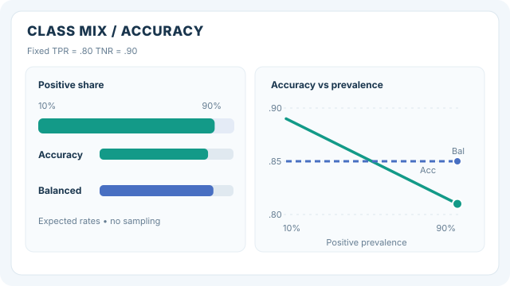

---
related:
  - engineering/evaluation
tags:
  - evaluation
  - metrics
  - classification
---

# Accuracy

Accuracy is the fraction of predictions that match the true label. It is the simplest classification metric and the one most often misread.

## Definition

For a binary problem with true positives $TP$, true negatives $TN$, false positives $FP$ and false negatives $FN$:

$$\text{Accuracy} = \frac{TP + TN}{TP + TN + FP + FN}$$

For multiclass problems, it is the share of samples whose predicted class equals the true class.

## Animated explanation: prevalence and balanced accuracy

*Original instructional animation, CC BY-SA 4.0.* MkDocs provides Play/Pause; focus the image to scroll horizontally on narrow screens. Reduced-motion users see a still frame. [GitHub static preview](../../../../assets/concept-animations/accuracy-prevalence-still.svg) · [Full SVG animation](../../../../assets/concept-animations/accuracy-prevalence-motion.svg).

The illustration uses **hypothetical population rates, not sampled or measured classifier results**. If positive prevalence is $p$, with fixed sensitivity (TPR) $0.80$ and specificity (TNR) $0.90$:

$$
\begin{gathered}
\operatorname{Accuracy}(p) \\
= p(0.80)+(1-p)(0.90) \\
= 0.90-0.10p.
\end{gathered}
$$

Balanced accuracy is the **unweighted mean of class recalls**, $(0.80+0.90)/2=0.85$. Varying $p$ from $0.10$ to $0.90$ thus moves ordinary accuracy from **0.89 to 0.81**, while balanced accuracy stays **0.85**.[^balanced-demo] This holds only if both conditional class-wise rates remain fixed; real distribution shifts can change them too.

## Interpretation

Accuracy needs no threshold and is easy to explain. Its weakness is that it depends on the class balance. If 99% of cases are negative, a model that never predicts a positive scores 99% accuracy while finding no positives at all.

## When to use it

Use accuracy when the classes are roughly balanced and every kind of error has the same cost. Otherwise report precision and recall alongside it, or use a ranking metric such as [PR-AUC](pr-auc.md).

## Worked example

Using the 100 cases above, accuracy is $(40 + 30) / 100 = 0.70$. The same classifier has precision 0.80 and recall 0.67 (see [precision](precision.md) and [recall](recall.md)), so accuracy alone does not show which kind of error dominates.

## Properties and variants

- **Baseline.** A classifier that always predicts the majority class scores that class's share of the data. On data that is 90% negative, 0.90 accuracy is no improvement.
- **Balanced accuracy.** The mean of recall over classes, which for two classes is $\tfrac{1}{2}(\mathrm{TPR} + \mathrm{TNR})$. It does not depend on class sizes.
- **Top-k accuracy.** In multi-class problems, a case counts as correct if the true class is among the $k$ highest scores.
- **Limit.** Accuracy treats every error alike, so it cannot express unequal costs of false alarms and misses.

## Pitfalls

- **Imbalance.** A high score can come from predicting the majority class. Compare against the majority-class rate as a baseline.
- **Multilabel data.** In scikit-learn, accuracy for multilabel input is subset accuracy: a sample counts as correct only when its whole set of labels matches. This is stricter than averaging per-label accuracy (see References).

## Related metrics

[Precision](precision.md), [Recall](recall.md) and [F1](f1.md) separate the kinds of error that accuracy combines. The family overview is [Classification Metrics](index.md).

## References

### Articles and documentation

- scikit-learn contributors. *accuracy_score*. https://scikit-learn.org/stable/modules/generated/sklearn.metrics.accuracy_score.html — API reference giving the definition, the normalisation option and the multilabel behaviour.
- scikit-learn contributors. *Metrics and scoring: quantifying the quality of predictions*. https://scikit-learn.org/stable/modules/model_evaluation.html — Overview of classification scorers and when each is appropriate.

### Additional sources

- Saito, T. & Rehmsmeier, M. (2015). The precision-recall plot is more informative than the ROC plot when evaluating binary classifiers on imbalanced datasets. *PLoS ONE* 10(3). https://doi.org/10.1371/journal.pone.0118432 — Shows why precision-recall curves are more informative than ROC curves for rare positives.
- Murphy, K. P. *Probabilistic Machine Learning: An Introduction*. MIT Press, 2022. https://probml.github.io/pml-book/book1.html — Textbook with a free online draft on probabilistic machine learning.
- *The Elements of Statistical Learning: Data Mining, Inference, and Prediction*, 2nd edition. https://hastie.su.domains/ElemStatLearn/ — Standard textbook on statistical learning and its evaluation.

[^balanced-demo]: scikit-learn contributors. *balanced_accuracy_score*. https://scikit-learn.org/stable/modules/generated/sklearn.metrics.balanced_accuracy_score.html — Defines the mean per-class recall used in the illustration.
